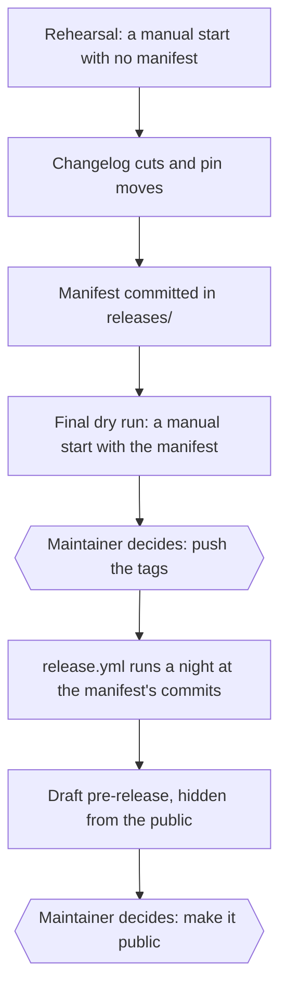

# Releasing the suite

A suite release is two card images, `robco-terminal.img.gz` and `robco-pipboy.img.gz`, tested whole in QEMU, with the commits they hold. One GitHub release in RobCo-Core carries both chains. This page says how one is made with the tools in [`tools/release/`](../tools/release/README.md) and the workflow [`.github/workflows/release.yml`](../.github/workflows/release.yml).

Two steps are a person's decision: pushing the tags, and making the draft public. Each is the repository maintainer's call, and nothing in the tools or the workflow takes either step.



## What a release holds

| File | Use |
|---|---|
| `robco-terminal.img.gz` | The terminal chain: RETROS-BIOS, MFBootAgent, UOS |
| `robco-pipboy.img.gz` | The Pip-Boy chain: Pip-OS, Deitrix |
| `fetch_firmware.sh` | Adds the three Pi firmware files to a written card. The images hold none |
| `SHA256SUMS` | Checks the other files |
| `VERSIONS.txt` | The version table of the night that built the cards |
| `suite-<YYYY.MM>.json` | The manifest: one version and one commit per repository |
| `NOTICES.txt` | The licence texts of the six repositories and of `third_party/` |

The cards are the `pins` cards of a nightly run at the manifest's commits. A card image cannot be rebuilt byte for byte, so the release ships the bytes the night booted and tested, not a second build.

## The workflow

`release.yml` starts on a pushed `suite-*` tag or by hand. It has four jobs.

| Job | Does | Permissions |
|---|---|---|
| `manifest` | Reads the manifest, checks it with `manifest.py check` against the six default branches, checks the `v` tags with `manifest.py remote-tags`, writes `NOTICES.txt` | `contents: read` |
| `night` | Calls `nightly.yml` with `pairing: pins` and the six commits | `contents: read`, `packages: read` |
| `assemble` | Checks both cards against their `SHA256SUMS`, runs `manifest.py verify-night` on each card's `VERSIONS.txt`, then `assemble.py` packs each image with `gzip -n`, checks that `gunzip -c` gives the night's SHA-256 again, and writes the files above. Uploads them as the artifact `release`, kept 14 days | `contents: read` |
| `publish` | Only on a pushed `suite-*` tag. Downloads `release`, checks it, and creates a draft pre-release named after the tag. It fails if a release of that name exists | `contents: write` |

A manual start is always a dry run. The `publish` job runs only when the event is `push` and the ref starts with `refs/tags/suite-`, so a manual start skips it, even one started on a tag. `publish` checks out no code, so no repository code runs with its write token. The workflow never pushes a tag and cannot tag a sibling.

What the manifest job reads:

- On a tag push, `releases/<tag>.json` at the tag. The tag must equal the manifest's `suite`, every rule of `check` holds, and every `v` tag must exist on its manifest commit.
- On a manual start with the `manifest` input, that file, such as `releases/suite-2026.12.json`, at the ref the run starts from. Every rule holds. A missing `v` tag is printed and passes. A `v` tag on another commit fails.
- On a manual start with no input, a rehearsal: `manifest.py new` writes a manifest from the six default heads, and `check --rehearsal` skips the changelog rule only. The library pin rule still holds, so a rehearsal fails while a sibling pins an older RobCo-Core than the head of `main`.

## Steps

1. Rehearse. Start `release.yml` by hand with no input. It shows whether the six default heads would make a release today.
2. Cut each changelog with `tools/release/cut_changelog.py cut`, and move the library and Pip-OS pins so that every sibling pins the commits the manifest will name. Each repository gets its own pull request.
3. Write the manifest from checkouts at the release commits, then check it:

   ```sh
   python3 -I tools/release/manifest.py new --suite suite-2026.12 --work w --out releases/suite-2026.12.json
   python3 -I tools/release/manifest.py check --manifest releases/suite-2026.12.json --work w
   ```

   Commit it to RobCo-Core through a pull request.
4. Run the final dry run: start `release.yml` by hand with `manifest` set to the file. Download its `release` artifact once and check it by hand with `sha256sum -c SHA256SUMS`.
5. Go through the checklist below.
6. Maintainer's decision: push the tags. `manifest.py tags` prints the commands and runs none. It pushes the six `v` tags first and the suite tag last, on the RobCo-Core commit that holds the manifest. The suite tag starts the workflow, which creates the draft. Before that, `manifest.py remote-tags --require` shows whether every `v` tag is in place.
7. Maintainer's decision: make the draft public, after reading its page and checking its files.

A tag never moves. A release that needs a new commit takes the next suite name, such as `suite-2026.12.1`.

## Checklist before the tags

- The last three scheduled nights are green with both pairings, and the newest is under two days old.
- CI is green on each of the six manifest commits. Read every workflow run of each commit.
- No pull request is open that the release should hold.
- The final dry run is green, and its `release` artifact was downloaded and checked by hand once.

## What a dry run does not prove

- That `publish` works. A dry run never runs it, so the first tag push is its first run: the token's `contents: write`, `gh release create` with `--verify-tag`, and the refusal of an existing release.
- That `remote-tags --require` passes. A dry run accepts missing `v` tags.
- That the tag push reads the manifest at the tag. A dry run reads it at the ref it starts from.
- That a card boots on a real board. The night tests in QEMU only.
