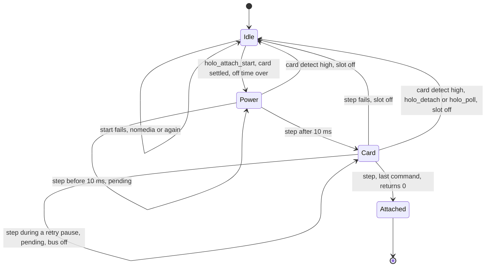
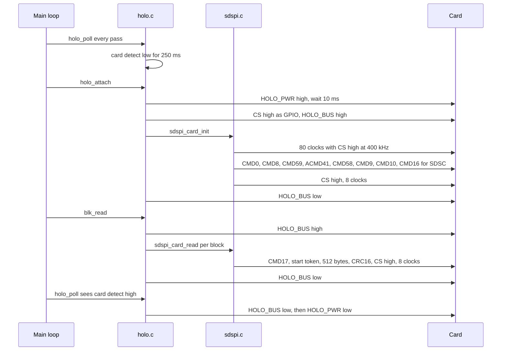

# Holotape slot

These sections cover the holotape slot of the Pip-Boy HAT: a removable SD card on SPI0, read-only. `sdspi.h` holds the SD protocol in SPI mode. `holo.h` holds the slot: its pins, power, card detect and the `"holo0"` block device. Errors, init and context follow the [Conventions](../API.md#conventions).

Nothing here has run on real hardware, the stepped attach included. The driver has run only against the host card model and, with no card, in QEMU. See [What is tested where](#what-is-tested-where).

| Header | Section |
|---|---|
| `holo.h` | [Slot](#slot-holoh) |
| `sdspi.h` | [SD protocol in SPI mode](#sd-protocol-in-spi-mode-sdspih) |

## Slot (`holo.h`)

The slot follows the software sequence of the HAT spec, section 4.12 of `pipboy-hat/spec/SPEC.md` in RobCo-Hardware. A card sits behind a bus buffer enabled by `HOLO_BUS` and a supply switch enabled by `HOLO_PWR`. The driver turns both on only when it talks to the card.

| Pin | Default | Direction | Meaning |
|---|---|---|---|
| `HOLO_CD` | GPIO 12 | Input, pull-up | Low with a card in |
| `HOLO_WP` | GPIO 13 | Input, pull-up | High with the lock tab on, and with no card |
| `HOLO_PWR` | GPIO 21 | Output, low at init | High turns the card's supply on |
| `HOLO_BUS` | GPIO 20 | Output, low at init | High connects SCLK, MOSI and CS to the card |
| CS | GPIO 7 | Output, high at init | The card's chip select, driven as a plain GPIO |

| Constant | Value | Meaning |
|---|---|---|
| `HOLO_HZ_DEFAULT` | `10000000u` | Data rate after init. It rounds down to 9.62 MHz on a 250 MHz core. |
| `HOLO_SETTLE_MS` | `250u` | Card detect must read low this long before power on |
| `HOLO_POWER_MS` | `10u` | Wait after `HOLO_PWR` goes high: the 1 ms slow start and settling |
| `HOLO_OFF_MS` | `100u` | Minimum supply off time before power on again |
| `HOLO_ST_CARD` | `0x01u` | Card detect reads low now |
| `HOLO_ST_PRESENT` | `0x02u` | Card detect has read low for `HOLO_SETTLE_MS` |
| `HOLO_ST_LOCKED` | `0x04u` | The lock tab is on. It means nothing with no card. |
| `HOLO_ST_POWER` | `0x08u` | `HOLO_PWR` is high |
| `HOLO_ST_BUS` | `0x10u` | `HOLO_BUS` is high |
| `HOLO_ST_ATTACHED` | `0x20u` | The block device is live |
| `HOLO_ST_ATTACHING` | `0x40u` | A stepped attach runs |
| `HOLO_EV_INSERTED` | `0x1u` | The card became present, after the debounce |
| `HOLO_EV_REMOVED` | `0x2u` | Card detect went high. The slot is off. |

```c
typedef struct {
    uint8_t cd_pin;
    uint8_t wp_pin;
    uint8_t pwr_pin;
    uint8_t bus_pin;
    uint8_t cs_pin;
    uint8_t spi_cs;
    uint32_t hz;
} holo_config_t;

#define HOLO_CONFIG_DEFAULT { 12u, 13u, 21u, 20u, 7u, 1u, HOLO_HZ_DEFAULT }
```

`spi_cs` is the SPI0 chip select the controller runs with during card transfers. Keep it off the display's chip select: with CS on GPIO 7 as a plain output, the controller's own CE1 never reaches a pin, so the card's transfers assert no chip select of the display.

`holo_init()` returns `SD_ERR_BUS` when `spi_cs` is `0`, the display's CE0. It also rejects a slot pin outside GPIO 0 to 27, a pin on GPIO 8 to 11, which carry SPI0, and two slot pins with the same number.

```c
int holo_init(const holo_config_t *cfg);
```

Drives `HOLO_BUS` low, then `HOLO_PWR` low, CS high, sets card detect and write protect as inputs with pull-ups, and turns MISO's pull-down off. It powers nothing. It starts SPI0 when no one has. `cfg` NULL takes `HOLO_CONFIG_DEFAULT`. The off time counts from this call, since the supply may have been on before a reset. Returns `0`, or `SD_ERR_BUS` for a bad config or a failed GPIO or SPI call.

```c
int holo_present(void);
```

Returns `1` when card detect has read low for `HOLO_SETTLE_MS`, `0` otherwise. It never blocks. The debounce runs on time stamps: each call samples the pin, a high read restarts it.

```c
unsigned holo_status(void);
```

Returns `HOLO_ST_*` bits for the pins and the driver state. `0` before `holo_init()`.

```c
int holo_attach(void);
```

Runs the spec's sequence: detect stable, power on, wait `HOLO_POWER_MS`, bus on, the protocol's init, bus off. Then it registers `"holo0"`. Returns `0`, `0` again when already attached, `BLK_ERR_NOMEDIA` with no card, `SD_ERR_AGAIN` while the card settles or the off time runs, or another `SD_ERR_*`. On any error the bus and the power are off. It blocks for `HOLO_POWER_MS` plus the card's init: about 20 ms plus the card's own ACMD41 time, and 1.2 s at most for a card that stays busy. It is a loop over the two stepped calls below, so both share one implementation.

```c
int holo_attach_start(void);
int holo_attach_step(void);
```

The same attach in steps, for a main loop that cannot block for 1.2 s. `holo_attach_start()` checks the card and the off time, powers the card and returns at once. It returns `0`, or the error `holo_attach()` would give before it powers anything: `BLK_ERR_NOMEDIA`, `SD_ERR_AGAIN` or `SD_ERR_BUS`. While an attach runs, it returns `0` and that attach goes on: no second power on. Already attached, it returns `0` and the next step returns `0`.

`holo_attach_step()` does one bounded piece of work. It returns `SD_PENDING` while work remains, `0` once `"holo0"` is registered, or the error `holo_attach()` would give, with the bus and the power off. After a final result it returns that result until the next start.

`SD_PENDING` is `1`. It is not `SD_ERR_AGAIN`, for two reasons. `SD_ERR_AGAIN` comes from the start and means nothing began: start again later. `SD_PENDING` means an attach runs: step again on the next pass. And `SD_PENDING` is positive, so `rc < 0` still means failed.

A step never waits. Before `HOLO_POWER_MS` ran, or during the 1 ms pause between two CMD0 or two ACMD41 tries, it returns `SD_PENDING` at once with the bus off. Otherwise it turns the bus on, runs one protocol step and turns the bus off. Between two steps the bus is off, CS is high and SPI0 is free for the display.

The bound: one step clocks at most `SDSPI_STEP_BYTES`, 64 bytes, at 400 kHz. That is about 1.3 ms of wire time. The largest step is a CMD9 or CMD10 with its data block, 31 bytes on the card model, about 0.63 ms of fake time. Card detect is read before each step and in every polled byte, so a pulled card ends the attach within one step.

#### The token wait after CMD9 and CMD10

After CMD9 and CMD10 the card sends some bytes of `0xFF`, then a start token, then its CSD or CID. A read cannot pause in the middle: CS goes high between two steps, and a card may drop a read whose CS rose. So the token wait lives inside one step, and each form has its own budget:

| Form | Token budget | A late token |
|---|---|---|
| `holo_attach()`, `sdspi_card_init()` | `SDSPI_TOKEN_US`, 100 ms | `SD_ERR_CMD` |
| `holo_attach_step()`, `sdspi_init_step()` | `SDSPI_STEP_TOKEN_BYTES`, 29 bytes, token included | The step ends cleanly and the next one sends the command again |

A stepped attach sends CMD9, then CMD10, up to `SDSPI_TOKEN_TRIES` times each, 4, with `SDSPI_RETRY_US` between two tries. After the last try it returns `SD_ERR_SLOW`, with the bus and the power off. The card is not dead: its token comes later than a step can hold. A caller that accepts a stall of up to 100 ms per register calls `holo_attach()` after `HOLO_OFF_MS`. A caller that does not leaves the card unattached and reports it.

The other waits of the init keep their budget in both forms:

| Wait | Before steps | Blocking now | Stepped now |
|---|---|---|---|
| R1 after a command, Ncr | 9 bytes | 9 bytes | 9 bytes |
| CMD0 until idle | 100 ms, 101 tries | 100 ms, 101 tries | 100 ms, 101 tries, one per step |
| ACMD41 until ready | 1 s, 1001 tries | 1 s, 1001 tries | 1 s, 1001 tries, one per step |
| Token after CMD9 or CMD10 | 100 ms | 100 ms | 29 bytes per try, 4 tries |
| Busy after a command | none: the init sends no R1b command | none | none |

`holo_detach()` ends a running attach. So does `holo_poll()` when it sees card detect high. A `holo_poll()` with the card still in leaves the attach alone. Either way the next step returns `BLK_ERR_NOMEDIA`.

These pairs are never split across two steps:

| Pair | Why |
|---|---|
| The 80 start clocks with CS high, then the first CMD0 | The card counts the clocks from power up. CMD0 follows them at once. |
| CMD55, then ACMD41 | CMD55 marks the next command as an application command. Nothing goes between them. |
| A command, its reply, then CS high and 8 clocks | The card releases DO only after the 8 clocks. Each step ends with them, so the bus goes off with the card idle. |
| CMD9 or CMD10, then its data block | The block follows the reply in the same transaction. |

#### The stepped attach



#### In a cooperative loop

Start on `HOLO_EV_INSERTED`. Then run one step per loop pass, and let the rest of the loop run between them.

```c
static int attaching;

void loop_pass(void)
{
    unsigned ev = holo_poll();

    if ((ev & HOLO_EV_INSERTED) && holo_attach_start() == 0) {
        attaching = 1;
    }
    if (attaching) {
        int rc = holo_attach_step();

        if (rc != SD_PENDING) {
            attaching = 0;
            /* rc 0: holo_blkdev() is live. */
        }
    }
    /* sound, input and display work */
}
```

An SDHC card that leaves idle at the fourth ACMD41 takes 10 steps that clock, plus the passes that only wait. Each extra busy ACMD41 adds one step and a 1 ms pause.

```c
void holo_detach(void);
```

Turns the bus off, then the power. The device stays but answers `BLK_ERR_NOMEDIA`.

```c
unsigned holo_poll(void);
```

Call it every main loop pass, at the 100 Hz input scan or faster. It samples card detect. A high read while attached detaches at once. Returns `HOLO_EV_*` bits.

```c
blk_dev_t *holo_blkdev(void);
```

Returns the `"holo0"` device while attached, `NULL` otherwise. `flags` is `BLK_FLAG_READONLY | BLK_FLAG_REMOVABLE` whatever the lock tab says: `blk_write()` returns `BLK_ERR_RO`. Each block of a read turns the bus on, reads the block, sends 8 clocks with CS high and turns the bus off. A pointer kept across a detach still works: `read`, `write` and `sync` then return `BLK_ERR_NOMEDIA`, and `block_count` is `0`, so the range check lets them through.

```c
const sd_info_t *holo_info(void);
```

Returns the card details while attached, `NULL` otherwise. The fields are those of `sd.h`. `rca` is `0`: SPI mode has no relative address. `psn` and `cid` hold the serial number. Do not print or log them by default.

### The sequence



### Sharing SPI0

The display and the card share SPI0. Both run from the main loop and each transfer is synchronous, so they never interleave. The rule for every SPI0 user:

- Set the rate, the mode and the chip select you need before each transfer. `spi_configure()` per chip select and `spi_begin()` do that.
- End each transfer with the controller idle and your chip select released.
- Never assume a pin's function. `spi_init()` puts GPIO 7 back at ALT0. The slot sets it to a plain output again before each transfer.
- Never send to the display while `HOLO_BUS` is high. This driver turns it off before it returns, on every path.

The slot saves nothing and assumes nothing. Before each block it sets GPIO 7 as an output, MISO's pull and its own rate and mode. The display keeps its own chip select line and rate in `spi.h`, so it needs no change.

Never call `holo_*` or the block device from an interrupt handler. A read takes about 0.5 ms per block, it drives the bus the display shares, and nothing here is reentrant.

### Errors

| Code | Name | From `holo_attach()` |
|---|---|---|
| `SD_PENDING` | `pending` | From `holo_attach_step()` only: the attach runs, step again |
| `BLK_ERR_NOMEDIA` | `nomedia` | Card detect high, before or during the attach, or the attach was ended by `holo_detach()` or `holo_poll()` |
| `SD_ERR_AGAIN` | `again` | Card detect not low for `HOLO_SETTLE_MS` yet, or the supply off less than `HOLO_OFF_MS` |
| `SD_ERR_NOCARD` | `nocard` | No idle answer to CMD0 within 100 ms |
| `SD_ERR_OLD` | `old` | CMD8 is illegal: a version 1 SD card or an MMC card |
| `SD_ERR_VOLTAGE` | `voltage` | Wrong CMD8 echo, or no 3.3 V bit in the OCR |
| `SD_ERR_BUSY` | `busy` | ACMD41 stayed idle for 1 s |
| `SD_ERR_CMD` | `cmd` | A command got an error R1, no R1, or a bad CSD or CID block |
| `SD_ERR_CSD` | `csd` | Unknown CSD layout |
| `SD_ERR_BUS` | `bus` | An SPI or GPIO call failed, or `holo_init()` did not run |
| `SD_ERR_SLOW` | `slow` | From `holo_attach_step()` only: the CSD or CID token never fit in a step, see [the token wait](#the-token-wait-after-cmd9-and-cmd10). `holo_attach()` may still attach the card. |

| Code | From a block read |
|---|---|
| `BLK_ERR_NOMEDIA` | Not attached, or card detect high before or after the block |
| `BLK_ERR_TIMEOUT` | No R1, or no start token within 100 ms |
| `BLK_ERR_RANGE` | Address or parameter error in the R1, or an out of range error token |
| `BLK_ERR_IO` | Any other R1 error, error token or CRC16 mismatch, or a bus failure |

Every error turns the bus and the power off and detaches. Call `holo_attach()` again after `HOLO_OFF_MS`.

### Design choices

| Choice | Why | Cost |
|---|---|---|
| One block per CMD17, no CMD18 and no CMD12 | Simpler: one command, one token, one CRC per block, and a pulled card loses at most one block. A 2 MiB tape is 4096 commands. | About 16 bytes of command, reply, token and CRC per 512 data bytes, 3 %, plus the bus toggles. At 9.62 MHz a 2 MiB tape takes about 1.8 s of wire time. |
| Version 1 SD and MMC refused | They need a second init path, byte addressing only and an older ACMD41. Such cards are 2 GB or less and from before 2006. | A very old card gives `SD_ERR_OLD`. |
| Debounce on time stamps | `holo_poll()` and `holo_attach()` only sample. No call blocks for the 250 ms. | The caller polls until `SD_ERR_AGAIN` clears. |
| Off time of 100 ms, enforced | The spec's supply needs about 36 ms to fall under 0.3 V with a card. 100 ms gives margin. | `holo_attach()` returns `SD_ERR_AGAIN` until it ran. |
| Detach on every error | The card's state after an error is unknown, and the spec wants the slot off. | A read error needs a new attach. |
| Card detect checked in every wait | A pulled card fails within one byte, not after the 100 ms timeout. | One GPIO read per polled byte. |

## SD protocol in SPI mode (`sdspi.h`)

`sdspi.h` is pure code in `src/lib/`. It reaches the card only through a table of functions, so host tests run it against a card model. `holo.c` is its only user in the library.

| Constant | Value | Meaning |
|---|---|---|
| `SDSPI_INIT_HZ` | `400000u` | Rate for the start clocks and the identification |
| `SDSPI_START_BYTES` | `10u` | Bytes of `0xFF` with CS high before CMD0: 80 clocks, at least 74 |
| `SDSPI_CMD0_US` | `100000u` | CMD0 tries until the card answers idle |
| `SDSPI_R1_BYTES` | `9u` | Bytes polled for an R1 |
| `SDSPI_INIT_US` | `1000000u` | ACMD41 tries until the card leaves idle |
| `SDSPI_TOKEN_US` | `100000u` | Wait for a start token |
| `SDSPI_RETRY_US` | `1000u` | Pause between two CMD0, ACMD41, CMD9 or CMD10 tries |
| `SDSPI_STEP_BYTES` | `64u` | Bytes one init step clocks, at most |
| `SDSPI_STEP_TOKEN_BYTES` | `29u` | Bytes a step polls for the CSD or CID token, token included: what is left of a step |
| `SDSPI_BLOCKING_TOKEN_BYTES` | `400064u` | Byte cap of the 100 ms token wait, against a stuck clock |
| `SDSPI_TOKEN_TRIES` | `4u` | CMD9 or CMD10 sends in the stepped init before `SD_ERR_SLOW` |

```c
typedef struct {
    void *ctx;
    int (*xfer)(void *ctx, const uint8_t *tx, uint8_t *rx, size_t len);
    void (*cs)(void *ctx, int high);
    int (*set_hz)(void *ctx, uint32_t hz);
    void (*delay_us)(void *ctx, uint32_t us);
    uint64_t (*now_us)(void *ctx);
    int (*present)(void *ctx);
} sdspi_ops_t;

typedef struct {
    const sdspi_ops_t *ops;
    sd_info_t info;
    int ready;
    /* stepped init state, private */
    int phase;
    int result;
    uint32_t hz;
    unsigned tries;
    uint32_t token_bytes;
    uint64_t deadline;
    uint64_t wake_us;
} sdspi_card_t;
```

`xfer` clocks `len` bytes. `tx` is never NULL: MOSI stays high whenever the protocol only reads. `present` may be NULL. When it returns `0`, every wait stops at once.

```c
int sdspi_card_init(sdspi_card_t *c, const sdspi_ops_t *ops, uint32_t hz);
```

Sends 80 clocks with CS high, then CMD0 until the card answers idle, CMD8 with its echo check, CMD59 to turn CRC checks on, ACMD41 with the HCS bit, CMD58 for the CCS bit, CMD9 for the capacity, CMD10 for the identity and CMD16 on SDSC, all at `SDSPI_INIT_HZ`. Then it switches to `hz`. Every command carries its CRC7. Each command ends with CS high and 8 clocks. Returns `0` or `SD_ERR_*`, see the [errors](#errors). It is a loop over the stepped calls below: between two steps it waits `sdspi_init_wait_us()`.

```c
int sdspi_init_start(sdspi_card_t *c, const sdspi_ops_t *ops, uint32_t hz);
int sdspi_init_step(sdspi_card_t *c);
uint32_t sdspi_init_wait_us(const sdspi_card_t *c);
```

The same init in steps. `sdspi_init_start()` clocks nothing and returns `SD_PENDING`, or `SD_ERR_BUS` for bad arguments. Each `sdspi_init_step()` sets `SDSPI_INIT_HZ`, runs one phase and returns `SD_PENDING`, `0` when the card is ready, or `SD_ERR_*`. The last step sets `hz`. After a final result a step returns it again.

The phases are the start clocks with the first CMD0, then one per command: CMD0 again until idle, CMD8, CMD59, CMD55 with ACMD41 until ready, CMD58, CMD9, CMD10 and CMD16 on SDSC. A step clocks `SDSPI_STEP_BYTES` at most and ends with CS high and 8 clocks. `sdspi_init_wait_us()` returns how long to wait before the next step: `SDSPI_RETRY_US` after a failed try, `0` otherwise. A step run sooner still runs and spends one of the tries.

```c
void sdspi_init_set_blocking(sdspi_card_t *c);
```

Called after `sdspi_init_start()`, it gives the steps the blocking token budget, 100 ms after CMD9 and CMD10. A step may then clock more than `SDSPI_STEP_BYTES`, and a late token gives `SD_ERR_CMD`, never `SD_ERR_SLOW`. `sdspi_card_init()` calls it, and so does `holo_attach()`.

```c
int sdspi_card_read(sdspi_card_t *c, uint64_t lba, uint8_t *buf);
```

Reads block `lba` into `buf`, 512 bytes, any alignment, with CMD17. SDHC takes the block number, SDSC the byte address. It checks the CRC16 of the data. It never writes past `buf`. Returns `0` or `BLK_ERR_*`: `BLK_ERR_PARAM` for NULL, `BLK_ERR_NOMEDIA` before init or when `present` says gone, `BLK_ERR_RANGE` past the card's capacity, then the codes of the [errors](#errors) table.

```c
uint8_t sdspi_crc7(const uint8_t *p, size_t len);
```

Returns the CRC7 of a command, shifted left with the end bit set: the sixth byte of the frame. CMD0 gives `0x95`.

```c
uint16_t sdspi_crc16(const uint8_t *p, size_t len);
```

Returns the CRC16-CCITT of a data block: polynomial `0x1021`, initial value `0`.

## What is tested where

| Where | What |
|---|---|
| `tests/host/test_sdspi.c` | The protocol against the card model: SDHC and SDSC init, CID and CSD fields, refusals of version 1 and MMC cards, each init timeout, first, last and past-the-end blocks, an unaligned buffer, 4096 blocks compared with the backing array, each injected fault, a pulled card at every byte of an init and of a read, and the stepped init: steps per card type, a card busy for n polls, the step byte bound, CS high with 8 clocks after every step and CMD55 never apart from its ACMD41 |
| `tests/host/test_holo.c` | The slot on the real `spi0.c` over a fake controller and GPIO, with the model behind a model of the bus buffer: safe pins at init, the debounce, the pin order, the off time, reads, detach, removal at every byte of an attach and of a read with power and bus off after, re-attach, display frames and card reads taking turns on SPI0, and the stepped attach: each card type, a card busy for n polls with the step count and the longest step, the byte bound under faults, a card pulled at every step boundary and at every byte, `holo_detach()` and `holo_poll()` mid-attach, a start while one runs, and a display transfer between every two steps that finds the bus off and CS high |
| `tests/target/test_holo.py` | `examples/holo` in QEMU on four boards, with card detect driven through qtest. No card can attach to SPI0, so it checks only the no-card paths, for `a` and for the stepped `g`, the pin levels and that the example stays responsive. |
| Hardware | Everything else. See [HARDWARE_VALIDATION.md](../../HARDWARE_VALIDATION.md#holotape-slot). |

The card model in `tests/host/sdcard_model.c` also checks the driver's side and fails a test on any break: a command before 74 clocks with CS high, MOSI low while CS is high or while the card sends, CS low again or the bus off without 8 clocks after CS rose, a clock over 400 kHz before ACMD41 finished, a bad CRC7, a write command, power on with no card, the bus on with the power off, the power off with the bus on, and power on less than 100 ms after it went off. The slot test also counts any display byte sent while `HOLO_BUS` is high.

From [`examples/holo`](../../../examples/holo/main.c), the bring-up tool:

```c
holo_init(NULL);
for (;;) {
    unsigned ev = holo_poll();

    if ((ev & HOLO_EV_INSERTED) && holo_attach() == 0) {
        blk_read(holo_blkdev(), 0, 1, sector);
    }
}
```
