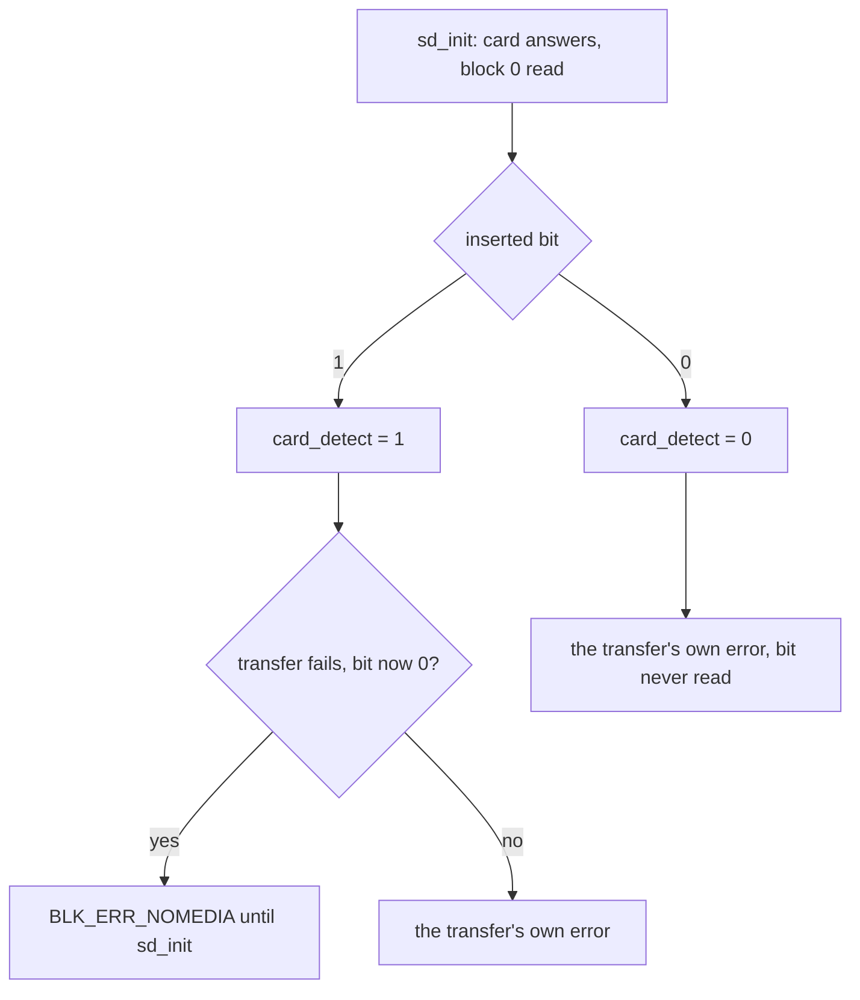
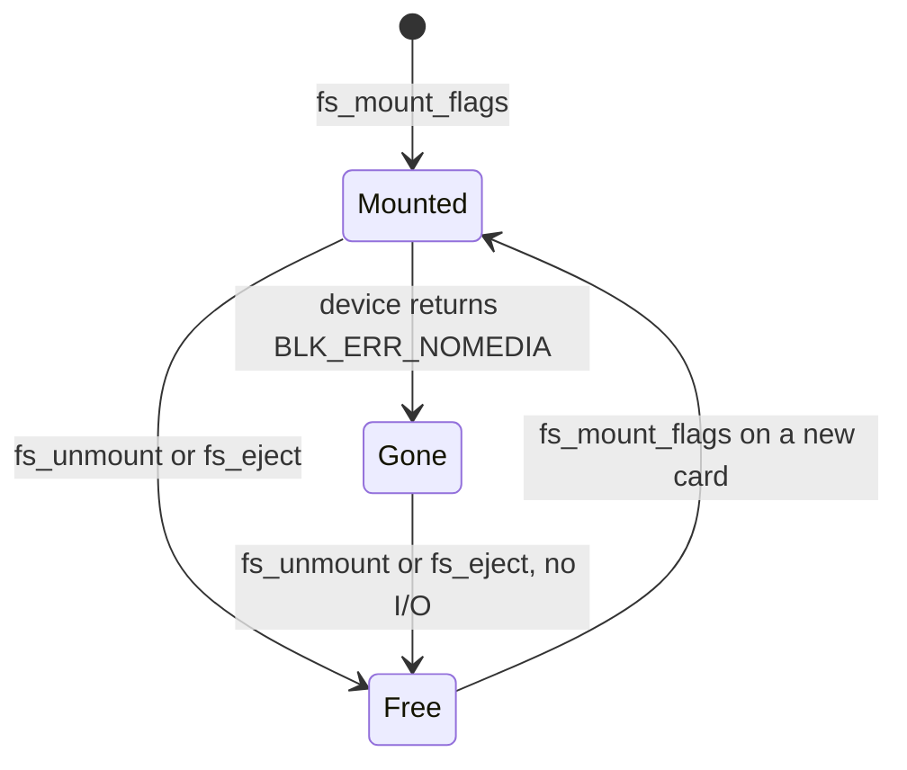

# Storage and files

These sections cover raw block devices, MBR partitions, the SD card driver, the FAT file system and the stage loader. Errors, init and context follow the [Conventions](../API.md#conventions).

| Header | Section |
|---|---|
| `blk.h` | [Block devices](#block-devices-blkh) |
| `blk_ram.h` | [RAM disk](#ram-disk-blk_ramh) |
| `part.h` | [Partitions](#partitions-parth) |
| `sd.h` | [SD card](#sd-card-sdh) |
| `fs.h` | [FAT file system](#fat-file-system-fsh) |
| `loader.h` | [Stage loader](#stage-loader-loaderh) |

## Block devices (`blk.h`)

`blk.h` is the interface between storage drivers and file systems. A driver fills in a `blk_dev_t`. The file system and `part.h` call only the checked wrappers below. Blocks are 512 bytes.

```c
typedef struct blk_dev blk_dev_t;

struct blk_dev {
    const char *name;
    uint32_t block_size;
    uint64_t block_count;
    uint32_t flags;
    int (*read)(blk_dev_t *dev, uint64_t lba, uint32_t count, void *buf);
    int (*write)(blk_dev_t *dev, uint64_t lba, uint32_t count, const void *buf);
    int (*sync)(blk_dev_t *dev);
    void *priv;
};
```

| Field | Meaning |
|---|---|
| `name` | Short name for messages, for example `"sd0"` |
| `block_size` | Bytes per block. Always `BLK_SECTOR_SIZE` today. |
| `block_count` | Number of blocks, `0` if unknown |
| `flags` | `BLK_FLAG_*` |
| `read`, `write` | Move `count` whole blocks from `lba`. `buf` holds `count * block_size` bytes. |
| `sync` | Flushes device buffers. May be NULL. |
| `priv` | Driver data |

| Constant | Value | Meaning |
|---|---|---|
| `BLK_SECTOR_SIZE` | `512u` | Bytes per block |
| `BLK_FLAG_READONLY` | `0x1u` | `blk_write()` returns `BLK_ERR_RO` |
| `BLK_FLAG_REMOVABLE` | `0x2u` | The medium can be removed |
| `BLK_ERR_IO` | `-1` | The device reported an error |
| `BLK_ERR_TIMEOUT` | `-2` | The device did not answer in time |
| `BLK_ERR_RANGE` | `-3` | Block number or count out of range |
| `BLK_ERR_NOMEDIA` | `-4` | No card or medium present |
| `BLK_ERR_RO` | `-5` | The device is read-only |
| `BLK_ERR_PARAM` | `-6` | Bad argument |

```c
static inline int blk_check(const blk_dev_t *dev, uint64_t lba, uint32_t count, const void *buf);
```

Returns `BLK_ERR_PARAM` for a NULL device, a NULL buffer or a zero count. Returns `BLK_ERR_RANGE` when the blocks run past `block_count`. A device with `block_count` `0` skips the range check. Returns `0` otherwise.

```c
static inline int blk_read(blk_dev_t *dev, uint64_t lba, uint32_t count, void *buf);
static inline int blk_write(blk_dev_t *dev, uint64_t lba, uint32_t count, const void *buf);
```

Run `blk_check()`, then call the driver. `blk_write()` returns `BLK_ERR_RO` on a device with `BLK_FLAG_READONLY`. Both return `BLK_ERR_PARAM` when the driver has no callback for the direction.

```c
static inline int blk_sync(blk_dev_t *dev);
```

Calls the driver's `sync`, or returns `0` when it has none. Returns `BLK_ERR_PARAM` for a NULL device.

```c
static inline const char *blk_strerror(int err);
```

Returns a short name: `"ok"`, `"io"`, `"timeout"`, `"range"`, `"nomedia"`, `"readonly"`, `"param"` or `"unknown"`.

## RAM disk (`blk_ram.h`)

`blk_ram.h` turns a buffer into a block device. The host tests use it, and so can a RAM disk on the target. The code is in `src/lib/blk_ram.c` and has no register access.

```c
int blk_ram_init(blk_dev_t *dev, void *buf, size_t size, uint32_t flags);
```

Fills `dev` with a device named `"ram"` over `size` bytes at `buf`, rounded down to whole blocks. `flags` takes `BLK_FLAG_*`. The device has no `sync`. The buffer must outlive the device. Returns `0`, or `BLK_ERR_PARAM` if `dev` or `buf` is NULL or `size` is under one block.

## Partitions (`part.h`)

`part.h` reads an MBR partition table and gives a block device limited to one partition. Errors are `BLK_ERR_*` codes. The code is in `src/lib/part.c` and has no register access.

```c
typedef struct {
    blk_dev_t *dev;
    uint8_t index;
    uint8_t type;
    uint8_t bootable;
    uint8_t superfloppy;
    uint64_t start_lba;
    uint64_t block_count;
} part_info_t;
```

| Field | Meaning |
|---|---|
| `dev` | Device the entry was read from |
| `index` | MBR slot `0` to `3`. `0` for a superfloppy. |
| `type` | MBR type byte. `0` for a superfloppy. |
| `bootable` | `1` when the active flag (`0x80`) is set |
| `superfloppy` | `1` for a FAT volume at block 0 with no table |
| `start_lba`, `block_count` | Position and size in blocks of `dev` |

| Constant | Value | Meaning |
|---|---|---|
| `PART_MAX` | `4u` | Primary entries in an MBR |
| `PART_TYPE_FAT12` | `0x01u` | FAT12 |
| `PART_TYPE_FAT16_SM` | `0x04u` | FAT16 under 32 MiB |
| `PART_TYPE_EXTENDED` | `0x05u` | Extended partition |
| `PART_TYPE_FAT16` | `0x06u` | FAT16 |
| `PART_TYPE_FAT32` | `0x0Bu` | FAT32, CHS |
| `PART_TYPE_FAT32_LBA` | `0x0Cu` | FAT32, LBA |
| `PART_TYPE_FAT16_LBA` | `0x0Eu` | FAT16, LBA |
| `PART_TYPE_EXT_LBA` | `0x0Fu` | Extended partition, LBA |
| `PART_TYPE_GPT` | `0xEEu` | Protective MBR of a GPT disk |

```c
int part_scan(blk_dev_t *dev, part_info_t *out, unsigned max);
```

Reads block 0 of `dev` and returns how many entries it stored in `out`.

| Block 0 holds | Result |
|---|---|
| An MBR | Up to `max` used primary entries, in slot order. Empty entries and entries that do not fit the device are skipped. Extended and GPT entries are listed, not followed. |
| A FAT boot sector | One superfloppy entry with `start_lba` `0` and `block_count` equal to the device's. Returns `1`, or `0` when `max` is `0`. |
| No `0x55AA` signature, or a status byte other than `0x00` or `0x80` | Returns `0`. |

Returns `BLK_ERR_PARAM` for a NULL `dev`, a NULL `out` with a non-zero `max`, or a block size other than 512. Returns the device error when block 0 cannot be read.

```c
int part_open(blk_dev_t *dev, const part_info_t *p, blk_dev_t *out);
```

Fills `out` with a device whose block 0 is `p->start_lba` on `dev`. `out` has `p->block_count` blocks, so the wrappers reject blocks past the end with `BLK_ERR_RANGE`. It copies the name, block size and flags of `dev`, and its `sync` calls the parent's. `out` keeps a pointer to `p`: `p` must stay valid and unchanged while `out` is in use.

Returns `BLK_ERR_PARAM` when an argument is NULL, `p->dev` is not `dev`, or `p->block_count` is `0`. A superfloppy entry from a device with unknown size has `block_count` `0`. Returns `BLK_ERR_RANGE` when the partition does not fit the device.

```c
blk_dev_t *part_parent_of(const blk_dev_t *dev, uint64_t *start_lba);
```

When `dev` came from `part_open()`, returns the parent device and stores the partition's first block on it in `*start_lba`. Returns NULL for any other device. `start_lba` may be NULL. `fs_mount()` uses it to refuse overlapping partitions.

To mount the card a stage boots from, use `fs_mount_boot()` below rather than the first entry of `part_scan()`. The first entry is not always the FAT volume.

### Boot volume

`fs_mount_boot()` finds the boot volume with the rule every RobCo stage shares, from [BOOT_PROTOCOL.md](../../spec/BOOT_PROTOCOL.md#finding-loading-and-entering-the-next-stage):

1. It reads the MBR. A card with no partition table and a FAT boot sector at block 0 is one volume, the whole card.
2. It tries the entries with a FAT type byte (`0x01`, `0x04`, `0x06`, `0x0B`, `0x0C`, `0x0E`) in slot order, then the other entries in slot order. Extended and GPT protective entries are never mounted.
3. With markers, it chooses the first volume that mounts and holds one marker as a regular file of at least one byte. A folder or an empty file of that name does not count. If no volume holds a marker, it chooses the first one that mounts. Without markers, it chooses the first one that mounts.

The second pass of step 2 finds a FAT volume behind a wrong type byte, which some tools write. It runs only after every FAT-typed entry failed to mount or held no marker, and `fs_mount()` checks the boot sector, so a volume that is not FAT never mounts. Mounting only reads.

| Constant | Value | Name | Meaning |
|---|---|---|---|
| `PART_BOOT_OK` | `0` | `ok` | A volume is mounted |
| `PART_BOOT_ERR_DEVICE` | `1` | `nodev` | No device, or block 0 does not read |
| `PART_BOOT_ERR_NOFAT` | `2` | `nofat` | No FAT entry, and no other entry mounts. Also a card with no table and no FAT boot sector. |
| `PART_BOOT_ERR_GPT` | `3` | `gpt` | A GPT card. GPT is not supported. |
| `PART_BOOT_ERR_MOUNT` | `4` | `mount` | FAT entries, none mounts |
| `PART_BOOT_ERR_ARG` | `5` | `arg` | NULL `volume` or `out`, or NULL `markers` with a count |
| `PART_BOOT_ERR_BUSY` | `6` | `busy` | `volume` is mounted, or `out` holds a mounted device |
| `PART_BOOT_ERR_RELEASE` | `7` | `release` | A probed volume did not unmount because the device failed to flush. It stays mounted as `volume` and `out` describes it. |
| `FS_BOOT_WHOLE` | `0xffu` | | `slot` of a card with no partition table |

```c
typedef struct {
    uint8_t slot;          /* MBR slot 0 to 3, or FS_BOOT_WHOLE */
    uint8_t type;          /* MBR type byte; 0 for FS_BOOT_WHOLE */
    uint8_t marker;        /* 1: holds one of the markers */
    uint8_t by_type;       /* 1: a FAT type byte or no table; 0: found in the second pass */
    uint64_t start_lba;    /* first block on the card; 0 for FS_BOOT_WHOLE */
    uint64_t block_count;
    int last_err;          /* last part_scan() or fs_mount() error, 0 if none */
    part_info_t part;      /* private */
    blk_dev_t dev;         /* private: the mounted partition device */
} fs_boot_t;

int fs_mount_boot(const char *volume, blk_dev_t *dev, const char *const *markers,
                  unsigned n_markers, fs_boot_t *out);
```

Runs the rule on `dev` and mounts the chosen volume as `volume`. Marker paths have no volume prefix, such as `/ROBCO/MFBOOT.SYS`. Returns `PART_BOOT_OK` with the volume mounted. `PART_BOOT_ERR_RELEASE` stops the search with one volume still mounted as `volume`, and `out` describes it, so the caller can use it or retry `fs_unmount(volume)`. Any other error leaves nothing mounted. `out` holds the device of the mounted volume, so it must stay valid and unchanged until `fs_unmount(volume)`. `start_lba` is what a loader writes to `boot_part_lba`. On `PART_BOOT_ERR_BUSY` it leaves `out` as it is.

```c
static const char *const markers[] = { "/ROBCO/MFBOOT.SYS", "/ROBCO/MFBOOT.BAK" };
static fs_boot_t vol;

int rc = fs_mount_boot("sd", sd_blkdev(), markers, 2, &vol);

if (rc != PART_BOOT_OK) {
    k_printf("@RC stage=" STAGE " ev=error code=io what=%s\n", part_boot_strerror(rc));
}
```

The decisions are pure functions in `part.h`, with host tests:

```c
int part_boot_class(const part_info_t *p);
unsigned part_boot_order(const part_info_t *parts, unsigned n, uint8_t order[PART_MAX]);
int part_boot_pick(const uint8_t *probe, unsigned n);
int part_boot_failure(int scan, const part_info_t *parts);
const char *part_boot_strerror(int rc);
```

`part_boot_class()` returns `PART_BOOT_FAT` for a FAT type byte or a superfloppy, `PART_BOOT_NEVER` for an empty, extended or GPT entry, and `PART_BOOT_OTHER` for any other type. `part_boot_order()` stores the indexes to try: FAT entries in slot order, then the others. `part_boot_pick()` takes one `PART_PROBE_NOMOUNT`, `PART_PROBE_MOUNTED` or `PART_PROBE_MARKER` per entry tried and returns the position of the first marker, else the first mounted one, else `-1`. `part_boot_failure()` names why nothing was chosen: `PART_BOOT_ERR_DEVICE` for a negative scan, then `PART_BOOT_ERR_MOUNT` when a FAT entry exists, then `PART_BOOT_ERR_GPT` when a GPT entry exists, else `PART_BOOT_ERR_NOFAT`. `part_boot_strerror()` returns the names in the table, or `unknown`.

## SD card (`sd.h`)

`sd.h` drives the SD card through the BCM283x EMMC controller (Arasan SDHCI) at peripheral base + `0x300000`. It uses polled PIO on a 1-bit bus with a 25 MHz target clock: no DMA, no interrupts. It supports SDSC cards (byte addressing) and SDHC or SDXC cards (block addressing). It does not support BCM2711.

`sd_init()` needs step 1 of the [initialisation order](../API.md#initialisation-order) and nothing else. It uses the mailbox for the base clock (tag `0x00030002`, clock id 1), the system timer for every wait and `gpio.h` for pin routing. Call `uart_init()` first if you want to print the result.

| Constant | Value | Name | Meaning |
|---|---|---|---|
| `SD_ERR_BOARD` | `-10` | `board` | Unknown board, or BCM2711 |
| `SD_ERR_CLOCK` | `-11` | `clock` | No base clock, or the SD clock did not settle |
| `SD_ERR_RESET` | `-12` | `reset` | The controller did not leave reset |
| `SD_ERR_NOCARD` | `-13` | `nocard` | No answer to CMD8 nor to ACMD41 |
| `SD_ERR_VOLTAGE` | `-14` | `voltage` | CMD8 echo wrong, or the card rejects 3.3 V |
| `SD_ERR_BUSY` | `-15` | `busy` | The card stayed busy in ACMD41 for 1 s |
| `SD_ERR_CMD` | `-16` | `cmd` | An identification command failed |
| `SD_ERR_CSD` | `-17` | `csd` | Unknown CSD layout |

```c
typedef enum {
    SD_TYPE_NONE = 0,
    SD_TYPE_SDSC = 1,
    SD_TYPE_SDHC = 2,
} sd_type_t;

typedef struct {
    sd_type_t type;
    uint32_t ocr;
    uint32_t rca;
    uint32_t cid[4];
    uint8_t mid;
    char oid[3];
    char pnm[6];
    uint8_t prv;
    uint32_t psn;
    uint16_t mdt_year;
    uint8_t mdt_month;
    uint64_t capacity_blocks;
    uint32_t clock_hz;
    uint32_t present_state;
    uint8_t card_detect;
} sd_info_t;
```

`SD_TYPE_SDHC` covers SDHC and SDXC. `cid` holds raw CID bits 127:8, with bits 127:96 in `cid[0]`. `oid` and `pnm` are the OEM ID and product name as strings. `prv` is the product revision in BCD. `capacity_blocks` comes from the CSD. `clock_hz` is the bus clock in use, which can be below 25 MHz when the divider cannot hit it. `present_state` is the controller's present state register, read right after `sd_init()` read block 0. `card_detect` is `1` when its card-inserted bit, bit 16, read 1 then. See [Card detect](#card-detect).

```c
int sd_init(void);
```

Routes the card to EMMC, resets the controller, and identifies the card at 400 kHz (CMD0, CMD8, ACMD41, CMD2, CMD3, CMD9, CMD7). Then it switches to 25 MHz, sets the block length on SDSC cards, reads block 0 and samples the card-inserted bit. Returns `0` or `SD_ERR_*`. Each wait has a timeout on the system timer, so a missing card fails in well under a second. Calling it again restarts from scratch.

```c
const char *sd_strerror(int err);
```

Returns the name of an `sd_init()` result from the table above, `"ok"` for `0`, or `"unknown"`.

```c
blk_dev_t *sd_blkdev(void);
```

Returns the `"sd0"` block device after a successful `sd_init()`, `NULL` otherwise. `block_count` is `capacity_blocks`. `flags` is `BLK_FLAG_REMOVABLE`.

```c
const sd_info_t *sd_info(void);
```

Returns the card details after a successful `sd_init()`, `NULL` otherwise.

```c
void sd_deinit(void);
```

Stops the SD clock and turns bus power off. `sd_blkdev()` and `sd_info()` return `NULL` after it. Does nothing before the first `sd_init()`.

Transfers through `sd_blkdev()`:

| Topic | Behaviour |
|---|---|
| Commands | One block uses CMD17 or CMD24. More use CMD18 or CMD25 with auto-CMD12, up to 65535 blocks per command. Larger counts are split. |
| Retries | A failed command is tried 3 times in total. Between tries the driver resets the command and data lines, sends CMD12 and waits for the card. |
| Fallback | If a multi-block command still fails, the driver moves those blocks one at a time, each with the same 3 tries. |
| Writes | `write` returns after the card is back in the transfer state. `sync` polls CMD13 until the card is ready, for up to 1 s. |
| Buffers | Any alignment. Word-aligned buffers take a faster path. |
| Timeouts | 100 ms per command, 1 s per data block. |
| Errors | `BLK_ERR_NOMEDIA` before a successful init, and on a board that reports card detect, after a failed transfer when the card-inserted bit is clear. `BLK_ERR_RANGE` past the end of the card or for an address error from the card, with no retry. `BLK_ERR_TIMEOUT` when the card or controller does not answer. `BLK_ERR_IO` for CRC and other errors. |

Pin routing: on boards with WiFi (Pi 3, Zero W, Zero 2 W) the firmware routes the card to the SDHOST controller on GPIO 48 to 53 (ALT0), and EMMC to the WiFi chip on GPIO 34 to 39 (ALT3). `sd_init()` sets GPIO 34 to 39 to input when any of them is ALT3. It sets GPIO 48 to 53 to ALT3 when any of them is not ALT3. It never selects ALT0. WiFi stops working after this.

Sharp edges:

| Edge | Detail |
|---|---|
| Main context only. | The driver has no locks. Do not call it from an IRQ handler or a tick callback. |
| Busy waits. | A large transfer busy-waits for its whole length. |
| WiFi is lost. | The pin routing above takes EMMC away from the WiFi chip. |
| Card detect may be missing. | See [Card detect](#card-detect). On a board that does not report it, a pulled card shows up as timeouts or I/O errors. |

### Card detect

The controller has a card-inserted bit, bit 16 of its present state register. QEMU sets it while a card is in the slot and clears it on an eject. On a real Pi the slot's detect line may not reach the controller, and the bit may read 0 with a working card in. Nobody has read it on a real board yet.

So the driver learns at `sd_init()` whether the board reports it. After the card has answered and block 0 has been read, it samples the bit once.

| Bit at init, with a working card | `card_detect` | After a failed transfer |
|---|---|---|
| 1 | `1`, reported | When the bit is now 0, the driver returns `BLK_ERR_NOMEDIA`, and again on every call until `sd_init()`. The volume on it becomes gone. When the bit is still 1, it returns the transfer's own error. |
| 0 | `0`, not reported | The driver never reads the bit. It returns the transfer's own error, `BLK_ERR_TIMEOUT` or `BLK_ERR_IO`, after its retries, as before card detect existed. The next call tries the card again. |
| Block 0 failed | `0`, not reported | As the row above. |

A transient error therefore never makes a card gone on a board without card detect. QEMU sets the bit, so every QEMU run takes the reported branch.



On a board without card detect, the caller decides when a card is gone. The rule this library suggests, used in [Several volumes and removable media](#several-volumes-and-removable-media):

1. When a call on the volume fails with `FS_ERR_TIMEOUT` or `FS_ERR_IO`, call `fs_probe()`. It reads block 0, with the driver's 3 tries.
2. If the probe also fails, call `fs_eject()`. It frees the slot with no I/O. Data not yet written is lost, as it would be on a pulled card.
3. Call `sd_init()`. `SD_ERR_NOCARD` means the slot is empty. `0` means a card is there, maybe another one: mount it again.

`examples/sdraw` prints the facts in its `ev=detect` marker, for example `present=0x01ff0000 inserted=1 card_detect=reported`. One run on a real board answers the question for that board.

Pending hardware validation: the pin routing, the 25 MHz clock and the retry path are verified in QEMU only, with one exception. On a Zero W 1.1, `sd_init()` and reads up to 256 blocks worked with one SDHC card on 2026-11-24, with the driver set to 25 MHz. Writes, SDSC cards, retries and every other board are still unvalidated. See [HARDWARE_VALIDATION.md](../../HARDWARE_VALIDATION.md#zero-w-11-examplessdraw-2026-11-24).

From [`examples/sdraw`](../../../examples/sdraw/main.c), which reads and writes raw blocks from UART commands:

```c
int rc = sd_init();
uint8_t sector[BLK_SECTOR_SIZE];

k_printf("sd: %s\n", sd_strerror(rc));
if (rc == 0) {
    blk_dev_t *sd = sd_blkdev();

    rc = blk_read(sd, 0, 1, sector);
    if (rc == 0) {
        rc = blk_write(sd, 1, 1, sector);
    }
    k_printf("copy: %s\n", blk_strerror(rc));
}
```

## FAT file system (`fs.h`)

`fs.h` reads and writes FAT12, FAT16 and FAT32 volumes on any `blk_dev_t`. It wraps ChaN's FatFs R0.16, kept unchanged in `third_party/fatfs/`. Projects include only `fs.h`. The configuration is `src/fs/ffconf.h`. The code has no register access and runs on the host in the unit tests.

| Topic | Rule |
|---|---|
| Paths | `"sd:/DIR/FILE.EXT"`. Without `vol:`, a path uses the default volume: the first one mounted, or the last one passed to `fs_chdir()`. `/` and `\` both separate. `.` and `..` work. |
| Names | Long names, UTF-8, at most 255 bytes. Lookups ignore case. Every long name also gets an 8.3 alias. |
| Volumes | Two at a time by default. Set `ROBCO_FS_VOLUMES` in `robco_config.h` to change it. See [Several volumes and removable media](#several-volumes-and-removable-media). |
| Size limits | Files up to 4 GiB - 1. Devices are seen as at most `0xFFFFFFFF` blocks. No exFAT. |
| Memory | No heap. A static table holds one slot per volume, about 590 bytes each, mostly a 512-byte sector buffer. Long names share one static 512-byte buffer. Each `fs_file_t` holds its own 512-byte buffer. `fs_mkfs()` puts a 512-byte work buffer on the stack. |
| Locking | None. Call from one context at a time. |
| Open files | Do not open the same file twice for writing, and do not unlink or rename an open file. FatFs does not check. |
| Time | New and modified files get the time of the library clock when it is set, else 2026-01-01 00:00. See [File time stamps](#file-time-stamps). |
| Read-only build | `#define ROBCO_FS_READONLY 1` in `robco_config.h` drops the write, mkfs, rename and mkdir code. Mount, list, stat, open for reading, read, seek and unmount work. Every function that would write returns `FS_ERR_RO`, and so does `fs_statvfs()`, since FatFs counts free clusters only in the read-write build. `fs_sync()` on a read handle returns `0`. `examples/storage` builds both flavours, and the host and target tests run both. |
| Code size | `examples/storage`, which calls every function, has 48.3 KiB of code read-write and 37.7 KiB read-only for the whole image, so the read-only build saves about 10.6 KiB. The file system adds about 2.3 KiB of BSS in both. An image that calls no `fs_` function links none of it. |

Every function returns `FS_OK` (`0`) or a count on success, or a negative code:

| Constant | Value | `fs_strerror()` | Meaning |
|---|---|---|---|
| `FS_OK` | `0` | `ok` | Success |
| `FS_ERR_IO` | `-1` | `i/o error` | The device reported an error |
| `FS_ERR_TIMEOUT` | `-2` | `device timeout` | The device did not answer in time |
| `FS_ERR_NOTREADY` | `-3` | `device not ready` | No medium, or the device is not ready |
| `FS_ERR_RO` | `-4` | `read-only` | Read-only device or build |
| `FS_ERR_INVAL` | `-5` | `invalid argument` | Bad argument or flags |
| `FS_ERR_NOENT` | `-6` | `no such file or directory` | No such file or directory |
| `FS_ERR_EXIST` | `-7` | `already exists` | The name already exists |
| `FS_ERR_DENIED` | `-8` | `access denied` | Directory not empty, root directory full, wrong open mode, read-only file |
| `FS_ERR_ISDIR` | `-9` | `is a directory` | A directory where a file was expected |
| `FS_ERR_NAME` | `-10` | `invalid name` | Invalid name |
| `FS_ERR_NAMETOOLONG` | `-11` | `path too long` | Path longer than `FS_PATH_MAX` |
| `FS_ERR_NOSPC` | `-12` | `no space left` | Volume full |
| `FS_ERR_NOVOL` | `-13` | `no such volume` | No such volume, or not mounted |
| `FS_ERR_NOFS` | `-14` | `no FAT file system` | No FAT file system on the device |
| `FS_ERR_BUSY` | `-15` | `busy` | No free volume slot, name in use, or device already mounted |
| `FS_ERR_BADF` | `-16` | `handle not open` | File or directory handle not open |
| `FS_ERR_CORRUPT` | `-17` | `file system corrupt` | Inconsistent file system |
| `FS_ERR_NOMEM` | `-18` | `out of memory` | A work buffer was too small |
| `FS_ERR_MKFS` | `-19` | `cannot format` | The device cannot hold the requested FAT type |
| `FS_ERR_TOOBIG` | `-20` | `file too big` | The file is larger than the buffer |
| `FS_ERR_MOUNTED` | `-21` | `device already mounted` | A mounted volume already uses the device or some of its blocks |
| `FS_ERR_GONE` | `-22` | `medium removed` | The volume's medium left. Unmount the volume and mount it again |

Device errors map as follows:

| `blk.h` | `fs.h` |
|---|---|
| `BLK_ERR_IO` | `FS_ERR_IO` |
| `BLK_ERR_TIMEOUT` | `FS_ERR_TIMEOUT` |
| `BLK_ERR_NOMEDIA` | `FS_ERR_NOTREADY` during `fs_mount()`, `FS_ERR_GONE` on a mounted volume |
| `BLK_ERR_RO` | `FS_ERR_RO` |
| `BLK_ERR_PARAM` | `FS_ERR_INVAL` |
| `BLK_ERR_RANGE` | `FS_ERR_CORRUPT` |

| Constant | Value | Meaning |
|---|---|---|
| `FS_VOLUMES` | `ROBCO_FS_VOLUMES`, `2` by default | Volumes mounted at the same time |
| `FS_VOL_MAX` | `7u` | Longest volume name |
| `FS_PATH_MAX` | `255u` | Longest path, volume prefix included |
| `FS_NAME_MAX` | `255u` | Longest name in bytes of UTF-8 |
| `FS_FILE_SIZE` | `640u` | Bytes in an `fs_file_t` |
| `FS_DIR_SIZE` | `128u` | Bytes in an `fs_dir_t` |

```c
const char *fs_strerror(int err);
```

Returns the message in the table above. Unknown codes give `"unknown error"`.

### Volumes

```c
int fs_mount(const char *volume, blk_dev_t *dev);
int fs_mount_flags(const char *volume, blk_dev_t *dev, unsigned flags);
int fs_unmount(const char *volume);
```

`fs_mount()` reads the boot sector of `dev` and makes it available as `volume`. A name is 1 to 7 characters without `:`, `/` or `\`. `dev` must have 512-byte blocks: pass a partition from `part_open()`, or the whole device for a superfloppy.

| Result | When |
|---|---|
| `FS_ERR_INVAL` | Bad name, NULL `dev`, or a block size other than 512 |
| `FS_ERR_BUSY` | The name is in use, or both slots are taken |
| `FS_ERR_MOUNTED` | A mounted volume already uses `dev`, or a `part_open()` device whose blocks overlap `dev`'s on the same parent |
| `FS_ERR_NOFS` | No FAT volume on `dev` |
| Device error | Block 0 cannot be read |

A read-only device mounts, and every write then returns `FS_ERR_RO`.

`fs_mount_flags()` is `fs_mount()` with flags. `FS_MOUNT_RDONLY` makes the volume read-only at run time: every write returns `FS_ERR_RO` and the device sees no write. Other flag bits return `FS_ERR_INVAL`. To mount one partition, pass a `part_open()` device.

Two volumes over one medium keep separate caches and corrupt it at the first write, so `fs_mount()` checks the device first. It compares the device pointer, then follows `part_open()` devices down to their parent with `part_parent_of()` and compares block ranges. A device of unknown size counts as reaching the end of its parent. Other wrapper devices are opaque: the check cannot see that two of them share a medium, so never mount two such views of one card.

`fs_unmount()` calls `blk_sync()` on the device first. If that fails, it returns the device error and the volume stays mounted, so you can call it again. On a gone volume it skips the sync. Then it forgets the volume. It does not flush open files: close them first. Handles still open on the volume return `FS_ERR_BADF` afterwards, even after a new mount. Returns `FS_ERR_NOVOL` for a name that is not mounted. If the volume was the default, the default moves to the other mounted volume, if any.

```c
int fs_statvfs(const char *volume, fs_statvfs_t *out);
```

```c
typedef struct {
    uint64_t total_bytes;
    uint64_t free_bytes;
    uint32_t cluster_bytes;
    uint8_t fat_type;
} fs_statvfs_t;
```

`volume` is a bare name such as `"sd"`, without `:`. The read-only build returns `FS_ERR_RO` and zeros `*out`. `total_bytes` counts the data clusters. `fat_type` is `12`, `16` or `32`. The first call on a large FAT32 volume may scan the whole FAT.

```c
int fs_mkfs(blk_dev_t *dev, const fs_mkfs_opts_t *opts);
```

```c
typedef struct {
    unsigned fmt;
    uint32_t cluster_bytes;
} fs_mkfs_opts_t;
```

Writes a new empty FAT volume over all of `dev`, with no partition table and two FATs, then syncs the device. No mounted volume may use `dev` or any of its blocks, and one volume slot must be free. NULL `opts` means `FS_MKFS_ANY` with a cluster size picked from the device size. `cluster_bytes` `0` also picks a size.

| Result | When |
|---|---|
| `FS_ERR_INVAL` | NULL `dev`, a block size other than 512, or an unknown `fmt` |
| `FS_ERR_MOUNTED` | `dev` or some of its blocks are mounted, checked as `fs_mount()` does |
| `FS_ERR_BUSY` | No slot is free |
| `FS_ERR_MKFS` | The device is too small or too large for the requested type |
| `FS_ERR_RO` | Read-only device or build |

| Constant | Value | Meaning |
|---|---|---|
| `FS_MKFS_ANY` | `0u` | FAT12 or FAT16 by size, FAT32 for large devices |
| `FS_MKFS_FAT` | `1u` | FAT12 or FAT16 only |
| `FS_MKFS_FAT32` | `2u` | FAT32 only |

```c
int fs_chdir(const char *path);
```

Sets the current directory of the path's volume and makes that volume the default. Relative paths start there.

### Several volumes and removable media

A device can hold a boot card and a removable holotape card. Each is a volume with its own name. A path picks the volume by name, such as `"tape:/GAMES/ROBCO.HOL"`. A path without a name uses the default volume, so code written for one volume keeps working. A handle stays on the volume it was opened on.

```c
#define FS_MOUNT_RDONLY 0x1u

int fs_eject(const char *volume);
int fs_probe(const char *volume);
uint32_t fs_changes(void);
```

| Function | What it does |
|---|---|
| `fs_mount_flags()` | Mounts with flags. The tape uses `FS_MOUNT_RDONLY`. |
| `fs_unmount()` | Flushes and detaches. On a gone volume it does no I/O and returns `FS_OK`. |
| `fs_eject()` | Detaches at once with no I/O, whether or not the medium is there. Data not yet written is lost. Handles return `FS_ERR_BADF` after it. |
| `fs_probe()` | Reads the volume's first block. Returns `FS_OK`, `FS_ERR_GONE`, `FS_ERR_NOVOL` or a device error. On a board without card detect, a probe that fails with a device error is the sign to eject. |
| `fs_changes()` | A counter that moves on every mount, unmount, eject and lost medium. |

Every function runs in main context only. None of them waits beyond the device calls, and none calls back.

A volume is gone once its device returns `BLK_ERR_NOMEDIA`, from any call. The device driver decides that. For the EMMC slot, see [Card detect](#card-detect).

| Situation | What the library guarantees |
|---|---|
| The call that meets the pull | Returns `FS_ERR_GONE`. FatFs gets no more device calls for the volume. |
| Every later call on the volume, by path or by handle | Returns `FS_ERR_GONE`. No device call, no cached data, no wait. This covers `fs_tell()` and `fs_size()`, which never touch the device. |
| `fs_close()` and `fs_closedir()` on a gone volume | Return `FS_ERR_GONE` and release the handle. Handles live in caller memory, so nothing leaks. |
| `fs_unmount()` or `fs_eject()` on a gone volume | Return `FS_OK` with no I/O and free the slot. |
| A handle from before, after a new mount of the slot | Returns `FS_ERR_BADF`. It never reads the new card. |
| A new mount after a new card | Reads the boot sector, FAT and directories from the new card. No sector of the old card is kept. |
| The other volumes | Keep working throughout. |
| A failed mount of a missing card | Returns `FS_ERR_NOTREADY` and leaves the slot free and clean. |
| A failed mount, `fs_mkfs()` or `fs_probe()`, in any way | Leaves no flag behind. Every later call on that slot or another one gives the same result as on a fresh system. |

Each slot holds the state below. Two functions in `fs.c` change which slots are in use. `slot_take()` claims a free slot from a clean state. `slot_free()` clears every field at once. Every mount, mount failure, unmount, eject and `fs_mkfs()` exit goes through them, and nothing else frees a slot.

| Slot state | Set by | Cleared by |
|---|---|---|
| Device pointer | `slot_take()`, at the start of a mount or a format | `slot_free()` |
| Read-only flag | `slot_take()`, from `FS_MOUNT_RDONLY` | `slot_free()` |
| Gone flag | The glue, when the device returns `BLK_ERR_NOMEDIA`, and `fs_probe()` | `slot_free()` |
| Last device error | The glue, on a failed device call | Each path call and handle call before it starts, and `slot_free()` |
| Volume name | A mount that succeeds | `slot_free()` |
| Mount number, carried by handles | A mount that succeeds, from a counter that never repeats | `slot_free()`. Old handles then return `FS_ERR_BADF`. |
| FatFs work area and sector window | `f_mount()` during a mount | `slot_free()` unregisters it with `f_mount(NULL)`, then zeroes it |
| Default volume choice | The first mount that succeeds, and `fs_chdir()` | `slot_free()` moves it to another mounted volume, or to none |

A failed mount or format thus frees the slot through `slot_free()` too. A host build checks after each failure that a free slot holds only zeros.



A ROM or shell polls the counter from its main loop. When the counter moves, it lists the volumes again. To notice a pull while nothing reads the card, call `fs_probe()` from time to time. To notice a new card, ask the driver, for example `sd_init()`.

```c
static uint32_t seen;

void poll_tape(void)
{
    int rc = fs_probe("tape");

    if (rc == FS_ERR_GONE) {
        fs_unmount("tape");
    } else if (rc == FS_ERR_TIMEOUT || rc == FS_ERR_IO) {
        /* A board without card detect: the card may have left. */
        fs_eject("tape");
        if (sd_init() == 0) {
            fs_mount_flags("tape", sd_blkdev(), FS_MOUNT_RDONLY);
        }
    }
    if (fs_changes() != seen) {
        seen = fs_changes();
        refresh_tape_list();
    }
}
```

What FatFs does alone, and what the glue adds:

| FatFs behaviour | The hole | What the glue does |
|---|---|---|
| A read error invalidates the sector window and marks the open file with an error. A directory or another file of the volume keeps its own cached sector. | A later call could serve a cached sector of the old card. | The glue checks a gone flag before every call and returns `FS_ERR_GONE`. |
| `validate()` checks `disk_status()` on every handle call, and every path call asks `disk_status()` too. When it reports `STA_NOINIT`, FatFs calls `disk_initialize()` and mounts the drive again. | A new card in the slot would be mounted behind the caller's back, while old handles point to the old one. | `disk_status()` and `disk_initialize()` report `STA_NOINIT` and `STA_NODISK` for a gone volume. Only `slot_free()`, through an unmount or an eject, clears that. |
| After an error, FatFs may still try to write back its window or a file buffer. | Writes to a card that left, or to a new card. | `disk_read()`, `disk_write()` and `disk_ioctl()` return `RES_NOTRDY` for a gone volume without calling the device. |
| `f_tell()` and `f_size()` are macros on the handle, with no check. | Stale positions and sizes after a pull. | Each handle keeps the mount number of its slot. Every handle call compares it. |
| `f_close()` leaves the handle open when it fails. | A handle that cannot be closed. | The glue marks the handle closed in every case. With `FF_FS_LOCK` at `0`, FatFs keeps no open file table. |
| `f_mount()` resets the work area of the slot. | None. | The glue mounts with `f_mount()` every time. |

FatFs stays unmodified. The glue changes only `ffconf.h`, `fs_glue.c` and `fs.c`.

A writable volume pulled during a write is treated like a power cut. The call returns `FS_ERR_GONE` and nothing hangs. On the next mount of that card, `fs_atomic_recover()` leaves each atomic file with its complete old or complete new content, as after a power cut. Not guaranteed: files written with `fs_write()` and not yet closed, the free cluster count, and anything when the card itself corrupts a sector it was writing as it lost power. Run a FAT checker on a card pulled during a write.

Cost: each volume slot takes about 590 bytes of BSS. The removal checks add about 1.1 KiB of code to an image that uses the file system. A project that needs one volume sets `ROBCO_FS_VOLUMES` to `1` and saves one slot.

| `examples/storage` without its removal commands | Image | BSS |
|---|---|---|
| Before removal support, 2 volumes | 54,908 bytes | 167,232 bytes |
| With removal support, 2 volumes | 56,004 bytes | 167,264 bytes |
| With removal support, 1 volume | 55,348 bytes | 166,672 bytes |

Removal is tested on the host with fake devices and in QEMU on the EMMC card. Nothing here is validated on real hardware. See [HARDWARE_VALIDATION.md](../../HARDWARE_VALIDATION.md#card-removal).

### Files

```c
typedef struct {
    union {
        uint64_t align;
        unsigned char raw[FS_FILE_SIZE];
    } priv;
} fs_file_t;
```

The caller owns the handle. Its contents are private. A static assert in `src/fs/fs.c` checks that the FatFs file object fits in `FS_FILE_SIZE`.

```c
int fs_open(fs_file_t *f, const char *path, unsigned flags);
```

| Flag | Value | Meaning |
|---|---|---|
| `FS_READ` | `0x01u` | Allow reads |
| `FS_WRITE` | `0x02u` | Allow writes |
| `FS_CREATE` | `0x04u` | Create the file if missing |
| `FS_TRUNC` | `0x08u` | Cut the file to 0 bytes |
| `FS_APPEND` | `0x10u` | Every write goes to the end |
| `FS_EXCL` | `0x20u` | With `FS_CREATE`, fail if the file exists |

You need `FS_READ`, `FS_WRITE` or both. `FS_CREATE`, `FS_TRUNC` and `FS_APPEND` need `FS_WRITE`. `FS_EXCL` needs `FS_CREATE`.

| Result | When |
|---|---|
| `FS_ERR_INVAL` | NULL `f`, or a flag combination not allowed above |
| `FS_ERR_NOENT` | The file is missing without `FS_CREATE`, or a directory on the way is missing |
| `FS_ERR_ISDIR` | The path is a directory |
| `FS_ERR_EXIST` | The file exists and `FS_EXCL` is set |
| `FS_ERR_RO` | A write mode on a read-only volume or build |

A new file reaches the disk on `fs_sync()` or `fs_close()`.

```c
int fs_close(fs_file_t *f);
```

Writes back what is buffered and frees the handle. If the write-back fails, it returns the error and the handle is closed anyway. A second close returns `FS_ERR_BADF`.

```c
int fs_read(fs_file_t *f, void *buf, size_t len);
int fs_write(fs_file_t *f, const void *buf, size_t len);
```

Both return the bytes transferred or an error. A count above `0x7FFFFFFF` is clipped. `fs_read()` returns `0` at the end of the file. When the volume fills up, `fs_write()` returns the bytes that fit, then `FS_ERR_NOSPC` on the next call. A handle opened without the needed mode returns `FS_ERR_DENIED`. After a device error the handle keeps returning that error: close it.

```c
int fs_seek(fs_file_t *f, int64_t offset, int whence);
int64_t fs_tell(fs_file_t *f);
int64_t fs_size(fs_file_t *f);
int fs_sync(fs_file_t *f);
```

`whence` is `FS_SEEK_SET` (`0`), `FS_SEEK_CUR` (`1`) or `FS_SEEK_END` (`2`). A target below `0` or above 4 GiB - 1 returns `FS_ERR_INVAL`. Seeking past the end of a handle opened with `FS_WRITE` extends the file with zeros at once, so the gap reads back as zeros and uses space. Without `FS_WRITE` the position stops at the end of the file. `fs_tell()` and `fs_size()` return `FS_ERR_BADF` on a closed handle. `fs_sync()` writes the file's data and directory entry, then syncs the device.

### Names and directories

```c
int fs_stat(const char *path, fs_stat_t *out);
```

```c
typedef struct {
    uint32_t size;
    uint8_t attr;
    uint8_t is_dir;
    uint16_t date, time;
    char name[FS_NAME_MAX + 1];
    char short_name[13];
    uint8_t leftover;
} fs_stat_t;
```

| Field | Meaning |
|---|---|
| `size` | Bytes. `0` for a directory. |
| `attr` | `FS_ATTR_RDONLY` (`0x01`), `FS_ATTR_HIDDEN` (`0x02`), `FS_ATTR_SYSTEM` (`0x04`), `FS_ATTR_DIR` (`0x10`), `FS_ATTR_ARCHIVE` (`0x20`) |
| `date`, `time` | FAT format |
| `name` | Long name, or the 8.3 name. `fs_stat()` gives the spelling in `path`. `fs_readdir()` gives the stored spelling. |
| `short_name` | 8.3 name, empty if the volume has none |
| `leftover` | `1` when the name starts with `~` or `#`: a work file of `fs_write_file_atomic()`, see [Whole files](#whole-files). Listings show it so a program can skip it. |

The root directory gives `is_dir` set and the name `/`.

```c
int fs_unlink(const char *path);
int fs_rename(const char *from, const char *to);
int fs_mkdir(const char *path);
```

`fs_unlink()` removes a file or an empty directory. A non-empty directory gives `FS_ERR_DENIED`. `fs_rename()` moves a file or directory within one volume. It returns `FS_ERR_EXIST` when `to` exists and `FS_ERR_INVAL` across volumes. `fs_mkdir()` creates one directory. The parent must exist, or it returns `FS_ERR_NOENT`.

```c
typedef struct {
    union {
        uint64_t align;
        unsigned char raw[FS_DIR_SIZE];
    } priv;
} fs_dir_t;
```

```c
int fs_opendir(fs_dir_t *d, const char *path);
int fs_readdir(fs_dir_t *d, fs_stat_t *out);
int fs_closedir(fs_dir_t *d);
```

`fs_readdir()` returns `1` with an entry in `out`, `0` at the end, or an error. Entries come in directory order, which is creation order on a fresh volume. `.` and `..` are skipped. A closed handle returns `FS_ERR_BADF`. From `tests/host/fs_tool.c`:

```c
while ((rc = fs_readdir(&d, &st)) == 1) {
    if (st.is_dir) {
        printf("d %s\n", st.name);
    } else {
        printf("f %lu %s\n", (unsigned long)st.size, st.name);
    }
}
```

### Whole files

```c
int fs_read_file(const char *path, void *buf, size_t max, size_t *out_len);
```

Reads a file into `buf`. Stores the bytes read in `*out_len` when `out_len` is not NULL. Returns `FS_ERR_TOOBIG` when the file is larger than `max`. `buf` then holds the first `max` bytes.

```c
int fs_write_file_atomic(const char *path, const void *buf, size_t len);
int fs_atomic_recover(const char *path);
int fs_read_file_atomic(const char *path, void *buf, size_t max, size_t *out_len);
```

`fs_write_file_atomic()` replaces a file so that a power cut or an error cannot leave it half written. Use it for save files and settings. Read such a file with `fs_read_file_atomic()`, or call `fs_atomic_recover()` on it first: a plain read after a power cut can miss the content, which may sit in a work file.

**Work files.** The call keeps two work files next to the target. `~NAME` holds the new content while it is written. `#NAME` holds the old content while the new one moves into place. `SAVE1.SAV` uses `~SAVE1.SAV` and `#SAVE1.SAV`, so `A.SAV` and `A.DAT` never share a work file, and an ordinary `SAVE1.TMP` is never touched. Names that start with `~` or `#` are reserved: the three calls return `FS_ERR_NAME` for such a target, and `fs_readdir()` and `fs_stat()` set `leftover` for them. A target base name of up to 7 characters keeps 8.3 work names. A longer one gets long work names, which this build supports.

**Steps.** Every rename and unlink ends with a device sync.

1. Run the recovery below, so only the target is left.
2. Write `~NAME`, then sync the file and the device. If this fails, the call removes `~NAME` and returns the error. Nothing else has changed.
3. If the target exists, rename it to `#NAME`.
4. Rename `~NAME` to the target.
5. Unlink `#NAME`.

FAT cannot rename onto an existing name, which is why the old file moves aside first.

**Recovery.** `fs_atomic_recover()` reads which of the three names exist and does this:

| Target | `~NAME` | `#NAME` | What it means | Action |
|---|---|---|---|---|
| present | any | any | The target is complete: the old content if the cut came before step 4, the new one after | Remove `~NAME` and `#NAME` |
| missing | present | present | `#NAME` exists only after `~NAME` was synced: the new content is complete | Rename `~NAME` to the target, remove `#NAME` |
| missing | missing | present | Cut between steps 3 and 4 of a call that could not finish | Rename `#NAME` back to the target |
| missing | present | missing | A first write cut before its rename. The file may be cut short, and nothing on disk shows whether it is complete | Remove it. The target stays absent. |
| missing | missing | missing | Nothing to do | None |

FatFs renames by adding the new entry before it removes the old one. A cut in between, when the entries sit in different directory sectors, leaves two names on one cluster chain. Before it removes a work file that shares the target's chain, recovery points the work file's entry at no cluster, so the target's data stay allocated.

`fs_write_file_atomic()` runs the recovery itself. `fs_read_file_atomic()` runs it, then calls `fs_read_file()`. On a read-only volume it changes nothing and reads whichever name holds the content, by the same table. `fs_atomic_recover()` returns `FS_OK` when the target is clean, `FS_ERR_RO` when work files are left on a read-only volume, or the error of the step that failed. A failed recovery stops `fs_write_file_atomic()` before it writes anything.

What is guaranteed, after recovery:

- The target holds either the complete previous content or the complete new content. Never a mix, and never nothing if the target existed before.
- A first write that did not finish leaves the target absent, never partial.
- No work file is left.

What is not guaranteed:

- That the new content survives a power cut before the call returns `FS_OK`. After an error the target may hold either version.
- Anything when the medium corrupts sectors, tears a sector write, reorders writes or loses a write it acknowledged after `blk_sync()`. Many SD cards cache writes internally; see [HARDWARE_VALIDATION.md](../../HARDWARE_VALIDATION.md#sd-card).
- Two callers writing the same path. There is no locking.
- Free space after a cut. A cut inside an unlink can leave the removed file's clusters allocated with no entry. A PC `fsck` frees them; the library does not.

**Tests.** `tests/host/test_fs_faults.c` replaces a file, and writes one for the first time, through a fault device. It fails the Nth write call, the Nth sync, or cuts the power after block N, for every N from the first to the last of the call, then remounts the RAM disk without flushing, recovers and checks the target: exactly the old or the new content, or absent for a first write, and no work file left. It also writes a 16 KiB file afterwards and reads the target again, which catches clusters freed twice. One run spreads the directory over two sectors to reach the renaming window above. The power cut test drops every block after N while the calls still succeed, so it proves the order of the writes: any prefix of them recovers. It does not model a torn sector, a card that reorders writes, or a card that loses data it acknowledged.

### File time stamps

```c
typedef int (*fs_clock_fn)(datetime_t *out);
void fs_set_clock(fs_clock_fn get);
uint32_t fs_time_hook(void);
```

New and modified files get the time of the library clock. The weak `fs_time_hook()` in `src/fs/fs_glue.c` asks the function set with `fs_set_clock()`. Without one, it asks `clock_get()` from `rtc.h` when the image links the RTC driver. The file system holds only a weak reference to `clock_get()`, so an image without the driver links without it. When no clock answers, or it gives a date outside 2000 to 2099, files get 2026-01-01 00:00. `fs_set_clock(NULL)` goes back to the default. With an RTC module, `i2c_init()` and `rtc_init()` set the clock, and nothing else is needed. A program can also replace `fs_time_hook()`, which returns the time in FAT format, `date << 16 | time`. The read-only build stamps nothing.

Sharp edges:

| Edge | Detail |
|---|---|
| No locking. | One caller at a time, from one context. |
| Duplicate handles. | Two write handles on one file, or unlink and rename of an open file, corrupt the volume. FatFs does not check. |
| Unmount does not flush files. | Close files before `fs_unmount()`. |
| `fs_statvfs()` in the read-only build. | It returns `FS_ERR_RO` and zeros: FatFs builds `f_getfree()` only with write support. |
| Time stamps need a clock. | Without one, every file gets 2026-01-01 00:00. See [File time stamps](#file-time-stamps). |

Power cuts and errors. Only `fs_write_file_atomic()` promises a whole old or whole new file. The other calls behave like this:

| Call | After a power cut or a device error in the middle |
|---|---|
| `fs_open()` with `FS_TRUNC` | The old content is gone as soon as the call returns, before any new byte is written. Use `fs_write_file_atomic()` to replace a file. |
| `fs_write()` that fails | The handle keeps returning the error. A close that then succeeds records the bytes earlier calls reported, plus at most the part of the failed call that was already buffered. Every byte recorded is the caller's. |
| `fs_write()` before `fs_sync()` or `fs_close()` | Not on the card yet. A cut loses it: the file keeps its last synced size, and clusters it had taken may stay allocated with no owner. |
| `fs_rename()` | Returns `FS_ERR_EXIST` without a change when `to` exists. FatFs writes the new entry before it removes the old one: a cut in between, when the two entries sit in different directory sectors, leaves both names on one cluster chain. Unlinking either name then frees the other's data. `fs_write_file_atomic()` recovery handles this for its own names; for others, run a PC `fsck`. |
| `fs_unlink()` | Removes the entry, then frees the clusters. A cut in between leaves lost clusters, never an entry that points at free space. |
| `fs_mkfs()` | Refuses a mounted device with `FS_ERR_MOUNTED`. A cut during the format leaves no usable volume. |
| Second FAT copy | FatFs ignores a failed write of the second FAT copy, so the call can return `FS_OK`. The first copy is the one FatFs reads. |

Pending hardware validation: the file system is tested on the host and with mtools images, not yet on a real SD card. See [HARDWARE_VALIDATION.md](../../HARDWARE_VALIDATION.md).

## Stage loader (`loader.h`)

`loader.h` loads a `rimg` file from the FAT file system into a memory slot and validates it as [IMAGE_FORMAT.md](../../spec/IMAGE_FORMAT.md) says. A stage uses it to load the next one. It allocates nothing and prints nothing: the caller emits the `@RC` markers. Return codes are `rimg_err_t` values, and `rimg_strerror()` gives their `@RC` names.

Init order: mount the card first with `sd_init()`, then `fs_mount_boot()`. A path without a volume uses the default volume.

| Constant | Value | Meaning |
|---|---|---|
| `LOADER_CHUNK` | `8192u` | Bytes per read. Reads after the header stay aligned to this offset in the file. |
| `LOADER_PATH_MAX` | `64u` | Size of `loader_result_t.path`, with the NUL |

```c
typedef struct {
    uint32_t base; /* slot base address, the load_addr images must carry */
    uint32_t size; /* slot size in bytes */
    void *mem;     /* where the slot is in memory; NULL means (void *)base */
} loader_slot_t;
```

`mem` lets host tests point the slot at a buffer. On the target, leave it `NULL`.

```c
typedef struct {
    int err;
    const rimg_header_t *hdr;
    uint32_t entry, file_size, mem_size, fat_size, crc32;
    char path[LOADER_PATH_MAX];
    int fallback;
    int primary_err;
} loader_result_t;
```

`err` is the code of the file loaded last. `hdr` points at the header inside the slot after a successful load, and is `NULL` otherwise. `entry`, `file_size`, `mem_size` and `crc32` come from the header once it has been read. `fat_size` is the size the file system reports. `path` is the path of the file loaded last, cut to fit. `fallback` and `primary_err` are set by `loader_load_fallback()`.

```c
int loader_load(const char *path, const loader_slot_t *slot, const rimg_expect_t *expect,
                loader_result_t *out);
```

Loads `path` into `slot`. `expect` gives the magic and the ABI major, as for `rimg_validate()`; `NULL` accepts any known magic with its default ABI major. Its slot and `file_size` fields are ignored: the loader uses `slot` and the FAT size. `out` may be `NULL`; when it is not, it is filled on failure too. The checks run in this order:

1. The file opens: `RIMG_E_NOFILE` for a `NULL` path, a missing file, a missing directory, a directory, a bad name or a denied open. Any other failure, such as an unmounted volume, is `RIMG_E_IO`. A `NULL` slot, a slot of size 0 or a slot past 4 GiB also gives `RIMG_E_IO`.
2. The first `0x60` bytes are read into a stack buffer: `RIMG_E_IO` for a read error or a file shorter than that.
3. Validation steps 1 to 5 run on that header with the FAT size, through `rimg_check_header()`: `magic`, `version`, `size`, `bounds`, `abi`. The slot is not written before they pass.
4. The header is copied to the slot base and the rest of the file is read after it in chunks: `RIMG_E_IO` for a read error or a file that ends early.
5. `rimg_validate()` runs on the slot, so step 6 checks the CRC over the bytes loaded: `RIMG_E_CRC`.

Step 3 makes `file_size` equal to the FAT size and keeps `load_addr + mem_size` within the slot, with `load_addr` equal to the slot base. The loader then writes exactly `file_size` bytes from the slot base. It writes no byte outside the slot, also for a file larger than the slot or larger than its header claims. After a CRC failure the slot holds the bad image; the slot belongs to the image, so this is allowed. The loader does not zero BSS.

```c
int loader_load_fallback(const char *primary, const char *backup, const loader_slot_t *slot,
                         const rimg_expect_t *expect, loader_result_t *out);
```

The fallback rule from [BOOT_PROTOCOL.md](../../spec/BOOT_PROTOCOL.md): loads `primary`, and `backup` when the primary is missing or fails any step. `out->fallback` is 1 when the backup was tried. `out->primary_err` holds why the primary failed, or `RIMG_OK`. The return value and `out->err` belong to the file tried last. `backup` may be `NULL`. RETROS-BIOS loading MFBootAgent:

```c
const loader_slot_t slot = { 0x00200000, 0x00200000, NULL };
const rimg_expect_t expect = { .magic = RIMG_MAGIC_BOOT, .abi_major = 2 };
loader_result_t r;
int rc = loader_load_fallback("/ROBCO/MFBOOT.SYS", "/ROBCO/MFBOOT.BAK", &slot, &expect, &r);

if (r.fallback) {
    k_printf("@RC stage=bios ev=error code=%s path=/ROBCO/MFBOOT.SYS\n", rimg_strerror(r.primary_err));
    k_printf("@RC stage=bios ev=fallback path=/ROBCO/MFBOOT.BAK\n");
}
```

`examples/chain1`, built with `-DCHAIN1_SD=1`, does the whole sequence: mount, load with fallback, boot info and handoff. It prints `ev=load` with the size and CRC once a load has passed every check.

```c
typedef struct {
    int (*open)(void *ctx, const char *path, uint64_t *size);
    int (*read)(void *ctx, void *buf, uint32_t len);
    void (*close)(void *ctx);
    void *ctx;
} loader_io_t;

int loader_load_io(const loader_io_t *io, const char *path, const loader_slot_t *slot,
                   const rimg_expect_t *expect, loader_result_t *out);
int loader_load_fallback_io(const loader_io_t *io, const char *primary, const char *backup,
                            const loader_slot_t *slot, const rimg_expect_t *expect,
                            loader_result_t *out);
```

The same loader over any file access. `open()` returns `RIMG_OK` and the size, `RIMG_E_NOFILE`, or another value that counts as `RIMG_E_IO`. `read()` returns the bytes read, which may be fewer than asked, `0` at the end, or a negative value. `close()` may be `NULL`. These live in `src/lib/loader_core.c` and touch no hardware; `loader_load()` plugs in `fs.h`.


### SD card images

```
tools/mksdimage.sh <out.img> <size-mib> <dir>
```

Builds an SD card image file from a directory tree with mtools, without root: an MBR with one FAT partition at LBA 2048, FAT16 below 64 MiB and FAT32 from 64 MiB. The size is rounded up to a power of 2, at least 4 MiB, because QEMU needs that. It refuses a device or a directory as the output and a missing input directory. `tools/mkbootdir.sh` assembles the directory. In a project, `make sdimage SDIMAGE_DIR=<dir>` writes `build/sd.img`; `SDIMAGE_MIB` sets the size, 64 by default.

### Storage example

Mounts the first partition of the card as `sd`, then reads commands on the PL011, one per line, and answers each with one marker: `ls`, `cat`, `put`, `atomic`, `recover`, `rm`, `mv`, `mkdir`, `df`, `ini`, `sync`, `umount`, `mount` and `mount ro`. For removal tests it also has `hopen`, `hread` and `hclose` for one file held open, `probe`, `changes`, `eject`, `sdinit` and `ramfs`, which mounts a RAM volume `ram` next to the card. `put` and `atomic` write byte `i` of the file as `((seed + i) * 2654435761 mod 2^32) >> 24`. `tests/target/test_storage.py` and `tests/target/test_storage_removal.py` drive it. See [examples/storage](../../../examples/storage/main.c).
