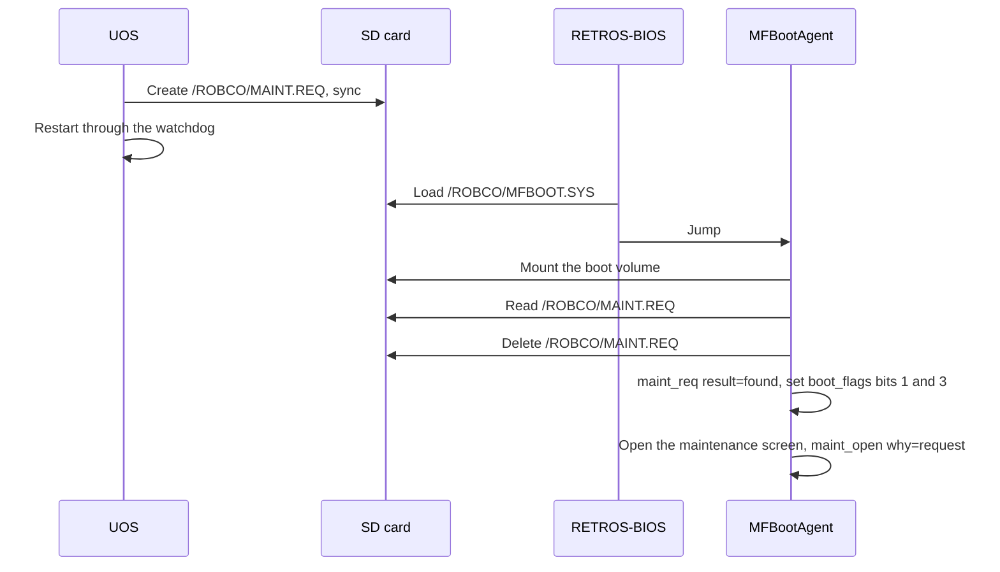

# Boot protocol

## Chains

| Chain | Order |
|---|---|
| Terminal | Firmware → RETROS-BIOS → MFBootAgent → UOS, MAINT or DIAG |
| Pip-Boy | Firmware → Pip-OS → Deitrix ROM → holotapes |

The chains are separate. MFBootAgent never loads Pip-OS. Every stage also boots alone, straight from the firmware or QEMU, with no earlier stage.

## Finding, loading and entering the next stage

| Stage | Loads | Path | Slot base |
|---|---|---|---|
| RETROS-BIOS | MFBootAgent | `/ROBCO/MFBOOT.SYS`, then `/ROBCO/MFBOOT.BAK` | `0x00200000` |
| MFBootAgent | Entry chosen in the menu | From `/ROBCO/BOOT.CFG`. Default `/ROBCO/UOS.SYS`. | `0x00400000` |
| Pip-OS | Deitrix | `/PIPBOY/ROM1.ROM` | `0x00400000` |
| Pip-OS | Holotape, when Deitrix asks | `<NAME>.HTP` in the root of the holotape slot card, then `/PIPBOY/HOLO/<NAME>.HTP` | `0x00800000` |

Each loader:

1. Mounts the boot volume on the SD card through FatFs, by the rule in [Boot volume](#boot-volume).
2. Opens the file, reads it into the slot and validates it as described in [IMAGE_FORMAT.md](./IMAGE_FORMAT.md). A failed attempt emits `ev=error` with the code and the path. A switch to the backup file emits `ev=fallback`. Once an image has loaded and passed every check, the stage emits `ev=load` with its path, size and CRC.
3. Updates the boot info, as described below.
4. Prepares the CPU for the jump.
5. Jumps to `load_addr` with the registers in the next table. Emits `ev=jump` right before.

CPU state at the jump between terminal stages:

| Item | State |
|---|---|
| Mode | SVC |
| IRQ, FIQ | Masked in CPSR. Every source and FIQ routing disabled at the controller. |
| MMU | Off, even if the previous stage had it on |
| D-cache | Cleaned and invalidated, then off |
| I-cache | Invalidated. Off when the previous stage used `mmu.h`. |
| Timers | System timer channels 1 and 3 parked a full counter wrap ahead, their match flags cleared |
| UART | PL011 left on, FIFO drained |
| Framebuffer | Left on. Its address is in the boot info. |

`robco_handoff(entry, bi, fdt_or_atags)` in `src/arch/handoff.c` does steps 4 and 5, in this order:

1. Masks IRQ and FIQ on the CPU.
2. Disables FIQ routing and every IRQ source at the interrupt controller: pending 1, pending 2 and basic.
3. Sets system timer compare channels 1 and 3, the channels the ARM side owns, to one tick before the current counter value, so they cannot match for about 71 minutes. Then it clears their match flags. The next stage takes no stale timer interrupt when it unmasks a timer source.
4. If the MMU or D-cache is on and the image links `mmu_disable()`, which any image that uses `mmu.h` or `cache.h` does, it calls it. `mmu_disable()` cleans and invalidates the whole D-cache on every supported CPU, then turns the MMU, D-cache and I-cache off. Otherwise it turns the MMU and D-cache off, and cleans the D-cache first only on ARM1176.
5. Invalidates the I-cache and the branch predictor.
6. Jumps to `entry` in SVC mode with IRQ and FIQ masked and the registers below.

The caller may call `robco_handoff()` with the MMU and caches on or off when it turned them on with `mmu.h`. The next stage then starts with them off and every dirty line in memory. An image that turned the caches on by its own code, without linking `mmu.h` or `cache.h`, must clean them first on ARMv7 and later. The caller drains the UART with `uart_flush()`. The cache behaviour of the handoff is pending hardware validation.

Pip-OS enters ROMs and holotapes differently, in USR mode. See [PIPOS_ABI.md](./PIPOS_ABI.md).

### Boot volume

Every stage picks the same FAT volume with `fs_mount_boot()`. A card with no partition table and a FAT boot sector at block 0 is one volume, the whole card. Otherwise the stage reads the four primary MBR entries. It tries the entries with a FAT type byte in slot order, then the other entries in slot order, since some tools write a wrong type byte. Extended entries and a GPT protective entry are never mounted, and a GPT card is not supported. A stage passes the files it loads as markers, such as `/ROBCO/MFBOOT.SYS` and `/ROBCO/MFBOOT.BAK` for RETROS-BIOS. It uses the first volume that mounts and holds a marker as a regular file of at least one byte. When no volume holds one, it uses the first volume that mounts, and the load reports the missing file. When nothing mounts, the stage fails with `code=io`.

`boot_part_lba` is the first block of the chosen volume, or 0 for a card with no partition table.

The Pi firmware has its own rule, and it runs before any RobCo code. It loads the first-stage image from a FAT volume it chooses itself, in practice the first partition. This is not verified on hardware here. So put the first-stage image on the first partition. The rule above only decides where the later stages look.

### BOOT.CFG

`/ROBCO/BOOT.CFG` is INI text in the syntax of [`ini.h`](../guide/api/buses.md#configuration-files-inih), which parses this example as it stands, section names with a space included. `tests/host/test_ini.c` reads the example from this file. MFBootAgent reads `[boot]` and the `[entry NAME]` sections. RETROS-BIOS reads `[bios]`. The maintenance image reads `[maint]`.

```
[boot]
default = UOS
timeout = 3

[entry UOS]
path = /ROBCO/UOS.SYS
cmdline =

[entry MAINT]
path = /ROBCO/MAINT.SYS

[entry DIAG]
path = /ROBCO/DIAG.SYS
```

#### The `[boot]` and `[entry NAME]` sections

| Section | Key | Value | Default |
|---|---|---|---|
| `[boot]` | `default` | The name of an entry | The first entry |
| `[boot]` | `timeout` | Seconds, 0 to 99 | None: the menu waits for a key |
| `[entry NAME]` | `path` | Absolute 8.3 path of the image, as the rules below state | None: the entry is dropped |
| `[entry NAME]` | `cmdline` | Up to 127 printable ASCII characters, copied to `cmdline` in the boot info | Empty |

| Limit | Value |
|---|---|
| Entries | 8 usable entries. A dropped section does not take a slot. |
| Entry name | 1 to 15 characters, each a letter, a digit, `_` or `-` |
| `path` | 63 characters, so it fits `boot_path` with its NUL. At most 8 components, each 8.3. |
| `cmdline` | 127 characters, so it fits `cmdline` with its NUL. The INI reader caps a value at 127 bytes, so a longer line makes the whole file bad. |
| File size | 4096 bytes. A longer file is a read error. |

Rules:

- A reader uses `ini_parse_sections()`, not `ini_parse()`. `ini_parse()` calls its handler only for keys, so it cannot see a section with no keys. Then `[entry UOS]` with no keys, followed by a second `[entry UOS]` with a path, would look like one section. `ini_parse_sections()` reports every section header in file order, empty ones and repeats included, before the keys under it.
- The handlers run for each line before the parse reaches a bad line. So the reader acts on the sections and keys only after the call returns `0`.
- Section names, key names and entry names are case-insensitive. The menu shows an entry name as written. Values keep their case.
- An entry header is `entry`, one or more spaces or tabs, then the name. `ini.h` trims the spaces around the whole header.
- Within one section, a key given twice takes its last value. `[boot]` given twice acts as one section.
- The reader takes each `[entry ...]` header in file order and gives it exactly one result, in this order of tests:
  1. `[entry]` with no name, or a name that breaks the limit: the section is dropped and counts as `bad`.
  2. A name that an earlier entry header used: the section is dropped and counts as `dup`. The earlier header keeps the name, even when it was dropped for a bad name rule or a missing or bad value. So the first of two headers with the same name always wins.
  3. No `path` key, or a `path` or `cmdline` that breaks the rules below: the section is dropped and counts as `bad`.
  4. The 8 slots are full: the section counts as `ignored`.
  5. Otherwise the entry takes the next slot. The menu lists the slots in file order.
- The `entries` key of the `config` marker is the number of filled slots. `dup` counts only step 2. `bad` counts steps 1 and 3, plus a bad `timeout`. The keys of a dropped or ignored section count nowhere else.
- An entry with no usable `path` is dropped and counts as `bad`. A bad `path` value counts as `bad` too.
- The rules below apply to the value after INI decoding, so a `\n` escape in a quoted value is a newline byte.
- A usable `path` follows the [boot partition name rule](./IMAGE_FORMAT.md#files-on-the-sd-card): `/`, then 1 to 8 components separated by `/`, 63 characters at most. Each component is a name of 1 to 8 characters, then optionally a dot and an extension of 1 to 3 characters. Each character is an ASCII letter, a digit, `_`, `-` or `~`. FAT allows more characters, such as `$` and `!`. This set is a deliberate subset. An empty component, a `/` at the end, `.` or `..` breaks the rule. A path that breaks the rule makes the entry dropped, counted as `bad`.
- Letters may be written in either case. FAT names are case-insensitive, so the stage upper-cases the path, then compares and stores it in that form. `boot_path` in the boot info and the `path` key of the markers hold the upper-case path. `path = /robco/uos.sys` loads `/ROBCO/UOS.SYS`.
- A usable `cmdline` holds only printable ASCII, 0x20 to 0x7E. A control byte, a byte above 0x7E or a newline from a `\n` escape makes it bad. The whole entry is then dropped and counts as `bad`. The stage does not boot the entry with an empty command line, because an operating image must not start with a changed command line.
- `timeout` follows the number rule of `delay_ms`: one or more ASCII digits and nothing else. A value above 99 becomes 99 and counts as `clamped`. A bad value counts as `bad`, and the menu waits as with no key.
- `timeout = 0` shows the menu, then boots the default entry at once. With no `timeout` key the menu waits for a key.
- A `default` that names no entry in a slot, or no `default` key, means the first slot. A `default` that names a dropped or ignored section counts the same way.
- Unknown keys, keys before the first section and keys in unknown sections count as `unknown`. MFBootAgent skips `[bios]` and `[maint]` without a count.
- A line that does not parse makes the whole file bad. A file that parses but leaves no entry with a usable path is bad too, also an empty file.
- A missing file, a read error or a bad file gives the menu with one entry, `UOS` at `/ROBCO/UOS.SYS`, and no timeout. The `config` marker reports each case.

#### Examples

An empty section takes its name first:

```
[entry UOS]

[entry UOS]
path = /ROBCO/UOS.SYS

[entry MAINT]
path = /ROBCO/MAINT.SYS
```

The first `[entry UOS]` has no `path`. It counts as `bad` and keeps the name `UOS`. The second counts as `dup`, although it has a path. The menu shows one entry, `MAINT`. The `config` marker has `entries=1 dup=1 bad=1`.

Dropped sections do not take slots:

```
[entry E1]
[entry E2]
[entry E3]
[entry E4]
[entry E5]
[entry E6]
[entry E7]
[entry E8]
[entry E9]
path = /ROBCO/UOS.SYS
```

`E1` to `E8` have no `path`. Each counts as `bad` and takes no slot. `E9` takes the first slot. The menu shows one entry, `E9`. The `config` marker has `entries=1 ignored=0 bad=8`.

#### The `[bios]` section

RETROS-BIOS reads only the `[bios]` section and ignores every other section. MFBootAgent ignores `[bios]`. This section is a draft.

```
[bios]
delay_ms = 1000
beep = on
scheme = green
```

| Key | Values | Default |
|---|---|---|
| `delay_ms` | Length of the key window in milliseconds, 0 to 10000 | `1000` |
| `beep` | `on`, `off`, `yes`, `no`, `true`, `false`, `1`, `0` | `on` |
| `scheme` | Screen colours: `green`, `amber`, `blue`, `white` | `green` |

Key names and the words of `beep` and `scheme` are case-insensitive.

A `delay_ms` value is one or more ASCII digits and nothing else. Leading zeros are fine. A sign, a space inside the number, a unit such as `ms` or any other character makes the value bad. A run of digits past 4294967295 saturates there. A value above 10000 is then clamped to 10000. So `delay_ms = 1000000000` gives 10000, and `delay_ms = 10ms` is bad. With `delay_ms = 0` there is no key window.

A bad value or an unknown key in `[bios]` is skipped and counted, and the key keeps its default. A line that does not parse as INI makes the whole file bad: every key takes its default. A missing file means the defaults too. The `config` marker reports each case.

#### The `[maint]` section

The [maintenance image](#maintenance-image) reads only the `[maint]` section and ignores every other section. MFBootAgent and RETROS-BIOS ignore `[maint]` without a count.

| Key | Values | Default |
|---|---|---|
| `restore_users` | `on`, `off` | `off` |

- The key name and the words are case-insensitive.
- `on` turns the restore users tool on. Any other value keeps it off.
- A value other than `on` or `off` is bad. It counts as `bad`, and the tool stays off.
- An unknown key in `[maint]` counts as `unknown` and is skipped.
- `[maint]` given twice acts as one section. A key given twice takes its last value.
- A missing file, a read error or a line that does not parse leaves the tool off. The `config` marker of the maintenance image reports each case.
- The shipped card leaves the key `off`.

## Registers at entry

| Register | Value |
|---|---|
| r0 | `0` |
| r1 | Machine type the firmware passed in r1 |
| r2 | Address of the DTB or ATAGS copy, `0x00101000`, or `0` if there is none |
| r3 | `0x00100000`, the boot info address |

Firmware entry, for comparison: r0 is `0`, r1 is the machine type, r2 points at ATAGS at `0x100`, r3 is undefined.

## Entry API

Every image provides one C entry point:

```c
void robco_main(void);
```

`start.S` calls `robco_start()`. It detects the board, then calls `robco_main()`. If `robco_main()` returns, the image halts. See the startup sequence in [BOARD_SUPPORT.md](./BOARD_SUPPORT.md).

`robco_main()` takes no arguments. Code reads the entry state through accessors:

| Accessor | Header | Returns |
|---|---|---|
| `robco_boot_args()` | `robco/boot.h` | `robco_boot_args_t`: r0 to r3 at entry and the entry mode, CPSR bits [4:0] |
| `board_get()` | `robco/board.h` | `robco_board_t`: MIDR, SoC, peripheral base, VC bus alias, board revision, ARM memory |
| `bootinfo_get()` | `robco/bootinfo.h` | `const robco_bootinfo_t *`, the trusted block, the block the image built with `bootinfo_build()`, or `NULL` |
| `bootinfo_inherited()` | `robco/bootinfo.h` | 1 if the block from the previous stage passed the trust rule |

The accessors return pointers to data the library owns. Callers must not write through them.

## Boot info

The boot info block lives at `0x00100000` in the terminal chain. Pip-OS keeps its own copy inside its own range. The struct is version 2. It replaces `termlink_info_t` from MFBootAgent.

All fields are little-endian. The struct is packed with no padding. Strings are ASCII and NUL-terminated within their arrays.

```c
#include <stdint.h>

#define ROBCO_BOOTINFO_ADDR     0x00100000u
#define ROBCO_BOOTINFO_MAGIC    0x524F4243u  /* "CBOR" in memory, reads "ROBC" as a word */
#define ROBCO_BOOTINFO_VERSION  2u
#define ROBCO_HANDOFF_FDT_ADDR  0x00101000u
#define ROBCO_HANDOFF_FDT_MAX   0x0001F000u

typedef struct __attribute__((packed)) robco_bootinfo {
    uint32_t magic;
    uint16_t version;
    uint16_t size;
    uint32_t crc32;
    uint32_t stage;
    uint32_t board_rev;
    uint32_t soc;
    uint32_t periph_base;
    uint32_t midr;
    uint32_t mem_base;
    uint32_t mem_size;
    uint32_t fw_r0;
    uint32_t fw_r1;
    uint32_t fw_r2;
    uint32_t fdt_addr;
    uint32_t fdt_size;
    uint32_t caps;
    uint32_t uart_type;
    uint32_t uart_clock;
    uint32_t uart_baud;
    uint32_t fb_addr;
    uint32_t fb_size;
    uint32_t fb_width;
    uint32_t fb_height;
    uint32_t fb_pitch;
    uint32_t fb_depth;
    uint32_t fb_order;
    uint16_t con_cols;
    uint16_t con_rows;
    uint16_t con_cx;
    uint16_t con_cy;
    uint32_t con_scheme;
    uint32_t boot_dev;
    uint32_t boot_part_lba;
    uint32_t boot_flags;
    char     boot_path[64];
    char     cmdline[128];
} robco_bootinfo_t;

_Static_assert(sizeof(robco_bootinfo_t) == 320, "robco_bootinfo_t must be 320 bytes");
```

| Offset | Size | Field | Meaning |
|---|---|---|---|
| `0x000` | 4 | `magic` | `0x524F4243` |
| `0x004` | 2 | `version` | `2` |
| `0x006` | 2 | `size` | `320`, the struct size |
| `0x008` | 4 | `crc32` | CRC-32/ISO-HDLC over `size` bytes with this field as 0 |
| `0x00C` | 4 | `stage` | Stage that wrote the block last. See stage ids. |
| `0x010` | 4 | `board_rev` | Raw value of mailbox tag `0x00010002` |
| `0x014` | 4 | `soc` | `0x2835`, `0x2836`, `0x2837` or `0x2711` |
| `0x018` | 4 | `periph_base` | Peripheral base from the detection table |
| `0x01C` | 4 | `midr` | Raw MIDR |
| `0x020` | 4 | `mem_base` | ARM memory base, mailbox tag `0x00010005` |
| `0x024` | 4 | `mem_size` | ARM memory size in bytes, same tag |
| `0x028` | 4 | `fw_r0` | r0 the firmware passed to the first stage |
| `0x02C` | 4 | `fw_r1` | r1 the firmware passed, the machine type |
| `0x030` | 4 | `fw_r2` | r2 the firmware passed, the original ATAGS or DTB address |
| `0x034` | 4 | `fdt_addr` | Address of the copy, `0x00101000`, or 0 |
| `0x038` | 4 | `fdt_size` | Size of the copy in bytes, or 0 |
| `0x03C` | 4 | `caps` | Capability bits. See below. |
| `0x040` | 4 | `uart_type` | Console UART: 0 none, 1 PL011, 2 mini UART |
| `0x044` | 4 | `uart_clock` | UART reference clock in Hz |
| `0x048` | 4 | `uart_baud` | Console baud rate, `115200` |
| `0x04C` | 4 | `fb_addr` | Framebuffer ARM physical address, bus alias cleared. 0 if none. |
| `0x050` | 4 | `fb_size` | Framebuffer size in bytes |
| `0x054` | 4 | `fb_width` | Width in pixels |
| `0x058` | 4 | `fb_height` | Height in pixels |
| `0x05C` | 4 | `fb_pitch` | Bytes per row |
| `0x060` | 4 | `fb_depth` | Bits per pixel |
| `0x064` | 4 | `fb_order` | Pixel order from the mailbox: 0 BGR, 1 RGB |
| `0x068` | 2 | `con_cols` | Text console columns |
| `0x06A` | 2 | `con_rows` | Text console rows |
| `0x06C` | 2 | `con_cx` | Cursor column, so the next stage continues the screen |
| `0x06E` | 2 | `con_cy` | Cursor row |
| `0x070` | 4 | `con_scheme` | Colour scheme: 0 green, 1 amber, 2 blue, 3 white |
| `0x074` | 4 | `boot_dev` | 0 unknown, 1 SD on EMMC, 2 SD on SDHOST |
| `0x078` | 4 | `boot_part_lba` | First LBA of the boot volume. 0 for a card with no partition table. |
| `0x07C` | 4 | `boot_flags` | Boot flag bits. See below. |
| `0x080` | 64 | `boot_path` | Path of the image loaded last, for example `/ROBCO/UOS.SYS` |
| `0x0C0` | 128 | `cmdline` | Command line from `BOOT.CFG`, may be empty |
| | 320 | | Total, `0x140` |

A later stage keeps the screen the earlier stage left on. It passes the `fb_*` fields to `fb_adopt()` and the `con_*` fields to `console_adopt()`, and does not call `fb_init()` again. If either call rejects the description, it falls back to `fb_init()` and `console_init()`. This behaviour is pending hardware validation.

### Stage ids

| Value | Stage | `@RC` name |
|---|---|---|
| 0 | None | |
| 1 | RETROS-BIOS | `bios` |
| 2 | MFBootAgent | `bootagent` |
| 3 | UOS | `uos` |
| 4 | Maintenance image | `maint` |
| 5 | Diagnostics image | `diag` |
| 6 | Pip-OS | `pipos` |
| 7 | Deitrix | `deitrix` |

### caps bits

| Bit | Meaning |
|---|---|
| 0 | Framebuffer valid |
| 1 | PL011 initialised |
| 2 | Mini UART initialised |
| 3 | SD card initialised |
| 4 | Local interrupt controller at `0x40000000` present |
| 5 to 31 | Reserved, 0 |

### boot_flags bits

| Bit | Meaning |
|---|---|
| 0 | The loader used a fallback file, such as `MFBOOT.BAK` |
| 1 | The user asked for maintenance mode. MFBootAgent sets it when a request file was found, the maintenance screen was opened or the image it starts is a maintenance image, subtype 2, this boot. |
| 2 | The writing stage cold-booted and built the block itself |
| 3 | Maintenance was asked by a request file. See [Maintenance request](#maintenance-request). Bit 1 is set too. MFBootAgent owns bits 1 and 3. |
| 4 to 31 | Reserved, 0 |

## Trust rule

A stage trusts the boot info only if all of these hold:

1. r3 at entry equals `0x00100000`.
2. `magic` is `0x524F4243`, `version` is 2 and `size` is 320.
3. The CRC matches.

`robco_start()` applies the trust rule before `robco_main()`, unless the project's `robco_config.h` sets `ROBCO_FIRST_STAGE` to 1. `bootinfo_inherited()` gives the result and `bootinfo_get()` the trusted block. A cold-booted image gets `NULL` from `bootinfo_get()` until it calls `bootinfo_build()`.

If any check fails, the stage cold-boots. It detects the board, queries the mailbox and builds a fresh block. It sets `boot_flags` bit 2. Then it continues as normal. This is why every stage can run alone.

RETROS-BIOS and Pip-OS are first stages. They always cold-boot and ignore r3. RAM can keep an old block across a watchdog reset, and the firmware does not define r3.

A trusting stage still reads MIDR. If MIDR differs from `midr`, it cold-boots.

Before the jump, the loader sets `stage` to its own id, updates the fields it changed, and recomputes the CRC. `bootinfo_build(bi, stage)` does this and seals the block. `bootinfo_seal()` recomputes the CRC after a later change.

A stage passes on the state it did not set up itself. Hardware such as a framebuffer stays active across the handoff, so its fields stay valid. The rule: a field that describes state this stage set up comes from this stage. Every other field is carried over from the trusted block. With no trusted block, the stage fills every field itself.

| Field group | Comes from this stage when |
|---|---|
| `stage`, `board_rev`, `soc`, `periph_base`, `midr`, `mem_base`, `mem_size`, caps bit 4 | Always |
| `fw_r0`, `fw_r1`, `fw_r2` | Cold boot only |
| `fdt_addr`, `fdt_size` | The stage copied the firmware blob |
| `uart_type`, `uart_clock`, `uart_baud`, caps bit 1 | The stage configured the PL011 |
| caps bit 2 | The stage initialised the mini UART |
| caps bit 3 | The stage initialised the SD card |
| `fb_*`, caps bit 0 | The stage called `fb_init()` or `fb_adopt()` with success |
| `con_cols`, `con_rows`, `con_cx`, `con_cy`, `con_scheme` | The stage's console is active |
| `boot_dev`, `boot_part_lba`, `boot_flags`, `boot_path`, `cmdline` | Cold boot only |
| Other caps bits | Never. They are reserved and 0. |

A stage that sets up a new framebuffer without a console clears `con_cols`, `con_rows`, `con_cx` and `con_cy`, since the old console drew on the old framebuffer. It keeps `con_scheme`. A loader that picks a boot device writes the `boot_*` fields after `bootinfo_build()` and calls `bootinfo_seal()`. `bootinfo_merge()` in `src/lib/bootinfo.c` holds the rule.

## DTB and ATAGS

The first stage copies what the firmware passed in r2 to `0x00101000`.

- If the word at r2 is `0xD00DFEED` in big-endian order, it is a DTB. The size is the big-endian `totalsize` at offset 4.
- Otherwise, if r2 points at an `ATAG_CORE` tag, `0x54410001`, it is an ATAGS list. The size runs to and includes the `ATAG_NONE` tag.
- Otherwise there is nothing to copy.

If the size is above `0x1F000`, the stage does not copy. It sets `fdt_addr` and `fdt_size` to 0 and passes r2 = 0. With no `.dtb` on the card, the firmware passes ATAGS.

Later stages pass `fdt_addr` on unchanged. No stage edits the copy.

`bootinfo_copy_fw_blob(dest, max)` applies these rules to the saved r2 and returns the size. `bootinfo_build()` records the copy in a cold-built block.

## Serial markers

Stages print machine-readable lines on the PL011 for tests. Each marker is one line.

```
marker = "@RC" SP "stage=" name SP "ev=" event *( SP key "=" value ) CRLF
name   = 1*( lower / DIGIT / "_" )
event  = 1*( lower / DIGIT / "_" )
key    = 1*( lower / DIGIT / "_" )
value  = 1*( VCHAR except SP )
```

- Numbers are hex with `0x`, or decimal for sizes, counts and clocks. Register values and addresses are always hex with 8 digits. `mem` in `boot` is hex too.
- `soc` is the lowercase SoC name: `bcm2835`, `bcm2836`, `bcm2837`. It is not the numeric `soc` field of the boot info.
- Paths are absolute and contain no spaces.
- Markers are always on. They are not behind a debug flag.
- A marker line never shares a line with other output. Code may print `\n` before a marker to end a partial line.
- The first marker of every image is `boot`.

Example:

```
@RC stage=bios ev=error code=crc path=/ROBCO/MFBOOT.SYS
@RC stage=bios ev=fallback path=/ROBCO/MFBOOT.BAK from=/ROBCO/MFBOOT.SYS to=/ROBCO/MFBOOT.BAK reason=crc
@RC stage=bios ev=load path=/ROBCO/MFBOOT.BAK size=81920 crc=0x1c291ca3 addr=0x00200000 name=mfboot
@RC stage=bios ev=jump entry=0x00200000
```

A marker may carry more keys than the table below lists, and a stage may print events the table does not list. Readers ignore keys and events they do not know.

### Events

| Event | Keys | Meaning |
|---|---|---|
| `boot` | `midr soc base board_rev mem entry_mode` | First marker of every image. `entry_mode` is the CPU mode at entry, such as `svc` or `hyp`. RETROS-BIOS and MFBootAgent add `version`, their own version. |
| `handoff` | `trusted=0\|1` | Result of the trust rule. Not printed by first stages. |
| `mount` | `lba blocks` | The stage mounted the boot volume that holds the next image. `lba` is 0 for a card with no partition table. RETROS-BIOS and Pip-OS add `part`, the MBR slot 0 to 3 or `whole` for a card with no partition table. |
| `card` | `rc`, then `sd`, `part` or `fs why` | Pip-OS: the result of the card mount. `rc` is `ok`, `nocard`, `nopart` or `nomount`. |
| `load` | `path size crc addr name` | An image loaded and passed every validation step. `size` is `file_size`, `crc` the header CRC, `addr` the load address, `name` the header name. Without `path`, the image was already in its slot and the stage only validated it. |
| `fallback` | `path from to reason` | The loader moves to the backup file `path`, the same as `to`. `from` is the primary file and `reason` the code it failed with. |
| `error` | `code path` | A load or validation failed. `code` uses the names from [IMAGE_FORMAT.md](./IMAGE_FORMAT.md), or `io` when the card or the mount failed. `path` names the file the attempt was for. Other failures use their own `code`, such as `mmu`, with no `path`. On an unsupported board `robco_start()` prints `code=unsupported_board midr` instead and halts. |
| `jump` | `entry` | Last line before entering the next stage at `entry` |
| `ready` | | Stage reached its main screen or prompt |
| `shell` | `reason` | Stage entered its emergency shell. `reason` is the `code` of the error that caused it, or why the shell was asked for. A first stage adds `available`: `1` when the shell opens, `0` when it cannot run. See [First-stage emergency shell](#first-stage-emergency-shell). |
| `halt` | | The stage stops on purpose |
| `exception` | `type pc lr spsr dfsr dfar` | CPU exception. `type` is `undef`, `svc`, `prefetch_abort`, `data_abort`, `irq`, `fiq` or `reset`. The stage halts after it. |
| `panic` | `msg` | Fatal software error. `msg` uses `_` for spaces. |
| `rom_exit` | `status` | The ROM returned or called `exit`. `status` is its exit status, 0 to 255. |
| `rom_kill` | `reason pc` | Pip-OS killed the ROM after a fault. `reason` is `undef`, `prefetch_abort` or `data_abort` for a fault, `thumb_svc` for a system call made in Thumb state, or `killed` when Pip-OS stopped the ROM for another reason. `pc` is the address of the instruction. |
| `holo_launch` | `path` | Pip-OS starts a holotape |
| `holo_exit` | `status` | Holotape returned |
| `holo_kill` | `reason pc` | Pip-OS killed a holotape. `reason` and `pc` work as in `rom_kill`. `reason` is also `eject` when the slot card of a running tape was pulled. Every `holo_kill` carries `pc`. For `eject`, `pc` is the tape's program counter at the syscall where Pip-OS ended it, in the same format as for a fault. |
| `init` | `fb console tick hz` | First stage: return codes of the hardware set-up, and the tick rate |
| `input` | `serial mini script` | First stage: return codes of the input back ends |
| `post` | `name result`, then probe keys | First stage: one self-test probe. `result` is `ok`, `fail`, `absent` or `skipped`. A skipped probe has `after`, the probe that stopped the self test. See [First-stage self test](#first-stage-self-test). |
| `post_done` | `result ok fail absent skipped us` | First stage: the self-test summary. `result` is `fail` when the self test stops the boot, else `ok`. |
| `config` | `result path`, then `applied clamped bad unknown`, or `why` | First stage: reading `BOOT.CFG`. `result` is `ok`, `missing` or `bad`. With `bad`, `why` is `read`, with `rc`, or `syntax`, with `line`. |
| `settings` | `delay_ms beep scheme` | First stage: the `[bios]` settings in use |
| `beep` | `state` | First stage: the power-on beep. `state` is `played` or `failed`, with `rc`, `off`, or `skipped`, with `reason`, the result of the audio probe. |
| `key_window` | `ms` | First stage: the key window starts |
| `shell_request` | `source` | First stage: a key came in the key window, from `console` or `maint` |
| `key_window_end` | `key` | First stage: the key window ended. `key=1` when a key came. |
| `bootinfo` | `flags caps dev part_lba fdt_size` | First stage: the boot info as handed over, right before `jump` |
| `idle` | | First and second stage: the boot stopped and the stage waits in its idle loop |
| `reboot` | | First stage: the maintenance port or the shell's reboot command asked for a reboot |
| `shell_cmd` | `name rc` | First stage: one shell line ended. `name` is the command in lower case, or `unknown`. `rc` is `0`, or a word that says why the command failed. |
| `diag` | `name result`, then test keys | First stage: one diagnostic ran. `result` is `ok`, `fail`, `absent` or `skipped`. |
| `diag_done` | `ok fail absent skipped` | First stage: the run of every diagnostic ended, with the count of each result |
| `video_pattern` | `width height` | First stage: the video diagnostic drew its test pattern |
| `fault_hook` | `name` | First stage, test builds only: the image carries a fault hook for tests. A shipped image never prints it. |
| `screen` | `fb console kept unknown scheme` | Second stage: the screen set-up. `kept=1` when the text of the previous stage stays on screen. |
| `selfcheck` | `rc size` | Second stage: the result of `rimg_self_check()`. Information only. |
| `entries` | `count default timeout` | Second stage: the menu in use. `timeout` is `none` when the menu waits for a key. |
| `countdown` | `state`, then `seconds` | Second stage: `state=start` with `seconds` when the menu shows with a timeout above 0, `state=stopped` when a key stops it |
| `select` | `index name` | Second stage: the selection moved. `index` counts from 1. |
| `choose` | `index name path via` | Second stage: an entry is to boot. `via` is `key` or `timeout`, and a key sent through the maintenance port's `key` script command counts as `key`. |
| `maint_req` | `result rc` | Second stage: the [maintenance request](#maintenance-request) check, once per boot in which the boot volume mounted. `result` is `none`, `found` or `clear_failed`. `rc` is `0`, or the file system code of the failed delete. |
| `maint_open` | `why` | Second stage: the maintenance screen opened. `why` is `key`, `button`, `port`, `flag` or `request`. A received `boot_flags` bit 1 opens the screen with `why=flag`. |
| `tool` | `name result`, then tool keys | Maintenance image: one tool ended. See [Maintenance image markers](#maintenance-image-markers). |

| Stage | Must emit |
|---|---|
| `bios` | `boot`, `init`, `input`, `post`, `post_done`, `mount`, `config`, `settings`, `beep`, `key_window`, `key_window_end`, `load`, `fallback`, `error`, `bootinfo`, `jump`, `shell`, `shell_cmd`, `diag`, `diag_done`, `idle` |
| `bootagent` | `boot`, `handoff`, `input`, `screen`, `selfcheck`, `mount`, `maint_req`, `maint_open`, `config`, `entries`, `ready` when the menu shows, `choose`, `load`, `error`, `bootinfo`, `jump`, `idle` |
| `uos`, `diag` | `boot`, `handoff`, `ready` |
| `maint` | `boot`, `handoff`, `config`, `ready`, `tool` |
| `pipos` | `boot`, `load`, `error`, `jump` for the ROM, `rom_exit`, `rom_kill`, `shell`, `holo_launch`, `holo_exit`, `holo_kill` |
| `deitrix` | `boot`, `ready` |

All stages emit `exception` and `panic` when those happen. Deitrix runs in USR mode, so it prints through the `log` syscall.

The first-stage events, from `init` to `fault_hook` in the table, are RETROS-BIOS's. Their keys are a draft.

The second stage also prints `input`, `config`, `bootinfo` and `reboot`. `input` has the keys of the first stage. `config` has `result path`, then `entries ignored dup unknown bad clamped default_found`, or `why`. `why` is `read` with `rc`, `syntax` with `line`, or `empty`, a file with no usable entry. `bootinfo` adds `path cmdline_len scheme cx cy` to the first-stage keys. `reboot` has `source`, `key` or `maint`. `error` adds `name`, the entry name, to a load error, and `what` with `rc` to `code=io`.

`key_window` is always followed by `key_window_end`, also with `delay_ms = 0`. `shell_request` comes between them when a key came. `post` comes once per probe, in probe order, on every path, and `post_done` follows the last one.

### First-stage error codes

Besides the loader codes from [IMAGE_FORMAT.md](./IMAGE_FORMAT.md) and `io`, RETROS-BIOS uses two `error` codes of its own, with no `path`:

| `code=` | Screen | Cause |
|---|---|---|
| `memtest` | `E16` | The memory test found a fault |
| `timer` | `E17` | The system timer does not advance |

### First-stage self test

RETROS-BIOS runs eight probes in this order. This order is a draft.

| Probe | Passes when | `absent` when | Stops the boot |
|---|---|---|---|
| `memory` | The memory test of 256 KiB at `0x00400000` finds no fault | Never | Yes. Only the `timer` probe still runs. |
| `video` | The framebuffer and the console start | Never | No |
| `timer` | The system timer changes within a million reads | Never | Yes, and no later probe runs |
| `sd` | `sd_init()` succeeds and block 0 reads | No card answers | Yes, also when absent |
| `fat` | A volume mounts by the [boot volume](#boot-volume) rule | The `sd` probe did not pass | Yes, also when absent |
| `rng` | The hardware RNG gives a value | No peripheral base | No |
| `rtc` | A DS1307 or DS3231 answers and its time reads | No chip answers | No |
| `audio` | `audio_init()` returns 0 | `audio_init()` returns `AUDIO_ERR_NO_PWM` or `AUDIO_ERR_PIN` | No |

Memory runs first because everything after it needs memory. Video runs before the timer because the framebuffer and the mailbox do not wait on the timer. The timer runs before every probe that waits on it. After a stopped timer, every later probe is `skipped` with `after=timer`. After a failed memory test, every later probe but `timer` is `skipped` with `after=memory`. The timer probe still runs, because the shell may open after a failed memory test and the shell waits on the timer. A failed memory test gives `code=memtest`, a stopped timer `code=timer`, and a failed `sd` or `fat` probe `code=io` with `what=sd` or `what=fat`.

## Failure behaviour

| Stage | Failure | Action |
|---|---|---|
| RETROS-BIOS | `MFBOOT.SYS` fails any step | `ev=error`, `ev=fallback`, then try `MFBOOT.BAK` |
| RETROS-BIOS | `MFBOOT.BAK` also fails | `ev=error`, then the emergency shell |
| RETROS-BIOS | SD card or FAT mount fails | `ev=error code=io`, then the emergency shell |
| RETROS-BIOS | The memory test fails and the timer passed | `ev=error code=memtest`, a warning, then the emergency shell |
| RETROS-BIOS | The timer does not advance | `ev=error code=timer` or `code=memtest`, then the halted state |
| MFBootAgent | The chosen entry fails | `ev=error`. Shows the error under the menu and stays in the menu. The countdown does not start again. |
| MFBootAgent | `BOOT.CFG` missing, bad or with no usable entry | Menu with the default entry only |
| MFBootAgent | No card answers or no volume mounts | `ev=error code=io` with `what=sd` or `what=fat`, `BOOT HALTED` on screen, then `ev=idle`. The maintenance port keeps answering. |
| MFBootAgent | `/ROBCO/MAINT.REQ` exists and its delete fails | `ev=maint_req result=clear_failed`. Opens the maintenance screen once with a notice. See [Maintenance request](#maintenance-request). |
| Maintenance image | A tool fails | `ev=tool` with the result. The tool shows the error, writes nothing more and returns to the menu. |
| Maintenance image | Boot info not trusted | Cold-boots, starts its own screen and runs |
| UOS | Boot info not trusted | Cold-boots and runs |
| Pip-OS | `ROM1.ROM` fails any step | `ev=error`, then the emergency shell |
| Pip-OS | A holotape fails any step | `ev=error`. The `launch` syscall returns an error to Deitrix. |
| Pip-OS | The ROM crashes | `ev=rom_kill`. Pip-OS shows the fault on screen and stops running the ROM. |
| Pip-OS | A holotape crashes | `ev=holo_kill`. Control returns to Deitrix. |
| Any | CPU exception in a stage | `ev=exception`, then halt |

After any of these stops RETROS-BIOS never jumps and never reboots by itself, so there is no reboot loop. [First-stage emergency shell](#first-stage-emergency-shell) says what it does instead.

Each real stage provides its own emergency shell. RobCo-Core has none: `loader_load_fallback()` returns the result and prints nothing, and the stage decides what to print and where to go. `examples/chain1`, built with `CHAIN1_SD`, follows the RETROS-BIOS rows above for its markers. Where RETROS-BIOS would enter its shell, it prints `ev=shell` with the reason, then `ev=halt`, and halts.

## First-stage emergency shell

RETROS-BIOS has an emergency shell on the PL011 and on the screen console. This section fixes when it opens, its markers and the maintenance port. The command set, such as `HELP`, `INFO`, `POST`, `DIR`, `BOOT`, `CONTINUE`, `DIAG` and `REBOOT`, is the BIOS's own business: see the RETROS-BIOS user manual. This section is a draft.

### When it opens

| Cause | `shell reason=` | Result |
|---|---|---|
| A key in the key window, on the console or the maintenance port | `key` | The shell opens. The boot waits in it. |
| `shell` on the maintenance port before the key window ends | `maint` | The shell opens at the end of the window, also with `delay_ms = 0` |
| A load error, or `code=io` from the `sd` or `fat` probe | The error `code` | The shell opens under the error lines |
| A failed memory test with a timer that passed | `memtest` | The stage shows a warning that results may be wrong, then opens the shell |
| A stopped timer | `timer` | No shell. The halted state. |
| A failed memory test and a stopped timer | `memtest` | No shell. The halted state. |

The shell needs the system timer: input waits, the SD card, the audio and most diagnostics wait on it. So the shell opens only when the `timer` probe passed. The marker carries `available=1` when the shell opens and `available=0` when it cannot.

In the halted state the stage shows the first error and `BOOT HALTED`, prints `shell available=0` and then `idle`, and waits. Its idle loop polls the maintenance port without waiting on the timer. The `reboot` command restarts the board through the watchdog.

### Leaving it

- `CONTINUE` goes on with the normal boot. It works only when a key or the maintenance port opened the shell. After a boot error there is nothing to continue, and it is refused.
- `CONTINUE` follows the rule of the power-on boot. When the last self test had a fatal result, a failed `memory`, `timer`, `sd` or `fat` probe, `CONTINUE` is refused and the shell stays open. This also holds after a `POST` run from the shell.
- `BOOT` loads and starts the second stage. It is the operator's choice, so it stays allowed after a fatal self test and after a boot error. After a failed memory test it shows the warning first. It uses the same load and handoff steps and markers as the boot. `BOOT` with a path loads only that file, so no `fallback` comes.
- `REBOOT` restarts the board through the watchdog.

A `POST` run from the shell applies the same rule as the boot. A stopped timer closes the shell and enters the halted state. A failed memory test with a timer that passed shows the warning, and the shell stays open.

### Shell markers

- The shell prints `shell` once, when it opens.
- Every line that is not blank ends with one `shell_cmd`. A `BOOT` that starts a second stage ends with `jump` instead. `REBOOT` prints its `shell_cmd`, then `reboot`.
- Markers a command prints, such as `post`, `diag`, `error` or `load`, come before its `shell_cmd`.
- `rc` in `shell_cmd` is `0`, or one of `usage`, `unknown`, `nofile`, `isdir`, `notdir`, `novol`, `io`, `outside`, `device`, `abort`, `refused`, `fail`, or the load error code for `BOOT`, or the self test error code for a refused `CONTINUE`.
- The diagnostics print one `diag` per test. `name` is `mem`, `sd`, `video`, `audio`, `timer`, `rng`, `rtc` or `input`. A run of every test ends with `diag_done`. The other keys of each test are the BIOS's own.

### Maintenance port

The maintenance port answers in every phase, also in the halted state. In QEMU it is the mini UART on the second serial port. On hardware the mini UART reaches no pin. Each line gets `ok` or `err <reason>`. The library's built-in script commands, such as `key` and `char`, work too.

| Command | Effect |
|---|---|
| `state` | One line: `phase=<init\|post\|keys\|load\|halted\|shell> error=<code\|none> shell_requested=<0\|1> post=<ok\|fail>` |
| `dump` | The screen text. `err no screen` without a framebuffer. |
| `shell` | Asks for the shell at the end of the key window. Refused when the shell is open, past the key window, and in the halted state. |
| `paging on`, `paging off` | Turns the shell's pager on or off. It is on at boot. Tests turn it off. |
| `reboot` | Prints `reboot` and restarts the board through the watchdog |

The shell reads its lines from the PL011 console only. A script drives it by writing the command line to the console.

## Second stage

MFBootAgent is the second stage of the terminal chain. This section fixes what it does besides the menu.

### Screen

MFBootAgent keeps the screen of the previous stage, as [Boot info](#boot-info) states. It passes the inherited fields to `fb_adopt()`, through `bootinfo_fb_info()`, and to `console_adopt()`. It does not call `fb_init()` first. It calls `fb_init()` and `console_init()` only when the block is not trusted, has caps bit 0 clear, or either adopt call fails. The `screen` marker reports `kept=1` when both adopt calls succeed.

### Boot volume markers

MFBootAgent passes `/ROBCO/BOOT.CFG` and `/ROBCO/UOS.SYS` to `fs_mount_boot()`. The first volume that holds either file is the boot volume. It does not use `boot_part_lba` from the boot info to choose: every stage applies the [boot volume](#boot-volume) rule itself.

### Loading an entry

MFBootAgent loads the chosen entry into the slot at `0x00400000` and expects magic `BOOT` with ABI major 2. It loads only operating images: subtype 0 UOS, 2 maintenance or 3 diagnostics.

MFBootAgent checks the subtype itself. It runs this check at step 4, the bounds step of [IMAGE_FORMAT.md](./IMAGE_FORMAT.md), after the header checks of steps 1 to 3 and before the ABI and CRC steps. It trusts nothing else in the image before this check passes. Any subtype other than 0, 2 or 3 fails with `code=bounds`, a boot agent included. The code is `bounds` because the image is not allowed in this slot. The screen says it is not an operating image.

The library's `loader_load()` does not make this check for the caller. With a caller slot it checks only that the subtype has some slot, then checks the bounds against the caller's slot. So a `BOOT` image with subtype 4 to 7, linked at `0x00400000`, passes `loader_load()`. A second stage that only calls `loader_load()` does not meet this rule.

A failed load prints `error` and shows the error under the menu. The menu stays, so the user can pick another entry or reboot. The stage never jumps to an image that failed a step and never reboots by itself.

### Boot info

Before the jump MFBootAgent unmounts the volume and calls `bootinfo_build()` with stage id 2. Then it writes:

| Field | Value |
|---|---|
| `boot_dev` | 1, SD on EMMC |
| `boot_part_lba` | First block of its boot volume |
| `boot_path` | `path` of the chosen entry |
| `cmdline` | `cmdline` of the chosen entry, or empty |
| `boot_flags` | Bit 0 cleared, since it loaded no fallback file. Bit 1 set when any of these holds this boot, clear otherwise: a [maintenance request](#maintenance-request) was found, the maintenance screen was opened, or the image it starts is a maintenance image, subtype 2. So `MAINT.SYS` always receives bit 1, whatever road started it. Bit 3 set when a request was found this boot, clear otherwise. The agent sets or clears bits 1 and 3 whatever it received. The other bits stay as received. |

It then calls `bootinfo_seal()` and jumps with r2 set to the firmware blob copy, or 0 when there is none.

## Maintenance request

A maintenance request asks the next boot to open the maintenance screen of MFBootAgent. It survives a reset because it is a file on the card. UOS writes it for its command `SET HALT RESTART /MAINTENANCE`.

### The file

- The request is the file `/ROBCO/MAINT.REQ` on the boot volume. Its presence is the request. Only a regular file counts. A folder of that name is no request, and the agent leaves it alone.
- Its content is one optional line of at most 63 printable ASCII bytes, 0x20 to 0x7E, for a person to read, such as who asked. A line may end with CR, LF or CRLF.
- A reader ignores a longer content or a byte outside that range, and still honours the file. An empty file is a valid request.
- Nothing else carries a request. No register, no boot info field and no command line does.

### Writer

Any operating image may write the request. The writer:

1. Leaves `/ROBCO/MAINT.REQ` as it is when it exists.
2. Otherwise creates it with `fs_open()`, writes the line, if any, with `fs_write()`, and calls `fs_sync()`.
3. Restarts the terminal through the watchdog.

The writer does not use `fs_write_file_atomic()`. That call can leave the complete file under a `~` or `#` work name after a power cut, and the reader checks the plain name only. The presence of the file is the request and its content is only a note, so a torn write is still a valid request. A power cut during the create leaves no file, and the person asks again, or a file, and the agent honours it.

UOS writes the request this way. Who may ask is UOS's own rule: its command `SET HALT RESTART /MAINTENANCE` needs the `OPER` privilege. See the UOS command reference.

### Reader

MFBootAgent reads the request once per boot. RETROS-BIOS never looks at it. The agent:

1. Mounts the boot volume, by the rule in [Boot volume markers](#boot-volume-markers). When nothing mounts, it halts as the [failure table](#failure-behaviour) states and prints no `maint_req`.
2. Before the menu shows and before the countdown starts, looks for `/ROBCO/MAINT.REQ` by its plain name. It runs no recovery of work names. With no file, or with a folder of that name, it prints `maint_req result=none rc=0` and goes on as before.
3. Reads the line, if any, and keeps it for the screen.
4. Deletes the file with `fs_unlink()`. Delete first makes the request one-shot: a fault later cannot make the terminal start in maintenance for ever.
5. Prints `maint_req result=found rc=0` when the delete worked, or `maint_req result=clear_failed rc=<code>` when it failed.
6. Sets `boot_flags` bits 1 and 3 for the next image. They say what was asked, not what was started: they stay set whatever entry the person picks. An image other than the maintenance image ignores them. Without a request, bit 1 is still set when the maintenance screen opens or a maintenance image starts, as [Boot info](#boot-info) states. Bit 3 is then clear.
7. Shows the menu with no countdown, then opens the maintenance screen and prints `maint_open why=request`. The screen shows the request line, if any. No image boots without a key.

The agent can delete this one file. It mounts the boot volume with write support, and it writes nothing else on the card.

A request and a held BACK button together count as a request: the marker says `why=request`.

### Failure cases

| Case | Marker | What the person sees |
|---|---|---|
| No file, or a folder named `MAINT.REQ` | `maint_req result=none rc=0` | The normal menu and countdown |
| No volume mounts | `error code=io`, `idle`. No `maint_req`. | `BOOT HALTED` |
| An empty file, or a content that is too long or not printable | `maint_req result=found rc=0`, `maint_open why=request` | The maintenance screen, with no request line |
| The delete fails, for a locked or read-only card or an I/O error | `maint_req result=clear_failed rc=<code>`, `maint_open why=request` | The maintenance screen, with a notice that the request could not be cleared and comes back at each start until the file is removed |
| The person closes the screen and picks an entry | `choose`, `load`, `jump` as usual | The chosen image starts. Bits 1 and 3 are set in its boot info. |
| The person starts the maintenance image and the file is missing or bad | `choose`, then `error` with the load code | The load error under the menu, as for any entry |

The agent never loops on its own. Honouring a request means opening the maintenance screen, where a person decides. With a delete that keeps failing, every start opens the screen again with the notice.



### Compatibility

- An agent that predates the request ignores the file. The file then stays on the card, harmless, until a newer agent or a person removes it.
- An operating image that predates bit 3 ignores it.
- `boot_flags` bit 1 keeps its meaning.

## Maintenance image

`/ROBCO/MAINT.SYS` is the tool a person at the terminal uses when UOS cannot be used. It is an operating image: magic `BOOT`, subtype 2, loaded into the OS slot at `0x00400000`. It is built in the MFBootAgent repository, like `DIAG.SYS`. Its stage id is 4 and its marker name `maint`.

### Authority

The image needs no login. Physical presence at the terminal, with its card, is the authority, as for the BIOS shell. Anyone who can hold a button at power-on reaches this image. So the one tool that changes accounts, restore users, is off unless `BOOT.CFG` turns it on with `[maint] restore_users = on`. A terminal on show must not hand its accounts to a passer-by. A person who can edit `BOOT.CFG` on a computer already holds the card, so the setting gives away nothing new.

### Start

- The boot entry `MAINT` starts it from the menu. The agent sets `boot_flags` bit 1 whenever it starts a maintenance image, from the menu, the maintenance screen or the maintenance port. So this image always receives bit 1. Bit 3 is set only when a request file was found this boot. The agent's maintenance screen can always start it: it uses the path of the `MAINT` entry when `BOOT.CFG` has one, and `/ROBCO/MAINT.SYS` when it has none, the fallback menu included. A damaged `BOOT.CFG` is a case where a person needs this image. A missing or bad file is the usual load failure.
- It applies the [trust rule](#trust-rule). With a trusted block it adopts the agent's screen, as `DIAG.SYS` does. Alone, or with a block it does not trust, it starts its own screen.
- It mounts the boot volume, reads the `[maint]` section of `BOOT.CFG`, then shows its menu and prints `ready`.
- It is driven by the console keys, the six buttons and the maintenance port, with a menu like `DIAG.SYS`.

### Tools

Version 1 has these tools and no other.

| Tool | Reads | Writes |
|---|---|---|
| Check card | Every folder and every file of the boot volume, each file whole | Nothing. Reports each error with its path, and the free space. |
| Check images | Every image file in `/ROBCO`, validated with the steps of [IMAGE_FORMAT.md](./IMAGE_FORMAT.md) | Nothing. Shows the result per file. |
| View file | One text file, shown in a pager. `BOOT.CFG`, `UOS.CFG`, `DEVICES.CFG` and `TERMINAL.CFG` are offered by name. It does not parse them. | Nothing |
| Set clock | The real-time clock that the library's [RTC driver](../guide/api/buses.md#real-time-clock-and-software-clock-rtch) found | The time on the clock. With no clock, the tool says so. |
| Restore users | `/UOS/SYSUAF.DEF` | `/UOS/SYSUAF.DAT`. Off unless `[maint] restore_users = on`. |
| Restart | Nothing | Nothing. Restarts the terminal through the watchdog. |

Restore users is the way back in when every password is lost. It copies bytes and knows nothing of the format. It:

1. Shows that the setting disables it, and does nothing, when `restore_users` is not `on`.
2. Checks that `/UOS/SYSUAF.DEF` exists and is not empty. Otherwise it says so and changes nothing.
3. Asks a question that names both files and takes an explicit yes.
4. Writes a temporary file, then renames it over `/UOS/SYSUAF.DAT`, with `fs_write_file_atomic()`. A power cut leaves the old or the new file whole.

### Writes

- Every tool that writes says what it will write before it does, and writes nothing without a yes.
- Check card, check images and view file never write. A write guard in front of the card counts and refuses any write while they run, as in `DIAG.SYS`. A count above 0 fails the tool.

### Maintenance image markers

The image prints `boot`, `handoff`, `config`, `ready`, then one `tool` per tool result. `config` comes before `ready`, as in the second stage:

| Event | Keys | Meaning |
|---|---|---|
| `config` | `result path restore_users bad unknown`, or `why` | Reading `[maint]`. `result` is `ok`, `missing` or `bad`. `restore_users` is `on` or `off`. |
| `tool` | `name result`, then tool keys | One tool ended. `name` is `check_card`, `check_images`, `view_file`, `set_clock`, `restore_users` or `restart`. `result` is `ok`, `fail`, `absent`, `off` or `refused`. The read-only tools add `writes`, the guard's count. |

`restart` prints its `tool`, then `reboot`.

### Out of scope

Version 1 does not edit a config file, format the card, repair a file system, change one user's password or use the network.

### What each project does

- MFBootAgent reads and clears the request as [Reader](#reader) states, sets `boot_flags` bit 1 whenever it starts a maintenance image, skips `[maint]` in `BOOT.CFG` without a count, lets its maintenance screen start the maintenance image, and builds `MAINT.SYS`.
- UOS writes the request as [Writer](#writer) states, with a plain create, for `SET HALT RESTART /MAINTENANCE`, and ships `/UOS/SYSUAF.DEF` on its card image.
- RETROS-BIOS does nothing.

## Third-stage markers

UOS prints its markers as `stage=uos`. Its design reserves these events. They are being implemented, so their keys may still change.

| Event | Keys | Meaning |
|---|---|---|
| `boot` | As in [Events](#events) | First marker |
| `handoff` | `trusted` | Result of the trust rule |
| `mount` | As in [Events](#events) | The boot volume mounted |
| `config` | | UOS read its configuration |
| `uaf` | | UOS read its user file |
| `login` | `user result` | A login attempt ended |
| `lockout` | | Too many failed logins locked the terminal |
| `cmd` | `verb rc` | A command ended. One after every command. |
| `tui` | `menu sel` | The menu screen changed |
| `hack` | Event details | A step of the hacking minigame |
| `dev` | `name state` | A device changed state |
| `holo` | | A holotape event |
| `panic` | `msg` | As in [Events](#events) |
| `halt` | | UOS stops on purpose |
