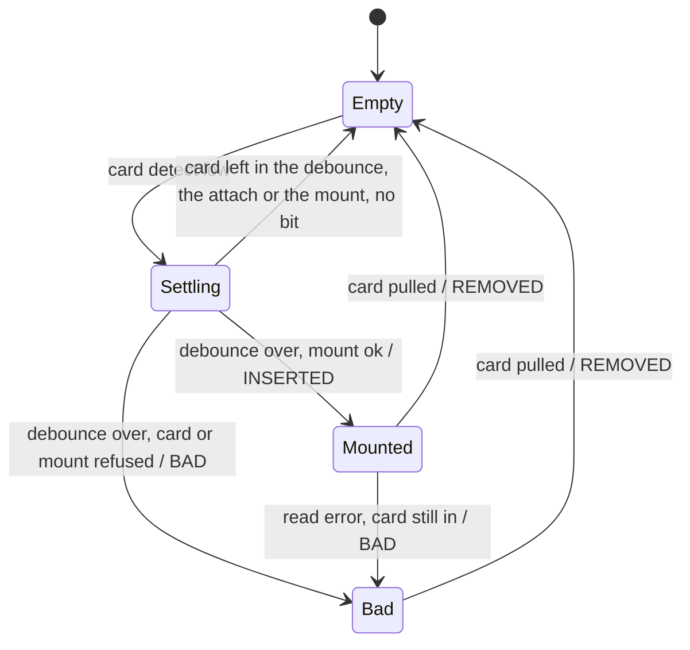

# Pip-OS ABI

This is the contract between Pip-OS and the code it runs: the Deitrix ROM and holotapes. The ABI version is 1.4, `abi_version = 0x00010004` in the image header.

Version rule: a new call or a new button number raises the minor version, because an image may rely on it. A change to a stable row raises the major version. The loader checks only the major, so an image built for 1.4 also runs on a 1.0 to 1.3 Pip-OS. There, a call added in 1.1 returns `-PIP_ENOSYS` on 1.0. An image built for 1.2 never receives button 6 on a 1.0 or 1.1 Pip-OS, and bit 6 of `read_buttons` stays 0. An image reads the version it runs on in `pipos_startup_t.abi_version`. Version 1.1 adds `sample_queue`. Version 1.2 adds button 6, Back. Version 1.3 adds `hw_flags` to `sys_info`. A Pip-OS before 1.3 writes 0 there, so an image that reads `hw_flags` first checks that `abi_version` in `sys_info` or in `pipos_startup_t` is at least `0x00010003`. Version 1.4 adds removable holotapes: `PIP_HW_TAPE`, the `flags` field of `pip_holo_info_t`, the `PIP_EV_TAPE` event and the `holo_eject_event` mask. See [Holotapes](#holotapes).

An image ignores an event type and a flag bit it does not know. A field the spec marks as reserved may carry a value in a later minor version.

Rows marked "draft" in a status column may change before 1.0 is frozen. Rows marked "stable" will not change within major version 1.

## Entry state

Pip-OS loads the image as described in [BOOT_PROTOCOL.md](./BOOT_PROTOCOL.md) and enters it at `load_addr`.

| Item | ROM | Holotape |
|---|---|---|
| Entry address | `0x00400000` | `0x00800000` |
| Mode | USR | USR |
| IRQ | Enabled | Enabled |
| FIQ | Masked | Masked |
| sp | `0x01800000` | `0x02000000` |
| r0 | Pointer to `pipos_startup_t` | Pointer to `pipos_startup_t` |
| r1 to r3 | 0 | 0 |
| lr | Exit trampoline | Exit trampoline |

Returning from the entry function goes to the exit trampoline. It acts like `exit(r0)`.

The image's `crt0.S` zeroes BSS, then calls `pip_main(const pipos_startup_t *)`.

```c
#include <stdint.h>

typedef struct __attribute__((packed)) pipos_startup {
    uint32_t abi_version;
    uint32_t size;
    uint32_t heap_base;
    uint32_t heap_size;
    uint32_t stack_top;
    uint32_t kind;
    uint32_t flags;
    char     args[100];
} pipos_startup_t;

_Static_assert(sizeof(pipos_startup_t) == 128, "pipos_startup_t must be 128 bytes");
```

| Offset | Size | Field | Meaning | Status |
|---|---|---|---|---|
| `0x00` | 4 | `abi_version` | ABI Pip-OS implements, `(major << 16) \| minor` | stable |
| `0x04` | 4 | `size` | `128` | stable |
| `0x08` | 4 | `heap_base` | ROM `0x01000000`, holotape `0x01800000` | stable |
| `0x0C` | 4 | `heap_size` | `0x007F0000`, the region minus the 64 KiB stack | stable |
| `0x10` | 4 | `stack_top` | Same value as sp at entry | stable |
| `0x14` | 4 | `kind` | 0 ROM, 1 holotape | stable |
| `0x18` | 4 | `flags` | Reserved, 0 | draft |
| `0x1C` | 100 | `args` | NUL-terminated argument string from the launcher | draft |
| | 128 | | Total | |

Pip-OS writes the struct and the exit trampoline at the bottom of the image's stack area, at `stack_top - 0x10000`. Both sit in the image's own memory, so the image can overwrite them. Pip-OS never reads them back. An image that overwrites the trampoline must end with `exit`.

## Syscall convention

| Item | Rule |
|---|---|
| Instruction | `svc #0` |
| Number | r7 |
| Arguments | r0 to r3. Calls with more arguments take a pointer to a struct. |
| Return | r0. `>= 0` is success. A negative value is `-PIP_E*`. |
| Unknown number | Returns `-PIP_ENOSYS` |
| Preserved | r4 to r11, sp, lr |
| Clobbered | r0 to r3, r12, flags |
| Pointers | Pip-OS checks every pointer and length. The whole range must lie in the caller's image or heap region. Otherwise it returns `-PIP_EFAULT`. A holotape's input pointers may also point into the ROM slot, which it can read. |

`libpip.a` wraps each call as a C function with the name `pip_<name>`.

## Error codes

```c
#define PIP_EPERM      1   /* not allowed for this caller */
#define PIP_ENOENT     2   /* file, save or holotape not found */
#define PIP_EIO        5   /* SD card or device error */
#define PIP_EBADF      9   /* bad file handle */
#define PIP_ENOMEM    12   /* out of memory or handles */
#define PIP_EFAULT    14   /* bad pointer or range */
#define PIP_EBUSY     16   /* resource in use */
#define PIP_EEXIST    17   /* already exists */
#define PIP_EINVAL    22   /* bad argument */
#define PIP_ENOSPC    28   /* card full */
#define PIP_ERANGE    34   /* value out of range */
#define PIP_ENOSYS    38   /* unknown syscall */
#define PIP_ENOEXEC   40   /* holotape failed validation */
#define PIP_ENODEV    41   /* hardware not present or removed */
#define PIP_ETIMEDOUT 42   /* wait timed out */
```

## Syscall table

Numbers 0x01 to 0x04, 0x10, 0x11, 0x20, 0x21, 0x30, 0x40, 0x41, 0x50 and 0x51 keep the values Pip-OS already uses. Colours are `0x00RRGGBB`. Coordinates are in the logical 320x240 surface.

| Number | Name | Arguments | Return | Status |
|---|---|---|---|---|
| `0x01` | `draw_line` | `int32 x0, int32 y0, int32 x1, int32 y1` | 0 | stable |
| `0x02` | `draw_point` | `int32 x, int32 y, uint32 color` | 0 | stable |
| `0x03` | `draw_text` | `int32 x, int32 y, const char *text, uint32 scale` | Width drawn in pixels | stable |
| `0x04` | `clear` | `uint32 color` | 0 | stable |
| `0x05` | `gfx_info` | `pip_gfx_info_t *out` | 0 | draft |
| `0x06` | `rect` | `int32 x, int32 y, uint32 wh, uint32 fill`. `wh` is `(w << 16) \| h`. | 0 | draft |
| `0x07` | `polyline` | `const int16 *xy, uint32 count, uint32 closed` | 0 | draft |
| `0x08` | `arc` | `const pip_arc_t *a`: center, radius, start and end angle in degrees, fill | 0 | draft |
| `0x09` | `blit_1bpp` | `const pip_blit_t *b`: x, y, w, h, stride, data, color | 0 | draft |
| `0x0A` | `blit_rgb` | `const pip_blit_t *b`: x, y, w, h, stride, data as `0x00RRGGBB` | 0 | draft |
| `0x0B` | `set_clip` | `int32 x, int32 y, uint32 wh`. `wh = 0` clears the clip. | 0 | draft |
| `0x0C` | `set_color` | `uint32 fg, uint32 bg` | 0 | draft |
| `0x0D` | `text_metrics` | `const char *text, uint32 scale` | `(width << 16) \| height` | draft |
| `0x0E` | `present` | none | 0, or `-PIP_ENODEV`. Copies the back buffer to the display. | draft |
| `0x0F` | `set_font` | `uint32 font_id` | 0, or `-PIP_EINVAL` | draft |
| `0x10` | `read_buttons` | none | Bit mask of pressed buttons | stable |
| `0x11` | `read_dial` | none | Dial position, 0 to 359 | stable |
| `0x12` | `poll_event` | `pip_event_t *out` | 1 if an event was read, 0 if none | draft |
| `0x13` | `wait_event` | `pip_event_t *out, uint32 timeout_ms` | 1, or `-PIP_ETIMEDOUT` | draft |
| `0x20` | `tone` | `uint32 freq_hz, uint32 duration_ms` | 0 | stable |
| `0x21` | `sample` | `const uint8 *data, uint32 length` | 0. 8-bit unsigned, 8000 Hz. | stable |
| `0x22` | `audio_stop` | none | 0 | draft |
| `0x23` | `volume` | `uint32 level`, 0 to 100 | Previous level | draft |
| `0x24` | `audio_status` | none | 1 if playing, 0 if idle | draft |
| `0x25` | `play_seq` | `const pip_note_t *notes, uint32 count` | 0 | draft |
| `0x26` | `sample_queue` | `const uint8 *data, uint32 length` | 0, or an error | draft |
| `0x30` | `read_sensor` | `uint32 sensor, uint32 *value` | 0, or `-PIP_ENODEV` | stable |
| `0x31` | `sensor_available` | `uint32 sensor` | 1 or 0 | stable |
| `0x40` | `get_time` | `uint32 *unix_seconds` | 0, or `-PIP_ENODEV` when no clock is set | stable |
| `0x41` | `get_battery` | none | Percent, 0 to 100, or `-PIP_ENODEV` | stable |
| `0x42` | `ticks_ms` | none | Milliseconds since boot, wraps at 2^31, about 24.9 days. Measure the time from `a` to `b` as `(b - a) & 0x7FFFFFFF`. Plain unsigned subtraction is wrong across the wrap. | draft |
| `0x43` | `sleep_ms` | `uint32 ms` | 0, or `-PIP_ERANGE` above `0x7FFFFFFF` | draft |
| `0x44` | `exit` | `int32 status` | Does not return. The exit status is the low 8 bits. | draft |
| `0x45` | `sys_info` | `pip_sys_info_t *out`: board, ABI, Pip-OS version, hardware flags | 0 | draft |
| `0x46` | `mem_info` | `pip_mem_info_t *out`: heap base, size | 0 | draft |
| `0x47` | `power` | `uint32 op`: 0 reboot, 1 halt, 2 screen off, 3 screen on | 0, does not return, or `-PIP_EINVAL` | draft |
| `0x48` | `log` | `const char *text` | 0. Prints on the PL011. | draft |
| `0x49` | `rand` | none | Random value, 0 to 2^31 - 1, or `-PIP_EIO` | draft |
| `0x4A` | `set_time` | `uint32 unix_seconds` | 0, or `-PIP_EIO` if the clock chip write fails. ROM only. | draft |
| `0x50` | `read_save` | `const char *name, void *buf, uint32 size` | Bytes read | stable number, draft arguments |
| `0x51` | `write_save` | `const char *name, const void *buf, uint32 size` | Bytes written | stable number, draft arguments |
| `0x52` | `save_info` | `const char *name, uint32 *size` | 0 | draft |
| `0x53` | `save_delete` | `const char *name` | 0 | draft |
| `0x54` | `file_open` | `const char *path` | Handle `>= 0`. Read only. | draft |
| `0x55` | `file_read` | `int32 handle, void *buf, uint32 size` | Bytes read, 0 at end | draft |
| `0x56` | `file_close` | `int32 handle` | 0 | draft |
| `0x57` | `dir_list` | `const char *path, pip_dirent_t *out, uint32 max, uint32 start` | Entries written | draft |
| `0x60` | `holo_enumerate` | `pip_holo_info_t *out, uint32 max` | Entries written | draft |
| `0x61` | `holo_launch` | `const char *name, const char *args` | Holotape exit status, 0 to 255. `-PIP_ENODEV` when the slot card was pulled while the tape ran. ROM only. | draft |
| `0x62` | `holo_last_status` | none | Result of the last `holo_launch`, or `-PIP_ENOENT` | draft |
| `0x63` | `holo_eject_event` | none | Mask of `PIP_HOLO_EV_*` bits since the caller's last call, 0 for nothing. Clears the mask. 1 meant insert or remove before 1.4, and Pip-OS always returned 0. | draft |

The existing Pip-OS calls `read_save` and `write_save` took a byte offset. They now take a save name, so their argument lists are draft.

Buttons for `read_buttons`: bit 0 up, 1 down, 2 left, 3 right, 4 select, 5 dial press, 6 back. Button 6 was added in ABI 1.2. Sensors for `read_sensor`: 0 RTC, 1 battery, 2 geiger, 3 GPS, 4 accelerometer, 5 temperature, 6 heart rate. These values come from Pip-OS and are stable.

Holotapes cannot call `holo_launch`, `power` or `set_time`. They get `-PIP_EPERM`.

A call that this version of Pip-OS does not implement returns `-PIP_ENOSYS`, like an unknown number.

## Display

Every image draws on a logical surface of 320x240 pixels. `gfx_info` reports it.

```c
typedef struct __attribute__((packed)) pip_gfx_info {
    uint16_t width;    /* 320 */
    uint16_t height;   /* 240 */
    uint32_t format;   /* 0: 0x00RRGGBB */
    uint32_t backend;  /* 0 HDMI framebuffer, 1 SPI TFT */
    uint32_t fg_default; /* colour of the configured screen scheme */
} pip_gfx_info_t;     /* 16 bytes */
```

| Offset | Size | Field |
|---|---|---|
| `0x00` | 2 | `width` |
| `0x02` | 2 | `height` |
| `0x04` | 4 | `format` |
| `0x08` | 4 | `backend` |
| `0x0C` | 4 | `fg_default` |

Drawing goes to a back buffer. `present` shows it. On HDMI, Pip-OS scales the surface by the largest whole factor that fits the framebuffer and centres it. The border around it is black. On the default 640x480 mode the factor is 2. On the SPI TFT it copies 1:1. The surface is the same on both backends, so one set of golden images covers both.

### Drawing state

Each image has its own drawing state. Pip-OS resets it when the image starts.

| State | Set by | Start value |
|---|---|---|
| Foreground colour | `set_color` | `fg_default` from `gfx_info` |
| Background colour | `set_color` | `PIP_COLOR_NONE` |
| Clip rectangle | `set_clip` | The whole surface |
| Font | `set_font` | 0 |

`PIP_COLOR_NONE` is `0x01000000`. As a background it means transparent. Pip-OS ignores the top byte of every other colour argument.

Every call clips to the clip rectangle and to the surface. Coordinates outside are legal and draw nothing. When the ROM starts, the back buffer is cleared to black. The boot screen stays until the ROM's first `present`.

### Drawing calls

| Call | Rules |
|---|---|
| `draw_line` | Foreground colour. Bresenham: along the longer axis each step moves one pixel. The other axis moves `round(i * minor / major)` at step `i`, with halves rounded away from the start point. Both end points are drawn. A line from a point to itself draws that point. |
| `draw_point` | Uses the colour argument, not the foreground colour. |
| `draw_text` | Glyphs in the foreground colour. If the background is not `PIP_COLOR_NONE`, each glyph cell is filled with it first. `x, y` is the top left corner. `scale` is 1 to 8, and each font pixel becomes a `scale` by `scale` block. The text is at most 255 bytes. Bytes outside 0x20 to 0x7E draw as `?`. Returns the width in pixels, 8 times `scale` per byte. Checks `scale` before the text pointer. |
| `text_metrics` | Same limits and check order as `draw_text`. Draws nothing. |
| `clear` | Fills the whole surface with the colour argument. Ignores the clip rectangle. |
| `rect` | `fill` 0 draws the outline, 1 fills. Foreground colour. The outline is the first and last row and column, so a rectangle 1 or 2 pixels wide or high is filled. A zero width or height draws nothing. |
| `polyline` | `xy` holds `count` pairs of `int16 x, y`. `count` is 2 to 256. `closed` 0 leaves it open, 1 joins the last point to the first. Foreground colour. Checks the limits, then copies the points in. |
| `arc` | See `pip_arc_t`. Foreground colour. Copies the struct in, then checks the limits. |
| `blit_1bpp` | See `pip_blit_t`. Rows are packed most significant bit first. Set bits draw in `color`. Clear bits draw nothing. |
| `blit_rgb` | See `pip_blit_t`. Each pixel is a `uint32` `0x00RRGGBB`. `color` is ignored. |
| `set_clip` | `wh = 0` resets the clip to the whole surface. A non-zero `wh` with a zero width or height returns `-PIP_EINVAL`. The rectangle is cut to the surface. A rectangle entirely outside leaves an empty clip, and nothing draws until the next `set_clip`. |
| `set_font` | Font 0 is the 8x16 system font. ABI 1.0 has no other font, so any other value returns `-PIP_EINVAL`. |
| `present` | Copies the back buffer to the display. The back buffer keeps its content. Returns `-PIP_ENODEV` with no framebuffer or one smaller than 320x240. |

A bad limit, such as `scale` 9, `count` 1 or a `fill`, `closed` or blit `flags` value out of range, returns `-PIP_EINVAL`.

```c
typedef struct __attribute__((packed)) pip_arc {
    int16_t  cx, cy;      /* center */
    uint16_t radius;      /* 1 to 512 */
    uint16_t start_deg;   /* 0 to 359 */
    uint16_t end_deg;     /* 0 to 360 */
    uint16_t fill;        /* 0 outline, 1 filled slice */
} pip_arc_t;              /* 12 bytes */

typedef struct __attribute__((packed)) pip_blit {
    int16_t  x, y;        /* top left corner on the surface */
    uint16_t w, h;        /* 1 to 320, 1 to 240 */
    uint16_t stride;      /* bytes from one row to the next */
    uint16_t flags;       /* 0 */
    uint32_t data;        /* pointer to the first row */
    uint32_t color;       /* blit_1bpp only */
} pip_blit_t;             /* 20 bytes */
```

Angles are in degrees, clockwise on the screen, from the positive x axis. So 90 points down. The arc runs clockwise from `start_deg` to `end_deg`. If `end_deg` is not above `start_deg`, it passes through 0. `start_deg` 0 with `end_deg` 360 is a full circle.

The disk of an arc is every pixel with `dx^2 + dy^2 <= r^2 + r`. The outline is the disk pixels with at least one of their four neighbours outside the disk. A pixel is drawn when its angle lies between the start and end rays, both rays included. The rays come from a table of `round(65536 * sin(d))` for whole degrees, and the test uses exact integer cross products. A filled slice includes the centre.

A row of `blit_1bpp` is `(w + 7) / 8` bytes. A row of `blit_rgb` is `4 * w` bytes. `stride` must be at least one row. A blit copies its struct in and checks it. Then Pip-OS checks the range from `data` to the end of the last row, `stride * (h - 1)` plus one row. A bad range returns `-PIP_EFAULT` and draws nothing.

## Input

`read_buttons` returns the buttons that are down now, as a mask of bits 0 to 6. The buttons are up, down, left, right, select, dial press and back. Back sends press, release and repeat events like the others. It stays right after a queue overflow.

`read_dial` returns the dial position in degrees, 0 to 359. One detent of the dial is 15 degrees. The position comes from a running total of detents since boot, so it does not depend on the event queue. It counts turns whose events were dropped and turns made while no image runs. An image start or end does not reset it.

Events come from a queue of 32. When the queue is full, the oldest event is dropped. The queue is emptied when an image starts and when it ends. Every input call takes new input first, so an image that only polls still sees events. `poll_event` checks its `out` pointer before it looks at the queue, so a bad pointer returns `-PIP_EFAULT` even when no event waits.

```c
typedef struct __attribute__((packed)) pip_event {
    uint32_t type;      /* PIP_EV_* */
    uint32_t code;
    int32_t  value;
    uint32_t time_ms;   /* ticks_ms when Pip-OS registered the event */
} pip_event_t;          /* 16 bytes */
```

| `type` | Name | `code` | `value` |
|---|---|---|---|
| 1 | `PIP_EV_BUTTON` | Button number 0 to 6, the bit position from `read_buttons` | 1 press, 0 release, 2 repeat while held |
| 2 | `PIP_EV_DIAL` | 0 | Signed detents. Positive is clockwise. |
| 3 | `PIP_EV_TAPE` | 0 | `PIP_HOLO_EV_*` bits for one change of the holotape slot, a read error on a mounted card included. Since ABI 1.4. See [Holotapes](#holotapes). |

```c
#define PIP_EV_BUTTON  1
#define PIP_EV_DIAL    2
#define PIP_EV_TAPE    3   /* holotape slot change, since ABI 1.4 */
```

An image ignores an event whose `type` it does not know.

`time_ms` is the `ticks_ms` time when Pip-OS registered the event. GPIO buttons and the dial are sampled every 10 ms, so their stamp comes within about 10 ms of the change, after the 20 ms button debounce. Input from the serial console or the script channel is stamped when Pip-OS reads it, which can be later than the key press. It is never later than the `ticks_ms` value an image reads after it gets the event. Stamps follow `ticks_ms`, so they wrap when it wraps. Between wraps, stamps of successive events never go backwards. Compare stamps the way the `ticks_ms` row of the syscall table says to compare `ticks_ms` values.

A held button repeats. The first event with `value` 2 comes 500 ms after the press, then one every 100 ms until the release. Only the last button pressed repeats. Repeats follow a fixed schedule from the press. After a stall the schedule restarts from the current time instead of sending a burst. Repeat events count toward the 32.

`wait_event` blocks until an event arrives or `timeout_ms` passes. A timeout of 0 does not block. `0xFFFFFFFF` waits forever. Any other value above `0x7FFFFFFF` returns `-PIP_ERANGE`. It checks `timeout_ms`, then `out`, before it waits. It returns `-PIP_ETIMEDOUT` only when the queue is empty at the deadline, and then writes nothing. An event that arrives just after the deadline is returned.

## Audio

There is one voice. `tone`, `sample` and `play_seq` return at once and the sound plays in the background. A new sound replaces the one that is playing.

| Call | Rules |
|---|---|
| `tone` | `freq_hz` 20 to 20000. `duration_ms` 1 to 60000. |
| `sample` | 8-bit unsigned mono at 8000 Hz. 128 is silence. 1 to 65536 bytes, so length 0 returns `-PIP_EINVAL`. Pip-OS checks the length before the pointer. It copies the data before it returns. |
| `play_seq` | `count` is 1 to 256. Pip-OS checks every note before anything plays. One bad note refuses the whole sequence. It copies the notes before it returns. |
| `volume` | 0 to 100. Returns the previous level. The start value comes from `PIPOS.CFG`, 100 without one. A new level applies to a playing `sample` at once, and to a tone or sequence from its next note. At 0 sounds still play silently and `audio_status` reports them. |
| `audio_status` | 1 while a sound the image started plays, or a queued sample waits. The power-on beep does not count. |
| `sample_queue` | Same format, limits, check order and error codes as `sample` for the length and the pointer. Pip-OS copies the data before it returns. If a `sample` or a queued sample plays, the data plays right after it with no gap. One sample can wait: when one already waits, the call returns `-PIP_EBUSY` and changes nothing. If no sample plays, `sample_queue` acts exactly like `sample`: it starts the data now and replaces a tone or a sequence. Added in ABI 1.1. |
| `audio_stop` | Stops the sound and drops a waiting sample. Returns 0 also when nothing plays. |

A value outside these limits returns `-PIP_EINVAL`. `tone`, `sample`, `sample_queue` and `play_seq` return `-PIP_EIO` when the audio driver refuses the sound. A call refused for its arguments plays nothing and leaves the current sound playing.

When several errors apply, a call returns the first one in this order:

1. A number out of its limits: `-PIP_EINVAL`. These are the frequency and duration of `tone`, the length of `sample` and `sample_queue`, the count of `play_seq` and the level of `volume`.
2. A bad pointer: `-PIP_EFAULT`.
3. A bad note in `play_seq`: `-PIP_EINVAL`.
4. A sample already waiting, for `sample_queue`: `-PIP_EBUSY`.
5. The audio driver refuses the sound: `-PIP_EIO`.

So `sample_queue` with a bad length or pointer returns that error even when a sample already waits.

A refused call changes nothing. It stops no sound, so the audio trace prints no `op=stop` line for it. `audio_stop` with nothing playing returns 0 and prints no line either. A call that replaces a playing sound prints `op=stop` once, then its start line, as the stop rule in the [audio guide](../guide/api/audio.md) states.

The volume belongs to the device, not to the image. A level set by a ROM or a holotape stays after it ends, until the next power-on. Pip-OS stops the sound an image started, and a waiting sample, when the image starts and when it ends.

`tone`, `sample`, `play_seq` and `audio_stop` drop the waiting sample as well as the playing one.

Streaming: a ROM calls `sample_queue` in its loop with the next chunk until it returns 0, then prepares the following chunk. A chunk of 65536 bytes lasts 8.192 s. If the ROM is late and the sound ends, the next call starts it again, with a gap.

```c
typedef struct __attribute__((packed)) pip_note {
    uint16_t freq_hz;      /* 20 to 20000, or 0 for a rest */
    uint16_t duration_ms;  /* 1 to 60000 */
} pip_note_t;              /* 4 bytes */
```

## Time, sensors and power

Pip-OS keeps a software clock in Unix seconds. At boot it reads a real-time clock chip if one answers. `set_time` sets the software clock. When a real-time clock chip answered at boot and the time is inside the chip's range, Pip-OS also writes the time to the chip, so it survives power-off. If the chip write fails, `set_time` returns `-PIP_EIO`. The software clock keeps the new value. With no chip, `set_time` returns 0 and the time is lost at power-off. The chips hold years 2000 to 2099, Unix seconds 946684800 to 4102444799. For a time outside that range, the software clock takes it, the chip is not written, `set_time` returns 0, and the time is lost at power-off. With no chip and no `set_time`, the clock is not set and `get_time` returns `-PIP_ENODEV` and writes nothing.

The clock counts on the 1 MHz system timer, so periods with interrupts off do not slow it. It only goes back through `set_time`. `set_time` accepts any value. The clock stops at `0xFFFFFFFF` instead of wrapping.

`read_sensor` with sensor 0 returns the same value and result as `get_time`. No other sensor exists on the current hardware, so sensors 1 to 6 return `-PIP_ENODEV`, and so does `get_battery`. `sensor_available` returns 1 only when `read_sensor` would succeed. A `sensor` above 6 returns `-PIP_EINVAL` from both calls. `read_sensor` and `get_time` check the pointer first, so a bad pointer returns `-PIP_EFAULT` even for a missing sensor.

| `power` `op` | Effect |
|---|---|
| 0 | Resets the board. The ROM loads again. |
| 1 | Stops the sound, shows a halt line on the console, then halts with interrupts masked. Only a power cycle wakes it. |
| 2 | Turns the screen black. Drawing and `present` keep working on the back buffer. |
| 3 | Turns the screen back on. It shows the back buffer as it is now, or the console when the image has not called `present` yet. |

Any other `op` returns `-PIP_EINVAL`.

## System information

```c
typedef struct __attribute__((packed)) pip_sys_info {
    uint32_t size;           /* 32 */
    uint32_t abi_version;    /* (major << 16) | minor */
    uint32_t pipos_version;  /* (major << 16) | (minor << 8) | patch */
    uint32_t board_rev;      /* firmware board revision code */
    uint32_t soc;            /* value from BOARD_SUPPORT.md */
    uint32_t mem_size;       /* RAM in bytes */
    uint32_t hw_flags;       /* PIP_HW_*, since ABI 1.3. 0 before. */
    uint32_t reserved;       /* 0 */
} pip_sys_info_t;            /* 32 bytes */

#define PIP_HW_RTC    (1u << 0)  /* a clock chip answered at boot */
#define PIP_HW_AUDIO  (1u << 2)  /* the audio driver started */
#define PIP_HW_TAPE   (1u << 3)  /* a holotape slot exists, since ABI 1.4 */

typedef struct __attribute__((packed)) pip_mem_info {
    uint32_t heap_base;
    uint32_t heap_size;
    uint32_t stack_top;
    uint32_t stack_size;     /* 0x00010000 */
} pip_mem_info_t;            /* 16 bytes */
```

| Offset | Size | Field | Meaning |
|---|---|---|---|
| `0x00` | 4 | `size` | `32` |
| `0x04` | 4 | `abi_version` | ABI Pip-OS implements, as in `pipos_startup_t` |
| `0x08` | 4 | `pipos_version` | `(major << 16) \| (minor << 8) \| patch` |
| `0x0C` | 4 | `board_rev` | Firmware board revision code |
| `0x10` | 4 | `soc` | SoC value from [BOARD_SUPPORT.md](./BOARD_SUPPORT.md) |
| `0x14` | 4 | `mem_size` | RAM in bytes |
| `0x18` | 4 | `hw_flags` | Hardware flags, added in ABI 1.3. See below. |
| `0x1C` | 4 | `reserved` | 0 |
| | 32 | | Total |

| `hw_flags` bit | Name | Set when |
|---|---|---|
| 0 | `PIP_HW_RTC` | A real-time clock chip answered at boot. It says nothing about a later write. See below. |
| 1 | | Reserved, 0. `gfx_info` already reports the display backend. |
| 2 | `PIP_HW_AUDIO` | The audio driver started at boot, so the sound calls can play |
| 3 | `PIP_HW_TAPE` | `PIPOS.CFG` sets `[holotape] slot = on` and the slot driver started at boot. It says a slot exists, not that a card is in. Since ABI 1.4. |
| 4 to 31 | | Reserved, 0 |

What a ROM can tell its user: a set time lasts past power-off only when `PIP_HW_RTC` is set, the time lies in 946684800 to 4102444799, and `set_time` returns 0. With the bit set and a time outside that range, the time lasts until power-off. With `-PIP_EIO` the chip write failed and the time lasts until power-off. With the bit clear the time is always lost at power-off.

The struct keeps its size of 32 bytes. `hw_flags` takes the place of the first reserved word, which every Pip-OS before 1.3 writes as 0. So a ROM cannot tell "no clock chip" from "an older Pip-OS" by `hw_flags` alone: it checks `abi_version` first. A ROM built for 1.3 that runs on an older Pip-OS treats the flags as unknown. A ROM ignores a `hw_flags` bit it does not know.

`log` takes at most 255 bytes of text. With no NUL in the first 256 bytes it returns `-PIP_EINVAL`. Bytes other than printable ASCII, newline and tab print as `?`.

`sleep_ms` sleeps at least `ms` milliseconds.

`rand` returns `-PIP_EIO` when the hardware generator fails.

## Save files

- Path: `/PIPBOY/SAVE/<NAME>.SAV`. `NAME` is 1 to 8 characters from `A-Z`, `0-9` and `_`, and ends with a NUL within 9 bytes. Pip-OS upper-cases it. Anything else returns `-PIP_EINVAL`.
- A save is at most 64 KiB. A file on the card larger than that is not a valid save: `read_save` and `save_info` return `-PIP_ERANGE` and write nothing. `save_delete` removes it and `write_save` replaces it.
- `write_save` takes 0 to 65536 bytes and returns `size`. It replaces the file with RobCo-Core's atomic write. A power cut leaves the old save or the new one. A larger `size` returns `-PIP_ERANGE`. It creates `/PIPBOY/SAVE` when the folder is missing.
- The atomic write keeps work files named `~<NAME>.SAV` and `#<NAME>.SAV` in the folder. `read_save`, `save_info` and `save_delete` recover from them first. The [storage guide](../guide/api/storage.md#whole-files) describes the steps.
- `read_save` checks the whole `size` bytes of `buf`, then copies at most `size` bytes and returns the count. A missing save returns `-PIP_ENOENT`. `size` 0 needs no buffer.
- `save_info` stores the save's size. `save_delete` removes the save and both work files.
- ROMs and holotapes share the save folder. A holotape should use its own name prefix.

On a read-only card, `read_save` and `save_info` read the file the recovery steps choose and change nothing. `save_delete` and `write_save` return `-PIP_EIO` and change nothing.

## Files

File calls are read only. They reach the boot card only, never the holotape slot.

- A path is absolute, uses `/`, and is at most 127 bytes before the NUL. Pip-OS upper-cases the path.
- Each component is an 8.3 name: 1 to 8 characters, then an optional dot and 1 to 3 characters. The characters are `A-Z`, `0-9` and ``! # $ % & ' ( ) - @ ^ _ ` { } ~``.
- These return `-PIP_EINVAL`: a relative path, `//`, `.` or `..`, a trailing `/` or dot, a space, `\`, `:`, or any byte outside the set above. Only `dir_list` accepts `/` alone.
- A path in `/PIPBOY/SAVE` returns `-PIP_EPERM`, in any case and also through an 8.3 alias of `PIPBOY` or `SAVE`.
- An image can hold 8 open files. Handles are 0 to 7. `file_open` takes the lowest free handle and returns `-PIP_ENOMEM` when all are in use. A directory returns `-PIP_EINVAL`. Pip-OS closes an image's files when it ends.
- `file_read` checks the whole buffer first. It returns the bytes read, and 0 at the end of the file. `size` 0 returns 0. A refused read does not move the file position.
- `dir_list` checks the whole `out` range for `max` entries first. It writes at most `max` entries in directory order, starting at entry number `start`, and returns how many it wrote. It returns 0 past the end. `max` is 1 to 64. A file path returns `-PIP_EINVAL`.
- `dir_list` gives the 8.3 name, never the long name. An entry whose long name does not fit 8.3 shows its alias, such as `LONGFO~1`, and the file calls accept that name. Work files and hidden entries are listed too.

A missing card, a failed card or a file system error returns `-PIP_EIO`. A full card returns `-PIP_ENOSPC`. These apply to save and file calls alike.

```c
typedef struct __attribute__((packed)) pip_dirent {
    char     name[13];   /* 8.3 name, NUL terminated */
    uint8_t  flags;      /* bit 0: directory */
    uint16_t reserved;   /* 0 */
    uint32_t size;       /* bytes, 0 for a directory */
} pip_dirent_t;          /* 20 bytes */
```

## Holotapes

A holotape is a file in the `ROBCO78` image format. It lives in one of two places:

- On the boot card, as `/PIPBOY/HOLO/<NAME>.HTP`.
- On the card in the holotape slot, as `<NAME>.HTP` in its root folder. Since ABI 1.4.

### The holotape slot

The Pip-Boy board has one holotape slot: an SD card in SPI mode, driven by RobCo-Core's [`holo.h`](../guide/api/holo.md). `PIPOS.CFG` turns it on with `[holotape] slot = on`. The default is `off`. With `off`, Pip-OS never touches the slot pins and behaves as ABI 1.3 in every call. `PIP_HW_TAPE` in `hw_flags` is set when the setting is `on` and the slot driver started at boot.

The slot card is a FAT volume that the library can mount. Pip-OS mounts it as the library volume `tape` with `FS_MOUNT_RDONLY`, and ignores the lock tab. The driver's device is read-only too. The boot card stays the only writable volume. Pip-OS reads only the `NAME.HTP` files in the root folder of the slot card, under the name rule below. It skips dot names, hidden entries and system entries, as the library listing does.

`file_open`, `dir_list` and the save calls never reach the slot card. A slot tape saves to `/PIPBOY/SAVE` on the boot card, like any holotape. A data holotape on the slot cannot be launched either.

### Listing

`holo_enumerate` lists the slot tapes first, in directory order. Then it reads `/PIPBOY/HOLO` on the boot card in directory order and lists the tapes whose file name is not already listed. So a slot file shadows a boot card tape with the same file name, compared without case. It shadows by name alone: a slot file `NAME.HTP` that fails the header checks hides the boot card tape too, and neither is listed. `holo_launch` of that name returns `-PIP_ENOEXEC`. Pulling the slot card brings the boot card tape back. A listed file is named `NAME.HTP` and its header passes the magic, version and size checks. It does not check the CRC. It writes at most `max` entries, 1 to 32, counting both places together, and returns the count. A missing folder gives 0 entries. Pip-OS checks the whole `max` entries of `out` before it reads a card. A file with a long name is listed under its 8.3 alias. A file too short for a header is skipped.

The slot never makes `holo_enumerate` fail. A slot that is empty, still settling, or holds a card it cannot use adds no entry and no error. A read error on the slot card during the listing drops every slot entry, and the call still lists the boot card, including the tapes those entries shadowed. That error also makes the card bad, as [Slot changes](#slot-changes) says, so later calls list none of its tapes either. A read error on the boot card returns `-PIP_EIO`.

| Holotape call error | Cause |
|---|---|
| `-PIP_EINVAL` | A bad name, `max` outside 1 to 32, or `args` without a NUL in the first 100 bytes |
| `-PIP_EFAULT` | A NULL or bad pointer, or the holotape faulted |
| `-PIP_EIO` | A boot card read error in `holo_enumerate`, or a read error in `holo_launch`. The entries in `out` are then undefined. |
| `-PIP_ENODEV` | `holo_launch` only: the slot card was pulled while its tape ran |
| `-PIP_EPERM` | A holotape calls `holo_launch` |

A name is a plain 8.3 `NAME.HTP`: 1 to 8 characters from the file path set in [Files](#files), then `.HTP`. It is case-insensitive. A folder, `.`, `..`, a wildcard, a space or a longer name is a bad name. Names that start with `#` or `~` are ordinary tapes.

```c
typedef struct __attribute__((packed)) pip_holo_info {
    char     file[13];        /* 8.3 file name, for holo_launch */
    uint8_t  subtype;         /* 0 game, 1 utility, 2 data */
    uint16_t flags;           /* PIP_HOLO_*, since ABI 1.4. 0 before. */
    uint32_t size;            /* file size in bytes */
    uint32_t image_version;
    char     name[16];        /* from the image header */
    char     title[64];       /* from the META block, or empty */
    uint8_t  icon[128];       /* from the META block, or zero */
} pip_holo_info_t;            /* 232 bytes */

#define PIP_HOLO_SLOT  (1u << 0)  /* the tape is on the slot card */
```

`flags` was `reserved` before ABI 1.4 and was always 0. The struct size and every offset stay the same. Bits 1 to 15 are 0.

### Launching

`holo_launch` takes a file name from `holo_enumerate`, without a folder, and an argument string of at most 99 bytes. It looks for the name on the slot card first, then on the boot card. It runs these steps:

1. Load and validate the file, with every step from [IMAGE_FORMAT.md](./IMAGE_FORMAT.md). A failure returns `-PIP_ENOENT` for a missing file, `-PIP_EIO` for a card error and `-PIP_ENOEXEC` for any other failed step. A name that the card resolves to a folder, or to a file listed under another name, counts as missing. A data holotape, subtype 2, fails validation. A slot card pulled before or during the load gives `-PIP_ENOENT` when the file can no longer be found and `-PIP_EIO` when a read failed midway. The call then does not try a boot card tape of the same name. A read error on a slot card that stays in also returns `-PIP_EIO` and makes the card bad. A pull sets `REMOVED`, not `BAD`. While no slot volume is mounted, because the slot is empty, settling or holds a bad card, the name is looked up on the boot card only.
2. Stop the sound, empty the event queue, clear the back buffer, and give the holotape a fresh drawing state.
3. Run the holotape. The ROM waits inside `holo_launch`.
4. When the holotape ends, close its files, stop the sound, empty the event queue and restore the ROM's drawing state.

The image is loaded whole before it runs. Still, when the slot card is pulled while its tape runs, Pip-OS ends the tape no later than the tape's next syscall of any kind after Pip-OS saw the card leave. A tape that makes no syscall runs on. When Pip-OS ends the tape, it prints `ev=holo_kill reason=eject pc=<pc>`, where `pc` is the tape's program counter at the syscall where Pip-OS ended it, in the same format as for a fault. Then `holo_launch` returns `-PIP_ENODEV`. Step 4 runs as for any ended tape. The slot does not affect a tape launched from the boot card. A read error on the slot card does not end a running slot tape either, since its image is in memory. Only a removal ends it.

`holo_launch` returns the holotape's exit status, 0 to 255, `-PIP_EFAULT` when Pip-OS killed it after a fault, or `-PIP_ENODEV` as above. The back buffer holds whatever the holotape drew, so the ROM redraws its screen.

While a holotape runs, every call sees it as the caller: its kind, its memory for pointer checks and its heap in `mem_info`. It has its own 8 file handles. The ROM's handles stay open but do not work for the holotape.

`holo_last_status` returns what the ROM's last `holo_launch` call returned, whatever it was, argument errors included. It returns `-PIP_ENOENT` when the ROM made no call since boot. A holotape's refused `holo_launch` does not change it.

### Slot changes

`holo_eject_event` returns a mask of what happened on the slot since the caller's last call, and clears it. 0 means nothing happened. It has no error code.

```c
#define PIP_HOLO_EV_INSERTED  (1u << 0)  /* a card came in and its volume is mounted */
#define PIP_HOLO_EV_REMOVED   (1u << 1)  /* the card left */
#define PIP_HOLO_EV_BAD       (1u << 2)  /* the card in the slot cannot be used */
```

| Bit | Name | Meaning |
|---|---|---|
| 0 | `PIP_HOLO_EV_INSERTED` | A card was inserted and its volume is mounted. A `holo_enumerate` made after this bit lists its tapes. |
| 1 | `PIP_HOLO_EV_REMOVED` | A card reported by `INSERTED` or `BAD` left |
| 2 | `PIP_HOLO_EV_BAD` | The card in the slot cannot be used. At insertion, `holo_attach()` returned an `SD_ERR_*` code other than `SD_ERR_AGAIN`, or the mount found no FAT volume. Later, a read error hit the mounted card while it stayed in. None of its tapes is listed, and Pip-OS does not try the card again until it leaves. |
| 3 to 31 | | 0 |

- A card that is in at boot reports `INSERTED` or `BAD` once, after boot.
- A card that leaves before Pip-OS reported `INSERTED` or `BAD` for it sets no bit, at whatever step it leaves: the debounce, `holo_attach()` returning `BLK_ERR_NOMEDIA`, or the mount. `REMOVED` is set only for a card that was reported.
- A read error on a mounted slot card that stays in sets `BAD`. The call that met the error still returns its own result: `-PIP_EIO` from `holo_launch`, or a list without slot entries from `holo_enumerate`.
- A mounted card pulled during a call, such as a load in `holo_launch` or a listing, sets `REMOVED` only, never `BAD`. Pip-OS tells the two cases apart with the slot's card detect. The call still returns its own result.
- Several changes between two calls set several bits, and their order is lost. A ROM that sees `REMOVED` with `INSERTED` enumerates again.
- A holotape that calls it gets 0, and the mask is not cleared: the bits wait for the ROM.
- With `PIP_HW_TAPE` clear it returns 0.

Each change also puts a `PIP_EV_TAPE` event in the ROM's event queue, so `wait_event` wakes. Its `value` holds the bits for that one change. The queue is emptied around `holo_launch` and can drop events, so the event is a hint and `holo_eject_event` is the truth. A running holotape never gets `PIP_EV_TAPE`.

A change is reported after the driver's 250 ms card detect debounce, `HOLO_SETTLE_MS`, and, for an insertion, after the mount. While `holo_attach()` returns `SD_ERR_AGAIN`, the card is still settling: Pip-OS tries again and sets no bit.

On a removal, Pip-OS detaches the `tape` volume with the library's `fs_eject()`. It needs no card and does no I/O, so the volume slot is free and the next card mounts. After a read error on a mounted slot card that stays in, the driver detaches the card, and Pip-OS detaches the `tape` volume the same way and reports `BAD`. The card stays bad until it leaves. See [Several volumes and removable media](../guide/api/storage.md#several-volumes-and-removable-media). Pip-OS does its slot work at least inside these calls: `sleep_ms`, `poll_event`, `wait_event`, `read_buttons`, `read_dial`, `file_read`, `holo_enumerate` and `holo_eject_event`. A ROM that makes none of them sees no slot change.



### What a ROM does

1. At start, read `hw_flags`. With `PIP_HW_TAPE` clear, the list of tapes changes only when the ROM changes the boot card itself.
2. Call `holo_enumerate` and show the list. `PIP_HOLO_SLOT` tells which tapes sit on the slot.
3. On each `PIP_EV_TAPE`, and after each `holo_launch` returns, call `holo_eject_event`.
4. When it returns a non-zero mask, call `holo_enumerate` again. A ROM may show a message on `BAD` and drop it on `REMOVED`.

The loop also covers a read error. A `holo_launch` that returns `-PIP_EIO` for a slot tape is followed by `holo_eject_event`, which returns `BAD`, and the ROM enumerates again without the slot tapes.

### Compatibility

- A ROM built for 1.3 runs unchanged on 1.4. It sees a non-zero value only in the old `reserved` field of `pip_holo_info_t`, and an event type it does not know. It ignores both.
- A ROM built for 1.4 on a 1.3 Pip-OS sees `PIP_HW_TAPE` clear, `flags` 0 in every entry, no `PIP_EV_TAPE`, and `holo_eject_event` returning 0. Every tape is on the boot card.

### Not specified

- No time bound between a card change and its report.
- No file access to the slot card. `file_open` and `dir_list` reach the boot card only.
- One slot. A second slot needs a new ABI version.

## Sandbox

Pip-OS runs every image in USR mode behind an identity map of 1 MiB sections.

| Memory | ROM | Holotape |
|---|---|---|
| Pip-OS kernel, back buffers | No access | No access |
| Peripherals (MMIO) | No access | No access |
| ROM slot | Read and write | Read only |
| ROM heap and stack | Read and write | No access |
| Holotape slot | No access | Read and write |
| Holotape heap and stack | No access | Read and write |

- Pip-OS checks the image's CRC before it runs it.
- An image that faults is ended. A fault is a bad memory access or an undefined instruction.
- When a holotape faults, control returns to the ROM and `holo_launch` returns `-PIP_EFAULT`. Pip-OS shows nothing on screen. The ROM decides what to show.
- When the ROM faults, Pip-OS shows the fault on screen and stops running the ROM.

The sandbox does not protect an image from itself: its code, heap and stack are all writable. It sets no limit on CPU time, so an image that loops forever holds the device.

The map depends on the cache and MMU setup proven by the framebuffer spike. Its behaviour on real BCM2837 hardware is pending hardware validation.

RobCo-Core provides the mechanism for both levels in [`umode.h`](../guide/api/umode.md): `umode_run()` runs a program in USR mode and returns on exit, fault or kill, the `svc #0` entry hands each call to a handler, `umode_range_ok()` checks pointers, and with the MMU on the task's regions are the only user-accessible memory. A watchdog built on `umode_request_kill()` can also limit CPU time. Pip-OS decides how it uses them: the syscall table, the regions per level and the policy are its own. The library's system-call path preserves more than this ABI asks: every register but r0, and the flags.

## SDK

Pip-OS ships an SDK in its `sdk/` folder.

| File | Use |
|---|---|
| `include/pipos/*.h` | Syscall numbers, structs, error codes, `pip_*` wrappers |
| `crt0.S` | Branch stub, `rimg` header, META area, BSS clear, call to `pip_main` |
| `rom.ld` | Links at `0x00400000` |
| `holotape.ld` | Links at `0x00800000` |
| `libpip.a` | Syscall wrappers and a small libc |
| `pipos-app.mk` | Make fragment: flags, link, `rimg.py seal` |

A ROM project, such as Deitrix, adds Pip-OS as its only submodule at `external/pip-os`. It reaches RobCo-Core through Pip-OS's own submodule, so both use the same RobCo-Core commit. Its Makefile looks like this:

```make
PIPOS_SDK := external/pip-os/sdk
IMAGE     := ROM1.ROM
KIND      := rom            # or holotape
NAME      := DEITRIX
SRCS      := src/main.c src/ui.c
include $(PIPOS_SDK)/pipos-app.mk
```

`pipos-app.mk` sets magic and subtype from `KIND`, builds with the RobCo-Core flags, links with `rom.ld` or `holotape.ld`, and calls `tools/rimg.py seal`. ROM and holotape code must not include RobCo-Core driver headers. It talks to hardware only through syscalls.

### Calls newer than the target ABI

A project states the lowest ABI it needs. The SDK headers hide every call newer than that ABI, so a project that uses one fails to compile. This is a rule for the headers in Pip-OS. No header follows it yet.

The target promises one thing: the code calls nothing newer than the target. On a kernel whose ABI minor is at or above the target, no call the headers expose returns `-PIP_ENOSYS` for being unknown. The loader still accepts the image on an older kernel of the same major, as the [version rule](#pip-os-abi) says. There, a call added after that kernel's minor returns `-PIP_ENOSYS`. A program that must run on such a kernel reads `abi_version` in [`pipos_startup_t`](#entry-state) at start and handles `-PIP_ENOSYS`.

| Rule | Detail |
|---|---|
| The macro | `PIPOS_ABI_TARGET`. The build defines it to `(MAJOR << 16) \| MINOR` of the project's ABI, such as `0x00010003` for 1.3. Studio passes it with the `abi_define` field of `flags.json`, as [SDK_PACKAGE.md](./SDK_PACKAGE.md#flagsjson) says. |
| Not defined | The headers define it to the ABI they implement. A build that does not set it sees every call, as today. |
| Larger than the headers' ABI | A compile error that names both versions |
| What is hidden | The `pip_*` wrapper of each call added after the target, and its syscall number. A call added in 1.1 is visible when `PIPOS_ABI_TARGET >= 0x00010001`. |
| What stays visible | Struct layouts, every field included, since a struct is the same size on every kernel of the major. Error codes. |
| A use of a hidden call | Fails at compile time, with an error that names the call and the ABI that added it |
| The image header | The build writes the same value into `abi_version`. The loader checks only its major. |

Constants that come with a newer call, such as `PIP_HW_TAPE`, `PIP_EV_TAPE` and the `PIP_HOLO_EV_*` bits of 1.4, are not settled. They may stay visible, because an image ignores bits and events it does not know, or be hidden with their call.

## Changes

| Version | Change |
|---|---|
| 1.1 | `sample_queue` |
| 1.2 | Button 6, Back |
| 1.3 | `hw_flags` in `sys_info`. Pip-OS implements it in its own repository later. Until then it reports ABI 1.2 and writes 0. |
| 1.4 | Removable holotapes: `[holotape] slot` in `PIPOS.CFG`, `PIP_HW_TAPE`, `flags` in `pip_holo_info_t`, `PIP_EV_TAPE`, the `holo_eject_event` mask, `-PIP_ENODEV` from `holo_launch`. Pip-OS implements it in its own repository later. Until then it reports ABI 1.3, returns 0 from `holo_eject_event` and never sets the new bits. |
