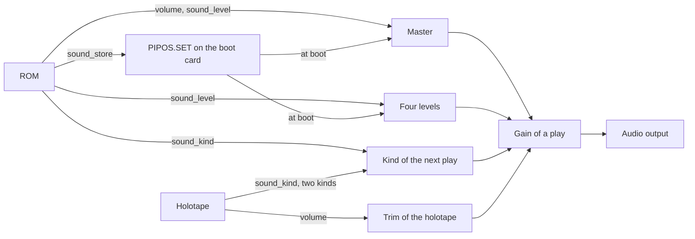
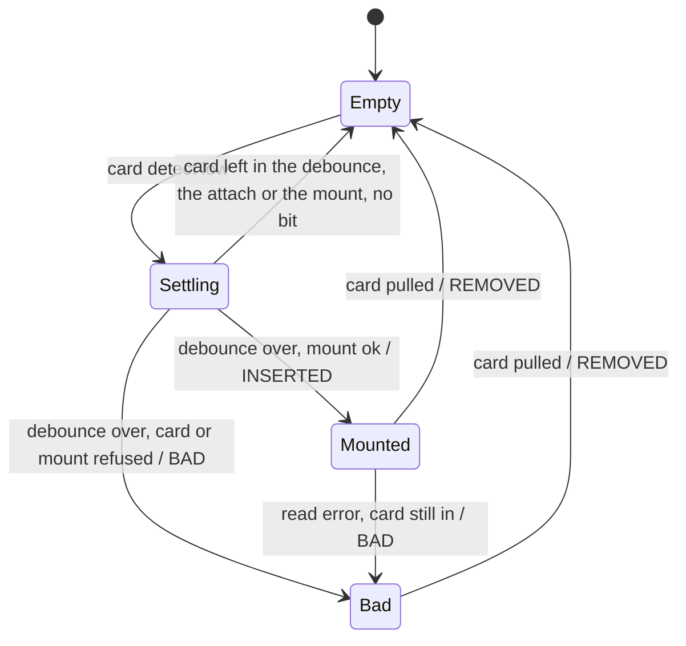

# Pip-OS ABI

This is the contract between Pip-OS and the code it runs: the Deitrix ROM and holotapes. The ABI version is 1.6, `abi_version = 0x00010006` in the image header.

Version rule: a new call or a new button number raises the minor version, because an image may rely on it. A change to a stable row raises the major version. The loader checks only the major, so an image built for 1.6 also runs on a 1.0 to 1.5 Pip-OS. There, a call added in 1.1 returns `-PIP_ENOSYS` on 1.0. An image built for 1.2 never receives button 6 on a 1.0 or 1.1 Pip-OS, and bit 6 of `read_buttons` stays 0. An image reads the version it runs on in `pipos_startup_t.abi_version`. Version 1.1 adds `sample_queue`. Version 1.2 adds button 6, Back. Version 1.3 adds `hw_flags` to `sys_info`. A Pip-OS before 1.3 writes 0 there, so an image that reads `hw_flags` first checks that `abi_version` in `sys_info` or in `pipos_startup_t` is at least `0x00010003`. Version 1.4 adds removable holotapes: `PIP_HW_TAPE`, the `flags` field of `pip_holo_info_t`, the `PIP_EV_TAPE` event and the `holo_eject_event` mask. See [Holotapes](#holotapes). Version 1.5 adds `sample_rate` and the `PIP_HW_AUDIO_MID` flag. See [Sample rate](#sample-rate) and [Rest level](#rest-level). Version 1.6 adds the sound kinds and their levels, with the calls `sound_kind`, `sound_level` and `sound_store`. It also changes what `volume` does for a holotape. The `volume` row is draft, so a minor version may change it. See [Sound kinds and levels](#sound-kinds-and-levels).

An image ignores an event type and a flag bit it does not know. A field the spec marks as reserved may carry a value in a later minor version.

Rows marked "draft" in a status column may change before 1.0 is frozen. Rows marked "stable" will not change within major version 1.

## Entry state

Pip-OS loads the image as described in [BOOT_PROTOCOL.md](./BOOT_PROTOCOL.md) and enters it at `load_addr`.

| Item | ROM | Holotape |
|---|---|---|
| Entry address | `0x00400000` | `0x00800000` |
| Mode | USR | USR |
| IRQ | Enabled | Enabled |
| FIQ | Masked | Masked |
| sp | `0x01800000` | `0x02000000` |
| r0 | Pointer to `pipos_startup_t` | Pointer to `pipos_startup_t` |
| r1 to r3 | 0 | 0 |
| lr | Exit trampoline | Exit trampoline |

Returning from the entry function goes to the exit trampoline. It acts like `exit(r0)`.

The image's `crt0.S` zeroes BSS, then calls `pip_main(const pipos_startup_t *)`.

```c
#include <stdint.h>

typedef struct __attribute__((packed)) pipos_startup {
    uint32_t abi_version;
    uint32_t size;
    uint32_t heap_base;
    uint32_t heap_size;
    uint32_t stack_top;
    uint32_t kind;
    uint32_t flags;
    char     args[100];
} pipos_startup_t;

_Static_assert(sizeof(pipos_startup_t) == 128, "pipos_startup_t must be 128 bytes");
```

| Offset | Size | Field | Meaning | Status |
|---|---|---|---|---|
| `0x00` | 4 | `abi_version` | ABI Pip-OS implements, `(major << 16) \| minor` | stable |
| `0x04` | 4 | `size` | `128` | stable |
| `0x08` | 4 | `heap_base` | ROM `0x01000000`, holotape `0x01800000` | stable |
| `0x0C` | 4 | `heap_size` | `0x007F0000`, the region minus the 64 KiB stack | stable |
| `0x10` | 4 | `stack_top` | Same value as sp at entry | stable |
| `0x14` | 4 | `kind` | 0 ROM, 1 holotape | stable |
| `0x18` | 4 | `flags` | Reserved, 0 | draft |
| `0x1C` | 100 | `args` | NUL-terminated argument string from the launcher | draft |
| | 128 | | Total | |

Pip-OS writes the struct and the exit trampoline at the bottom of the image's stack area, at `stack_top - 0x10000`. Both sit in the image's own memory, so the image can overwrite them. Pip-OS never reads them back. An image that overwrites the trampoline must end with `exit`.

## Syscall convention

| Item | Rule |
|---|---|
| Instruction | `svc #0` |
| Number | r7 |
| Arguments | r0 to r3. Calls with more arguments take a pointer to a struct. |
| Return | r0. `>= 0` is success. A negative value is `-PIP_E*`. |
| Unknown number | Returns `-PIP_ENOSYS` |
| Preserved | r4 to r11, sp, lr |
| Clobbered | r0 to r3, r12, flags |
| Pointers | Pip-OS checks every pointer and length. The whole range must lie in the caller's image or heap region. Otherwise it returns `-PIP_EFAULT`. A holotape's input pointers may also point into the ROM slot, which it can read. |

`libpip.a` wraps each call as a C function with the name `pip_<name>`.

## Error codes

```c
#define PIP_EPERM      1   /* not allowed for this caller */
#define PIP_ENOENT     2   /* file, save or holotape not found */
#define PIP_EIO        5   /* SD card or device error */
#define PIP_EBADF      9   /* bad file handle */
#define PIP_ENOMEM    12   /* out of memory or handles */
#define PIP_EFAULT    14   /* bad pointer or range */
#define PIP_EBUSY     16   /* resource in use */
#define PIP_EEXIST    17   /* already exists */
#define PIP_EINVAL    22   /* bad argument */
#define PIP_ENOSPC    28   /* card full */
#define PIP_ERANGE    34   /* value out of range */
#define PIP_ENOSYS    38   /* unknown syscall */
#define PIP_ENOEXEC   40   /* holotape failed validation */
#define PIP_ENODEV    41   /* hardware not present or removed */
#define PIP_ETIMEDOUT 42   /* wait timed out */
```

## Syscall table

Numbers 0x01 to 0x04, 0x10, 0x11, 0x20, 0x21, 0x30, 0x40, 0x41, 0x50 and 0x51 keep the values Pip-OS already uses. Colours are `0x00RRGGBB`. Coordinates are in the logical 320x240 surface.

| Number | Name | Arguments | Return | Status |
|---|---|---|---|---|
| `0x01` | `draw_line` | `int32 x0, int32 y0, int32 x1, int32 y1` | 0 | stable |
| `0x02` | `draw_point` | `int32 x, int32 y, uint32 color` | 0 | stable |
| `0x03` | `draw_text` | `int32 x, int32 y, const char *text, uint32 scale` | Width drawn in pixels | stable |
| `0x04` | `clear` | `uint32 color` | 0 | stable |
| `0x05` | `gfx_info` | `pip_gfx_info_t *out` | 0 | draft |
| `0x06` | `rect` | `int32 x, int32 y, uint32 wh, uint32 fill`. `wh` is `(w << 16) \| h`. | 0 | draft |
| `0x07` | `polyline` | `const int16 *xy, uint32 count, uint32 closed` | 0 | draft |
| `0x08` | `arc` | `const pip_arc_t *a`: center, radius, start and end angle in degrees, fill | 0 | draft |
| `0x09` | `blit_1bpp` | `const pip_blit_t *b`: x, y, w, h, stride, data, color | 0 | draft |
| `0x0A` | `blit_rgb` | `const pip_blit_t *b`: x, y, w, h, stride, data as `0x00RRGGBB` | 0 | draft |
| `0x0B` | `set_clip` | `int32 x, int32 y, uint32 wh`. `wh = 0` clears the clip. | 0 | draft |
| `0x0C` | `set_color` | `uint32 fg, uint32 bg` | 0 | draft |
| `0x0D` | `text_metrics` | `const char *text, uint32 scale` | `(width << 16) \| height` | draft |
| `0x0E` | `present` | none | 0, or `-PIP_ENODEV`. Copies the back buffer to the display. | draft |
| `0x0F` | `set_font` | `uint32 font_id` | 0, or `-PIP_EINVAL` | draft |
| `0x10` | `read_buttons` | none | Bit mask of pressed buttons | stable |
| `0x11` | `read_dial` | none | Dial position, 0 to 359 | stable |
| `0x12` | `poll_event` | `pip_event_t *out` | 1 if an event was read, 0 if none | draft |
| `0x13` | `wait_event` | `pip_event_t *out, uint32 timeout_ms` | 1, or `-PIP_ETIMEDOUT` | draft |
| `0x20` | `tone` | `uint32 freq_hz, uint32 duration_ms` | 0 | stable |
| `0x21` | `sample` | `const uint8 *data, uint32 length` | 0. 8-bit unsigned, at the rate set by `sample_rate`, 8000 Hz unless set. | stable |
| `0x22` | `audio_stop` | none | 0 | draft |
| `0x23` | `volume` | `uint32 level`, 0 to 100 | Previous level. From ABI 1.6 a ROM sets the master level and a holotape sets its own trim. See [Volume, master and trim](#volume-master-and-trim). | draft |
| `0x24` | `audio_status` | none | 1 if playing, 0 if idle | draft |
| `0x25` | `play_seq` | `const pip_note_t *notes, uint32 count` | 0 | draft |
| `0x26` | `sample_queue` | `const uint8 *data, uint32 length` | 0, or an error | draft |
| `0x27` | `sample_rate` | `uint32 hz`, 8000 or 37500 | Previous rate, or `-PIP_EINVAL` | draft |
| `0x28` | `sound_kind` | `uint32 kind`, 0 to 3 | Previous kind, or `-PIP_EINVAL` or `-PIP_EPERM` | draft |
| `0x29` | `sound_level` | `uint32 which, uint32 level`. `which` is a kind, 0 to 3, or `PIP_LEVEL_MASTER`, 4. `level` is 0 to 100, or `PIP_LEVEL_ASK` to read. | That level before the call, or `-PIP_EINVAL` or `-PIP_EPERM` | draft |
| `0x2A` | `sound_store` | none | 0, or `-PIP_EPERM`, `-PIP_ENOSPC` or `-PIP_EIO`. ROM only. | draft |
| `0x30` | `read_sensor` | `uint32 sensor, uint32 *value` | 0, or `-PIP_ENODEV` | stable |
| `0x31` | `sensor_available` | `uint32 sensor` | 1 or 0 | stable |
| `0x40` | `get_time` | `uint32 *unix_seconds` | 0, or `-PIP_ENODEV` when no clock is set | stable |
| `0x41` | `get_battery` | none | Percent, 0 to 100, or `-PIP_ENODEV` | stable |
| `0x42` | `ticks_ms` | none | Milliseconds since boot, wraps at 2^31, about 24.9 days. Measure the time from `a` to `b` as `(b - a) & 0x7FFFFFFF`. Plain unsigned subtraction is wrong across the wrap. | draft |
| `0x43` | `sleep_ms` | `uint32 ms` | 0, or `-PIP_ERANGE` above `0x7FFFFFFF` | draft |
| `0x44` | `exit` | `int32 status` | Does not return. The exit status is the low 8 bits. | draft |
| `0x45` | `sys_info` | `pip_sys_info_t *out`: board, ABI, Pip-OS version, hardware flags | 0 | draft |
| `0x46` | `mem_info` | `pip_mem_info_t *out`: heap base, size | 0 | draft |
| `0x47` | `power` | `uint32 op`: 0 reboot, 1 halt, 2 screen off, 3 screen on | 0, does not return, or `-PIP_EINVAL` | draft |
| `0x48` | `log` | `const char *text` | 0. Prints on the PL011. | draft |
| `0x49` | `rand` | none | Random value, 0 to 2^31 - 1, or `-PIP_EIO` | draft |
| `0x4A` | `set_time` | `uint32 unix_seconds` | 0, or `-PIP_EIO` if the clock chip write fails. ROM only. | draft |
| `0x50` | `read_save` | `const char *name, void *buf, uint32 size` | Bytes read | stable number, draft arguments |
| `0x51` | `write_save` | `const char *name, const void *buf, uint32 size` | Bytes written | stable number, draft arguments |
| `0x52` | `save_info` | `const char *name, uint32 *size` | 0 | draft |
| `0x53` | `save_delete` | `const char *name` | 0 | draft |
| `0x54` | `file_open` | `const char *path` | Handle `>= 0`. Read only. | draft |
| `0x55` | `file_read` | `int32 handle, void *buf, uint32 size` | Bytes read, 0 at end | draft |
| `0x56` | `file_close` | `int32 handle` | 0 | draft |
| `0x57` | `dir_list` | `const char *path, pip_dirent_t *out, uint32 max, uint32 start` | Entries written | draft |
| `0x60` | `holo_enumerate` | `pip_holo_info_t *out, uint32 max` | Entries written | draft |
| `0x61` | `holo_launch` | `const char *name, const char *args` | Holotape exit status, 0 to 255. `-PIP_ENODEV` when the slot card was pulled while the tape ran. ROM only. | draft |
| `0x62` | `holo_last_status` | none | Result of the last `holo_launch`, or `-PIP_ENOENT` | draft |
| `0x63` | `holo_eject_event` | none | Mask of `PIP_HOLO_EV_*` bits since the caller's last call, 0 for nothing. Clears the mask. 1 meant insert or remove before 1.4, and Pip-OS always returned 0. | draft |

The existing Pip-OS calls `read_save` and `write_save` took a byte offset. They now take a save name, so their argument lists are draft.

Buttons for `read_buttons`: bit 0 up, 1 down, 2 left, 3 right, 4 select, 5 dial press, 6 back. Button 6 was added in ABI 1.2. Sensors for `read_sensor`: 0 RTC, 1 battery, 2 geiger, 3 GPS, 4 accelerometer, 5 temperature, 6 heart rate. These values come from Pip-OS and are stable.

Holotapes cannot call `holo_launch`, `power` or `set_time`. They get `-PIP_EPERM`. From ABI 1.6 they get it from `sound_store` too, from a `sound_level` that sets a level, and from `sound_kind` for two of the four kinds. See [The three calls](#the-three-calls).

A call that this version of Pip-OS does not implement returns `-PIP_ENOSYS`, like an unknown number.

## Display

Every image draws on a logical surface of 320x240 pixels. `gfx_info` reports it.

```c
typedef struct __attribute__((packed)) pip_gfx_info {
    uint16_t width;    /* 320 */
    uint16_t height;   /* 240 */
    uint32_t format;   /* 0: 0x00RRGGBB */
    uint32_t backend;  /* 0 HDMI framebuffer, 1 SPI TFT */
    uint32_t fg_default; /* colour of the configured screen scheme */
} pip_gfx_info_t;     /* 16 bytes */
```

| Offset | Size | Field |
|---|---|---|
| `0x00` | 2 | `width` |
| `0x02` | 2 | `height` |
| `0x04` | 4 | `format` |
| `0x08` | 4 | `backend` |
| `0x0C` | 4 | `fg_default` |

Drawing goes to a back buffer. `present` shows it. On HDMI, Pip-OS scales the surface by the largest whole factor that fits the framebuffer and centres it. The border around it is black. On the default 640x480 mode the factor is 2. On the SPI TFT it copies 1:1. The surface is the same on both backends, so one set of golden images covers both.

### Drawing state

Each image has its own drawing state. Pip-OS resets it when the image starts.

| State | Set by | Start value |
|---|---|---|
| Foreground colour | `set_color` | `fg_default` from `gfx_info` |
| Background colour | `set_color` | `PIP_COLOR_NONE` |
| Clip rectangle | `set_clip` | The whole surface |
| Font | `set_font` | 0 |

`PIP_COLOR_NONE` is `0x01000000`. As a background it means transparent. Pip-OS ignores the top byte of every other colour argument.

Every call clips to the clip rectangle and to the surface. Coordinates outside are legal and draw nothing. When the ROM starts, the back buffer is cleared to black. The boot screen stays until the ROM's first `present`.

### Drawing calls

| Call | Rules |
|---|---|
| `draw_line` | Foreground colour. Bresenham: along the longer axis each step moves one pixel. The other axis moves `round(i * minor / major)` at step `i`, with halves rounded away from the start point. Both end points are drawn. A line from a point to itself draws that point. |
| `draw_point` | Uses the colour argument, not the foreground colour. |
| `draw_text` | Glyphs in the foreground colour. If the background is not `PIP_COLOR_NONE`, each glyph cell is filled with it first. `x, y` is the top left corner. `scale` is 1 to 8, and each font pixel becomes a `scale` by `scale` block. The text is at most 255 bytes. Bytes outside 0x20 to 0x7E draw as `?`. Returns the width in pixels, 8 times `scale` per byte. Checks `scale` before the text pointer. |
| `text_metrics` | Same limits and check order as `draw_text`. Draws nothing. |
| `clear` | Fills the whole surface with the colour argument. Ignores the clip rectangle. |
| `rect` | `fill` 0 draws the outline, 1 fills. Foreground colour. The outline is the first and last row and column, so a rectangle 1 or 2 pixels wide or high is filled. A zero width or height draws nothing. |
| `polyline` | `xy` holds `count` pairs of `int16 x, y`. `count` is 2 to 256. `closed` 0 leaves it open, 1 joins the last point to the first. Foreground colour. Checks the limits, then copies the points in. |
| `arc` | See `pip_arc_t`. Foreground colour. Copies the struct in, then checks the limits. |
| `blit_1bpp` | See `pip_blit_t`. Rows are packed most significant bit first. Set bits draw in `color`. Clear bits draw nothing. |
| `blit_rgb` | See `pip_blit_t`. Each pixel is a `uint32` `0x00RRGGBB`. `color` is ignored. |
| `set_clip` | `wh = 0` resets the clip to the whole surface. A non-zero `wh` with a zero width or height returns `-PIP_EINVAL`. The rectangle is cut to the surface. A rectangle entirely outside leaves an empty clip, and nothing draws until the next `set_clip`. |
| `set_font` | Font 0 is the 8x16 system font. ABI 1.0 has no other font, so any other value returns `-PIP_EINVAL`. |
| `present` | Copies the back buffer to the display. The back buffer keeps its content. Returns `-PIP_ENODEV` with no framebuffer or one smaller than 320x240. |

A bad limit, such as `scale` 9, `count` 1 or a `fill`, `closed` or blit `flags` value out of range, returns `-PIP_EINVAL`.

```c
typedef struct __attribute__((packed)) pip_arc {
    int16_t  cx, cy;      /* center */
    uint16_t radius;      /* 1 to 512 */
    uint16_t start_deg;   /* 0 to 359 */
    uint16_t end_deg;     /* 0 to 360 */
    uint16_t fill;        /* 0 outline, 1 filled slice */
} pip_arc_t;              /* 12 bytes */

typedef struct __attribute__((packed)) pip_blit {
    int16_t  x, y;        /* top left corner on the surface */
    uint16_t w, h;        /* 1 to 320, 1 to 240 */
    uint16_t stride;      /* bytes from one row to the next */
    uint16_t flags;       /* 0 */
    uint32_t data;        /* pointer to the first row */
    uint32_t color;       /* blit_1bpp only */
} pip_blit_t;             /* 20 bytes */
```

Angles are in degrees, clockwise on the screen, from the positive x axis. So 90 points down. The arc runs clockwise from `start_deg` to `end_deg`. If `end_deg` is not above `start_deg`, it passes through 0. `start_deg` 0 with `end_deg` 360 is a full circle.

The disk of an arc is every pixel with `dx^2 + dy^2 <= r^2 + r`. The outline is the disk pixels with at least one of their four neighbours outside the disk. A pixel is drawn when its angle lies between the start and end rays, both rays included. The rays come from a table of `round(65536 * sin(d))` for whole degrees, and the test uses exact integer cross products. A filled slice includes the centre.

A row of `blit_1bpp` is `(w + 7) / 8` bytes. A row of `blit_rgb` is `4 * w` bytes. `stride` must be at least one row. A blit copies its struct in and checks it. Then Pip-OS checks the range from `data` to the end of the last row, `stride * (h - 1)` plus one row. A bad range returns `-PIP_EFAULT` and draws nothing.

## Input

`read_buttons` returns the buttons that are down now, as a mask of bits 0 to 6. The buttons are up, down, left, right, select, dial press and back. Back sends press, release and repeat events like the others. It stays right after a queue overflow.

`read_dial` returns the dial position in degrees, 0 to 359. One detent of the dial is 15 degrees. The position comes from a running total of detents since boot, so it does not depend on the event queue. It counts turns whose events were dropped and turns made while no image runs. An image start or end does not reset it.

Events come from a queue of 32. When the queue is full, the oldest event is dropped. The queue is emptied when an image starts and when it ends. Every input call takes new input first, so an image that only polls still sees events. `poll_event` checks its `out` pointer before it looks at the queue, so a bad pointer returns `-PIP_EFAULT` even when no event waits.

```c
typedef struct __attribute__((packed)) pip_event {
    uint32_t type;      /* PIP_EV_* */
    uint32_t code;
    int32_t  value;
    uint32_t time_ms;   /* ticks_ms when Pip-OS registered the event */
} pip_event_t;          /* 16 bytes */
```

| `type` | Name | `code` | `value` |
|---|---|---|---|
| 1 | `PIP_EV_BUTTON` | Button number 0 to 6, the bit position from `read_buttons` | 1 press, 0 release, 2 repeat while held |
| 2 | `PIP_EV_DIAL` | 0 | Signed detents. Positive is clockwise. |
| 3 | `PIP_EV_TAPE` | 0 | `PIP_HOLO_EV_*` bits for one change of the holotape slot, a read error on a mounted card included. Since ABI 1.4. See [Holotapes](#holotapes). |

```c
#define PIP_EV_BUTTON  1
#define PIP_EV_DIAL    2
#define PIP_EV_TAPE    3   /* holotape slot change, since ABI 1.4 */
```

An image ignores an event whose `type` it does not know.

`time_ms` is the `ticks_ms` time when Pip-OS registered the event. GPIO buttons and the dial are sampled every 10 ms, so their stamp comes within about 10 ms of the change, after the 20 ms button debounce. Input from the serial console or the script channel is stamped when Pip-OS reads it, which can be later than the key press. It is never later than the `ticks_ms` value an image reads after it gets the event. Stamps follow `ticks_ms`, so they wrap when it wraps. Between wraps, stamps of successive events never go backwards. Compare stamps the way the `ticks_ms` row of the syscall table says to compare `ticks_ms` values.

A held button repeats. The first event with `value` 2 comes 500 ms after the press, then one every 100 ms until the release. Only the last button pressed repeats. Repeats follow a fixed schedule from the press. After a stall the schedule restarts from the current time instead of sending a burst. Repeat events count toward the 32.

`wait_event` blocks until an event arrives or `timeout_ms` passes. A timeout of 0 does not block. `0xFFFFFFFF` waits forever. Any other value above `0x7FFFFFFF` returns `-PIP_ERANGE`. It checks `timeout_ms`, then `out`, before it waits. It returns `-PIP_ETIMEDOUT` only when the queue is empty at the deadline, and then writes nothing. An event that arrives just after the deadline is returned.

## Audio

There is one voice. `tone`, `sample` and `play_seq` return at once and the sound plays in the background. A new sound replaces the one that is playing.

| Call | Rules |
|---|---|
| `tone` | `freq_hz` 20 to 20000. `duration_ms` 1 to 60000. |
| `sample` | 8-bit unsigned mono at the rate set by `sample_rate`, 8000 Hz unless set. 128 is silence. A sample that starts and ends at 128 makes no step when the output rests at its midpoint, see [Rest level](#rest-level). 1 to 65536 bytes, so length 0 returns `-PIP_EINVAL`. Pip-OS checks the length before the pointer. It copies the data before it returns. |
| `play_seq` | `count` is 1 to 256. Pip-OS checks every note before anything plays. One bad note refuses the whole sequence. It copies the notes before it returns. |
| `volume` | 0 to 100. Returns the previous level. The start value comes from `PIPOS.CFG`, 100 without one. Before ABI 1.6 a new level applies to a playing `sample` at once, and to a tone or sequence from its next note. At 0 sounds still play silently and `audio_status` reports them. From ABI 1.6 the level a ROM sets is the master, a holotape sets its own trim, the stored levels can replace the start value, and a sound that plays follows a new level as [Level changes](#level-changes) says. See [Volume, master and trim](#volume-master-and-trim). |
| `audio_status` | 1 while a sound the image started plays, or a queued sample waits. The power-on beep does not count. |
| `sample_queue` | Same format, limits, check order and error codes as `sample` for the length and the pointer. Pip-OS copies the data before it returns. If a `sample` or a queued sample plays, the data plays right after it with no gap, at the rate of that play. One sample can wait: when one already waits, the call returns `-PIP_EBUSY` and changes nothing. If no sample plays, `sample_queue` acts exactly like `sample`: it starts the data now and replaces a tone or a sequence. Added in ABI 1.1. |
| `audio_stop` | Stops the sound and drops a waiting sample. Returns 0 also when nothing plays. |
| `sample_rate` | `hz` is 8000 or 37500. Sets the rate of `sample` and `sample_queue` and returns the rate set before the call. Any other value returns `-PIP_EINVAL` and changes nothing. Added in ABI 1.5. See [Sample rate](#sample-rate). |
| `sound_kind` | `kind` is 0 to 3, a `PIP_SND_*` value. Sets the kind of the sounds the image starts after the call and returns the kind set before. It starts and stops nothing. A holotape may set two of the four kinds. Added in ABI 1.6. See [Sound kinds and levels](#sound-kinds-and-levels). |
| `sound_level` | `which` is a kind, 0 to 3, or `PIP_LEVEL_MASTER`, 4, for the master. `level` is 0 to 100 to set that level, or `PIP_LEVEL_ASK` to read it. Returns the level before the call. A holotape may only read. Added in ABI 1.6. See [The three calls](#the-three-calls). |
| `sound_store` | Writes the master and the four levels to the boot card. It starts no sound and cuts none. ROM only. Added in ABI 1.6. See [Stored levels](#stored-levels). |

A value outside these limits returns `-PIP_EINVAL`. `tone`, `sample`, `sample_queue` and `play_seq` return `-PIP_EIO` when the audio driver refuses the sound. A call refused for its arguments plays nothing and leaves the current sound playing.

When several errors apply, a call returns the first one in this order:

1. A number out of its limits: `-PIP_EINVAL`. These are the frequency and duration of `tone`, the length of `sample` and `sample_queue`, the count of `play_seq`, the level of `volume`, the rate of `sample_rate`, the kind of `sound_kind` and the `which` and the level of `sound_level`.
2. A call or a value this caller may not use: `-PIP_EPERM`. Since ABI 1.6. For a holotape these are `sound_store`, a `sound_level` that sets a level, and `sound_kind` with `PIP_SND_RADIO` or `PIP_SND_SFX`.
3. A bad pointer: `-PIP_EFAULT`.
4. A bad note in `play_seq`: `-PIP_EINVAL`.
5. A sample already waiting, for `sample_queue`: `-PIP_EBUSY`.
6. The audio driver refuses the sound: `-PIP_EIO`.
7. A storage error, for `sound_store`: `-PIP_ENOSPC` for a full card, and `-PIP_EIO` for a missing card, a failed card or another file system error. These are the codes of the save calls, see [Files](#files).

So `sample_queue` with a bad length or pointer returns that error even when a sample already waits. A holotape that calls `sound_level` with a `which` of 5 and a level of 50 gets `-PIP_EINVAL`, not `-PIP_EPERM`. A holotape that calls `sound_store` with no card gets `-PIP_EPERM`, not `-PIP_EIO`.

A refused call changes nothing. It stops no sound, so the audio trace prints no `op=stop` line for it. `audio_stop` with nothing playing returns 0 and prints no line either. A call that replaces a playing sound prints `op=stop` once, then its start line, as the stop rule in the [audio guide](../guide/api/audio.md) states.

The volume belongs to the device, not to the image. A level set by a ROM or a holotape stays after it ends, until the next power-on. From ABI 1.6 this holds for a ROM only: a holotape's `volume` sets a trim of its own, which ends with the holotape, and `sound_store` keeps the device's levels past a power-off. See [Sound kinds and levels](#sound-kinds-and-levels). Pip-OS stops the sound an image started, and a waiting sample, when the image starts and when it ends.

`tone`, `sample`, `play_seq` and `audio_stop` drop the waiting sample as well as the playing one.

Streaming: a ROM calls `sample_queue` in its loop with the next chunk until it returns 0, then prepares the following chunk. A chunk of 65536 bytes lasts 8.192 s at 8000 Hz and about 1.748 s at 37500 Hz. If the ROM is late and the sound ends, the next call starts it again, with a gap. That call starts a new play at the rate in force, so a ROM that streams keeps its rate set until the stream ends.

```c
typedef struct __attribute__((packed)) pip_note {
    uint16_t freq_hz;      /* 20 to 20000, or 0 for a rest */
    uint16_t duration_ms;  /* 1 to 60000 */
} pip_note_t;              /* 4 bytes */
```

### Rest level

Between two sounds the audio output rests at one level. `PIP_HW_AUDIO_MID` in the `hw_flags` of [`sys_info`](#system-information) tells which one. ABI 1.5 adds the bit.

Pip-OS sets it when it moved the rest level to the midpoint at boot and that move completed. The move is the rest ramp of the [audio guide](../guide/api/audio.md#rest-level). Otherwise the bit is clear and the output rests at its low level.

| | `PIP_HW_AUDIO_MID` set | `PIP_HW_AUDIO_MID` clear |
|---|---|---|
| Rest level | The midpoint, the level of the sample value 128 | The low level |
| `sample` and `sample_queue` | A sample that starts and ends at 128 starts and ends at the rest level, with no step | A sample that starts and ends at 128 begins and ends with a step between the low level and the midpoint. A speaker turns it into a thump, as it always did. The step is the distance between the low level and the sample's first and last values once the volume is applied. A sample makes no step only if those two values land on the low level: 0 at volume 100. |
| `tone` and `play_seq` | A tone is a square centred on the rest level. Its height follows the volume. A pitch above half the rate of the kernel's tone grid plays at that half. Pip-OS builds with a grid of 37500 Hz, so the top is 18750 Hz. A kernel built with a lower grid has a lower top. | A tone is a pulse. Its width follows the volume. Every pitch of the `tone` row plays at its own pitch. |

An image may read the bit to decide whether it plays short sample effects. The bit never changes while an image runs. It means something only with `PIP_HW_AUDIO` set, and it reads 0 with `PIP_HW_AUDIO` clear. A Pip-OS before 1.5 writes 0 there and says nothing by it. An image treats that as clear.

### Sample rate

`sample_rate` sets the rate at which `sample` and `sample_queue` play their bytes. ABI 1.5 adds it.

| Rule | Detail |
|---|---|
| Values | 8000 and 37500, in hertz. Any other value returns `-PIP_EINVAL` and changes nothing. |
| Return | The rate set before the call, 8000 or 37500 |
| No busy error | A valid value always succeeds, whatever plays or waits, and also with `PIP_HW_AUDIO` clear. The call starts no sound, stops none and drops no waiting sample. |
| When it applies | A play takes the rate when it starts and keeps it to its end. The call does not change a sound that plays. |
| `sample` | Plays at the rate in force at the call |
| `sample_queue` behind a play | The data keeps the rate of the play it joins, whatever the rate in force. Every buffer of one play has one rate. |
| `sample_queue` that starts a play | When no sample plays, the call starts a new play at the rate in force at the call |
| `tone` and `play_seq` | Not affected |

The rate belongs to the image, like the [drawing state](#drawing-state). The volume belongs to the device. Pip-OS sets the rate to 8000 when an image starts, a ROM and a holotape alike. A holotape's rate ends with the holotape. When it ends, the ROM gets back the rate it had at `holo_launch`, as it gets back its drawing state. Pip-OS stops the sound at both ends of a launch, so no play crosses from one image to the other.

The limits stay in bytes at both rates: 1 to 65536 bytes per call, and one waiting sample. No limit is a time. So the longest buffer lasts less at the higher rate.

| Rate | One second takes | 65536 bytes last |
|---|---|---|
| 8000 Hz | 8000 bytes | 8.192 s |
| 37500 Hz | 37500 bytes | About 1.748 s |

Why two values and not a range: 8000 Hz is the rate every existing image uses. 37500 Hz is one sample per period of the audio output's carrier, the highest rate the output can hold, `AUDIO_PCM_RATE_MAX` in the [audio guide](../guide/api/audio.md). It lets a sound reach above 4 kHz.

The `sample` row stays stable. An image that never calls `sample_rate` plays at 8000 Hz on every Pip-OS, as before 1.5.

An image knows the call exists by the ABI version, as for every addition. On a Pip-OS before 1.5, number `0x27` returns `-PIP_ENOSYS` and every sample plays at 8000 Hz. An image that must run there reads `abi_version` in [`pipos_startup_t`](#entry-state) at start, and calls `sample_rate` only on 1.5 or later:

```c
static int has_rate;   /* set once in pip_main: startup->abi_version >= 0x00010005 */

void play_fast(const uint8_t *data, uint32_t length)   /* data made for 37500 Hz */
{
    int32_t prev;

    if (!has_rate) {
        return;        /* or play a copy made for 8000 Hz */
    }
    prev = pip_sample_rate(37500);
    pip_sample(data, length);
    pip_sample_rate((uint32_t)prev);
}
```

The play took its rate when it started, so the image can set the old rate back right after `sample`. Without the call, an image plays data made for 8000 Hz or stays silent. Data made for 37500 Hz would last 4.6875 times longer there and sound that much lower. The SDK headers hide `pip_sample_rate` and its number when `PIPOS_ABI_TARGET` is below `0x00010005`, as [Calls newer than the target ABI](#calls-newer-than-the-target-abi) says.

### Sound kinds and levels

ABI 1.6 gives the device five sound levels. One is the master, the level `volume` sets. The four others each belong to one kind of sound. The image that starts a sound says which kind it is, and Pip-OS turns the levels into one gain for that play. The user sets the levels through the ROM.

```c
#define PIP_SND_RADIO       0
#define PIP_SND_SFX         1
#define PIP_SND_RECORDINGS  2
#define PIP_SND_GAMES       3
#define PIP_LEVEL_MASTER    4             /* sound_level only: the master, not a kind */
#define PIP_LEVEL_ASK       0xFFFFFFFFu   /* sound_level: read the level, change nothing */
```

| Kind | Name | Level key | Covers |
|---|---|---|---|
| 0 | `PIP_SND_RADIO` | `radio` | What a ROM plays as its radio |
| 1 | `PIP_SND_SFX` | `sfx` | Effects: the sounds of the interface, such as a key tone or a click, and every sound Pip-OS starts itself |
| 2 | `PIP_SND_RECORDINGS` | `recordings` | Recorded sound that an image plays back |
| 3 | `PIP_SND_GAMES` | `games` | The sounds of a holotape game |

The image that starts a sound picks its kind. This document does not say which kind a given sound takes. A sound that fits two kinds, such as a recorded piece on a radio station, takes the kind its ROM picks.

Each level is 0 to 100. The built-in value of each of the four levels is 100. `PIPOS.CFG` and the [stored levels](#stored-levels) can replace it, and the user can change it. So a ROM reads a level with `PIP_LEVEL_ASK` and never assumes its value.

The master is not a kind. No sound has it as its kind, and `sound_kind` takes 0 to 3 only. `PIP_LEVEL_MASTER` is a fifth value for the first argument of `sound_level`, so that call reaches all five levels.

This section is a rule for Pip-OS and for the audio driver of RobCo-Core. Neither follows it yet.

#### Finding the calls

An image knows the three calls exist by the ABI version, as for every addition. ABI 1.6 adds no `hw_flags` bit, because the levels are a state of the device and not hardware. An image reads `abi_version` in [`pipos_startup_t`](#entry-state) at start. It uses the calls only when the value is `0x00010006` or more.

On a Pip-OS before 1.6, numbers `0x28` to `0x2A` return `-PIP_ENOSYS`. `volume` is the only level there, and every sound follows it.

The three calls answer the same with `PIP_HW_AUDIO` clear, like `sample_rate`. The device keeps its levels even when it cannot play.

#### The kind of a play

The kind belongs to the image, like the [sample rate](#sample-rate). The levels belong to the device.

| Rule | Detail |
|---|---|
| At image start | Pip-OS sets the kind to `PIP_SND_SFX` for a ROM and to `PIP_SND_GAMES` for a holotape. It does so at every start. |
| An image that never calls `sound_kind` | Every sound of a ROM is `sfx`. Every sound of a holotape is `games`. |
| `sound_kind` | Sets the kind in force and returns the kind set before the call. It starts no sound, stops none and drops no waiting sample. |
| When it applies | A play takes the kind in force when it starts and keeps it to its end. The call does not change a sound that plays. This holds for `tone`, `sample`, `play_seq` and a `sample_queue` that starts a play. |
| `sample_queue` behind a play | The data keeps the kind of the play it joins, whatever the kind in force. Every buffer of one play has one kind. |
| At the end of a holotape | The holotape's kind ends with it. The ROM gets back the kind it had at `holo_launch`, as it gets back its sample rate. |
| Sounds Pip-OS starts itself | Each one is `sfx`, the power-on beep included, whichever image runs. The rest ramp of [Rest level](#rest-level) has no kind and no level. It always plays at full scale. |

There is one voice, so one play has one kind and one gain. Two kinds never sound together.

An image sets a kind, starts its sound and sets the old kind back:

```c
static int has_levels;   /* set once in pip_main: startup->abi_version >= 0x00010006 */

void play_as(uint32_t kind, const uint8_t *data, uint32_t length)
{
    int32_t prev;

    if (!has_levels) {
        pip_sample(data, length);   /* before 1.6 one level covers every sound */
        return;
    }
    prev = pip_sound_kind(kind);
    pip_sample(data, length);
    if (prev >= 0) {
        pip_sound_kind((uint32_t)prev);
    }
}
```

The play took its kind when it started, so the image can set the old kind back right after the start.

#### The three calls

`sound_kind`, number `0x28`:

| Rule | Detail |
|---|---|
| Argument | `uint32 kind`, 0 to 3, a `PIP_SND_*` value |
| Return | The kind in force before the call, 0 to 3 |
| Errors, in this order | `-PIP_EINVAL` for a kind above 3, `PIP_LEVEL_MASTER` included. Then `-PIP_EPERM` for a kind the caller may not set. |
| A ROM | May set every kind |
| A holotape | May set `PIP_SND_GAMES` and `PIP_SND_RECORDINGS`. `PIP_SND_RADIO` and `PIP_SND_SFX` return `-PIP_EPERM`. |
| No busy error | A call that passes these checks always succeeds, whatever plays or waits |
| A refused call | Leaves the kind as it was |

`sound_level`, number `0x29`:

| Rule | Detail |
|---|---|
| Arguments | `uint32 which`, the level to reach: a kind, 0 to 3, or `PIP_LEVEL_MASTER`, 4, for the master. `uint32 level`, 0 to 100 to set that level, or `PIP_LEVEL_ASK`, `0xFFFFFFFF`, to read it. |
| Return | That level before the call, 0 to 100. With `PIP_LEVEL_ASK` that is the level in force, and the call changes nothing. |
| Errors, in this order | `-PIP_EINVAL` for a `which` above 4, or for a level that is neither 0 to 100 nor `PIP_LEVEL_ASK`. Then `-PIP_EPERM` when a holotape sets a level, the master included. |
| A ROM | May read and set all five levels |
| A holotape | May read all five levels. A set returns `-PIP_EPERM`, for the master as for the four others. Its own `volume` stays its trim. |
| What a set changes | One of the five levels of the device. A sound that plays follows it when the level is the master or the level of that sound's kind, as [Level changes](#level-changes) says. The call never writes the card. |
| How long a set lasts | The level stays after the image ends, until the next power-on. `sound_store` keeps it longer. |
| `PIP_LEVEL_MASTER` | `sound_level(PIP_LEVEL_MASTER, PIP_LEVEL_ASK)` returns the master and changes nothing. `sound_level(PIP_LEVEL_MASTER, v)` sets the master as `volume(v)` does for a ROM and returns the master before the call. |
| Why the master is here | `volume` cannot read the master without setting it. A ROM that shows the master on a screen must be able to read it and change nothing. |
| A refused call | Changes no level |

`sound_store`, number `0x2A`:

| Rule | Detail |
|---|---|
| Arguments | None |
| Return | 0 once the boot card holds the master and the four levels in force |
| Errors, in this order | `-PIP_EPERM` for a holotape. Then a storage error, with the codes of the save calls: `-PIP_ENOSPC` for a full card, and `-PIP_EIO` for a missing card, a failed card, a read-only card or another file system error. |
| A ROM | May call it |
| A holotape | Always gets `-PIP_EPERM` |
| What it writes | The file of [Stored levels](#stored-levels) |
| Sound | It starts no sound and cuts none. The disk click, which Pip-OS plays for card work when `PIPOS.CFG` sets `[audio] system_sound = yes`, treats this write as it treats the write of `write_save`. |
| A refused or failed call | Changes no level. The levels in force stay in force, and the card keeps the file it had. |

#### Volume, master and trim

From ABI 1.6 `volume` does one of two things, by its caller. Its number, its argument and its limits stay as they are. A level above 100 returns `-PIP_EINVAL` and changes nothing, for both callers. `volume` never writes the card.

| Caller | What `volume(level)` does from ABI 1.6 |
|---|---|
| A ROM | Sets the master of the device, 0 to 100, and returns the master before the call. This is what `volume` did before 1.6. The master stays after the ROM ends, until the next power-on. `sound_store` keeps it longer. `sound_level(PIP_LEVEL_MASTER, level)` does the same, and it can also read the master. |
| A holotape | Sets the holotape's trim, 0 to 100, and returns the trim before the call. It does not change the master, and it changes none of the four levels. A holotape reads the master with `sound_level(PIP_LEVEL_MASTER, PIP_LEVEL_ASK)`. |

The trim follows these rules:

- Pip-OS sets the trim to 100 at each `holo_launch`.
- The trim ends with the holotape. The next holotape starts at 100 again.
- The trim scales only the sounds the holotape starts. A ROM's sounds and the sounds Pip-OS starts itself always use 100.
- The trim only lowers. At 100 the holotape's sounds play at the level the user chose. No value plays them louder.

So a holotape can make itself quieter, and it can never make the device louder than its user set it. Before 1.6 a holotape's `volume` set the device's level, and that level stayed after the holotape ended.

From 1.6, where this document says a sound follows the volume, it follows the gain of its play.

#### The gain of a play

Pip-OS computes one gain for each play, from the master, the level of the play's kind and the trim:

```
gain = (master * level * level * trim + 5000) / 10000
```

| Term | Value |
|---|---|
| `master` | The master level, 0 to 100 |
| `level` | The level of the play's kind, 0 to 100 |
| `trim` | The holotape's trim for a sound a holotape started, 0 to 100. 100 for a ROM's sound and for a sound Pip-OS starts itself. |
| `gain` | 0 to 10000, in units of 1/10000 of full scale. The divide is an integer divide, so the result is rounded to the nearest unit, a half up. |

The master and the trim are linear. The four levels follow a square law. Half the level gives a quarter of the gain, 12 dB less. The largest product is 10^8, so the sum fits 32 bits.

| `master` | `level` | `trim` | `gain` |
|---|---|---|---|
| 100 | 100 | 100 | 10000 |
| 80 | 100 | 100 | 8000 |
| 100 | 50 | 100 | 2500 |
| 80 | 40 | 100 | 1280 |
| 100 | 45 | 90 | 1823 |
| 100 | 100 | 0 | 0 |



The gain scales a sound around the midpoint, 128:

| Sound | Output |
|---|---|
| `sample` and `sample_queue` | A byte `s` plays as `128 + r((s - 128) * gain / 10000)`. `r()` rounds to the nearest whole step, a half away from zero. |
| `tone` and `play_seq`, with `PIP_HW_AUDIO_MID` set | The height of the square is its height at full gain times `gain / 10000`, rounded to the nearest step |
| `tone` and `play_seq`, with `PIP_HW_AUDIO_MID` clear | The width of the pulse is `(gain + 50) / 100` percent of half a period |

A ROM may rely on these rules:

- Full level changes nothing. With the level of a play's kind at 100 and a trim of 100, the gain is `master * 100`. Every output value is then the one the volume rule before 1.6 gives at `volume = master`. Only a `volume` call while a sound plays differs from 1.5, as [Level changes](#level-changes) says.
- Nothing clips. The gain is never above 10000, so a scaled sound stays inside 0 to 255.
- A gain of 0 is silence, not a stop. The sound still plays and `audio_status` reports it. With `PIP_HW_AUDIO_MID` set the output stays at the rest level, so a muted sound makes no step.
- With `PIP_HW_AUDIO_MID` clear, a sample still makes the step of [Rest level](#rest-level) at its start and its end. No level removes that step.
- A play starts at the gain in force at its start. Nothing fades in.

#### Level changes

Three things can change the gain of a sound that plays. `sound_level` does it when it sets the level of that play's kind, or the master. `volume` from a ROM does it through the master. `volume` from a holotape does it through the trim, for the holotape's own play. `sound_kind` never does, because a play keeps its kind.

| Rule | Detail |
|---|---|
| Nothing plays | The change applies to the next play that starts |
| A sample plays, or a tone with `PIP_HW_AUDIO_MID` set | The gain moves from its old value to the new one in equal steps, one per sample of the play. It reaches the new value within 20 ms and never passes it. |
| No click | Between two samples, the change of the gain alone moves the output by less than one step of the 0 to 255 scale. A level change makes no jump, at 8000 Hz and at 37500 Hz. |
| A second change before the first is done | The gain moves on from where it is toward the newest value |
| A tone plays with `PIP_HW_AUDIO_MID` clear | The pulse takes its new width at its next note, as before 1.6 |
| The order inside Pip-OS | Pip-OS sets a play's gain after it stops the sound that played and before the new play's first sample. So no play sounds at the gain of another kind. |

#### Stored levels

Pip-OS keeps the master and the four levels in one file on the boot card, so the device starts at the levels its user chose.

| Rule | Detail |
|---|---|
| The file | `/PIPBOY/PIPOS.SET` on the boot card |
| Format | INI text in the syntax of `PIPOS.CFG`, at most 512 bytes. One section, `[audio]`, with five keys: `volume`, `radio`, `sfx`, `recordings` and `games`. `volume` is the master. |
| What Pip-OS writes | Exactly six lines, each ended by one line feed, and no other byte: `[audio]`, then `volume = N`, `radio = N`, `sfx = N`, `recordings = N` and `games = N`, in that order. Each `N` is a decimal number, 0 to 100, with no leading zero. The file is 72 bytes at most. |
| What Pip-OS accepts | The section `[audio]` only, and only the five keys, each at most once, each a whole number 0 to 100. Comments and blank lines are fine, since a person may edit the file on a computer. A key that is absent keeps the value from before the file. |
| A file that is not valid | One that is larger than 512 bytes, has a syntax error, another section, another key or a key twice, or has a value that is not a whole number 0 to 100. Pip-OS then ignores the whole file. No part of it applies. |
| Who writes it | Pip-OS only, inside `sound_store`, with RobCo-Core's atomic write. A power cut leaves the old file or the new one. |
| When | Only when a ROM calls `sound_store`. `volume` and `sound_level` never write the card, and no other event does. |
| What | The master and the four levels in force at the call. Pip-OS stores no kind and no trim. |
| Order at boot | First the built-in values, 100 for the master and for each level. Then `PIPOS.CFG`, whose `[audio]` section takes the same five keys. Then `PIPOS.SET`. A key in `PIPOS.SET` wins over `PIPOS.CFG`, and a key in `PIPOS.CFG` wins over the built-in value. |
| Before the first sound | Pip-OS reads both files before it starts its first sound, so the power-on beep follows the stored levels |
| A deleted file | The next boot uses the values of `PIPOS.CFG` again |
| A missing file | It is not an error and prints nothing. A fresh card has none. Pip-OS keeps the values it has after `PIPOS.CFG`. |
| A file that is not valid, at boot | It never stops the boot. Pip-OS keeps the values it has after `PIPOS.CFG` and prints one `ev=levels` line, see [Trace lines](#trace-lines). |
| A valid file | It prints nothing. The gain on the start line of the next sound shows it. |
| `PIPOS.CFG` | Pip-OS never writes it |

No image can write `PIPOS.SET` directly. The [file calls](#files) are read only, and the [save calls](#save-files) reach `/PIPBOY/SAVE` only. `sound_store` is the one way to the file, and only a ROM may call it.

The file Pip-OS writes looks like this, 68 bytes here:

```ini
[audio]
volume = 70
radio = 45
sfx = 100
recordings = 60
games = 55
```

A level that no `sound_store` saved is lost at power-off. So a ROM that lets its user change a level calls `sound_store`, for example when it saves its own state.

#### Old and new versions

| Pair | What happens |
|---|---|
| A ROM built for 1.5 or older on a 1.6 Pip-OS | It never sets a kind, so every sound it starts is `sfx`. Its `volume` sets the master, as before. With the `sfx` level at 100, every output value and every line of the audio trace is the same as on 1.5, as long as the ROM calls `volume` only while nothing plays. A `volume` call while a sound plays changes it within 20 ms with no jump and prints one `op=gain` line. |
| A holotape built for 1.5 or older on a 1.6 Pip-OS | Its sounds are `games` and follow that level. Its `volume` sets its trim. It can lower its own sounds, it cannot raise the device's level, and its setting ends with it. |
| A ROM built for 1.6 on a Pip-OS before 1.6 | The three calls return `-PIP_ENOSYS`. `volume` is the only level and nothing stores it. The ROM reads `abi_version` once at start, hides the four levels from its user and keeps the master in a save of its own. |
| A holotape built for 1.6 on a Pip-OS before 1.6 | The three calls return `-PIP_ENOSYS`. Its `volume` sets the device's level there, and that level stays after the holotape ends. |
| The SDK | The headers hide `pip_sound_kind`, `pip_sound_level`, `pip_sound_store` and their numbers when `PIPOS_ABI_TARGET` is below `0x00010006`, as [Calls newer than the target ABI](#calls-newer-than-the-target-abi) says. `PIP_SND_*`, `PIP_LEVEL_MASTER` and `PIP_LEVEL_ASK` stay visible. |

#### Trace lines

A test may rely on these lines of the audio trace. The other fields of each line are those of the [audio guide](../guide/api/audio.md).

```
@RC stage=<stage> ev=audio op=tone hz=<n> vol=<n> t_ms=<ms> [gain=<n>]
@RC stage=<stage> ev=audio op=pcm rate=<hz> len=<bytes> vol=<n> crc=<8 hex> t_ms=<ms> [gain=<n>]
@RC stage=<stage> ev=audio op=gain gain=<n> t_ms=<ms>
```

| Line or field | Rule |
|---|---|
| `vol=` of a start line | A start line is the `op=tone`, `op=pcm` or `op=voice` line of a play. It keeps its `vol` field. From 1.6 the value is `gain / 100`, rounded down. |
| `gain=` of a start line | When the gain is not a multiple of 100, the start line ends with `gain=<n>`, 0 to 10000, as its last field. When it is a multiple of 100 the line has no `gain` field, and it is the line of 1.5. |
| `op=gain` | The trace prints one line for each call that changes the gain of the sound that plays. `gain` is the new value, 0 to 10000. |
| No line | A change while nothing plays prints nothing. The next start line carries the new gain. A call that leaves the gain of the playing sound as it is prints nothing either, such as a `sound_level` for another kind. |
| Sounds Pip-OS starts itself | Their start lines carry the gain of `sfx` with a trim of 100, also while a ROM or a holotape runs |
| A holotape at trim 100 | Its start lines carry the gain of its kind. A `volume(100)` from a holotape leaves that gain as it is. |
| Full level | With the four levels at 100 and no trim under 100, the `ev=audio` lines are those of 1.5 at the same master. The one new line is `op=gain`, for a `volume` call while a sound plays. |
| `ev=levels` | At boot, when `PIPOS.SET` is not valid, Pip-OS prints one line: `@RC stage=pipos ev=levels result=bad reason=<size\|syntax\|key\|value>`. A missing file and a valid file print no `ev=levels` line. |
| `reason=` of `ev=levels` | `size` for a file larger than 512 bytes. `syntax` for a syntax error. `key` for another section, another key or a key twice. `value` for a value that is not a whole number 0 to 100. When several apply, the line names the first one in the order `size`, `syntax`, `key`, `value`. |

A sound at master 80 and level 40 starts with `vol=12` and ends its line with `gain=1280`. A sound at master 80 and level 50 starts with `vol=20` and has no `gain` field.

#### What 1.6 leaves open

- Which kind a ROM gives each of its sounds. The ROM picks.
- A check of a holotape's kind. A holotape says by itself whether it is `games` or `recordings`, and Pip-OS takes its word.
- Two kinds at once. There is one voice, so this version has no rule for mixing two kinds.

## Time, sensors and power

Pip-OS keeps a software clock in Unix seconds. At boot it reads a real-time clock chip if one answers. `set_time` sets the software clock. When a real-time clock chip answered at boot and the time is inside the chip's range, Pip-OS also writes the time to the chip, so it survives power-off. If the chip write fails, `set_time` returns `-PIP_EIO`. The software clock keeps the new value. With no chip, `set_time` returns 0 and the time is lost at power-off. The chips hold years 2000 to 2099, Unix seconds 946684800 to 4102444799. For a time outside that range, the software clock takes it, the chip is not written, `set_time` returns 0, and the time is lost at power-off. With no chip and no `set_time`, the clock is not set and `get_time` returns `-PIP_ENODEV` and writes nothing.

The clock counts on the 1 MHz system timer, so periods with interrupts off do not slow it. It only goes back through `set_time`. `set_time` accepts any value. The clock stops at `0xFFFFFFFF` instead of wrapping.

`read_sensor` with sensor 0 returns the same value and result as `get_time`. No other sensor exists on the current hardware, so sensors 1 to 6 return `-PIP_ENODEV`, and so does `get_battery`. `sensor_available` returns 1 only when `read_sensor` would succeed. A `sensor` above 6 returns `-PIP_EINVAL` from both calls. `read_sensor` and `get_time` check the pointer first, so a bad pointer returns `-PIP_EFAULT` even for a missing sensor.

| `power` `op` | Effect |
|---|---|
| 0 | Resets the board. The ROM loads again. |
| 1 | Stops the sound, shows a halt line on the console, then halts with interrupts masked. Only a power cycle wakes it. |
| 2 | Turns the screen black. Drawing and `present` keep working on the back buffer. |
| 3 | Turns the screen back on. It shows the back buffer as it is now, or the console when the image has not called `present` yet. |

Any other `op` returns `-PIP_EINVAL`.

## System information

```c
typedef struct __attribute__((packed)) pip_sys_info {
    uint32_t size;           /* 32 */
    uint32_t abi_version;    /* (major << 16) | minor */
    uint32_t pipos_version;  /* (major << 16) | (minor << 8) | patch */
    uint32_t board_rev;      /* firmware board revision code */
    uint32_t soc;            /* value from BOARD_SUPPORT.md */
    uint32_t mem_size;       /* RAM in bytes */
    uint32_t hw_flags;       /* PIP_HW_*, since ABI 1.3. 0 before. */
    uint32_t reserved;       /* 0 */
} pip_sys_info_t;            /* 32 bytes */

#define PIP_HW_RTC        (1u << 0)  /* a clock chip answered at boot */
#define PIP_HW_AUDIO      (1u << 2)  /* the audio driver started */
#define PIP_HW_TAPE       (1u << 3)  /* a holotape slot exists, since ABI 1.4 */
#define PIP_HW_AUDIO_MID  (1u << 4)  /* the audio output rests at its midpoint, since ABI 1.5 */

typedef struct __attribute__((packed)) pip_mem_info {
    uint32_t heap_base;
    uint32_t heap_size;
    uint32_t stack_top;
    uint32_t stack_size;     /* 0x00010000 */
} pip_mem_info_t;            /* 16 bytes */
```

| Offset | Size | Field | Meaning |
|---|---|---|---|
| `0x00` | 4 | `size` | `32` |
| `0x04` | 4 | `abi_version` | ABI Pip-OS implements, as in `pipos_startup_t` |
| `0x08` | 4 | `pipos_version` | `(major << 16) \| (minor << 8) \| patch` |
| `0x0C` | 4 | `board_rev` | Firmware board revision code |
| `0x10` | 4 | `soc` | SoC value from [BOARD_SUPPORT.md](./BOARD_SUPPORT.md) |
| `0x14` | 4 | `mem_size` | RAM in bytes |
| `0x18` | 4 | `hw_flags` | Hardware flags, added in ABI 1.3. See below. |
| `0x1C` | 4 | `reserved` | 0 |
| | 32 | | Total |

| `hw_flags` bit | Name | Set when |
|---|---|---|
| 0 | `PIP_HW_RTC` | A real-time clock chip answered at boot. It says nothing about a later write. See below. |
| 1 | | Reserved, 0. `gfx_info` already reports the display backend. |
| 2 | `PIP_HW_AUDIO` | The audio driver started at boot, so the sound calls can play |
| 3 | `PIP_HW_TAPE` | `PIPOS.CFG` sets `[holotape] slot = on` and the slot driver started at boot. It says a slot exists, not that a card is in. Since ABI 1.4. |
| 4 | `PIP_HW_AUDIO_MID` | The audio output rests at its midpoint: `PIPOS.CFG` sets `[audio] system_sound = yes` and the rest ramp reached its end at boot. 0 when `PIP_HW_AUDIO` is clear. Since ABI 1.5. See [Rest level](#rest-level). |
| 5 to 31 | | Reserved, 0 |

What a ROM can tell its user: a set time lasts past power-off only when `PIP_HW_RTC` is set, the time lies in 946684800 to 4102444799, and `set_time` returns 0. With the bit set and a time outside that range, the time lasts until power-off. With `-PIP_EIO` the chip write failed and the time lasts until power-off. With the bit clear the time is always lost at power-off.

The struct keeps its size of 32 bytes. `hw_flags` takes the place of the first reserved word, which every Pip-OS before 1.3 writes as 0. So a ROM cannot tell "no clock chip" from "an older Pip-OS" by `hw_flags` alone: it checks `abi_version` first. A ROM built for 1.3 that runs on an older Pip-OS treats the flags as unknown. A ROM ignores a `hw_flags` bit it does not know.

`log` takes at most 255 bytes of text. With no NUL in the first 256 bytes it returns `-PIP_EINVAL`. Bytes other than printable ASCII, newline and tab print as `?`.

`sleep_ms` sleeps at least `ms` milliseconds.

`rand` returns `-PIP_EIO` when the hardware generator fails.

## Save files

- Path: `/PIPBOY/SAVE/<NAME>.SAV`. `NAME` is 1 to 8 characters from `A-Z`, `0-9` and `_`, and ends with a NUL within 9 bytes. Pip-OS upper-cases it. Anything else returns `-PIP_EINVAL`.
- A save is at most 64 KiB. A file on the card larger than that is not a valid save: `read_save` and `save_info` return `-PIP_ERANGE` and write nothing. `save_delete` removes it and `write_save` replaces it.
- `write_save` takes 0 to 65536 bytes and returns `size`. It replaces the file with RobCo-Core's atomic write. A power cut leaves the old save or the new one. A larger `size` returns `-PIP_ERANGE`. It creates `/PIPBOY/SAVE` when the folder is missing.
- The atomic write keeps work files named `~<NAME>.SAV` and `#<NAME>.SAV` in the folder. `read_save`, `save_info` and `save_delete` recover from them first. The [storage guide](../guide/api/storage.md#whole-files) describes the steps.
- `read_save` checks the whole `size` bytes of `buf`, then copies at most `size` bytes and returns the count. A missing save returns `-PIP_ENOENT`. `size` 0 needs no buffer.
- `save_info` stores the save's size. `save_delete` removes the save and both work files.
- ROMs and holotapes share the save folder. A holotape should use its own name prefix.

On a read-only card, `read_save` and `save_info` read the file the recovery steps choose and change nothing. `save_delete` and `write_save` return `-PIP_EIO` and change nothing.

## Files

File calls are read only. They reach the boot card only, never the holotape slot.

- A path is absolute, uses `/`, and is at most 127 bytes before the NUL. Pip-OS upper-cases the path.
- Each component is an 8.3 name: 1 to 8 characters, then an optional dot and 1 to 3 characters. The characters are `A-Z`, `0-9` and ``! # $ % & ' ( ) - @ ^ _ ` { } ~``.
- These return `-PIP_EINVAL`: a relative path, `//`, `.` or `..`, a trailing `/` or dot, a space, `\`, `:`, or any byte outside the set above. Only `dir_list` accepts `/` alone.
- A path in `/PIPBOY/SAVE` returns `-PIP_EPERM`, in any case and also through an 8.3 alias of `PIPBOY` or `SAVE`.
- An image can hold 8 open files. Handles are 0 to 7. `file_open` takes the lowest free handle and returns `-PIP_ENOMEM` when all are in use. A directory returns `-PIP_EINVAL`. Pip-OS closes an image's files when it ends.
- `file_read` checks the whole buffer first. It returns the bytes read, and 0 at the end of the file. `size` 0 returns 0. A refused read does not move the file position.
- `dir_list` checks the whole `out` range for `max` entries first. It writes at most `max` entries in directory order, starting at entry number `start`, and returns how many it wrote. It returns 0 past the end. `max` is 1 to 64. A file path returns `-PIP_EINVAL`.
- `dir_list` gives the 8.3 name, never the long name. An entry whose long name does not fit 8.3 shows its alias, such as `LONGFO~1`, and the file calls accept that name. Work files and hidden entries are listed too.

A missing card, a failed card or a file system error returns `-PIP_EIO`. A full card returns `-PIP_ENOSPC`. These apply to save and file calls alike.

```c
typedef struct __attribute__((packed)) pip_dirent {
    char     name[13];   /* 8.3 name, NUL terminated */
    uint8_t  flags;      /* bit 0: directory */
    uint16_t reserved;   /* 0 */
    uint32_t size;       /* bytes, 0 for a directory */
} pip_dirent_t;          /* 20 bytes */
```

## Holotapes

A holotape is a file in the `ROBCO78` image format. It lives in one of two places:

- On the boot card, as `/PIPBOY/HOLO/<NAME>.HTP`.
- On the card in the holotape slot, as `<NAME>.HTP` in its root folder. Since ABI 1.4.

### The holotape slot

The Pip-Boy board has one holotape slot: an SD card in SPI mode, driven by RobCo-Core's [`holo.h`](../guide/api/holo.md). `PIPOS.CFG` turns it on with `[holotape] slot = on`. The default is `off`. With `off`, Pip-OS never touches the slot pins and behaves as ABI 1.3 in every call. `PIP_HW_TAPE` in `hw_flags` is set when the setting is `on` and the slot driver started at boot.

The slot card is a FAT volume that the library can mount. Pip-OS mounts it as the library volume `tape` with `FS_MOUNT_RDONLY`, and ignores the lock tab. The driver's device is read-only too. The boot card stays the only writable volume. Pip-OS reads only the `NAME.HTP` files in the root folder of the slot card, under the name rule below. It skips dot names, hidden entries and system entries, as the library listing does.

`file_open`, `dir_list` and the save calls never reach the slot card. A slot tape saves to `/PIPBOY/SAVE` on the boot card, like any holotape. A data holotape on the slot cannot be launched either.

### Listing

`holo_enumerate` lists the slot tapes first, in directory order. Then it reads `/PIPBOY/HOLO` on the boot card in directory order and lists the tapes whose file name is not already listed. So a slot file shadows a boot card tape with the same file name, compared without case. It shadows by name alone: a slot file `NAME.HTP` that fails the header checks hides the boot card tape too, and neither is listed. `holo_launch` of that name returns `-PIP_ENOEXEC`. Pulling the slot card brings the boot card tape back. A listed file is named `NAME.HTP` and its header passes the magic, version and size checks. It does not check the CRC. It writes at most `max` entries, 1 to 32, counting both places together, and returns the count. A missing folder gives 0 entries. Pip-OS checks the whole `max` entries of `out` before it reads a card. A file with a long name is listed under its 8.3 alias. A file too short for a header is skipped.

The slot never makes `holo_enumerate` fail. A slot that is empty, still settling, or holds a card it cannot use adds no entry and no error. A read error on the slot card during the listing drops every slot entry, and the call still lists the boot card, including the tapes those entries shadowed. That error also makes the card bad, as [Slot changes](#slot-changes) says, so later calls list none of its tapes either. A read error on the boot card returns `-PIP_EIO`.

| Holotape call error | Cause |
|---|---|
| `-PIP_EINVAL` | A bad name, `max` outside 1 to 32, or `args` without a NUL in the first 100 bytes |
| `-PIP_EFAULT` | A NULL or bad pointer, or the holotape faulted |
| `-PIP_EIO` | A boot card read error in `holo_enumerate`, or a read error in `holo_launch`. The entries in `out` are then undefined. |
| `-PIP_ENODEV` | `holo_launch` only: the slot card was pulled while its tape ran |
| `-PIP_EPERM` | A holotape calls `holo_launch` |

A name is a plain 8.3 `NAME.HTP`: 1 to 8 characters from the file path set in [Files](#files), then `.HTP`. It is case-insensitive. A folder, `.`, `..`, a wildcard, a space or a longer name is a bad name. Names that start with `#` or `~` are ordinary tapes.

```c
typedef struct __attribute__((packed)) pip_holo_info {
    char     file[13];        /* 8.3 file name, for holo_launch */
    uint8_t  subtype;         /* 0 game, 1 utility, 2 data */
    uint16_t flags;           /* PIP_HOLO_*, since ABI 1.4. 0 before. */
    uint32_t size;            /* file size in bytes */
    uint32_t image_version;
    char     name[16];        /* from the image header */
    char     title[64];       /* from the META block, or empty */
    uint8_t  icon[128];       /* from the META block, or zero */
} pip_holo_info_t;            /* 232 bytes */

#define PIP_HOLO_SLOT  (1u << 0)  /* the tape is on the slot card */
```

`flags` was `reserved` before ABI 1.4 and was always 0. The struct size and every offset stay the same. Bits 1 to 15 are 0.

### Launching

`holo_launch` takes a file name from `holo_enumerate`, without a folder, and an argument string of at most 99 bytes. It looks for the name on the slot card first, then on the boot card. It runs these steps:

1. Load and validate the file, with every step from [IMAGE_FORMAT.md](./IMAGE_FORMAT.md). A failure returns `-PIP_ENOENT` for a missing file, `-PIP_EIO` for a card error and `-PIP_ENOEXEC` for any other failed step. A name that the card resolves to a folder, or to a file listed under another name, counts as missing. A data holotape, subtype 2, fails validation. A slot card pulled before or during the load gives `-PIP_ENOENT` when the file can no longer be found and `-PIP_EIO` when a read failed midway. The call then does not try a boot card tape of the same name. A read error on a slot card that stays in also returns `-PIP_EIO` and makes the card bad. A pull sets `REMOVED`, not `BAD`. While no slot volume is mounted, because the slot is empty, settling or holds a bad card, the name is looked up on the boot card only.
2. Stop the sound, empty the event queue, clear the back buffer, and give the holotape a fresh drawing state and a sample rate of 8000 Hz. From ABI 1.6, also give it the sound kind `PIP_SND_GAMES` and a trim of 100.
3. Run the holotape. The ROM waits inside `holo_launch`.
4. When the holotape ends, close its files, stop the sound, empty the event queue and restore the ROM's drawing state and its sample rate. From ABI 1.6, also restore the ROM's sound kind and drop the holotape's trim.

The image is loaded whole before it runs. Still, when the slot card is pulled while its tape runs, Pip-OS ends the tape no later than the tape's next syscall of any kind after Pip-OS saw the card leave. A tape that makes no syscall runs on. When Pip-OS ends the tape, it prints `ev=holo_kill reason=eject pc=<pc>`, where `pc` is the tape's program counter at the syscall where Pip-OS ended it, in the same format as for a fault. Then `holo_launch` returns `-PIP_ENODEV`. Step 4 runs as for any ended tape. The slot does not affect a tape launched from the boot card. A read error on the slot card does not end a running slot tape either, since its image is in memory. Only a removal ends it.

`holo_launch` returns the holotape's exit status, 0 to 255, `-PIP_EFAULT` when Pip-OS killed it after a fault, or `-PIP_ENODEV` as above. The back buffer holds whatever the holotape drew, so the ROM redraws its screen.

While a holotape runs, every call sees it as the caller: its kind, its memory for pointer checks and its heap in `mem_info`. It has its own 8 file handles. The ROM's handles stay open but do not work for the holotape.

`holo_last_status` returns what the ROM's last `holo_launch` call returned, whatever it was, argument errors included. It returns `-PIP_ENOENT` when the ROM made no call since boot. A holotape's refused `holo_launch` does not change it.

### Slot changes

`holo_eject_event` returns a mask of what happened on the slot since the caller's last call, and clears it. 0 means nothing happened. It has no error code.

```c
#define PIP_HOLO_EV_INSERTED  (1u << 0)  /* a card came in and its volume is mounted */
#define PIP_HOLO_EV_REMOVED   (1u << 1)  /* the card left */
#define PIP_HOLO_EV_BAD       (1u << 2)  /* the card in the slot cannot be used */
```

| Bit | Name | Meaning |
|---|---|---|
| 0 | `PIP_HOLO_EV_INSERTED` | A card was inserted and its volume is mounted. A `holo_enumerate` made after this bit lists its tapes. |
| 1 | `PIP_HOLO_EV_REMOVED` | A card reported by `INSERTED` or `BAD` left |
| 2 | `PIP_HOLO_EV_BAD` | The card in the slot cannot be used. At insertion, `holo_attach()` returned an `SD_ERR_*` code other than `SD_ERR_AGAIN`, or the mount found no FAT volume. Later, a read error hit the mounted card while it stayed in. None of its tapes is listed, and Pip-OS does not try the card again until it leaves. |
| 3 to 31 | | 0 |

- A card that is in at boot reports `INSERTED` or `BAD` once, after boot.
- A card that leaves before Pip-OS reported `INSERTED` or `BAD` for it sets no bit, at whatever step it leaves: the debounce, `holo_attach()` returning `BLK_ERR_NOMEDIA`, or the mount. `REMOVED` is set only for a card that was reported.
- A read error on a mounted slot card that stays in sets `BAD`. The call that met the error still returns its own result: `-PIP_EIO` from `holo_launch`, or a list without slot entries from `holo_enumerate`.
- A mounted card pulled during a call, such as a load in `holo_launch` or a listing, sets `REMOVED` only, never `BAD`. Pip-OS tells the two cases apart with the slot's card detect. The call still returns its own result.
- Several changes between two calls set several bits, and their order is lost. A ROM that sees `REMOVED` with `INSERTED` enumerates again.
- A holotape that calls it gets 0, and the mask is not cleared: the bits wait for the ROM.
- With `PIP_HW_TAPE` clear it returns 0.

Each change also puts a `PIP_EV_TAPE` event in the ROM's event queue, so `wait_event` wakes. Its `value` holds the bits for that one change. The queue is emptied around `holo_launch` and can drop events, so the event is a hint and `holo_eject_event` is the truth. A running holotape never gets `PIP_EV_TAPE`.

A change is reported after the driver's 250 ms card detect debounce, `HOLO_SETTLE_MS`, and, for an insertion, after the mount. While `holo_attach()` returns `SD_ERR_AGAIN`, the card is still settling: Pip-OS tries again and sets no bit.

On a removal, Pip-OS detaches the `tape` volume with the library's `fs_eject()`. It needs no card and does no I/O, so the volume slot is free and the next card mounts. After a read error on a mounted slot card that stays in, the driver detaches the card, and Pip-OS detaches the `tape` volume the same way and reports `BAD`. The card stays bad until it leaves. See [Several volumes and removable media](../guide/api/storage.md#several-volumes-and-removable-media). Pip-OS does its slot work at least inside these calls: `sleep_ms`, `poll_event`, `wait_event`, `read_buttons`, `read_dial`, `file_read`, `holo_enumerate` and `holo_eject_event`. A ROM that makes none of them sees no slot change.



### What a ROM does

1. At start, read `hw_flags`. With `PIP_HW_TAPE` clear, the list of tapes changes only when the ROM changes the boot card itself.
2. Call `holo_enumerate` and show the list. `PIP_HOLO_SLOT` tells which tapes sit on the slot.
3. On each `PIP_EV_TAPE`, and after each `holo_launch` returns, call `holo_eject_event`.
4. When it returns a non-zero mask, call `holo_enumerate` again. A ROM may show a message on `BAD` and drop it on `REMOVED`.

The loop also covers a read error. A `holo_launch` that returns `-PIP_EIO` for a slot tape is followed by `holo_eject_event`, which returns `BAD`, and the ROM enumerates again without the slot tapes.

### Compatibility

- A ROM built for 1.3 runs unchanged on 1.4. It sees a non-zero value only in the old `reserved` field of `pip_holo_info_t`, and an event type it does not know. It ignores both.
- A ROM built for 1.4 on a 1.3 Pip-OS sees `PIP_HW_TAPE` clear, `flags` 0 in every entry, no `PIP_EV_TAPE`, and `holo_eject_event` returning 0. Every tape is on the boot card.

### Not specified

- No time bound between a card change and its report.
- No file access to the slot card. `file_open` and `dir_list` reach the boot card only.
- One slot. A second slot needs a new ABI version.

## Sandbox

Pip-OS runs every image in USR mode behind an identity map of 1 MiB sections.

| Memory | ROM | Holotape |
|---|---|---|
| Pip-OS kernel, back buffers | No access | No access |
| Peripherals (MMIO) | No access | No access |
| ROM slot | Read and write | Read only |
| ROM heap and stack | Read and write | No access |
| Holotape slot | No access | Read and write |
| Holotape heap and stack | No access | Read and write |

- Pip-OS checks the image's CRC before it runs it.
- An image that faults is ended. A fault is a bad memory access or an undefined instruction.
- When a holotape faults, control returns to the ROM and `holo_launch` returns `-PIP_EFAULT`. Pip-OS shows nothing on screen. The ROM decides what to show.
- When the ROM faults, Pip-OS shows the fault on screen and stops running the ROM.

The sandbox does not protect an image from itself: its code, heap and stack are all writable. It sets no limit on CPU time, so an image that loops forever holds the device.

The map depends on the cache and MMU setup proven by the framebuffer spike. Its behaviour on real BCM2837 hardware is pending hardware validation.

RobCo-Core provides the mechanism for both levels in [`umode.h`](../guide/api/umode.md): `umode_run()` runs a program in USR mode and returns on exit, fault or kill, the `svc #0` entry hands each call to a handler, `umode_range_ok()` checks pointers, and with the MMU on the task's regions are the only user-accessible memory. A watchdog built on `umode_request_kill()` can also limit CPU time. Pip-OS decides how it uses them: the syscall table, the regions per level and the policy are its own. The library's system-call path preserves more than this ABI asks: every register but r0, and the flags.

## SDK

Pip-OS ships an SDK in its `sdk/` folder.

| File | Use |
|---|---|
| `include/pipos/*.h` | Syscall numbers, structs, error codes, `pip_*` wrappers |
| `crt0.S` | Branch stub, `rimg` header, META area, BSS clear, call to `pip_main` |
| `rom.ld` | Links at `0x00400000` |
| `holotape.ld` | Links at `0x00800000` |
| `libpip.a` | Syscall wrappers and a small libc |
| `pipos-app.mk` | Make fragment: flags, link, `rimg.py seal` |

A ROM project, such as Deitrix, adds Pip-OS as its only submodule at `external/pip-os`. It reaches RobCo-Core through Pip-OS's own submodule, so both use the same RobCo-Core commit. Its Makefile looks like this:

```make
PIPOS_SDK := external/pip-os/sdk
IMAGE     := ROM1.ROM
KIND      := rom            # or holotape
NAME      := DEITRIX
SRCS      := src/main.c src/ui.c
include $(PIPOS_SDK)/pipos-app.mk
```

`pipos-app.mk` sets magic and subtype from `KIND`, builds with the RobCo-Core flags, links with `rom.ld` or `holotape.ld`, and calls `tools/rimg.py seal`. ROM and holotape code must not include RobCo-Core driver headers. It talks to hardware only through syscalls.

### Calls newer than the target ABI

A project states the lowest ABI it needs. The SDK headers hide every call newer than that ABI, so a project that uses one fails to compile. This is a rule for the headers in Pip-OS, and they follow it: they hide `sample_queue` below 1.1 and `sample_rate` below 1.5.

The target promises one thing: the code calls nothing newer than the target. On a kernel whose ABI minor is at or above the target, no call the headers expose returns `-PIP_ENOSYS` for being unknown. The loader still accepts the image on an older kernel of the same major, as the [version rule](#pip-os-abi) says. There, a call added after that kernel's minor returns `-PIP_ENOSYS`. A program that must run on such a kernel reads `abi_version` in [`pipos_startup_t`](#entry-state) at start and handles `-PIP_ENOSYS`.

| Rule | Detail |
|---|---|
| The macro | `PIPOS_ABI_TARGET`. The build defines it to `(MAJOR << 16) \| MINOR` of the project's ABI, such as `0x00010003` for 1.3. Studio passes it with the `abi_define` field of `flags.json`, as [SDK_PACKAGE.md](./SDK_PACKAGE.md#flagsjson) says. |
| Not defined | The headers define it to the ABI they implement. A build that does not set it sees every call, as today. A Makefile build sets it with the `ABI` variable of [pipos-app.mk](#the-target-abi-in-pipos-appmk). |
| Larger than the headers' ABI | A compile error that names both versions |
| What is hidden | The `pip_*` wrapper of each call added after the target, and its syscall number. A call added in 1.1 is visible when `PIPOS_ABI_TARGET >= 0x00010001`. |
| What stays visible | Struct layouts, every field included, since a struct is the same size on every kernel of the major. Error codes. Constants that come with a newer call, such as `PIP_HW_TAPE`, `PIP_EV_TAPE` and the `PIP_HOLO_EV_*` bits of 1.4, because an image ignores bits and events it does not know. |
| A use of a hidden call | Fails at compile time, with an error that names the call and the ABI that added it |
| The image header | The startup code, compiled with the same define, writes the same value into `abi_version`. See [Startup code](./SDK_PACKAGE.md#startup-code). The loader checks only its major. |

### The target ABI in pipos-app.mk

`pipos-app.mk` takes the project's ABI in one optional variable, `ABI`. `pipos-app.mk` in Pip-OS reads it, and the Makefile of the SDK's example tape sets it.

| Rule | Detail |
|---|---|
| The variable | `ABI := MAJOR.MINOR`, decimal, with the limits of `target.abi` in [STUDIO_PROJECT.md](./STUDIO_PROJECT.md#target), such as `ABI := 1.3` |
| What it does | `pipos-app.mk` passes `-DPIPOS_ABI_TARGET=<abi>` to the compile of `crt0.S` and to the compile of every file of `SRCS`. `<abi>` is `0x` and 8 lower case hex digits, `(MAJOR << 16) \| MINOR`, such as `0x00010003`. |
| The library | `libpip.a` is never compiled with the define. It holds the wrapper of every call of the headers' ABI, and it is the same archive for every project and every target. |
| Not set | No define is passed. The headers use their own ABI, and the tape has the same bytes as before this variable existed. |
| A bad value | Make stops before it compiles anything, with a message that names `ABI`: a value that is not `MAJOR.MINOR`, a part above 65535, or a major other than 1 |
| Larger than the headers' ABI | The compile error of the table above |
| A change of the value | Rebuilds the startup code and every source, as a change of `NAME` or of a flag does |

A project that also has a `robco.toml` sets `ABI` to the value of `target.abi`, so that both builds write the same `abi_version`. See [A project that also builds with a Makefile](./STUDIO_PROJECT.md#a-project-that-also-builds-with-a-makefile).

## Changes

| Version | Change |
|---|---|
| 1.1 | `sample_queue` |
| 1.2 | Button 6, Back |
| 1.3 | `hw_flags` in `sys_info` |
| 1.4 | Removable holotapes: `[holotape] slot` in `PIPOS.CFG`, `PIP_HW_TAPE`, `flags` in `pip_holo_info_t`, `PIP_EV_TAPE`, the `holo_eject_event` mask, `-PIP_ENODEV` from `holo_launch` |
| 1.5 | `sample_rate`: `sample` and `sample_queue` play at 8000 or 37500 Hz. `PIP_HW_AUDIO_MID` in `hw_flags`: the audio output rests at its midpoint. |
| 1.6 | Sound kinds and levels: `sound_kind`, `sound_level` and `sound_store`, numbers `0x28` to `0x2A`. Four levels beside the master, `PIP_LEVEL_MASTER` to read the master, one gain per play, and a level change with no click. The levels are stored in `/PIPBOY/PIPOS.SET`, and `PIPOS.CFG` takes the keys `radio`, `sfx`, `recordings` and `games` under `[audio]`. `volume` from a holotape sets a trim that ends with the holotape. No new `hw_flags` bit. Pip-OS implements it in its own repository later. Until then it reports ABI 1.5, returns `-PIP_ENOSYS` for the three numbers and keeps the `volume` of 1.5. |

Pip-OS implements every version up to 1.5 and reports ABI 1.5.
