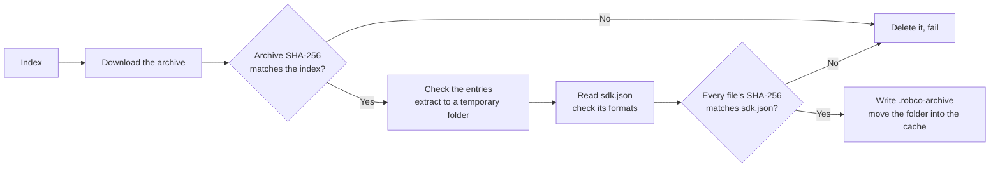
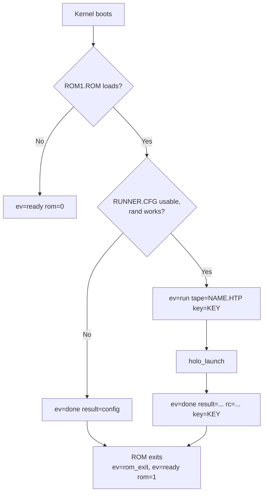

# SDK packages

An SDK package is a versioned zip archive that holds what a Studio project builds and runs against: headers, libraries, linker scripts, kernels and boot data. An SDK index lists the packages and the tools Studio downloads. This spec fixes the archive, its manifest `sdk.json`, the build flags `flags.json`, the runner ROM, the firmware pins, the `templates` package, the index, the rules that say whether a package fits a project, and every hash check.

State today: no package is built and no index exists. Pip-OS ships its SDK as the `sdk/` folder of its repository, as [PIPOS_ABI.md](./PIPOS_ABI.md#sdk) describes. A package is the compiled form of that folder plus the boot files. [STUDIO_PROJECT.md](./STUDIO_PROJECT.md) fixes the project that uses a package. [TESTING.md](./TESTING.md#bootjson) fixes `boot.json`.

## Packages and tools

| Name | Kind | Contents | Version |
|---|---|---|---|
| `pipos` | Package | Headers, `libpip.a`, `crt0.S`, linker scripts, `flags.json`, kernels, the runner ROM, the firmware stub, `boot.json`, the firmware pins | `MAJOR.MINOR.BUILD`. `MAJOR.MINOR` is the Pip-OS ABI it implements. |
| `templates` | Package | The project skeletons that `robco new` writes | The RobCo-Reel release, `X.Y.Z` |
| `gcc` | Tool | One xPack `arm-none-eabi-gcc` archive per host, from its publisher | The full xPack release, such as `15.2.1-1.1` |
| `qemu` | Tool | One QEMU build per host, with its source archive | The QEMU version, such as `10.1.2` |

A package is our archive with an `sdk.json`. A tool is an upstream or separate archive that the index points to by URL and hash. A tool has no `sdk.json`.

Other packages, such as `deitrix`, `terminal` and `reel`, follow the same rules when they exist. This spec defines the layout of `pipos` and of `templates`.

## The archive

A package file is a zip archive named `<name>-<version>.zip`, such as `pipos-1.3.0.zip`.

| Rule | Detail |
|---|---|
| Compression | Stored or deflate only |
| Entries | Regular files and folders only. No symbolic links, no devices. |
| Names | UTF-8, `/` as the separator, relative, no empty, `.` or `..` component, no drive letter |
| Case | No two entries whose names differ only in case |
| Manifest | `sdk.json` at the archive root |
| Everything else | Listed in `sdk.json` `files`, and nothing unlisted |

An archive that breaks a rule fails the install with `package: archive` and names the entry. The tool extracts nothing from it.

A tool installs a package into its own folder, `<cache>/packages/<name>/<version>/`. The tool never writes into an installed package folder after the install. [What the cache records](#what-the-cache-records) names the one file the install adds.

### The cache folder

`<cache>` is the system's standard per-user cache folder plus `robco`:

| System | `<cache>` |
|---|---|
| Linux | `$XDG_CACHE_HOME/robco`. When `XDG_CACHE_HOME` is unset, empty or not an absolute path: `$HOME/.cache/robco`. |
| macOS | `$HOME/Library/Caches/robco` |
| Windows | `%LOCALAPPDATA%\robco` |

The environment variable `ROBCO_CACHE` overrides the table on every system. Its value is used as `<cache>` itself, with no `robco` added. A value that is set but empty counts as unset. A value that is not an absolute path fails with `cache: path`. Every command of [STUDIO_CLI.md](./STUDIO_CLI.md#commands) needs the cache, and makes this check right after the check of its command line, before it reads any file. The tool creates `<cache>` and its subfolders when it first needs them.

| Folder | Content |
|---|---|
| `<cache>/packages/<name>/<version>/` | An installed package |
| `<cache>/tools/<name>/<version>/<host>/` | An installed tool: what the folder `root` of its archive holds, so `bin/` is right under it, such as `<cache>/tools/gcc/15.2.1-1.1/linux-x64/bin/`. See [Tool archives](#tool-archives). |
| `<cache>/firmware/<tag>/` | The firmware files of one [firmware pin](#firmware-pins) |

A person may delete `<cache>` at any time, or the folder of one package or one tool. The next command that needs a file downloads it again and checks it as [Hashes](#hashes) says.

#### What the cache records

A lock pins the hash of an archive, and the cache keeps the extracted files, not the archive. So each install records which archive a folder came from.

| Rule | Detail |
|---|---|
| The file | `.robco-archive`, right under the package folder or the tool folder |
| Its content | The SHA-256 of the archive the folder was extracted from: 64 lower case hex digits and one line feed, 65 bytes |
| When it is written | By the install, into the temporary folder, before the folder moves into the cache. So one rename brings the files and the record. |
| What it is not | A file of the package. `files` of `sdk.json` does not list it, and no check of `files` counts it. |
| An archive that holds an entry of that name in that place | Refused: `package: archive` for a package, `tool: archive` for a tool |

The cache holds an item when its folder is there and holds a `.robco-archive` in that form. A folder without one was not put there by an install that ended. The tool treats the item as missing: the next install of it removes the folder first.

A command that finds an item in the cache does not download it. It compares the record with the hash it would have downloaded, as [Hashes](#hashes) says. So two projects whose locks pin two archives of one version cannot both build from one cache, and the tool says so instead of building with the wrong one.



## sdk.json

`sdk.json` is a JSON object, UTF-8, at the archive root.

| Field | Type | Required | Meaning |
|---|---|---|---|
| `format` | integer | Yes | `1` for this spec |
| `name` | string | Yes | The package name: 1 to 32 characters from `a` to `z`, `0` to `9` and `-`, starting with a letter. Equals the name in the file name and in the index. |
| `version` | string | Yes | `X.Y.Z`, decimal, each part from 0 to 65535 with no leading zero: `1.3.0`, never `1.03.0`. Equals the version in the file name and in the index. |
| `abi` | string | For `pipos` | The ABI the package implements, `MAJOR.MINOR`, each part from 0 to 65535 with no leading zero. Equals the first two parts of `version`. See [Which package carries which field](#which-package-carries-which-field). |
| `built_from` | array of objects | Yes | One per repository that went into the package |
| `formats` | object | Yes | The format versions the package uses. See below. |
| `requires` | array of objects | No | Other packages this one needs. Empty by default. |
| `tools` | array of objects | For `pipos` | The compiler and the emulator that go with this package. See [Tools a package names](#tools-a-package-names). |
| `firmware` | object | For `pipos` | The firmware pins. See [Firmware pins](#firmware-pins). |
| `licences` | array of objects | Yes | The licence of each part. See [Licences](#licences). |
| `files` | array of objects | Yes | Every file in the archive but `sdk.json` |

`built_from` entries:

| Field | Type | Meaning |
|---|---|---|
| `repo` | string | The repository name, such as `Pip-OS` |
| `commit` | string | The full 40-digit commit, lower case hex |

`formats` holds one integer per format. A package names every format it carries.

| Key | Format | Defined in |
|---|---|---|
| `rimg` | The `rimg` header version, `hdr_version` | [IMAGE_FORMAT.md](./IMAGE_FORMAT.md) |
| `flags` | `flags.json` `format` | This spec |
| `boot` | `boot.json` `format` | [TESTING.md](./TESTING.md#bootjson) |
| `runner` | The runner ROM's contract: `RUNNER.CFG` and its marker lines | [The runner ROM](#the-runner-rom) |
| `templates` | `templates.json` `format` | [templates.json](#templatesjson) |
| `project` | `robco.toml` `format` of the manifests a package holds | [STUDIO_PROJECT.md](./STUDIO_PROJECT.md#format-version) |
| `scenario` | Scenario file `format` of the scenarios a package holds | [STUDIO_CLI.md](./STUDIO_CLI.md#scenario-files) |

A `pipos` package carries `rimg`, `flags`, `boot` and `runner`. A `templates` package carries `templates`, `project` and `scenario`.

`requires` entries:

| Field | Type | Meaning |
|---|---|---|
| `name` | string | A package name |
| `abi` | string | The lowest ABI of that package, `MAJOR.MINOR`. It fits by the rules of [Version and ABI rules](#version-and-abi-rules). |

`files` entries:

| Field | Type | Meaning |
|---|---|---|
| `path` | string | The entry name in the archive |
| `size` | integer | The size in bytes |
| `sha256` | string | 64 lower case hex digits |

`files` is sorted by `path` in byte order, and the order is required. A reader checks that each `path` is greater than the one before it, compared byte by byte as UTF-8. A list out of order, or one path twice, fails with `package: manifest` and names the path. The order makes two builds of one package write the same `sdk.json`, and lets a reader find a path that comes twice in one pass. No other array of `sdk.json` has a required order but `tools`.

### Which package carries which field

| Field | `pipos` | `templates` | Any other package |
|---|---|---|---|
| `abi` | Required | Must be absent | Optional |
| `tools` | Required | Must be absent | Must be absent |
| `firmware` | Required | Must be absent | Optional |

A required field that is absent, and a field that is present where it must be absent, fail with `package: manifest` and name the field.

A tool never works out an ABI from a version. Where `abi` is required and absent, the package is refused: in `sdk.json` with `package: manifest`, in an index entry with `index: entry`. Where `abi` is present in a `pipos` package, it must equal the first two parts of `version`, as text: `1.3` for `1.3.0`. Another value fails with the same two codes. A package without `abi` fits no project and no `requires` entry, by [Version and ABI rules](#version-and-abi-rules).

One place has no `abi` field to read: `robco.lock`, which holds a name, a version and a hash. There the ABI of a locked `pipos` package is the first two parts of its version, which this rule makes equal to its `abi`. [A stale lock](./STUDIO_PROJECT.md#a-stale-lock) uses it.

### Reading sdk.json

- An archive with no `sdk.json` at its root fails with `package: archive`, by [The archive](#the-archive).
- An `sdk.json` that is not UTF-8, is not JSON, or whose top value is not an object fails with `package: manifest`. The same code covers `flags.json` and `boot.json`: `package: manifest` means that a file of the package was read and is not valid, and the detail names the file. A file that could not be fetched or opened never gets this code.
- A missing `format`, one that is not a positive integer, and one larger than the tool knows fail with `package: format`. For a larger one the message asks for a newer tool.
- A format in `formats` that the tool does not know, by its name or by its value, fails with `package: format` and names the format. Studio links its format code when it is built, so it never guesses. A tool of this spec knows the seven names of the table above, each with the value `1`.
- A field the tool does not know is ignored. A new field that changes how a package must be read raises `format`.
- A required field that is missing or has the wrong type, and a value outside the form its table gives, fail with `package: manifest`.
- The checks come in this order: the file parses, `format`, `formats`, then each field in the order of the table of [sdk.json](#sdkjson), then [what must equal the index entry](#what-must-equal-the-index-entry), then the hashes of [Hashes](#hashes). [Order of checks](./STUDIO_CLI.md#order-of-checks) has the same steps for every file a tool reads.

### What must equal the index entry

An index entry says what a package is before anyone downloads it, and the resolver decides on that alone. So the package must be what its entry says. When an install has read `sdk.json`, it compares these fields with the index entry it fetched the archive for:

| Field | Equal means |
|---|---|
| `name`, `version` | The same text, byte for byte |
| `abi` | The same text, or absent in both |
| `requires` | The same entries in the same order. An absent `requires` equals an empty array. |
| `tools` | The same entries in the same order, or absent in both |
| `formats` | The same names, each with the same value. The order of names does not count. |

A field that differs fails the install with `package: manifest` and names the field. The package does not enter the cache. A package that is already in the cache was checked when it was installed, and a later command checks the hash of the archive it came from, by [What the cache records](#what-the-cache-records). So this comparison runs at an install only.

### Layout of pipos

A `pipos` package holds exactly these files. The third column says where each comes from at the commits in `built_from`.

| Path | Content | From |
|---|---|---|
| `sdk.json` | The manifest | The package job |
| `LICENSES/MIT.txt` | The licence text | Pip-OS `LICENSE` |
| `boot.json` | The QEMU arguments per board | RobCo-Core `make boot-json`. See [boot.json](./TESTING.md#bootjson). |
| `boot/PIPOS.CFG` | The default Pip-OS config | Pip-OS `boot/PIPOS.CFG` |
| `boot/PIPOS.IMG` | The release kernel | Pip-OS `build/pipos.img` |
| `boot/RUNNER.ROM` | The runner ROM: it launches the project's tape and prints its exit status. See [The runner ROM](#the-runner-rom). | Pip-OS `sdk/examples/runner/`, built |
| `boot/config.txt` | The default `config.txt` | Pip-OS `boot/config.txt` |
| `boot/fwstub.bin` | The QEMU firmware stub | RobCo-Core `tests/fwstub/`, built |
| `boot/pipos.elf` | The kernel's ELF, for a debugger | Pip-OS `build/pipos.elf` |
| `docs/API.md` | The system call reference | Pip-OS `docs/API.md` |
| `flags.json` | Compile and link flags. See [flags.json](#flagsjson). | The package job, from `sdk/pipos-app.mk` |
| `include/pipos/*.h` | The ten SDK headers listed below | Pip-OS `sdk/include/pipos/` |
| `lib/crt0.S` | The startup code, as source. See [Startup code](#startup-code). | Pip-OS `sdk/crt0.S` |
| `lib/holotape.ld` | Links at `0x00800000` | Pip-OS `sdk/holotape.ld` |
| `lib/libpip.a` | Syscall wrappers and the small libc. See [Building libpip.a](#building-libpipa). | Pip-OS `sdk/lib/*.c` and the RobCo-Core sources that `pipos-app.mk` names, built |
| `lib/rom.ld` | Links at `0x00400000` | Pip-OS `sdk/rom.ld` |

The headers are the whole of `sdk/include/pipos/`, byte for byte:

| Header | Holds |
|---|---|
| `pip.h` | Includes the nine others. A tape or a ROM includes `<pipos/pip.h>` and nothing else of the SDK. |
| `abi.h` | Call numbers, error codes, limits and the structs of [PIPOS_ABI.md](./PIPOS_ABI.md) |
| `crc32.h` | `pip_crc32()` |
| `crt0.h` | `pip_main()` and the registers at entry |
| `heap.h` | The heap allocator |
| `ini.h` | The INI parser, `pip_ini_get()` and its codes |
| `printf.h` | `pip_printf()` and `pip_snprintf()` |
| `selftest.h` | The self-check markers of a test ROM |
| `string.h` | `memcpy()`, `strlen()` and the other string functions |
| `syscall.h` | One `pip_<name>()` wrapper per call |

A file of the first table that the archive lacks, or that `files` does not list, fails the install with `package: manifest` and names the path. So does a header of the second table. A later package may add a header: a tool does not refuse a header it does not know. No file named `pipos.h` exists.

What Pip-OS must add for the layout:

1. `make sdk-package`, which writes `pipos-<version>.zip` with the files of the first table, each from the source the table names, and an `sdk.json` that lists every one of them.
2. The copy of `sdk/include/pipos/` takes every header of the folder, so a header added later ships without a change to the job.

### Tools a package names

`tools` in the `sdk.json` of `pipos` names the two tools a project must use with this package, at one exact version each. The tool that resolves takes those versions. It never takes the newest version the index lists.

`tools` holds exactly two entries, `gcc` first, then `qemu`:

| Field | Type | Required | Meaning |
|---|---|---|---|
| `name` | string | Yes | `gcc` or `qemu` |
| `version` | string | Yes | The version, spelled as the index spells it: the full xPack release for `gcc`, such as `15.2.1-1.1`, and the QEMU version for `qemu`, such as `10.1.2` |

| Entry | What the version says |
|---|---|
| `gcc` | The compiler that built `lib/libpip.a`, and the compiler that every project build against this package runs |
| `qemu` | The emulator that the package's kernel, firmware stub and `boot.json` were tested with |

The reason: the sealed tape is equal across build paths only when the project's objects and `libpip.a` come from the same compiler release. [K2](https://github.com/RobCo-Industries/RobCo-Studio/blob/main/docs/spikes/K2.md) built Culvert with another release of the compiler and got another tape. If the tool took the newest `gcc` of the index, adding a compiler to the index would change the tapes of every project at its next `robco update`, and no package would say which compiler its `libpip.a` came from. `boot.json` and the kernel depend on the emulator in the same way, since the [canary suite](./TESTING.md#canary-suite) proves one QEMU version at a time.

Rules for the tool:

| Case | What the tool does |
|---|---|
| Resolving | For the `pipos` package it picked, it takes each tool at the `version` the package names. The index entry of the package carries the same `tools`, so resolving needs no download. |
| Comparing versions | As strings, byte for byte. Tool versions have no order. |
| The index has no tool with that name and version | Fails with `sdk: no tool` and names the tool and the version |
| That tool has no archive for the running host | Fails with `index: host`, for `gcc` and for `qemu`, whatever the command installs |
| `tools` of an installed `sdk.json` differs from `tools` of its index entry | Fails the install with `package: manifest`, by [What must equal the index entry](#what-must-equal-the-index-entry) |
| `tools` is absent in a `pipos` package, has another length, another order or another name | Fails with `package: manifest` |
| A package other than `pipos` carries `tools` | Fails with `package: manifest` |

Left out on purpose: a second package that names tools, and a range of versions. One package names both tools, at one version each.

Rules for Pip-OS, which builds the package:

1. Its package job downloads the `linux-x64` archive of the `gcc` release from the publisher and checks it against a SHA-256 pinned in the Pip-OS repository.
2. It builds `lib/libpip.a` with that compiler and with no other.
3. It fails when `arm-none-eabi-gcc -dumpfullversion` does not print the part of `version` before the first `-`, such as `15.2.1` for `15.2.1-1.1`.
4. It writes the two versions into `tools`.

### Building libpip.a

Pip-OS builds `lib/libpip.a` with `ar rcsD`. The `D` flag writes 0 for every date, user and group id and a fixed mode, so two builds of one package from one commit give the same archive. Without it `ar` stores the build time and the archive hash differs on every build. Today `pipos-app.mk` runs `ar rcs`, so Pip-OS must change it to `ar rcsD`. [K2](https://github.com/RobCo-Industries/RobCo-Studio/blob/main/docs/spikes/K2.md) measured this.

## flags.json

`flags.json` holds the compile and link flags of a project build. Pip-OS writes it from `pipos-app.mk` when it builds the package, so the flags have one source.

| Field | Type | Required | Meaning |
|---|---|---|---|
| `format` | integer | Yes | `1` for this spec |
| `cflags` | array of strings | Yes | Flags for each C compile, in order |
| `include_dirs` | array of strings | Yes | Folders for `-I`, relative to the package root |
| `ldflags` | array of strings | Yes | Flags for the link, in order |
| `linker_scripts` | object | Yes | Kind to script path, relative to the package root: `holotape`, `rom` |
| `crt0` | string | Yes | The startup code source, relative to the package root: `lib/crt0.S` |
| `crt0_defines` | object | Yes | Kind and subtype to an array of macro definitions for the startup code. Keys: `holotape-game`, `holotape-utility`, `rom`. Each string is `NAME=VALUE`, passed as `-D` and the string. |
| `libs` | array of strings | Yes | Archive paths relative to the package root, in link order |
| `system_libs` | array of strings | Yes | Flags for the compiler's own libraries, last on the link line, such as `-lgcc` |
| `abi_define` | string | Yes | The macro that carries the project's ABI. See [PIPOS_ABI.md](./PIPOS_ABI.md#calls-newer-than-the-target-abi). |

No flag in `cflags` or `ldflags` holds a path. Paths live in the fields made for them, so a tool joins them to the package folder on any system. `flags.json` holds no path map either: the tool adds the maps itself, as [Path maps](#path-maps) says.

### Build order

A tool runs these steps in order, with `gcc` the `arm-none-eabi-gcc` of the locked tool archive, `PKG` the installed package folder and `<maps>` the flags of [Path maps](#path-maps). Each command is an argument list passed to the program with no shell, so a quote inside an argument reaches `gcc` as it is.

1. Compile the startup code:
   `gcc <cflags> -D<abi_define>=<abi> -D<crt0_defines>... -I<PKG/include_dirs>... <maps> -c <PKG/crt0> -o <crt0 object>`.
   `<crt0_defines>` is the array of the project's kind and subtype, such as `holotape-game`, one `-D` argument per string, in array order.
2. For each source, in the order of the source list of [STUDIO_PROJECT.md](./STUDIO_PROJECT.md#source-order):
   `gcc <cflags> -D<abi_define>=<abi> -I<PKG/include_dirs>... <maps> -c <source> -o <object>`.
3. `gcc <ldflags> -T <PKG/linker script> <crt0 object> <objects> <PKG/libs>... <system_libs> -o build/NAME.elf`, with `<objects>` in the order of the source list.
4. `arm-none-eabi-objcopy -O binary build/NAME.elf <raw>`
5. Seal `<raw>` into `build/NAME.HTP`.

`<abi>` is `0x` and 8 lower case hex digits: `(MAJOR << 16) | MINOR` of `target.abi`, such as `0x00010003` for `1.3`. Steps 1 and 2 pass the same value. The object paths are the tool's choice, under `build/`.

### Startup code

The package ships the startup code as source, `lib/crt0.S`, and every project build compiles it at step 1 of [Build order](#build-order). So the header's `abi_version` holds the project's target ABI, not the package's.

| Rule | Detail |
|---|---|
| The file | `lib/crt0.S` is Pip-OS's `sdk/crt0.S` at the commit in `built_from`, byte for byte |
| The ABI | `crt0.S` writes `PIPOS_ABI_TARGET` into `abi_version`. The build passes it as `-DPIPOS_ABI_TARGET=<abi>`, through `abi_define`. |
| Magic and subtype | From `crt0_defines`: `PIP_IMG_MAGIC="ROBCO78"` and `PIP_IMG_SUBTYPE=0` for `holotape-game`, `PIP_IMG_MAGIC="ROBCO78"` and `PIP_IMG_SUBTYPE=1` for `holotape-utility`, `PIP_IMG_MAGIC="ROM1"` and `PIP_IMG_SUBTYPE=0` for `rom` |
| An older target | A project with `abi = "1.3"` built against `pipos` 1.4.0 gets `abi_version = 0x00010003`. The loader checks only the major, so the tape loads on every 1.x kernel. |
| No define | Without `PIPOS_ABI_TARGET`, `abi.h` defines it to `PIP_ABI_VERSION`, the ABI of the headers. `pipos-app.mk` builds this way when its `ABI` variable is not set. See [The target ABI in pipos-app.mk](./PIPOS_ABI.md#the-target-abi-in-pipos-appmk). |

Seal never changes `abi_version`, as [Seal steps](./IMAGE_FORMAT.md#seal-steps) says. Only the compile of `crt0.S` sets it.

What Pip-OS's `sdk/crt0.S` and `abi.h` must do for this rule. Today `crt0.S` writes `PIP_ABI_VERSION`, so every tape carries the ABI of the headers.

1. `abi.h` defines `PIPOS_ABI_TARGET` to `PIP_ABI_VERSION` when it is not defined, and stops with `#error` when it is larger than `PIP_ABI_VERSION`. These are the rules of [Calls newer than the target ABI](./PIPOS_ABI.md#calls-newer-than-the-target-abi).
2. `crt0.S` writes `.word PIPOS_ABI_TARGET` in place of `.word PIP_ABI_VERSION`.

### Path maps

No path of the machine that builds may reach a build output, so every root that appears on a compile line gets a map to a fixed name. The tool adds three `-ffile-prefix-map` flags to every compile, steps 1 and 2 of [Build order](#build-order), and to no other step:

1. `-ffile-prefix-map=<project root>=.`
2. `-ffile-prefix-map=<toolchain root>=toolchain`
3. `-ffile-prefix-map=<package root>=sdk`

`<project root>` is the absolute path of the folder that holds `robco.toml`. `<toolchain root>` is the absolute path of the folder that holds the gcc archive's `bin/`. `<package root>` is `PKG`, the installed package folder under `<cache>`. On Windows the tool passes each map twice, first with `\` and then with `/` as the separator, so six flags in all.

Without the maps, the person's folder path, the toolchain path and the cache path, which holds the user name, land in the debug info of `build/NAME.elf`. The maps keep them out. They do not change the tape, which holds no debug info. [K2](https://github.com/RobCo-Industries/RobCo-Studio/blob/main/docs/spikes/K2.md) measured the first two maps. The third follows from the same rule and is not measured yet. Two checks will measure it: the agreement check that compares tapes across systems and build paths, and a check that searches the ELF for the project root, the toolchain root and the cache root.

### What must be equal

Only the sealed tape, `build/NAME.HTP`, must be byte-equal across host systems and project folders, for the same manifest, lock and sources. Objects, `build/NAME.elf` and the map files may differ. [K2](https://github.com/RobCo-Industries/RobCo-Studio/blob/main/docs/spikes/K2.md) found the tape equal on Linux, macOS and Windows and through two build paths with no extra flag. The Windows ELF differs in its debug sections through the `libgcc.a` of xPack's Windows archive, and no compile flag cures that. So the tool adds no `-fno-ident`, and a test of a build compares tapes only.

### Reading flags.json

A `flags.json` that is not UTF-8 JSON with an object at the top fails with `package: manifest`. A `format` that is missing, is not a positive integer or is larger than the tool knows fails with `package: format`. A required field that is missing or has the wrong type fails with `package: manifest` and names the field. An unknown field is ignored. The checks come in that order, and then field by field in the order of the table.

## The runner ROM

The runner ROM is the ROM that `robco run` and `robco test` boot. It launches one tape, prints how the tape ended and exits. It draws nothing, shows no menu and reads no key. With it, a tape project runs without Deitrix.

State today: it does not exist. `tests/launcher/` in RobCo-Reel is a test ROM of the same shape, with the tape name built in. Pip-OS will build the runner from its SDK and ship it in the `pipos` package.

| Property | Value |
|---|---|
| Path in the package | `boot/RUNNER.ROM` |
| Path on a card | `/PIPBOY/ROM1.ROM` |
| Image | A sealed `ROM1` image, subtype 0, with the header `name` `RUNNER`. It is built with `pipos-app.mk` with no `ABI` variable, so it carries the ABI of the package. |
| Version of this contract | `runner` in `formats` of `sdk.json`, `1` for this spec. It covers `RUNNER.CFG` and the marker lines. |

### What the kernel gives a ROM

These are facts of the kernel as it is, and the runner is shaped by them. None is a request.

| Fact | Consequence |
|---|---|
| The kernel loads one ROM, `/PIPBOY/ROM1.ROM`. It has no setting for another path. | The tool copies `boot/RUNNER.ROM` to the card under that name. |
| A ROM gets no argument. `args` in its startup block is empty. | The runner reads the tape's name from a file on the card, with `file_open` and `file_read`. |
| A ROM runs in USR mode and prints only through `log`. It cannot read the values of a `boot` marker. | The runner prints no `boot` marker. |
| `holo_launch` returns the tape's exit status or a negative code, as [Launching](./PIPOS_ABI.md#launching) says. | The runner prints that value and needs nothing else. |
| After the ROM exits, the kernel prints `ev=rom_exit` and `ev=ready rom=1` and stays in its main loop. It does not power off. | QEMU keeps running. The tool ends the run. |
| The kernel sets no time limit on a tape. | A tape that never ends holds the machine. The tool's time limit ends the run. |
| While a tape runs, the kernel reads the script channel only inside `sleep_ms`, the input calls, `file_read` and `holo_enumerate`. | A key sent to a tape that makes none of those calls is not answered. |
| The kernel prints `ev=holo_start name=<file>` when a tape starts and `ev=holo_error code=<code> name=<file>` when a load fails. [BOOT_PROTOCOL.md](./BOOT_PROTOCOL.md#events) lists `holo_launch path` and neither of these. | A tool reads the runner's lines, not these. |
| `log` writes its text to the PL011 as it is, with no prefix. A line feed, a tab and every printable ASCII byte pass, `@` included, and any other byte prints as `?`. A ROM and a holotape print through the same call. This is `sys_log()` in Pip-OS's `kernel/sys_system.c`, with `pipos_log_char()` in `kernel/sysabi.c`. | A holotape can start a fresh line and print any text on it, a line in the form of any marker included. The text of a line on the PL011 never proves who printed it. |
| The kernel prints its own markers on the same PL011. | A holotape can print a line in the form of a kernel marker too. |
| A holotape may open every file of the boot card outside `/PIPBOY/SAVE`, as [Files](./PIPOS_ABI.md#files) says, and may read the ROM slot, as [Sandbox](./PIPOS_ABI.md#sandbox) says. | A secret in `RUNNER.CFG`, or in a static object of the runner, is no secret. |
| A holotape has no access to the ROM's heap and stack. It starts with the registers the kernel sets, `r0`, `sp` and `lr`, and every other register 0. | A value that the runner keeps in automatic variables only stays unknown to the tape. |
| No call reads back what was printed on the PL011, and the kernel keeps no copy of it. | A holotape cannot read a line the runner printed. |
| No call writes the mini UART. Only the kernel prints there: `ready` once, and the answers of the script channel. | An answer on the script channel is the kernel's. |
| While a holotape runs, the ROM waits inside `holo_launch` and runs no code. | The runner prints nothing while a tape runs. |
| When a holotape ends, the kernel prints one whole line before `holo_launch` returns: `ev=holo_exit`, `ev=holo_kill` or `ev=error`. | The runner's `done` line starts at the start of a line, whatever the tape left unfinished. |
| `rand` returns a value from 0 to 2^31 - 1 from the hardware generator, or `-PIP_EIO`. | The runner can make a number that nobody can predict. |

### RUNNER.CFG

The runner reads `/PIPBOY/RUNNER.CFG`: 1 to 255 bytes of INI text.

| Section | Key | Required | Value |
|---|---|---|---|
| `run` | `tape` | Yes | The file name of the tape, such as `PIPES.HTP`: a name `holo_launch` accepts, with no folder. 1 to 12 bytes, each from `0x21` to `0x7E`. |

The runner reads this one key and passes an empty argument string to the tape. Left out on purpose: an argument string, a list of tapes and a tape on the slot card.

#### What the tool writes

The tool writes the file as exactly these two lines, with `NAME` the `project.name`:

```
[run]
tape = NAME.HTP
```

Byte for byte: `[run]`, one line feed, `tape`, one space, `=`, one space, `NAME`, `.HTP`, one line feed. No carriage return, no byte order mark, no comment, no blank line and no other space. A name has 1 to 8 bytes, so the file has 19 to 26 bytes. The tool writes no other form.

#### What the runner accepts

The runner parses the file with `pip_ini_get()`. The call exists: `include/pipos/ini.h` declares it and `libpip.a` holds it. It is RobCo-Core's `ini_get()` under the SDK's prefix, with the same limits and the same codes, so the runner links nothing but the SDK and no SDK change is needed.

```c
int pip_ini_get(const char *text, size_t len, const char *section, const char *key,
                char *out, size_t out_size);
```

The runner calls `pip_ini_get(buf, n, "run", "tape", name, 13)`, with `n` the bytes read. The call accepts more than the two lines the tool writes. This is the whole grammar, so a card written by hand behaves the same on every runner:

| Part | Rule |
|---|---|
| The file | 1 to 255 bytes. A byte order mark is not skipped: its bytes make the first line a syntax error. |
| A line | It ends at a line feed. One carriage return right before the line feed is dropped. The last line may lack its line feed, and one carriage return at its end is dropped too. |
| The longest line | 255 bytes without its line end. No file of 255 bytes holds a longer one, so the limit of the file is the one that counts. |
| Bytes | A byte below `0x20` other than a tab, or the byte `0x7F`, anywhere in a line, is refused. That covers a NUL and a carriage return that is not before a line feed. Bytes from `0x80` up pass in a comment and in a value. |
| Blanks | A blank is a space or a tab. Blanks at the start of a line are skipped. |
| An empty line | Skipped. So is a line that holds only blanks. |
| A comment | A line whose first byte after its blanks is `#` or `;`. Skipped to its end. |
| A section line | `[`, blanks, the name, blanks, `]`, then only blanks and an optional comment. The name has 1 to 31 bytes from `A` to `Z`, `a` to `z`, `0` to `9`, `_`, `.` and `-`. Blanks between those bytes are part of the name. |
| A key line | The key, blanks, `=`, blanks, the value. The key has 1 to 31 bytes from the same set, with no blank. |
| A plain value | It runs to the end of the line, or to a `#` or `;` that starts the value or follows a blank. Blanks at its end are dropped. It may be empty. At most 127 bytes. |
| A quoted value | It starts with `"` and ends at the next `"` that no backslash escapes. Inside, `\"` is a quote, `\\` a backslash and `\n` a line feed. Any other byte after a backslash is refused. After the closing quote come only blanks and an optional comment. At most 127 bytes after the escapes. |
| Any other line | Refused |
| Names | Compared byte for byte. `[Run]` and `Tape` are other names. |
| A key before any section | It belongs to the section with the empty name, never to `run` |
| `tape` twice in `run` | The last one counts. A second `[run]` line continues the section. |
| Other sections and keys | Parsed and ignored. The whole file must parse, so an error in a line the runner does not need still fails. |
| The value of `tape` | 1 to 12 bytes, each from `0x21` to `0x7E`. Twelve is the longest 8.3 name: 8 bytes, a dot and 3 bytes. |

Each way the file can be wrong, and the line the runner then prints. [Runner markers](#runner-markers) defines the line. The parser reports the first bad line of the file, so a bad line comes before a missing key.

| The file | The runner prints `@RC stage=runner ev=done result=config` and |
|---|---|
| Does not exist | `rc=-2 why=open`. -2 is `-PIP_ENOENT`. |
| Cannot be opened for another reason, such as a card error | `rc=<rc> why=open`, with the value `file_open` returned, such as `-5` |
| Cannot be read | `rc=<rc> why=read`, with the negative value `file_read` returned |
| Has 0 bytes, or more than 255 | `rc=0 why=size` |
| Holds a control byte | `rc=-4 why=parse`. -4 is `PIP_INI_ERR_CHAR`. |
| Holds a line that is no section, key, comment or empty line, a section line or a quoted value that breaks its rule, or a key line with no `=` | `rc=-2 why=parse`. -2 is `PIP_INI_ERR_SYNTAX`. |
| Holds a section name or a key above 31 bytes, or a value above 127 | `rc=-3 why=parse`. -3 is `PIP_INI_ERR_TOO_LONG`. |
| Parses and has no key `tape` in a section `run` | `rc=-5 why=parse`. -5 is `PIP_INI_ERR_NOT_FOUND`. |
| Parses and the last `tape` of `run` has more than 12 bytes | `rc=-6 why=parse`. -6 is `PIP_INI_ERR_SPACE`. |
| Parses and the value is empty, or holds a byte outside `0x21` to `0x7E`, such as a space | `rc=0 why=name` |

### What the runner does

The runner is `pip_main()` of one C file. It runs these steps once, in order, and stops at the first that fails:

| Step | Action | On failure it prints `ev=done` with |
|---|---|---|
| 1 | `file_open("/PIPBOY/RUNNER.CFG")` | `result=config why=open`, `rc` the value returned |
| 2 | `file_read` into a buffer of 256 bytes until it returns 0 or the buffer is full, then `file_close`, also after a read that failed. The value `file_close` returns is not checked. | `result=config why=read`, `rc` the negative value returned |
| 3 | The file holds 1 to 255 bytes | `result=config why=size rc=0` |
| 4 | `pip_ini_get(buf, n, "run", "tape", name, 13)`, as [What the runner accepts](#what-the-runner-accepts) says | `result=config why=parse`, `rc` the negative value returned |
| 5 | The value has 1 to 12 bytes, each from `0x21` to `0x7E` | `result=config why=name rc=0` |
| 6 | `rand`, twice. The key is the first value, then the second, each as 8 lower case hex digits. See [The key of a run](#the-key-of-a-run). | `result=config why=rand`, `rc` the negative value of the first call that failed |
| 7 | Print `ev=run` with the value and the key | |
| 8 | `holo_launch(value, "")` | |
| 9 | Print `ev=done` with the result of step 8 and the key | |
| 10 | Return 0 from `pip_main()` when the result is `exit`, else 1 | |

The runner prints each marker with one `pip_printf()` call, as one line that ends in a line feed. It prints nothing else. It never draws and never reads an event. A failure of steps 1 to 6 returns 1 from `pip_main()` after its `done` line.

### The key of a run

A holotape prints on the same port as the runner, with the same call, and may print any text. So a line `ev=done` proves nothing by its text: a tape could print it and then hang, and a tool would take a run that never ended for one that ended well. The runner therefore marks its lines with a key that no tape can know.

| Rule for the runner | Detail |
|---|---|
| Making the key | Two `rand` calls, at step 6, after the settings are read and before anything else is printed. Each value is from 0 to 2^31 - 1. The key is both values written with `%08x%08x`: 16 lower case hex digits, 62 random bits. The first and the ninth digit are from `0` to `7`. |
| Printing it | Once in the `run` line, before `holo_launch`. Once in the `done` line, after `holo_launch` returned. Nowhere else. |
| Keeping it | In automatic variables of `pip_main()` only, so it lives in registers and on the ROM's stack. No static object, no global and no file ever holds it or a text that contains it. `pip_printf()` formats on the caller's stack and fits this rule. |
| A new key per boot | The runner never reads the key from the card and never takes it from the tool. |

Why a tape cannot print a `done` line with the key:

| A tape cannot | Because |
|---|---|
| Print before the `run` line | The runner prints it before `holo_launch`. Until then only the kernel and the runner have printed, and neither prints text that a project supplies, but the tape's file name in `tape=`. |
| Read the key from memory | The key is on the ROM's stack and in registers. A holotape has no access to the ROM's heap and stack, and the kernel clears the registers before it starts the tape. The ROM slot, which a tape may read, holds no copy. |
| Read the key from the card | The key is never on the card. |
| Read the key from the serial port | No call reads back what was printed. |
| Guess the key | A guess is right once in 2^62. |
| Make the runner print | The runner waits inside `holo_launch` while a tape runs. |

So a `done` line with the key of the `run` line was printed by the runner, after `holo_launch` returned. It proves two things at once: the tape has ended, and `rc` is the value `holo_launch` returned.

The key gives no secrecy to anything else, and it is no protection of the device. It only tells the runner's lines from a tape's.

### Runner markers

The lines follow the marker format of [Serial markers](./BOOT_PROTOCOL.md#serial-markers), with the stage name `runner`. The keys come in the order shown, with one space between them.

| Line | When |
|---|---|
| `@RC stage=runner ev=run tape=<file> key=<key>` | Right before `holo_launch`. At most once per boot. |
| `@RC stage=runner ev=done result=<result> rc=<rc> key=<key>` | After `holo_launch` returned. `<rc>` is the value it returned, as a signed decimal number, printed with `%d`. `<key>` is the key of the `run` line. |
| `@RC stage=runner ev=done result=config rc=<rc> why=<why>` | The runner could not start the tape, and `holo_launch` was not called. This line has no key and comes with no `run` line. |

A runner that reaches its end prints exactly one `done` line, and it is the last line the runner prints. `<file>` is the value of `tape` in `RUNNER.CFG`, 1 to 12 bytes from `0x21` to `0x7E`. `<key>` is 16 lower case hex digits, as [The key of a run](#the-key-of-a-run) says. `<result>` is a name of the table below. `<rc>` is an optional `-` and 1 to 10 decimal digits. `<why>` is `open`, `read`, `size`, `parse`, `name` or `rand`. Each line ends with one line feed, has one space between its parts, and holds no other byte.

| `result` | `holo_launch` returned | Meaning |
|---|---|---|
| `exit` | 0 to 255 | The tape ran and ended. `rc` is its exit status. |
| `fault` | `-PIP_EFAULT`, -14 | The kernel killed the tape after a fault. The kernel printed `ev=holo_kill` first. |
| `missing` | `-PIP_ENOENT`, -2 | No such tape on the card |
| `bad` | `-PIP_ENOEXEC`, -40 | The file failed a validation step, or it is a data tape |
| `io` | `-PIP_EIO`, -5 | A read of the card failed |
| `eject` | `-PIP_ENODEV`, -41 | The slot card was pulled while its tape ran |
| `error` | Any other negative value | Such as `-PIP_EINVAL`, -22, for a name the kernel refuses |
| `config` | Not called | See the steps above. `why` is `open`, `read`, `size`, `parse`, `name` or `rand`. |

A run of a tape that returns 3:

```
@RC stage=pipos ev=jump entry=0x00400000
@RC stage=runner ev=run tape=PIPES.HTP key=3f2a9c0b5d417e86
@RC stage=pipos ev=holo_start name=PIPES.HTP
tape: ready
@RC stage=pipos ev=holo_exit status=3
@RC stage=runner ev=done result=exit rc=3 key=3f2a9c0b5d417e86
@RC stage=pipos ev=rom_exit status=0
@RC stage=pipos ev=ready rom=1
```

A run of a tape that prints a `done` line of its own, with a guessed key, and then returns 3. A tool takes the tape's line for text and the runner's line for the end:

```
@RC stage=pipos ev=jump entry=0x00400000
@RC stage=runner ev=run tape=PIPES.HTP key=6c01d4e27a93b5f0
@RC stage=pipos ev=holo_start name=PIPES.HTP
@RC stage=runner ev=done result=exit rc=0 key=0000000000000000
@RC stage=pipos ev=holo_exit status=3
@RC stage=runner ev=done result=exit rc=3 key=6c01d4e27a93b5f0
@RC stage=pipos ev=rom_exit status=0
@RC stage=pipos ev=ready rom=1
```

A card without the tape:

```
@RC stage=runner ev=run tape=PIPES.HTP key=1b7e44a90c35d2f8
@RC stage=runner ev=done result=missing rc=-2 key=1b7e44a90c35d2f8
@RC stage=pipos ev=rom_exit status=1
@RC stage=pipos ev=ready rom=1
```

A card without `RUNNER.CFG`:

```
@RC stage=runner ev=done result=config rc=-2 why=open
@RC stage=pipos ev=rom_exit status=1
@RC stage=pipos ev=ready rom=1
```

The `stage=pipos` lines are the kernel's own and are shown for context. Only the `stage=runner` lines are part of this contract.

### When a run is over

A tool reads the PL011 line by line, as [Serial lines](./STUDIO_CLI.md#serial-lines) says, and sorts each whole line into one of three kinds.

| Kind | How a tool finds it |
|---|---|
| A runner line | The whole line, from its first byte to its last, is one of the three lines of [Runner markers](#runner-markers): the same parts in the same order, one space between them, a value of the right form in each, and nothing before or after. A line that holds `stage=runner` in any other shape is text. |
| A kernel marker | The line contains the four bytes `@RC `. The marker runs from the first of them to the end of the line. A tape may leave a line unfinished, so a kernel marker does not always start its line. The tool splits the marker at spaces into `key=value` pairs, at the first `=` of each, and takes the first pair of each name. |
| Text | Every other line |

The table is read from the top. A line in the shape of a runner line is a runner line, and never a kernel marker, though it holds `@RC ` too. The comparison is on bytes: every byte of a runner line is ASCII.

A tool then keeps one value, the key of the run, and follows these rules:

1. The first runner line with `ev=run` gives the key of the run. A later `ev=run` line is text.
2. A runner line with `ev=done` and `key=` is the runner's `done` line only when a `run` line came before it and its key equals the key of the run. Otherwise it is text.
3. A runner line with `ev=done` and `result=config` is the runner's `done` line only when no `run` line came before it. Otherwise it is text.

The first of these lines ends the run:

| Line | The run ended because | A tape can print it |
|---|---|---|
| The runner's `done` line, by rules 2 and 3 | The runner reported. `result` and `rc` say how. | No |
| A kernel marker with `ev=exception` or `ev=panic`, of any stage | The kernel stopped on a fault of its own. No `done` line will come. | Yes |
| A kernel marker with `stage=pipos` and `ev=ready`, before the runner's `done` line | The kernel reached its main loop and the runner did not report: the ROM did not load, with `rom=0`, or the kernel killed it, with `rom=1`. No `done` line will come. | Yes |

A run with none of these lines is not over. The tape still runs, and only the tool's time limit ends it. After the runner's `done` line the machine idles in the kernel's main loop, with the script channel still answering, until the tool stops QEMU.

#### Who may print a line

This table lists every line a tool reads, who prints it, and what a tool may conclude. The rule behind it: a tool takes good news only from a line that a tape cannot print, and it takes bad news from any line.

| Line | Printed by | A tape can print the same bytes | A tool concludes |
|---|---|---|---|
| The first `ev=run` runner line | The runner | No. No tape has run yet. | The key of the run. Nothing else. |
| A later `ev=run` runner line | A tape | Yes | Nothing. It is text. |
| An `ev=done` runner line with the key of the run | The runner | No. See [The key of a run](#the-key-of-a-run). | The tape has ended, and `rc` is what `holo_launch` returned. This is the only line that can end a run well. |
| An `ev=done` runner line with another key, or before any `run` line | A tape | Yes | Nothing. It is text. |
| An `ev=done result=config` runner line before any `run` line | The runner | No. No tape has run. | The run is over, and it failed: the runner could not start the tape. |
| An `ev=done result=config` runner line after a `run` line | A tape | Yes | Nothing. It is text. |
| A kernel marker with `ev=exception` or `ev=panic` | The kernel | Yes | The run is over, and it failed. Never that a run went well. |
| A kernel marker `stage=pipos ev=ready` before the runner's `done` line | The kernel | Yes | The run is over, and it failed. Never that a run went well. |
| Any other kernel marker, such as `ev=holo_exit` or `ev=rom_exit` | The kernel | Yes | Nothing. A tool reads none of them. |
| A line that holds the text of `--expect` or of an `expect` step | Anyone. The tape, by design. | Yes, and that is the point | That a line held the text. Nothing about how or whether the tape ended. |
| `ok`, `ok dropped` and `err` lines on the mini UART | The kernel | No. No call writes the mini UART. | The answer to a line the tool sent on the script channel |

So a tape that prints a kernel marker can only fail its own run: the tool reports `guest: fault` or `guest: runner` for a machine that had no fault. A tape that prints text in the shape of the runner's lines changes nothing. And a tape cannot make a tool believe that it ended, or that it ended with a given status.



### What Pip-OS must add for the runner

1. `sdk/examples/runner/`: `main.c` and a `Makefile` that includes `pipos-app.mk` with `KIND := rom`, `NAME := RUNNER` and `IMAGE := RUNNER.ROM`. The code follows [What the runner does](#what-the-runner-does) and [The key of a run](#the-key-of-a-run), and prints the lines of [Runner markers](#runner-markers), byte for byte.
2. Its package build copies the built image to `boot/RUNNER.ROM` and writes `"runner": 1` into `formats` of `sdk.json`.
3. A target test on every board that boots a card with the runner as `/PIPBOY/ROM1.ROM`: a tape that returns 0, a tape that returns 3, a missing tape, a tape with a bad CRC, a card without `RUNNER.CFG`, and one card for each row of the table of bad files in [What the runner accepts](#what-the-runner-accepts). Each case checks the exact `done` line and that `ev=ready rom=1` follows.
4. A target test of the key: the `run` and `done` lines of one boot carry the same key, two boots give two keys, and a tape that prints a `done` line with a key of its own and then returns 3 is followed by the runner's line with `rc=3` and the key of the `run` line.
5. A build check that the runner's own object file, built from `main.c`, has an empty `.data` and an empty `.bss`, so the key has no static home.

No kernel change is needed.

### What Pip-OS must keep for the runner

The key holds only while these stay true. Each is a fact of Pip-OS today. A change to one of them is a change to this spec first.

| Fact | Where Pip-OS has it |
|---|---|
| A holotape has no access to the ROM's heap and stack | `holo_regions` in `kernel/sys_holo.c`, and [Sandbox](./PIPOS_ABI.md#sandbox) |
| A holotape starts with every register 0 but `r0`, `sp` and `lr` | `pipos_image_run()` in `kernel/rom.c`, on the library's `umode_run()` |
| No call reads back the text of `log`, and the kernel keeps no copy an image can reach | `sys_log()` in `kernel/sys_system.c` |
| No call writes the mini UART | The whole table of calls in `kernel/sys_*.c` |
| The ROM runs no code while a holotape runs | `holo_launch` in `kernel/sys_holo.c` |
| A whole kernel line ends every tape before `holo_launch` returns | `run_tape()` in `kernel/sys_holo.c` |
| `rand` returns the hardware generator's bits, and no fixed sequence | `sys_rand()` in `kernel/sys_system.c` |
| `pip_printf()` keeps its text on the caller's stack | `sdk/lib/printf.c` |

A kernel that prefixed or escaped what a holotape logs would also tell the two apart. It is left out on purpose: the test ROMs and the conformance tape of Pip-OS print `@RC` lines of their own through `log`, and that must keep working.

## Firmware pins

The Pi firmware files are never part of a package. The `pipos` package carries their pins in `sdk.json` `firmware`, with the values of `tools/fetch_firmware.sh` at the RobCo-Core commit the package was built from.

| Field | Type | Meaning |
|---|---|---|
| `repo` | string | `raspberrypi/firmware` |
| `tag` | string | The release tag, such as `1.20260915` |
| `commit` | string | The full commit of that tag |
| `base_url` | string | The download base. `<base_url>/<file>` is each file. |
| `files` | array of objects | `name`, `sha256`, for `bootcode.bin`, `start.elf`, `fixup.dat` |

No command of version 1 of [STUDIO_CLI.md](./STUDIO_CLI.md) downloads a firmware file: [the simulator card](./STUDIO_CLI.md#the-simulator-card) holds none, and `robco sdk install` fetches none. A later command that writes a card for a real device downloads each file, checks its SHA-256 and keeps it in `<cache>/firmware/<tag>/`. A mismatch deletes the file and fails with `firmware: hash`. The tool never puts a firmware file into a package, an index or a release of its own.

## The templates package

The `templates` package holds the project skeletons that `robco new` writes. RobCo-Reel builds it. State today: no template and no package exists.

It is a package like any other: the rules of [The archive](#the-archive), [sdk.json](#sdkjson), [Hashes](#hashes) and [What a package must never contain](#what-a-package-must-never-contain) apply, and it installs into `<cache>/packages/templates/<version>/`.

| Property | Value |
|---|---|
| File name | `templates-<version>.zip` |
| `version` | `X.Y.Z`, the RobCo-Reel release it was built from |
| `abi`, `tools`, `firmware` | Absent |
| `requires` | Empty |
| `built_from` | `RobCo-Reel` and its commit |
| `formats` | `templates`, `project` and `scenario`, each `1` for this spec |
| `licences` | MIT for every path |

`project` and `scenario` are the format versions of the `robco.toml` and of the scenario files that the templates hold. A tool that does not know one of them refuses the package by the rule of [Reading sdk.json](#reading-sdkjson), so it never writes a project it cannot build.

### Layout of templates

| Path | Content |
|---|---|
| `sdk.json` | The manifest |
| `templates.json` | The list of templates |
| `<id>/` | The files of the template `<id>`, laid out as they go into a new project |
| `LICENSES/MIT.txt` | The licence text, RobCo-Reel's `LICENSE` |

The archive holds nothing else.

### templates.json

`templates.json` is a JSON object, UTF-8, at the archive root.

| Field | Type | Required | Meaning |
|---|---|---|---|
| `format` | integer | Yes | `1` for this spec |
| `templates` | array of objects | Yes | One or more templates, sorted by `id` in byte order |

A template:

| Field | Type | Required | Meaning |
|---|---|---|---|
| `id` | string | Yes | The name a person gives to `robco new`, and the folder of the template in the archive. 1 to 32 characters from `a` to `z`, `0` to `9` and `-`. It starts with a letter. |
| `title` | string | Yes | A short name for lists. ASCII, 1 to 64 bytes. |
| `description` | string | Yes | One sentence. ASCII, 1 to 200 bytes. |
| `kind` | string | Yes | The `project.kind` of the manifest the template writes: `holotape` |
| `files` | array of objects | Yes | Every file of the template, sorted by `path` in byte order |

A file:

| Field | Type | Required | Meaning |
|---|---|---|---|
| `path` | string | Yes | The path of the file inside `<id>/` and inside the new project. It follows the path rules of [robco.toml](./STUDIO_PROJECT.md#syntax). |
| `substitute` | boolean | Yes | `true`: the tool replaces the tokens of [Tokens](#tokens) in this file. `false`: the tool copies the file byte for byte. |

`robco new` reads `templates.json` and checks all of it before it writes anything:

| Case | Error |
|---|---|
| The file is missing, is not UTF-8 JSON, or its top value is not an object | `templates: manifest` |
| `format` is missing, is not a positive integer, or is larger than the tool knows | `templates: format`. For a larger one the message asks for a newer tool. |
| A required field other than `format` is missing or has the wrong type | `templates: manifest` |
| A field this spec does not define | `templates: manifest`, with its name. This file is new, so it starts strict. |
| Two templates with the same `id`, a list that is not sorted, or a value outside its limits | `templates: manifest` |
| A `path` that breaks a path rule, or two paths of one template that differ only in case | `templates: manifest` |
| A listed file that the package does not hold at `<id>/<path>` | `templates: manifest` |
| A file under `<id>/` that `files` does not list | `templates: manifest` |

### Tokens

A token is `@`, then one or more of `A` to `Z` and `_`, then `@`. Tokens count only in a file with `substitute` set to `true`.

| Token | Replaced by |
|---|---|
| `@NAME@` | The project name given to `robco new`, which follows the [name rules](./STUDIO_PROJECT.md#name-rules) |

The tool replaces every `@NAME@` in the file's bytes and changes nothing else. Any other token in such a file fails with `templates: token` and names the file and the token. A file that needs such text as it stands sets `substitute` to `false`.

The tool never changes line ends, on any system, and a `path` holds no token. Left out on purpose: a title or a version given on the command line, files that depend on an answer, and renamed files.

### The holotape-c template

The first template is `holotape-c`: a holotape in C that draws one screen, logs one line and ends on a key. Its entry in `templates.json`:

```json
{
  "format": 1,
  "templates": [
    {
      "id": "holotape-c",
      "title": "Holotape in C",
      "description": "A holotape in C that draws one screen and waits for SELECT.",
      "kind": "holotape",
      "files": [
        {"path": "icon.pbm", "substitute": false},
        {"path": "robco.toml", "substitute": true},
        {"path": "src/main.c", "substitute": false},
        {"path": "tests/golden/start/ready.png", "substitute": false},
        {"path": "tests/start.toml", "substitute": false}
      ]
    }
  ]
}
```

| File | Must hold |
|---|---|
| `robco.toml` | The manifest below, byte for byte |
| `icon.pbm` | A 32x32 PBM icon, `P1` or `P4`, of original art |
| `src/main.c` | The tape, by the rules below |
| `tests/start.toml` | The scenario below, byte for byte |
| `tests/golden/start/ready.png` | The golden image of the tape's screen, taken from QEMU, by the rules of [Golden images](./STUDIO_CLI.md#golden-images) |

`robco.toml`:

```toml
format = 1

[project]
name = "@NAME@"
title = "@NAME@"
version = "0.1.0"
kind = "holotape"
subtype = "utility"
icon = "icon.pbm"

[target]
platform = "pipos"
abi = "1.4"

[build]
backend = "robco"
sources = ["src/*.c"]
```

`tests/start.toml`:

```toml
format = 1

[[step]]
expect = "tape: ready"

[[step]]
screen = "ready"

[[step]]
tap = "select"

[[step]]
exit = 0
```

The tape, `src/main.c`:

1. Its first line is `/* SPDX-License-Identifier: MIT */`. It includes `<pipos/pip.h>` and no other header, and it calls nothing newer than ABI 1.4. `pip.h` is `include/pipos/pip.h` of the package, as [Layout of pipos](#layout-of-pipos) says. It is the header that Pip-OS's `sdk/examples/tape/main.c` and RobCo-Reel's `samples/hello/main.c` include.
2. It draws one screen and calls `present` once. The screen depends only on the code and on the default colours of `gfx_info`. It shows no clock, no random value, no project name and no animation.
3. After `present` returns, it logs the line `tape: ready` once, with one `pip_printf("tape: ready\n")`.
4. It then waits for events. On a press of SELECT it returns 0 from `pip_main()`. It ignores every other event and draws nothing more.

Rule 2 makes one golden image right for every project name and every board. Rule 3 gives `robco run --headless --expect "tape: ready"` its line, after the frame is on the screen. Rule 4 lets the scenario send a key and read an exit status.

The golden image is right only on the card of [The simulator card](./STUDIO_CLI.md#the-simulator-card), whose `PIPOS.CFG` sets the colour scheme.

### What RobCo-Reel must add for the templates

1. `templates/holotape-c/` with the five files above.
2. A build of the template through `pipos-app.mk`, for its own tests: a Makefile outside the template folder with `NAME`, `TITLE`, `VERSION := 0.1.0`, `SUBTYPE := utility`, `ICON`, `ABI := 1.4` and `SRCS := src/main.c`, run in the template folder.
3. A target test on every board that boots that tape with the `PIPOS.CFG` of [The simulator card](./STUDIO_CLI.md#the-simulator-card), waits for `tape: ready`, compares the screen with `tests/golden/start/ready.png` pixel for pixel, sends SELECT and reads the tape's exit status 0. The ROM that launches the tape is the runner ROM once the Pip-OS pin holds it, and the repository's test launcher until then.
4. `make templates-package`, which writes `templates-<version>.zip` with `sdk.json`, `templates.json`, `holotape-c/` and `LICENSES/`.

## The index

The index is one JSON file that lists every package and tool a tool may install.

| Field | Type | Required | Meaning |
|---|---|---|---|
| `format` | integer | Yes | `1` for this spec |
| `packages` | array of objects | Yes | Every package version |
| `tools` | array of objects | Yes | Every tool version |

`packages` entries:

| Field | Type | Required | Meaning |
|---|---|---|---|
| `name` | string | Yes | The package name |
| `version` | string | Yes | `X.Y.Z`, in the form `sdk.json` asks for |
| `abi` | string | For `pipos` | As in `sdk.json`, by [Which package carries which field](#which-package-carries-which-field) |
| `requires` | array | No | As in `sdk.json` |
| `tools` | array | For `pipos` | As in `sdk.json`. See [Tools a package names](#tools-a-package-names). |
| `formats` | object | Yes | As in `sdk.json`: one integer per format the package carries. The resolver reads it for the fourth rule of [Version and ABI rules](#version-and-abi-rules). |
| `url` | string | Yes | Where the archive is: a URL that starts with `https://`, or in a local index a path relative to the folder of the index file, by the path rules of [The archive](#the-archive). Any other value fails with `index: entry`. |
| `size` | integer | Yes | The archive size in bytes |
| `sha256` | string | Yes | The archive's SHA-256, 64 lower case hex digits |

`tools` entries:

| Field | Type | Required | Meaning |
|---|---|---|---|
| `name` | string | Yes | `gcc` or `qemu`. An entry with another name is skipped, as [Reading the index](#reading-the-index) says. |
| `version` | string | Yes | The version, compared as a string. For `gcc` it is the full xPack release. 1 to 64 bytes from `0x21` to `0x7E`, with no `"` and no `\`. |
| `archives` | object | Yes | Host name to an archive object |

An archive object:

| Field | Type | Required | Meaning |
|---|---|---|---|
| `url` | string | Yes | Where the archive is, in the form of the `url` of a package entry |
| `size` | integer | Yes | Its size in bytes |
| `sha256` | string | Yes | Its SHA-256, 64 lower case hex digits |
| `root` | string | Yes | The folder inside the archive that holds `bin/`. Empty when `bin/` is at the top. |

A host name has 1 to 32 characters from `a` to `z`, `0` to `9` and `-`, and starts with a letter. This spec defines five: `linux-x64`, `linux-arm64`, `macos-x64`, `macos-arm64` and `windows-x64`. A tool finds its own host among them.

| Key of `archives` | What the tool does |
|---|---|
| One of the five names | Reads the archive object |
| Another name in the form above | The same. It is a host that a later tool knows. The tool checks its archive object like the others, keeps it, and writes its hash into the lock with the rest, so a lock written today works on that host later. |
| A key in another form | Fails with `index: entry` and names the key |
| No key for the running host, in a tool that a resolution takes | Fails with `index: host`. A resolution takes both tools at the versions the package names, in every command: `robco build` and `robco update` too, which install no `qemu`. A lock without an archive for the running host would be [stale](./STUDIO_PROJECT.md#a-stale-lock) as soon as it was written. |

### Tool archives

A tool archive is a zip archive, or a tar archive compressed with gzip. The tool tells the two apart by the first bytes of the file: `50 4B 03 04` for zip and `1F 8B` for gzip. It never goes by the name in the URL.

The tool installs one in these steps:

1. It downloads the archive and checks it, by [Hashes](#hashes).
2. It extracts every entry into a temporary folder under `<cache>`. A symbolic link whose target stays inside the archive is kept as a link.
3. It takes the folder that `root` names, or the whole extraction when `root` is empty, and checks that it holds `bin/`.
4. It writes `.robco-archive` into that folder, by [What the cache records](#what-the-cache-records), moves the folder to `<cache>/tools/<name>/<version>/<host>/` and removes what is left of the temporary folder.

| Case | Error |
|---|---|
| The file is neither kind of archive, or its data cannot be read to the end | `tool: archive` |
| An entry would land outside the extraction folder: an absolute name, a `..` component, or a link that leads outside | `tool: archive`, with the entry |
| `root` names no folder of the archive, or that folder holds no `bin/` | `tool: archive`, with `root` |
| The folder holds an entry named `.robco-archive` | `tool: archive` |

A failure removes the download and the temporary folder, and nothing enters the cache. A program that a command needs and `bin/` lacks is not checked here: the command that starts it fails with `tool: program`.

### Where the index is

Every command that reads the index takes the option `--index LOCATION`, written as two arguments or as `--index=LOCATION`. `LOCATION` is one of:

| Form | Meaning |
|---|---|
| Starts with `https://` | A URL. The tool downloads the index from it. |
| Starts with `http://` or another scheme followed by `://` | Refused with `index: location` |
| Anything else | A local file path, absolute or relative to the current folder |

A command reads the index only when it must resolve or download something. A build whose lock pins packages and tools already in `<cache>` reads no index and needs no `--index`. A command that must read the index and has no `--index` fails with `index: location`, and the message names the option. It never falls back to the `index` value of `robco.lock`, which is for the record only. A missing local file, or a download that fails, gives `index: read`.

The lock records `LOCATION` as given. Studio's CI passes a local fixture index. A default index URL built into each release comes later. It will apply only when `--index` is absent.

### Reading the index

| Case | Result |
|---|---|
| The command must read the index and has no `--index`, or the location has a refused scheme | `index: location` |
| A local file that is missing or cannot be read, or a download that fails | `index: read`. The index could not be fetched or opened. |
| The bytes are there and are not UTF-8, are not JSON, or the top value is not an object | `index: syntax`. The index was fetched or opened, and it is not valid. |
| `format` is missing, is not a positive integer, or is larger than the tool knows | `index: format`. For a larger one the message asks for a newer tool. |
| A field the tool does not know, at the top, in an entry or in an archive object | Ignored |
| `packages` or `tools` is missing or is not an array, an entry is not an object, a field of an entry or of an archive object is missing, has the wrong type or breaks the form its table gives, or a `pipos` entry breaks a rule of [Which package carries which field](#which-package-carries-which-field) | `index: entry`, with the place, such as `packages[2].formats` |
| A `tools` entry whose `name` is a string other than `gcc` and `qemu` | The entry is skipped whole. See below. |
| Two `packages` entries with the same `name` and `version`, or two `tools` entries that were not skipped with the same `name` and `version` | `index: duplicate` |

The checks come in the order of the table: the location, the read, the syntax, `format`, then every entry of `packages` in the order of the array and every entry of `tools` in the order of the array, each field in the order of its table, and the duplicates last. The tool reports the first failure.

A skipped tool entry does not exist for this tool. No other field of it is checked. It is never resolved, never installed, never listed by `robco sdk list` and never written to a lock. It cannot be reached from a lock either: a lock may hold only `gcc` and `qemu`, as [Keys](./STUDIO_PROJECT.md#keys) says, and the tool installs a tool only when the locked `pipos` package names it. The reason for skipping in place of refusing: an index serves every version of the tool, and a later index may list a tool that only a later version needs. Refusing it would break every older version for a tool they never use. A change that an older version must not miss raises `format` of the index.

## Version and ABI rules

A version is `X.Y.Z`. Versions compare part by part as integers, X first.

A `pipos` package fits a project when:

1. The project's `target.platform` is `pipos`.
2. The package's ABI major equals the project's ABI major.
3. The package's ABI minor is at least the project's ABI minor.
4. Every format in the package's `formats` is one the tool knows, by its name and by its value.

So a project with `abi = "1.3"` fits `pipos` 1.3.x and 1.4.x, and not 1.2.x or 2.0.x. A tape built for 1.3 loads on any 1.x kernel, because a Pip-OS loader checks only the ABI major. On a kernel older than 1.3, a call added after that kernel's minor returns `-PIP_ENOSYS`. See [Calls newer than the target ABI](./PIPOS_ABI.md#calls-newer-than-the-target-abi).

A `requires` entry fits by the same rules 2, 3 and 4, with its `abi` as the project's. Rule 1 does not apply to it.

A resolver applies all four rules to the index entries alone. It downloads no archive to decide. Rule 4 reads `formats` of the entry, which the archive's `sdk.json` must equal, by [What must equal the index entry](#what-must-equal-the-index-entry). An index entry without `formats` is refused with `index: entry` when the index is read, so a resolver never meets one.

A version that fails rule 4 is passed over like one that fails rule 2 or 3. So when the newest `pipos` uses a format that this tool does not know, the tool picks the newest version it can read, and pins that one.

No package fits: the tool fails with `sdk: no package`, with the detail of [Resolving requires](#resolving-requires).

When several versions of a package fit, the tool picks the highest version by the order above. The lock then pins it. A newer package that appears in the index later changes nothing until `robco update`, as [When the lock changes](./STUDIO_PROJECT.md#when-the-lock-changes) says. Packages that a package requires are picked by [Resolving requires](#resolving-requires).

A tool, `gcc` or `qemu`, is never picked by its version. The resolved `pipos` package names the version of each, as [Tools a package names](#tools-a-package-names) says, and the lock pins the archives of that version.

### Resolving requires

A resolution picks one version per package name. Two versions of one package never appear in one resolution. It works by name, over every requirement at once, and reads `requires` from the index entries alone. An archive's `sdk.json` must hold the same `requires`, by [What must equal the index entry](#what-must-equal-the-index-entry), so the resolver downloads nothing to read them.

A requirement names a package and says which versions of it fit. There are two kinds:

| Requirement | Stated by | Fits a version when |
|---|---|---|
| The root | The project: `pipos` with `target.abi`. `robco sdk install`: the package of its argument. | For a project, rules 1 to 4 above. For `robco sdk install`, the form of its argument, by [robco sdk install](./STUDIO_CLI.md#robco-sdk-install), and rule 4. |
| A `requires` entry | The index entry of a picked version | Rules 2, 3 and 4, with the entry's `abi` |

The resolver keeps a set of requirements and one pick per name. It runs in passes:

1. The set holds the root requirement alone.
2. For each name that a requirement of the set names, the pick is the highest version in the index that fits every requirement of the set on that name.
3. The resolver adds to the set each `requires` entry of each picked version.
4. When step 3 added a requirement, it goes back to step 2. Otherwise the passes end.

A requirement stays in the set once added, even when a later pass passes over the version that stated it. So a pick only ever moves to a lower version, or to none, as the set grows. The set can hold only the root and `requires` entries of the index, so there are at most as many passes as that number, plus one. Each pass reads the whole set and every pick at once, so the result does not depend on the order of the index, of a `requires` array, or of the passes.

When the passes end, the resolution holds the root package and each package that a picked version requires, and each package those require, by name. A name in the set that no such chain reaches is left out. The lock lists the packages sorted by name in byte order, by [How the tool writes the lock](./STUDIO_PROJECT.md#how-the-tool-writes-the-lock). Each package of the resolution meets every requirement that a package of the resolution states on it.

| Case | Result |
|---|---|
| A requirement names a package that the index does not hold at any version | `sdk: no package` |
| At step 2, no version of a name fits every requirement on it | `sdk: no package` |

At a failure the passes stop. When several names fail in one pass, the detail names the first in byte order. The detail has this form:

```text
sdk: no package: <name>: <requirement>, <requirement>
```

It lists every requirement of the set on that name. The root comes first, as `robco.toml abi <abi>` or `command line <argument>`. Each `requires` entry follows as `<package> <version> abi <abi>`, the package and version that state it, sorted by package name and then by version. When a version met every requirement on the name but for rule 4, the detail ends with `; <version> needs a newer tool: <format> <value>`, for the highest such version and the first of its formats by name that the tool does not know.

The example `requires` index at the end of [Examples](#examples) shows two paths that require one package.

## Hashes

Every hash is SHA-256, written as 64 lower case hex digits: in the index, in `sdk.json`, in `robco.lock` and in `.robco-archive`. A hash in another form, upper case included, breaks the form of its field and fails with the code of its file: `index: entry`, `package: manifest` or `lock: entry`. A tool writes the hashes it computes in the same form and compares hashes as strings, byte for byte.

| What | Checked against | When | On a mismatch |
|---|---|---|---|
| A downloaded package archive | The `sha256` and `size` of its index entry. With a lock, the tool downloads only the entry whose hash the lock pins, so the lock agrees. | After the download, before any extraction | Deletes the download. Fails with `package: hash`. |
| Each file of a package | Its `files` entry in `sdk.json` | After extraction, before the folder enters the cache | Deletes the extracted folder. Fails with `package: hash` and names the file. |
| A downloaded tool archive | The `sha256` and `size` of its archive object in the index. With a lock, as for a package. | After the download, before extraction | Deletes the download. Fails with `tool: hash`. |
| A package or a tool that the cache holds, in a command that read a lock | Its `.robco-archive`, against `sha256` of the `[[package]]` entry, or against the value of the running host in `[tool.archives]` | Before the tool uses the item, where it would have installed it | Fails with `lock: hash` and names the item and its folder. Changes nothing. |
| A package or a tool that the cache holds, in a command that resolved from the index, `robco sdk install` included | Its `.robco-archive`, against the `sha256` of the index entry | The same | Fails with `package: hash` or `tool: hash`, and names the item and its folder. Changes nothing. |
| A firmware file | `sdk.json` `firmware` | After the download | Deletes the file. Fails with `firmware: hash`. |

A tool never retries a mismatch from another location, and never installs a file that failed its check. A download that stops short counts as a mismatch. So does an archive or a file that cannot be fetched at all: a URL that does not answer or answers with an error, and a local path with no file. The code is the same, `package: hash`, `tool: hash` or `firmware: hash`, and the detail says that nothing was fetched. Only the index has a code of its own for this, `index: read`.

The two rows for an item in the cache never delete it. Another project may pin the archive the cache holds. The detail names the folder, and a person who wants the other archive deletes that folder and runs the command again.

`robco new` reads the `templates` package with no lock and no index, so it compares no record.

## What a package must never contain

- The Pi firmware files `bootcode.bin`, `start.elf` and `fixup.dat`, or any other file from `raspberrypi/firmware`.
- A file under the GPL in any package whose files are compiled or linked into a tape: `pipos` today. The `qemu` tool archive is the only download under the GPL.
- A file not listed in `sdk.json` `files`.
- A path, user name or host name of the machine that built it, in `sdk.json`, `flags.json` or `boot.json`.

## Licences

`licences` lists each part of the package and its licence as an SPDX identifier.

| Field | Type | Meaning |
|---|---|---|
| `paths` | array of strings | Path prefixes in the archive |
| `spdx` | string | The SPDX licence identifier |

| Part | Licence |
|---|---|
| `pipos`: headers, `libpip.a`, `crt0.S`, linker scripts, kernels, runner ROM, firmware stub, data files | MIT |
| `templates`: every template file | MIT. A template is copied into a person's project and becomes part of their tape. |
| `gcc`: the xPack archive. Its `libgcc` ends up in every tape. | GPL-3.0 with the GCC Runtime Library Exception for `libgcc`. The archive is not ours and is not repackaged. |
| `qemu`: our build | GPL-2.0, with its source archive in the same release |
| The Pi firmware | Not in any package. Fetched from its publisher under its own licence. |

## Examples

`sdk.json` of a `pipos` package. The commits and hashes are placeholders: no package is built yet. The firmware pins are those of `tools/fetch_firmware.sh` today.

```json
{
  "format": 1,
  "name": "pipos",
  "version": "1.3.0",
  "abi": "1.3",
  "built_from": [
    {"repo": "Pip-OS", "commit": "1111111111111111111111111111111111111111"},
    {"repo": "RobCo-Core", "commit": "2222222222222222222222222222222222222222"}
  ],
  "formats": {"rimg": 1, "flags": 1, "boot": 1, "runner": 1},
  "requires": [],
  "tools": [
    {"name": "gcc", "version": "15.2.1-1.1"},
    {"name": "qemu", "version": "10.1.2"}
  ],
  "firmware": {
    "repo": "raspberrypi/firmware",
    "tag": "1.20260915",
    "commit": "6f0881cba8bea8ec24956a5718714730e9936ec5",
    "base_url": "https://raw.githubusercontent.com/raspberrypi/firmware/6f0881cba8bea8ec24956a5718714730e9936ec5/boot",
    "files": [
      {"name": "bootcode.bin", "sha256": "4245ec23b58158dc3e55f3e065eb4ecc0c0705d76c8db506e9f824941feee32e"},
      {"name": "start.elf", "sha256": "32f990801e7765bae6fe5cb940ba5eeff02dd0dac8dc5474db5b3fd345281790"},
      {"name": "fixup.dat", "sha256": "7853f2b51e4489f8b3ce6f9c52fd0afdda38c7383961524e0883d34afcb4827b"}
    ]
  },
  "licences": [
    {"paths": [""], "spdx": "MIT"}
  ],
  "files": [
    {"path": "LICENSES/MIT.txt", "size": 1071, "sha256": "0000000000000000000000000000000000000000000000000000000000000001"},
    {"path": "boot.json", "size": 4210, "sha256": "0000000000000000000000000000000000000000000000000000000000000002"},
    {"path": "boot/PIPOS.CFG", "size": 512, "sha256": "0000000000000000000000000000000000000000000000000000000000000003"},
    {"path": "boot/PIPOS.IMG", "size": 98304, "sha256": "0000000000000000000000000000000000000000000000000000000000000004"},
    {"path": "boot/RUNNER.ROM", "size": 4096, "sha256": "0000000000000000000000000000000000000000000000000000000000000005"},
    {"path": "boot/config.txt", "size": 160, "sha256": "0000000000000000000000000000000000000000000000000000000000000006"},
    {"path": "boot/fwstub.bin", "size": 1280, "sha256": "0000000000000000000000000000000000000000000000000000000000000007"},
    {"path": "boot/pipos.elf", "size": 524288, "sha256": "0000000000000000000000000000000000000000000000000000000000000008"},
    {"path": "docs/API.md", "size": 30000, "sha256": "0000000000000000000000000000000000000000000000000000000000000009"},
    {"path": "flags.json", "size": 700, "sha256": "000000000000000000000000000000000000000000000000000000000000000a"},
    {"path": "include/pipos/abi.h", "size": 2100, "sha256": "000000000000000000000000000000000000000000000000000000000000000b"},
    {"path": "include/pipos/crc32.h", "size": 2200, "sha256": "000000000000000000000000000000000000000000000000000000000000000c"},
    {"path": "include/pipos/crt0.h", "size": 2300, "sha256": "000000000000000000000000000000000000000000000000000000000000000d"},
    {"path": "include/pipos/heap.h", "size": 2400, "sha256": "000000000000000000000000000000000000000000000000000000000000000e"},
    {"path": "include/pipos/ini.h", "size": 2500, "sha256": "000000000000000000000000000000000000000000000000000000000000000f"},
    {"path": "include/pipos/pip.h", "size": 2600, "sha256": "0000000000000000000000000000000000000000000000000000000000000010"},
    {"path": "include/pipos/printf.h", "size": 2700, "sha256": "0000000000000000000000000000000000000000000000000000000000000011"},
    {"path": "include/pipos/selftest.h", "size": 2800, "sha256": "0000000000000000000000000000000000000000000000000000000000000012"},
    {"path": "include/pipos/string.h", "size": 2900, "sha256": "0000000000000000000000000000000000000000000000000000000000000013"},
    {"path": "include/pipos/syscall.h", "size": 3000, "sha256": "0000000000000000000000000000000000000000000000000000000000000014"},
    {"path": "lib/crt0.S", "size": 2600, "sha256": "0000000000000000000000000000000000000000000000000000000000000015"},
    {"path": "lib/holotape.ld", "size": 900, "sha256": "0000000000000000000000000000000000000000000000000000000000000016"},
    {"path": "lib/libpip.a", "size": 40000, "sha256": "0000000000000000000000000000000000000000000000000000000000000017"},
    {"path": "lib/rom.ld", "size": 900, "sha256": "0000000000000000000000000000000000000000000000000000000000000018"}
  ]
}
```

`sdk.json` of a `templates` package. It has no `abi`, no `tools` and no `firmware`.

```json
{
  "format": 1,
  "name": "templates",
  "version": "0.1.0",
  "built_from": [
    {"repo": "RobCo-Reel", "commit": "3333333333333333333333333333333333333333"}
  ],
  "formats": {"templates": 1, "project": 1, "scenario": 1},
  "requires": [],
  "licences": [
    {"paths": [""], "spdx": "MIT"}
  ],
  "files": [
    {"path": "LICENSES/MIT.txt", "size": 1071, "sha256": "0000000000000000000000000000000000000000000000000000000000000001"},
    {"path": "holotape-c/icon.pbm", "size": 2120, "sha256": "0000000000000000000000000000000000000000000000000000000000000002"},
    {"path": "holotape-c/robco.toml", "size": 229, "sha256": "0000000000000000000000000000000000000000000000000000000000000003"},
    {"path": "holotape-c/src/main.c", "size": 1400, "sha256": "0000000000000000000000000000000000000000000000000000000000000004"},
    {"path": "holotape-c/tests/golden/start/ready.png", "size": 1900, "sha256": "0000000000000000000000000000000000000000000000000000000000000005"},
    {"path": "holotape-c/tests/start.toml", "size": 105, "sha256": "0000000000000000000000000000000000000000000000000000000000000006"},
    {"path": "templates.json", "size": 520, "sha256": "0000000000000000000000000000000000000000000000000000000000000007"}
  ]
}
```

`flags.json`. The architecture flags are those of RobCo-Core's `mk/robco.mk` today. The other values show the shape. `pipos-app.mk` will write the real ones.

```json
{
  "format": 1,
  "cflags": [
    "-mcpu=arm1176jzf-s", "-marm", "-mfloat-abi=soft", "-mgeneral-regs-only",
    "-mno-unaligned-access", "-std=gnu11", "-ffreestanding", "-nostdlib",
    "-ffunction-sections", "-fdata-sections", "-fno-tree-loop-distribute-patterns",
    "-O2", "-g", "-Wall", "-Wextra"
  ],
  "include_dirs": ["include"],
  "ldflags": [
    "-mcpu=arm1176jzf-s", "-marm", "-mfloat-abi=soft", "-nostdlib",
    "-Wl,--gc-sections"
  ],
  "linker_scripts": {"holotape": "lib/holotape.ld", "rom": "lib/rom.ld"},
  "crt0": "lib/crt0.S",
  "crt0_defines": {
    "holotape-game": ["PIP_IMG_MAGIC=\"ROBCO78\"", "PIP_IMG_SUBTYPE=0"],
    "holotape-utility": ["PIP_IMG_MAGIC=\"ROBCO78\"", "PIP_IMG_SUBTYPE=1"],
    "rom": ["PIP_IMG_MAGIC=\"ROM1\"", "PIP_IMG_SUBTYPE=0"]
  },
  "libs": ["lib/libpip.a"],
  "system_libs": ["-lgcc"],
  "abi_define": "PIPOS_ABI_TARGET"
}
```

An index with both packages and both tools. The URLs and hashes are placeholders. A resolver for a project with `abi = "1.3"` on this index picks `pipos` 1.3.0, and writes the lock of [STUDIO_PROJECT.md](./STUDIO_PROJECT.md#examples).

```json
{
  "format": 1,
  "packages": [
    {
      "name": "pipos",
      "version": "1.3.0",
      "abi": "1.3",
      "requires": [],
      "tools": [
        {"name": "gcc", "version": "15.2.1-1.1"},
        {"name": "qemu", "version": "10.1.2"}
      ],
      "formats": {"rimg": 1, "flags": 1, "boot": 1, "runner": 1},
      "url": "https://example.invalid/robco/pipos-1.3.0.zip",
      "size": 812345,
      "sha256": "0000000000000000000000000000000000000000000000000000000000000001"
    },
    {
      "name": "templates",
      "version": "0.1.0",
      "requires": [],
      "formats": {"templates": 1, "project": 1, "scenario": 1},
      "url": "https://example.invalid/robco/templates-0.1.0.zip",
      "size": 20480,
      "sha256": "000000000000000000000000000000000000000000000000000000000000000a"
    }
  ],
  "tools": [
    {
      "name": "gcc",
      "version": "15.2.1-1.1",
      "archives": {
        "linux-x64": {"url": "https://example.invalid/gcc-linux-x64.tar.gz", "size": 1, "sha256": "0000000000000000000000000000000000000000000000000000000000000003", "root": "xpack-arm-none-eabi-gcc-15.2.1-1.1"},
        "linux-arm64": {"url": "https://example.invalid/gcc-linux-arm64.tar.gz", "size": 1, "sha256": "0000000000000000000000000000000000000000000000000000000000000002", "root": "xpack-arm-none-eabi-gcc-15.2.1-1.1"},
        "macos-x64": {"url": "https://example.invalid/gcc-macos-x64.tar.gz", "size": 1, "sha256": "0000000000000000000000000000000000000000000000000000000000000005", "root": "xpack-arm-none-eabi-gcc-15.2.1-1.1"},
        "macos-arm64": {"url": "https://example.invalid/gcc-macos-arm64.tar.gz", "size": 1, "sha256": "0000000000000000000000000000000000000000000000000000000000000004", "root": "xpack-arm-none-eabi-gcc-15.2.1-1.1"},
        "windows-x64": {"url": "https://example.invalid/gcc-windows-x64.zip", "size": 1, "sha256": "0000000000000000000000000000000000000000000000000000000000000006", "root": "xpack-arm-none-eabi-gcc-15.2.1-1.1"}
      }
    },
    {
      "name": "qemu",
      "version": "10.1.2",
      "archives": {
        "linux-x64": {"url": "https://example.invalid/qemu-linux-x64.tar.gz", "size": 1, "sha256": "0000000000000000000000000000000000000000000000000000000000000007", "root": ""},
        "macos-arm64": {"url": "https://example.invalid/qemu-macos-arm64.tar.gz", "size": 1, "sha256": "0000000000000000000000000000000000000000000000000000000000000008", "root": ""},
        "windows-x64": {"url": "https://example.invalid/qemu-windows-x64.zip", "size": 1, "sha256": "0000000000000000000000000000000000000000000000000000000000000009", "root": ""}
      }
    }
  ]
}
```

`boot.json` has its example in [TESTING.md](./TESTING.md#bootjson).

A `requires` index, for [Resolving requires](#resolving-requires). `app` requires `net` and `ui`, and both require `log` at different ABIs. The entries show only the fields the resolver reads. `url`, `size` and `sha256` are left out.

```json
[
  {"name": "app", "version": "1.0.0", "abi": "1.0", "requires": [{"name": "net", "abi": "1.0"}, {"name": "ui", "abi": "1.0"}], "formats": {}},
  {"name": "net", "version": "1.0.0", "abi": "1.0", "requires": [{"name": "log", "abi": "1.4"}], "formats": {}},
  {"name": "ui", "version": "1.0.0", "abi": "1.0", "requires": [{"name": "log", "abi": "1.5"}], "formats": {}},
  {"name": "log", "version": "1.4.0", "abi": "1.4", "requires": [], "formats": {}},
  {"name": "log", "version": "1.5.2", "abi": "1.5", "requires": [], "formats": {}}
]
```

`robco sdk install app` on this index picks `app` 1.0.0, `log` 1.5.2, `net` 1.0.0 and `ui` 1.0.0. `log` 1.5.2 meets both `abi 1.4` and `abi 1.5`. Without the `log` 1.5.2 entry, no version of `log` meets both, and the command fails with:

```text
sdk: no package: log: net 1.0.0 abi 1.4, ui 1.0.0 abi 1.5
```

