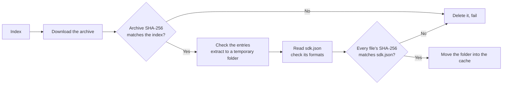
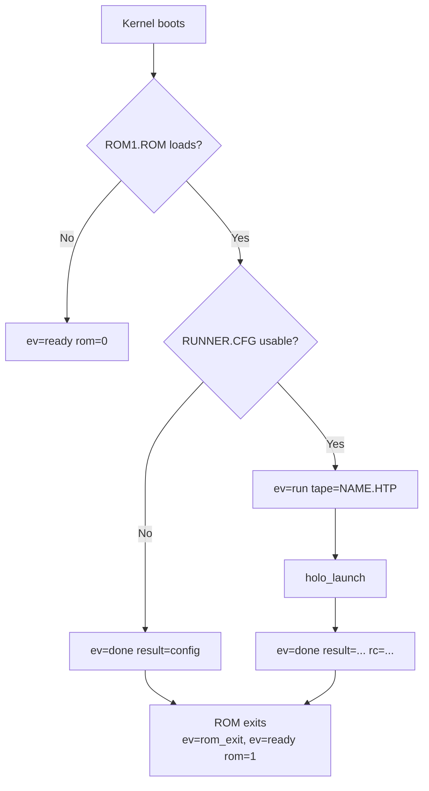

# SDK packages

An SDK package is a versioned zip archive that holds what a Studio project builds and runs against: headers, libraries, linker scripts, kernels and boot data. An SDK index lists the packages and the tools Studio downloads. This spec fixes the archive, its manifest `sdk.json`, the build flags `flags.json`, the runner ROM, the firmware pins, the `templates` package, the index, the rules that say whether a package fits a project, and every hash check.

State today: no package is built and no index exists. Pip-OS ships its SDK as the `sdk/` folder of its repository, as [PIPOS_ABI.md](./PIPOS_ABI.md#sdk) describes. A package is the compiled form of that folder plus the boot files. [STUDIO_PROJECT.md](./STUDIO_PROJECT.md) fixes the project that uses a package. [TESTING.md](./TESTING.md#bootjson) fixes `boot.json`.

## Packages and tools

| Name | Kind | Contents | Version |
|---|---|---|---|
| `pipos` | Package | Headers, `libpip.a`, `crt0.S`, linker scripts, `flags.json`, kernels, the runner ROM, the firmware stub, `boot.json`, the firmware pins | `MAJOR.MINOR.BUILD`. `MAJOR.MINOR` is the Pip-OS ABI it implements. |
| `templates` | Package | The project skeletons that `robco new` writes | The RobCo-Reel release, `X.Y.Z` |
| `gcc` | Tool | One xPack `arm-none-eabi-gcc` archive per host, from its publisher | The full xPack release, such as `15.2.1-1.1` |
| `qemu` | Tool | One QEMU build per host, with its source archive | The QEMU version, such as `10.1.2` |

A package is our archive with an `sdk.json`. A tool is an upstream or separate archive that the index points to by URL and hash. A tool has no `sdk.json`.

Other packages, such as `deitrix`, `terminal` and `reel`, follow the same rules when they exist. This spec defines the layout of `pipos` and of `templates`.

## The archive

A package file is a zip archive named `<name>-<version>.zip`, such as `pipos-1.3.0.zip`.

| Rule | Detail |
|---|---|
| Compression | Stored or deflate only |
| Entries | Regular files and folders only. No symbolic links, no devices. |
| Names | UTF-8, `/` as the separator, relative, no empty, `.` or `..` component, no drive letter |
| Case | No two entries whose names differ only in case |
| Manifest | `sdk.json` at the archive root |
| Everything else | Listed in `sdk.json` `files`, and nothing unlisted |

An archive that breaks a rule fails the install with `package: archive` and names the entry. The tool extracts nothing from it.

A tool installs a package into its own folder, `<cache>/packages/<name>/<version>/`. The tool never writes into an installed package folder after the install.

### The cache folder

`<cache>` is the system's standard per-user cache folder plus `robco`:

| System | `<cache>` |
|---|---|
| Linux | `$XDG_CACHE_HOME/robco`. When `XDG_CACHE_HOME` is unset, empty or not an absolute path: `$HOME/.cache/robco`. |
| macOS | `$HOME/Library/Caches/robco` |
| Windows | `%LOCALAPPDATA%\robco` |

The environment variable `ROBCO_CACHE` overrides the table on every system. Its value is used as `<cache>` itself, with no `robco` added. A value that is set but empty counts as unset. A value that is not an absolute path fails every command that needs the cache with `cache: path`. The tool creates `<cache>` and its subfolders when it first needs them.

| Folder | Content |
|---|---|
| `<cache>/packages/<name>/<version>/` | An installed package |
| `<cache>/tools/<name>/<version>/<host>/` | An extracted tool archive, such as `<cache>/tools/gcc/15.2.1-1.1/linux-x64/` |
| `<cache>/firmware/<tag>/` | The firmware files of one [firmware pin](#firmware-pins) |

A person may delete `<cache>` at any time. The next command that needs a file downloads it again and checks it as [Hashes](#hashes) says.



## sdk.json

`sdk.json` is a JSON object, UTF-8, at the archive root.

| Field | Type | Required | Meaning |
|---|---|---|---|
| `format` | integer | Yes | `1` for this spec |
| `name` | string | Yes | The package name. Equals the name in the file name and in the index. |
| `version` | string | Yes | `X.Y.Z`, decimal, each part from 0 to 65535. Equals the version in the file name and in the index. |
| `abi` | string | For `pipos` | The ABI the package implements, `MAJOR.MINOR`. Equals the first two parts of `version`. |
| `built_from` | array of objects | Yes | One per repository that went into the package |
| `formats` | object | Yes | The format versions the package uses. See below. |
| `requires` | array of objects | No | Other packages this one needs. Empty by default. |
| `tools` | array of objects | For `pipos` | The compiler and the emulator that go with this package. See [Tools a package names](#tools-a-package-names). |
| `firmware` | object | For `pipos` | The firmware pins. See [Firmware pins](#firmware-pins). |
| `licences` | array of objects | Yes | The licence of each part. See [Licences](#licences). |
| `files` | array of objects | Yes | Every file in the archive but `sdk.json` |

`built_from` entries:

| Field | Type | Meaning |
|---|---|---|
| `repo` | string | The repository name, such as `Pip-OS` |
| `commit` | string | The full 40-digit commit, lower case hex |

`formats` holds one integer per format. A package names every format it carries.

| Key | Format | Defined in |
|---|---|---|
| `rimg` | The `rimg` header version, `hdr_version` | [IMAGE_FORMAT.md](./IMAGE_FORMAT.md) |
| `flags` | `flags.json` `format` | This spec |
| `boot` | `boot.json` `format` | [TESTING.md](./TESTING.md#bootjson) |
| `runner` | The runner ROM's contract: `RUNNER.CFG` and its marker lines | [The runner ROM](#the-runner-rom) |
| `templates` | `templates.json` `format` | [templates.json](#templatesjson) |
| `project` | `robco.toml` `format` of the manifests a package holds | [STUDIO_PROJECT.md](./STUDIO_PROJECT.md#format-version) |
| `scenario` | Scenario file `format` of the scenarios a package holds | [STUDIO_CLI.md](./STUDIO_CLI.md#scenario-files) |

A `pipos` package carries `rimg`, `flags`, `boot` and `runner`. A `templates` package carries `templates`, `project` and `scenario`.

`requires` entries:

| Field | Type | Meaning |
|---|---|---|
| `name` | string | A package name |
| `abi` | string | The lowest ABI of that package, `MAJOR.MINOR`. It fits by the rules of [Version and ABI rules](#version-and-abi-rules). |

`files` entries:

| Field | Type | Meaning |
|---|---|---|
| `path` | string | The entry name in the archive |
| `size` | integer | The size in bytes |
| `sha256` | string | 64 lower case hex digits |

`files` is sorted by `path` in byte order.

### Reading sdk.json

- A larger `format` fails with `package: format` and asks for a newer tool.
- A format in `formats` with a value the tool does not know fails with `package: format` and names the format. Studio links its format code when it is built, so it never guesses.
- A field the tool does not know is ignored. A new field that changes how a package must be read raises `format`.
- A required field that is missing or has the wrong type fails with `package: manifest`.

### Layout of pipos

| Path | Content |
|---|---|
| `sdk.json` | The manifest |
| `include/pipos/*.h` | The SDK headers |
| `lib/libpip.a` | Syscall wrappers and the small libc. See [Building libpip.a](#building-libpipa). |
| `lib/crt0.S` | The startup code, as source. See [Startup code](#startup-code). |
| `lib/holotape.ld` | Links at `0x00800000` |
| `lib/rom.ld` | Links at `0x00400000` |
| `flags.json` | Compile and link flags |
| `boot/PIPOS.IMG` | The release kernel |
| `boot/pipos.elf` | Its ELF, for a debugger |
| `boot/PIPOS.CFG` | The default Pip-OS config |
| `boot/config.txt` | The default `config.txt` |
| `boot/RUNNER.ROM` | The runner ROM: it launches the project's tape and prints its exit status. See [The runner ROM](#the-runner-rom). |
| `boot/fwstub.bin` | The QEMU firmware stub, built from RobCo-Core `tests/fwstub/` |
| `boot.json` | The QEMU arguments per board |
| `docs/` | The API reference |
| `LICENSES/` | The licence texts |

### Tools a package names

`tools` in the `sdk.json` of `pipos` names the two tools a project must use with this package, at one exact version each. The tool that resolves takes those versions. It never takes the newest version the index lists.

`tools` holds exactly two entries, `gcc` first, then `qemu`:

| Field | Type | Required | Meaning |
|---|---|---|---|
| `name` | string | Yes | `gcc` or `qemu` |
| `version` | string | Yes | The version, spelled as the index spells it: the full xPack release for `gcc`, such as `15.2.1-1.1`, and the QEMU version for `qemu`, such as `10.1.2` |

| Entry | What the version says |
|---|---|
| `gcc` | The compiler that built `lib/libpip.a`, and the compiler that every project build against this package runs |
| `qemu` | The emulator that the package's kernel, firmware stub and `boot.json` were tested with |

The reason: the sealed tape is equal across build paths only when the project's objects and `libpip.a` come from the same compiler release. [K2](https://github.com/RobCo-Industries/RobCo-Studio/blob/main/docs/spikes/K2.md) built Culvert with another release of the compiler and got another tape. If the tool took the newest `gcc` of the index, adding a compiler to the index would change the tapes of every project at its next `robco update`, and no package would say which compiler its `libpip.a` came from. `boot.json` and the kernel depend on the emulator in the same way, since the [canary suite](./TESTING.md#canary-suite) proves one QEMU version at a time.

Rules for the tool:

| Case | What the tool does |
|---|---|
| Resolving | For the `pipos` package it picked, it takes each tool at the `version` the package names. The index entry of the package carries the same `tools`, so resolving needs no download. |
| Comparing versions | As strings, byte for byte. Tool versions have no order. |
| The index has no tool with that name and version | Fails with `sdk: no tool` and names the tool and the version |
| That tool has no archive for the running host | Fails with `index: host` |
| `tools` of an installed `sdk.json` differs from `tools` of its index entry | Fails the install with `package: manifest` |
| `tools` is absent in a `pipos` package, has another length, another order or another name | Fails with `package: manifest` |
| A package other than `pipos` carries `tools` | Fails with `package: manifest` |

Left out on purpose: a second package that names tools, and a range of versions. One package names both tools, at one version each.

Rules for Pip-OS, which builds the package:

1. Its package job downloads the `linux-x64` archive of the `gcc` release from the publisher and checks it against a SHA-256 pinned in the Pip-OS repository.
2. It builds `lib/libpip.a` with that compiler and with no other.
3. It fails when `arm-none-eabi-gcc -dumpfullversion` does not print the part of `version` before the first `-`, such as `15.2.1` for `15.2.1-1.1`.
4. It writes the two versions into `tools`.

### Building libpip.a

Pip-OS builds `lib/libpip.a` with `ar rcsD`. The `D` flag writes 0 for every date, user and group id and a fixed mode, so two builds of one package from one commit give the same archive. Without it `ar` stores the build time and the archive hash differs on every build. Today `pipos-app.mk` runs `ar rcs`, so Pip-OS must change it to `ar rcsD`. [K2](https://github.com/RobCo-Industries/RobCo-Studio/blob/main/docs/spikes/K2.md) measured this.

## flags.json

`flags.json` holds the compile and link flags of a project build. Pip-OS writes it from `pipos-app.mk` when it builds the package, so the flags have one source.

| Field | Type | Required | Meaning |
|---|---|---|---|
| `format` | integer | Yes | `1` for this spec |
| `cflags` | array of strings | Yes | Flags for each C compile, in order |
| `include_dirs` | array of strings | Yes | Folders for `-I`, relative to the package root |
| `ldflags` | array of strings | Yes | Flags for the link, in order |
| `linker_scripts` | object | Yes | Kind to script path, relative to the package root: `holotape`, `rom` |
| `crt0` | string | Yes | The startup code source, relative to the package root: `lib/crt0.S` |
| `crt0_defines` | object | Yes | Kind and subtype to an array of macro definitions for the startup code. Keys: `holotape-game`, `holotape-utility`, `rom`. Each string is `NAME=VALUE`, passed as `-D` and the string. |
| `libs` | array of strings | Yes | Archive paths relative to the package root, in link order |
| `system_libs` | array of strings | Yes | Flags for the compiler's own libraries, last on the link line, such as `-lgcc` |
| `abi_define` | string | Yes | The macro that carries the project's ABI. See [PIPOS_ABI.md](./PIPOS_ABI.md#calls-newer-than-the-target-abi). |

No flag in `cflags` or `ldflags` holds a path. Paths live in the fields made for them, so a tool joins them to the package folder on any system. `flags.json` holds no path map either: the tool adds the maps itself, as [Path maps](#path-maps) says.

### Build order

A tool runs these steps in order, with `gcc` the `arm-none-eabi-gcc` of the locked tool archive, `PKG` the installed package folder and `<maps>` the flags of [Path maps](#path-maps). Each command is an argument list passed to the program with no shell, so a quote inside an argument reaches `gcc` as it is.

1. Compile the startup code:
   `gcc <cflags> -D<abi_define>=<abi> -D<crt0_defines>... -I<PKG/include_dirs>... <maps> -c <PKG/crt0> -o <crt0 object>`.
   `<crt0_defines>` is the array of the project's kind and subtype, such as `holotape-game`, one `-D` argument per string, in array order.
2. For each source, in the order of the source list of [STUDIO_PROJECT.md](./STUDIO_PROJECT.md#source-order):
   `gcc <cflags> -D<abi_define>=<abi> -I<PKG/include_dirs>... <maps> -c <source> -o <object>`.
3. `gcc <ldflags> -T <PKG/linker script> <crt0 object> <objects> <PKG/libs>... <system_libs> -o build/NAME.elf`, with `<objects>` in the order of the source list.
4. `arm-none-eabi-objcopy -O binary build/NAME.elf <raw>`
5. Seal `<raw>` into `build/NAME.HTP`.

`<abi>` is `0x` and 8 lower case hex digits: `(MAJOR << 16) | MINOR` of `target.abi`, such as `0x00010003` for `1.3`. Steps 1 and 2 pass the same value. The object paths are the tool's choice, under `build/`.

### Startup code

The package ships the startup code as source, `lib/crt0.S`, and every project build compiles it at step 1 of [Build order](#build-order). So the header's `abi_version` holds the project's target ABI, not the package's.

| Rule | Detail |
|---|---|
| The file | `lib/crt0.S` is Pip-OS's `sdk/crt0.S` at the commit in `built_from`, byte for byte |
| The ABI | `crt0.S` writes `PIPOS_ABI_TARGET` into `abi_version`. The build passes it as `-DPIPOS_ABI_TARGET=<abi>`, through `abi_define`. |
| Magic and subtype | From `crt0_defines`: `PIP_IMG_MAGIC="ROBCO78"` and `PIP_IMG_SUBTYPE=0` for `holotape-game`, `PIP_IMG_MAGIC="ROBCO78"` and `PIP_IMG_SUBTYPE=1` for `holotape-utility`, `PIP_IMG_MAGIC="ROM1"` and `PIP_IMG_SUBTYPE=0` for `rom` |
| An older target | A project with `abi = "1.3"` built against `pipos` 1.4.0 gets `abi_version = 0x00010003`. The loader checks only the major, so the tape loads on every 1.x kernel. |
| No define | Without `PIPOS_ABI_TARGET`, `abi.h` defines it to `PIP_ABI_VERSION`, the ABI of the headers. `pipos-app.mk` builds this way when its `ABI` variable is not set. See [The target ABI in pipos-app.mk](./PIPOS_ABI.md#the-target-abi-in-pipos-appmk). |

Seal never changes `abi_version`, as [Seal steps](./IMAGE_FORMAT.md#seal-steps) says. Only the compile of `crt0.S` sets it.

What Pip-OS's `sdk/crt0.S` and `abi.h` must do for this rule. Today `crt0.S` writes `PIP_ABI_VERSION`, so every tape carries the ABI of the headers.

1. `abi.h` defines `PIPOS_ABI_TARGET` to `PIP_ABI_VERSION` when it is not defined, and stops with `#error` when it is larger than `PIP_ABI_VERSION`. These are the rules of [Calls newer than the target ABI](./PIPOS_ABI.md#calls-newer-than-the-target-abi).
2. `crt0.S` writes `.word PIPOS_ABI_TARGET` in place of `.word PIP_ABI_VERSION`.

### Path maps

No path of the machine that builds may reach a build output, so every root that appears on a compile line gets a map to a fixed name. The tool adds three `-ffile-prefix-map` flags to every compile, steps 1 and 2 of [Build order](#build-order), and to no other step:

1. `-ffile-prefix-map=<project root>=.`
2. `-ffile-prefix-map=<toolchain root>=toolchain`
3. `-ffile-prefix-map=<package root>=sdk`

`<project root>` is the absolute path of the folder that holds `robco.toml`. `<toolchain root>` is the absolute path of the folder that holds the gcc archive's `bin/`. `<package root>` is `PKG`, the installed package folder under `<cache>`. On Windows the tool passes each map twice, first with `\` and then with `/` as the separator, so six flags in all.

Without the maps, the person's folder path, the toolchain path and the cache path, which holds the user name, land in the debug info of `build/NAME.elf`. The maps keep them out. They do not change the tape, which holds no debug info. [K2](https://github.com/RobCo-Industries/RobCo-Studio/blob/main/docs/spikes/K2.md) measured the first two maps. The third follows from the same rule and is not measured yet. Two checks will measure it: the agreement check that compares tapes across systems and build paths, and a check that searches the ELF for the project root, the toolchain root and the cache root.

### What must be equal

Only the sealed tape, `build/NAME.HTP`, must be byte-equal across host systems and project folders, for the same manifest, lock and sources. Objects, `build/NAME.elf` and the map files may differ. [K2](https://github.com/RobCo-Industries/RobCo-Studio/blob/main/docs/spikes/K2.md) found the tape equal on Linux, macOS and Windows and through two build paths with no extra flag. The Windows ELF differs in its debug sections through the `libgcc.a` of xPack's Windows archive, and no compile flag cures that. So the tool adds no `-fno-ident`, and a test of a build compares tapes only.

### Reading flags.json

A `flags.json` with a larger `format` fails with `package: format`. An unknown field is ignored.

## The runner ROM

The runner ROM is the ROM that `robco run` and `robco test` boot. It launches one tape, prints how the tape ended and exits. It draws nothing, shows no menu and reads no key. With it, a tape project runs without Deitrix.

State today: it does not exist. `tests/launcher/` in RobCo-Reel is a test ROM of the same shape, with the tape name built in. Pip-OS will build the runner from its SDK and ship it in the `pipos` package.

| Property | Value |
|---|---|
| Path in the package | `boot/RUNNER.ROM` |
| Path on a card | `/PIPBOY/ROM1.ROM` |
| Image | A sealed `ROM1` image, subtype 0, with the header `name` `RUNNER`. It is built with `pipos-app.mk` with no `ABI` variable, so it carries the ABI of the package. |
| Version of this contract | `runner` in `formats` of `sdk.json`, `1` for this spec. It covers `RUNNER.CFG` and the marker lines. |

### What the kernel gives a ROM

These are facts of the kernel as it is, and the runner is shaped by them. None is a request.

| Fact | Consequence |
|---|---|
| The kernel loads one ROM, `/PIPBOY/ROM1.ROM`. It has no setting for another path. | The tool copies `boot/RUNNER.ROM` to the card under that name. |
| A ROM gets no argument. `args` in its startup block is empty. | The runner reads the tape's name from a file on the card, with `file_open` and `file_read`. |
| A ROM runs in USR mode and prints only through `log`. It cannot read the values of a `boot` marker. | The runner prints no `boot` marker. |
| `holo_launch` returns the tape's exit status or a negative code, as [Launching](./PIPOS_ABI.md#launching) says. | The runner prints that value and needs nothing else. |
| After the ROM exits, the kernel prints `ev=rom_exit` and `ev=ready rom=1` and stays in its main loop. It does not power off. | QEMU keeps running. The tool ends the run. |
| The kernel sets no time limit on a tape. | A tape that never ends holds the machine. The tool's time limit ends the run. |
| While a tape runs, the kernel reads the script channel only inside `sleep_ms`, the input calls, `file_read` and `holo_enumerate`. | A key sent to a tape that makes none of those calls is not answered. |
| The kernel prints `ev=holo_start name=<file>` when a tape starts and `ev=holo_error code=<code> name=<file>` when a load fails. [BOOT_PROTOCOL.md](./BOOT_PROTOCOL.md#events) lists `holo_launch path` and neither of these. | A tool reads the runner's lines, not these. |

### RUNNER.CFG

The runner reads `/PIPBOY/RUNNER.CFG`. It is INI text in the syntax of [`ini.h`](../guide/api/buses.md#configuration-files-inih), at most 255 bytes long.

| Section | Key | Required | Value |
|---|---|---|---|
| `run` | `tape` | Yes | The file name of the tape, such as `PIPES.HTP`: a name `holo_launch` accepts, with no folder |

The runner reads this one key and passes an empty argument string to the tape. Left out on purpose: an argument string, a list of tapes and a tape on the slot card.

The tool writes the file as exactly these bytes, with `NAME` the `project.name` and LF line ends:

```
[run]
tape = NAME.HTP
```

### What the runner does

The runner is `pip_main()` of one C file. It runs these steps once, in order, and stops at the first that fails:

| Step | Action | On failure it prints `ev=done` with |
|---|---|---|
| 1 | `file_open("/PIPBOY/RUNNER.CFG")` | `result=config why=open`, `rc` the value returned |
| 2 | `file_read` into a buffer of 256 bytes until it returns 0 or the buffer is full, then `file_close` | `result=config why=read`, `rc` the negative value returned |
| 3 | The file holds 1 to 255 bytes | `result=config why=size rc=0` |
| 4 | `pip_ini_get()` of key `tape` in section `run`, into 13 bytes | `result=config why=parse`, `rc` the value returned |
| 5 | Every byte of the value is from `0x21` to `0x7E` | `result=config why=name rc=0` |
| 6 | Print `ev=run` with the value | |
| 7 | `holo_launch(value, "")` | |
| 8 | Print `ev=done` with the result of step 7 | |
| 9 | Return 0 from `pip_main()` when the result is `exit`, else 1 | |

The runner prints each marker with one `log` call, as one line that ends in a line feed. It prints nothing else. It never draws and never reads an event.

### Runner markers

The lines follow the marker format of [Serial markers](./BOOT_PROTOCOL.md#serial-markers), with the stage name `runner`. The keys come in the order shown, with one space between them.

| Line | When |
|---|---|
| `@RC stage=runner ev=run tape=<file>` | Right before `holo_launch`. At most once per boot. |
| `@RC stage=runner ev=done result=<result> rc=<rc>` | After `holo_launch` returned. `<rc>` is the value it returned, as a signed decimal number. |
| `@RC stage=runner ev=done result=config rc=<rc> why=<why>` | `RUNNER.CFG` could not be used, and `holo_launch` was not called |

A runner that reaches its end prints exactly one `done` line, and it is the last line the runner prints.

| `result` | `holo_launch` returned | Meaning |
|---|---|---|
| `exit` | 0 to 255 | The tape ran and ended. `rc` is its exit status. |
| `fault` | `-PIP_EFAULT`, -14 | The kernel killed the tape after a fault. The kernel printed `ev=holo_kill` first. |
| `missing` | `-PIP_ENOENT`, -2 | No such tape on the card |
| `bad` | `-PIP_ENOEXEC`, -40 | The file failed a validation step, or it is a data tape |
| `io` | `-PIP_EIO`, -5 | A read of the card failed |
| `eject` | `-PIP_ENODEV`, -41 | The slot card was pulled while its tape ran |
| `error` | Any other negative value | Such as `-PIP_EINVAL`, -22, for a name the kernel refuses |
| `config` | Not called | See the steps above. `why` is `open`, `read`, `size`, `parse` or `name`. |

A run of a tape that returns 3:

```
@RC stage=pipos ev=jump entry=0x00400000
@RC stage=runner ev=run tape=PIPES.HTP
@RC stage=pipos ev=holo_start name=PIPES.HTP
tape: ready
@RC stage=pipos ev=holo_exit status=3
@RC stage=runner ev=done result=exit rc=3
@RC stage=pipos ev=rom_exit status=0
@RC stage=pipos ev=ready rom=1
```

A card without the tape:

```
@RC stage=runner ev=run tape=PIPES.HTP
@RC stage=runner ev=done result=missing rc=-2
@RC stage=pipos ev=rom_exit status=1
@RC stage=pipos ev=ready rom=1
```

A card without `RUNNER.CFG`:

```
@RC stage=runner ev=done result=config rc=-2 why=open
@RC stage=pipos ev=rom_exit status=1
@RC stage=pipos ev=ready rom=1
```

The `stage=pipos` lines are the kernel's own and are shown for context. Only the `stage=runner` lines are part of this contract.

### When a run is over

A tool reads the PL011 line by line. A line holds a marker when it contains the four bytes `@RC `, and the marker runs from the first of them to the end of the line. A tape may leave a line unfinished, so a marker does not always start its line. The tool splits the marker at spaces into `key=value` pairs, at the first `=` of each, and finds keys by name. The first of these markers ends the run:

| Marker | The run ended because |
|---|---|
| `stage=runner` with `ev=done` | The runner reported. `result` and `rc` say how. |
| Any stage with `ev=exception` or `ev=panic` | The kernel stopped on a fault of its own. No `done` line will come. |
| `stage=pipos` with `ev=ready`, before any `done` line | The kernel reached its main loop and the runner did not report: the ROM did not load, with `rom=0`, or the kernel killed it, with `rom=1`. No `done` line will come. |

A run with none of these lines is not over. The tape still runs, and only the tool's time limit ends it. After a `done` line the machine idles in the kernel's main loop, with the script channel still answering, until the tool stops QEMU.



### What Pip-OS must add for the runner

1. `sdk/examples/runner/`: `main.c` and a `Makefile` that includes `pipos-app.mk` with `KIND := rom`, `NAME := RUNNER` and `IMAGE := RUNNER.ROM`. The code follows [What the runner does](#what-the-runner-does) and prints the lines of [Runner markers](#runner-markers), byte for byte.
2. Its package build copies the built image to `boot/RUNNER.ROM` and writes `"runner": 1` into `formats` of `sdk.json`.
3. A target test on every board that boots a card with the runner as `/PIPBOY/ROM1.ROM`: a tape that returns 0, a tape that returns 3, a missing tape, a tape with a bad CRC and a card without `RUNNER.CFG`. Each case checks the exact `done` line and that `ev=ready rom=1` follows.

No kernel change is needed.

## Firmware pins

The Pi firmware files are never part of a package. The `pipos` package carries their pins in `sdk.json` `firmware`, with the values of `tools/fetch_firmware.sh` at the RobCo-Core commit the package was built from.

| Field | Type | Meaning |
|---|---|---|
| `repo` | string | `raspberrypi/firmware` |
| `tag` | string | The release tag, such as `1.20260915` |
| `commit` | string | The full commit of that tag |
| `base_url` | string | The download base. `<base_url>/<file>` is each file. |
| `files` | array of objects | `name`, `sha256`, for `bootcode.bin`, `start.elf`, `fixup.dat` |

A tool downloads each file, checks its SHA-256 and keeps it in `<cache>/firmware/<tag>/`. A mismatch deletes the file and fails with `firmware: hash`. The tool never puts a firmware file into a package, an index or a release of its own.

## The templates package

The `templates` package holds the project skeletons that `robco new` writes. RobCo-Reel builds it. State today: no template and no package exists.

It is a package like any other: the rules of [The archive](#the-archive), [sdk.json](#sdkjson), [Hashes](#hashes) and [What a package must never contain](#what-a-package-must-never-contain) apply, and it installs into `<cache>/packages/templates/<version>/`.

| Property | Value |
|---|---|
| File name | `templates-<version>.zip` |
| `version` | `X.Y.Z`, the RobCo-Reel release it was built from |
| `abi`, `tools`, `firmware` | Absent |
| `requires` | Empty |
| `built_from` | `RobCo-Reel` and its commit |
| `formats` | `templates`, `project` and `scenario`, each `1` for this spec |
| `licences` | MIT for every path |

`project` and `scenario` are the format versions of the `robco.toml` and of the scenario files that the templates hold. A tool that does not know one of them refuses the package by the rule of [Reading sdk.json](#reading-sdkjson), so it never writes a project it cannot build.

### Layout of templates

| Path | Content |
|---|---|
| `sdk.json` | The manifest |
| `templates.json` | The list of templates |
| `<id>/` | The files of the template `<id>`, laid out as they go into a new project |
| `LICENSES/` | The licence texts |

The archive holds nothing else.

### templates.json

`templates.json` is a JSON object, UTF-8, at the archive root.

| Field | Type | Required | Meaning |
|---|---|---|---|
| `format` | integer | Yes | `1` for this spec |
| `templates` | array of objects | Yes | One or more templates, sorted by `id` in byte order |

A template:

| Field | Type | Required | Meaning |
|---|---|---|---|
| `id` | string | Yes | The name a person gives to `robco new`, and the folder of the template in the archive. 1 to 32 characters from `a` to `z`, `0` to `9` and `-`. It starts with a letter. |
| `title` | string | Yes | A short name for lists. ASCII, 1 to 64 bytes. |
| `description` | string | Yes | One sentence. ASCII, 1 to 200 bytes. |
| `kind` | string | Yes | The `project.kind` of the manifest the template writes: `holotape` |
| `files` | array of objects | Yes | Every file of the template, sorted by `path` in byte order |

A file:

| Field | Type | Required | Meaning |
|---|---|---|---|
| `path` | string | Yes | The path of the file inside `<id>/` and inside the new project. It follows the path rules of [robco.toml](./STUDIO_PROJECT.md#syntax). |
| `substitute` | boolean | Yes | `true`: the tool replaces the tokens of [Tokens](#tokens) in this file. `false`: the tool copies the file byte for byte. |

`robco new` reads `templates.json` and checks all of it before it writes anything:

| Case | Error |
|---|---|
| A larger `format` | `templates: format`, and the message asks for a newer tool |
| The file is missing, is not JSON, or a required field is missing or has the wrong type | `templates: manifest` |
| A field this spec does not define | `templates: manifest`, with its name. This file is new, so it starts strict. |
| Two templates with the same `id`, a list that is not sorted, or a value outside its limits | `templates: manifest` |
| A `path` that breaks a path rule, or two paths of one template that differ only in case | `templates: manifest` |
| A listed file that the package does not hold at `<id>/<path>` | `templates: manifest` |
| A file under `<id>/` that `files` does not list | `templates: manifest` |

### Tokens

A token is `@`, then one or more of `A` to `Z` and `_`, then `@`. Tokens count only in a file with `substitute` set to `true`.

| Token | Replaced by |
|---|---|
| `@NAME@` | The project name given to `robco new`, which follows the [name rules](./STUDIO_PROJECT.md#name-rules) |

The tool replaces every `@NAME@` in the file's bytes and changes nothing else. Any other token in such a file fails with `templates: token` and names the file and the token. A file that needs such text as it stands sets `substitute` to `false`.

The tool never changes line ends, on any system, and a `path` holds no token. Left out on purpose: a title or a version given on the command line, files that depend on an answer, and renamed files.

### The holotape-c template

The first template is `holotape-c`: a holotape in C that draws one screen, logs one line and ends on a key. Its entry in `templates.json`:

```json
{
  "format": 1,
  "templates": [
    {
      "id": "holotape-c",
      "title": "Holotape in C",
      "description": "A holotape in C that draws one screen and waits for SELECT.",
      "kind": "holotape",
      "files": [
        {"path": "icon.pbm", "substitute": false},
        {"path": "robco.toml", "substitute": true},
        {"path": "src/main.c", "substitute": false},
        {"path": "tests/golden/start/ready.png", "substitute": false},
        {"path": "tests/start.toml", "substitute": false}
      ]
    }
  ]
}
```

| File | Must hold |
|---|---|
| `robco.toml` | The manifest below, byte for byte |
| `icon.pbm` | A 32x32 PBM icon, `P1` or `P4`, of original art |
| `src/main.c` | The tape, by the rules below |
| `tests/start.toml` | The scenario below, byte for byte |
| `tests/golden/start/ready.png` | The golden image of the tape's screen, taken from QEMU, by the rules of [Golden images](./STUDIO_CLI.md#golden-images) |

`robco.toml`:

```toml
format = 1

[project]
name = "@NAME@"
title = "@NAME@"
version = "0.1.0"
kind = "holotape"
subtype = "utility"
icon = "icon.pbm"

[target]
platform = "pipos"
abi = "1.4"

[build]
backend = "robco"
sources = ["src/*.c"]
```

`tests/start.toml`:

```toml
format = 1

[[step]]
expect = "tape: ready"

[[step]]
screen = "ready"

[[step]]
tap = "select"

[[step]]
exit = 0
```

The tape, `src/main.c`:

1. Its first line is `/* SPDX-License-Identifier: MIT */`. It includes `<pipos/pip.h>` and no other header, and it calls nothing newer than ABI 1.4.
2. It draws one screen and calls `present` once. The screen depends only on the code and on the default colours of `gfx_info`. It shows no clock, no random value, no project name and no animation.
3. After `present` returns, it logs the line `tape: ready` once, with one `pip_printf("tape: ready\n")`.
4. It then waits for events. On a press of SELECT it returns 0 from `pip_main()`. It ignores every other event and draws nothing more.

Rule 2 makes one golden image right for every project name and every board. Rule 3 gives `robco run --headless --expect "tape: ready"` its line, after the frame is on the screen. Rule 4 lets the scenario send a key and read an exit status.

The golden image is right only on the card of [The simulator card](./STUDIO_CLI.md#the-simulator-card), whose `PIPOS.CFG` sets the colour scheme.

### What RobCo-Reel must add for the templates

1. `templates/holotape-c/` with the five files above.
2. A build of the template through `pipos-app.mk`, for its own tests: a Makefile outside the template folder with `NAME`, `TITLE`, `VERSION := 0.1.0`, `SUBTYPE := utility`, `ICON`, `ABI := 1.4` and `SRCS := src/main.c`, run in the template folder.
3. A target test on every board that boots that tape with the `PIPOS.CFG` of [The simulator card](./STUDIO_CLI.md#the-simulator-card), waits for `tape: ready`, compares the screen with `tests/golden/start/ready.png` pixel for pixel, sends SELECT and reads the tape's exit status 0. The ROM that launches the tape is the runner ROM once the Pip-OS pin holds it, and the repository's test launcher until then.
4. `make templates-package`, which writes `templates-<version>.zip` with `sdk.json`, `templates.json`, `holotape-c/` and `LICENSES/`.

## The index

The index is one JSON file that lists every package and tool a tool may install.

| Field | Type | Required | Meaning |
|---|---|---|---|
| `format` | integer | Yes | `1` for this spec |
| `packages` | array of objects | Yes | Every package version |
| `tools` | array of objects | Yes | Every tool version |

`packages` entries:

| Field | Type | Required | Meaning |
|---|---|---|---|
| `name` | string | Yes | The package name |
| `version` | string | Yes | `X.Y.Z` |
| `abi` | string | For `pipos` | As in `sdk.json` |
| `requires` | array | No | As in `sdk.json` |
| `tools` | array | For `pipos` | As in `sdk.json`. See [Tools a package names](#tools-a-package-names). |
| `url` | string | Yes | Where the archive is. `https:` or, for a local index, a path relative to the index file. |
| `size` | integer | Yes | The archive size in bytes |
| `sha256` | string | Yes | The archive's SHA-256 |

`tools` entries:

| Field | Type | Required | Meaning |
|---|---|---|---|
| `name` | string | Yes | `gcc` or `qemu` |
| `version` | string | Yes | The version, compared as a string. For `gcc` it is the full xPack release. |
| `archives` | object | Yes | Host name to an archive object |

An archive object:

| Field | Type | Required | Meaning |
|---|---|---|---|
| `url` | string | Yes | Where the archive is |
| `size` | integer | Yes | Its size in bytes |
| `sha256` | string | Yes | Its SHA-256 |
| `root` | string | Yes | The folder inside the archive that holds `bin/`. Empty when `bin/` is at the top. |

The host names are `linux-x64`, `linux-arm64`, `macos-x64`, `macos-arm64` and `windows-x64`. A tool that has no archive for the running host fails with `index: host`.

### Where the index is

Every command that reads the index takes the option `--index LOCATION`, written as two arguments or as `--index=LOCATION`. `LOCATION` is one of:

| Form | Meaning |
|---|---|
| Starts with `https://` | A URL. The tool downloads the index from it. |
| Starts with `http://` or another scheme followed by `://` | Refused with `index: location` |
| Anything else | A local file path, absolute or relative to the current folder |

A command reads the index only when it must resolve or download something. A build whose lock pins packages and tools already in `<cache>` reads no index and needs no `--index`. A command that must read the index and has no `--index` fails with `index: location`, and the message names the option. It never falls back to the `index` value of `robco.lock`, which is for the record only. A missing local file, or a download that fails, gives `index: read`.

The lock records `LOCATION` as given. Studio's CI passes a local fixture index. A default index URL built into each release comes later. It will apply only when `--index` is absent.

### Reading the index

A larger `format` fails with `index: format`. An unknown field is ignored. An entry with a missing field fails with `index: entry` and names it. Two entries with the same name and version fail with `index: duplicate`.

## Version and ABI rules

A version is `X.Y.Z`. Versions compare part by part as integers, X first.

A `pipos` package fits a project when:

1. The project's `target.platform` is `pipos`.
2. The package's ABI major equals the project's ABI major.
3. The package's ABI minor is at least the project's ABI minor.
4. Every format in the package's `formats` is one the tool knows.

So a project with `abi = "1.3"` fits `pipos` 1.3.x and 1.4.x, and not 1.2.x or 2.0.x. A tape built for 1.3 loads on any 1.x kernel, because a Pip-OS loader checks only the ABI major. On a kernel older than 1.3, a call added after that kernel's minor returns `-PIP_ENOSYS`. See [Calls newer than the target ABI](./PIPOS_ABI.md#calls-newer-than-the-target-abi).

A `requires` entry fits by the same rules 2 and 3, with its `abi` as the project's.

No package fits: the tool fails with `sdk: no package` and names the platform and ABI.

When several versions of a package fit, the tool picks the highest version by the order above. The lock then pins it. A newer package that appears in the index later changes nothing until `robco update`, as [When the lock changes](./STUDIO_PROJECT.md#when-the-lock-changes) says. A `requires` entry is resolved by the same rule.

A tool, `gcc` or `qemu`, is never picked by its version. The resolved `pipos` package names the version of each, as [Tools a package names](#tools-a-package-names) says, and the lock pins the archives of that version.

## Hashes

Every hash is SHA-256, written as 64 lower case hex digits. A tool compares hashes as strings after it lowers their case.

| What | Checked against | When | On a mismatch |
|---|---|---|---|
| A downloaded package archive | The index `sha256` and `size` | After the download, before any extraction | Deletes the download. Fails with `package: hash`. |
| A package archive named in `robco.lock` | The lock `sha256` | Before the tool uses it | Fails with `lock: hash`. Changes nothing. |
| Each file of a package | Its `files` entry in `sdk.json` | After extraction, before the folder enters the cache | Deletes the extracted folder. Fails with `package: hash` and names the file. |
| A tool archive | The index archive object, and the lock if one exists | After the download, before extraction | Deletes the download. Fails with `tool: hash`. |
| A firmware file | `sdk.json` `firmware` | After the download | Deletes the file. Fails with `firmware: hash`. |

A tool never retries a mismatch from another location, and never installs a file that failed its check. A download that stops short counts as a mismatch.

## What a package must never contain

- The Pi firmware files `bootcode.bin`, `start.elf` and `fixup.dat`, or any other file from `raspberrypi/firmware`.
- A file under the GPL in any package whose files are compiled or linked into a tape: `pipos` today. The `qemu` tool archive is the only download under the GPL.
- A file not listed in `sdk.json` `files`.
- A path, user name or host name of the machine that built it, in `sdk.json`, `flags.json` or `boot.json`.

## Licences

`licences` lists each part of the package and its licence as an SPDX identifier.

| Field | Type | Meaning |
|---|---|---|
| `paths` | array of strings | Path prefixes in the archive |
| `spdx` | string | The SPDX licence identifier |

| Part | Licence |
|---|---|
| `pipos`: headers, `libpip.a`, `crt0.S`, linker scripts, kernels, runner ROM, firmware stub, data files | MIT |
| `templates`: every template file | MIT. A template is copied into a person's project and becomes part of their tape. |
| `gcc`: the xPack archive. Its `libgcc` ends up in every tape. | GPL-3.0 with the GCC Runtime Library Exception for `libgcc`. The archive is not ours and is not repackaged. |
| `qemu`: our build | GPL-2.0, with its source archive in the same release |
| The Pi firmware | Not in any package. Fetched from its publisher under its own licence. |

## Examples

`sdk.json` of a `pipos` package. The commits and hashes are placeholders: no package is built yet. The firmware pins are those of `tools/fetch_firmware.sh` today.

```json
{
  "format": 1,
  "name": "pipos",
  "version": "1.3.0",
  "abi": "1.3",
  "built_from": [
    {"repo": "Pip-OS", "commit": "1111111111111111111111111111111111111111"},
    {"repo": "RobCo-Core", "commit": "2222222222222222222222222222222222222222"}
  ],
  "formats": {"rimg": 1, "flags": 1, "boot": 1, "runner": 1},
  "requires": [],
  "tools": [
    {"name": "gcc", "version": "15.2.1-1.1"},
    {"name": "qemu", "version": "10.1.2"}
  ],
  "firmware": {
    "repo": "raspberrypi/firmware",
    "tag": "1.20260915",
    "commit": "6f0881cba8bea8ec24956a5718714730e9936ec5",
    "base_url": "https://raw.githubusercontent.com/raspberrypi/firmware/6f0881cba8bea8ec24956a5718714730e9936ec5/boot",
    "files": [
      {"name": "bootcode.bin", "sha256": "4245ec23b58158dc3e55f3e065eb4ecc0c0705d76c8db506e9f824941feee32e"},
      {"name": "start.elf", "sha256": "32f990801e7765bae6fe5cb940ba5eeff02dd0dac8dc5474db5b3fd345281790"},
      {"name": "fixup.dat", "sha256": "7853f2b51e4489f8b3ce6f9c52fd0afdda38c7383961524e0883d34afcb4827b"}
    ]
  },
  "licences": [
    {"paths": [""], "spdx": "MIT"}
  ],
  "files": [
    {"path": "boot.json", "size": 4210, "sha256": "0000000000000000000000000000000000000000000000000000000000000001"},
    {"path": "boot/PIPOS.CFG", "size": 512, "sha256": "0000000000000000000000000000000000000000000000000000000000000002"},
    {"path": "boot/PIPOS.IMG", "size": 98304, "sha256": "0000000000000000000000000000000000000000000000000000000000000003"},
    {"path": "boot/RUNNER.ROM", "size": 4096, "sha256": "0000000000000000000000000000000000000000000000000000000000000004"},
    {"path": "boot/config.txt", "size": 160, "sha256": "0000000000000000000000000000000000000000000000000000000000000005"},
    {"path": "boot/fwstub.bin", "size": 1280, "sha256": "0000000000000000000000000000000000000000000000000000000000000006"},
    {"path": "boot/pipos.elf", "size": 524288, "sha256": "0000000000000000000000000000000000000000000000000000000000000007"},
    {"path": "flags.json", "size": 700, "sha256": "0000000000000000000000000000000000000000000000000000000000000008"},
    {"path": "include/pipos/pipos.h", "size": 9000, "sha256": "0000000000000000000000000000000000000000000000000000000000000009"},
    {"path": "lib/crt0.S", "size": 2600, "sha256": "000000000000000000000000000000000000000000000000000000000000000a"},
    {"path": "lib/holotape.ld", "size": 900, "sha256": "000000000000000000000000000000000000000000000000000000000000000d"},
    {"path": "lib/libpip.a", "size": 40000, "sha256": "000000000000000000000000000000000000000000000000000000000000000e"},
    {"path": "lib/rom.ld", "size": 900, "sha256": "000000000000000000000000000000000000000000000000000000000000000f"}
  ]
}
```

`flags.json`. The architecture flags are those of RobCo-Core's `mk/robco.mk` today. The other values show the shape. `pipos-app.mk` will write the real ones.

```json
{
  "format": 1,
  "cflags": [
    "-mcpu=arm1176jzf-s", "-marm", "-mfloat-abi=soft", "-mgeneral-regs-only",
    "-mno-unaligned-access", "-std=gnu11", "-ffreestanding", "-nostdlib",
    "-ffunction-sections", "-fdata-sections", "-fno-tree-loop-distribute-patterns",
    "-O2", "-g", "-Wall", "-Wextra"
  ],
  "include_dirs": ["include"],
  "ldflags": [
    "-mcpu=arm1176jzf-s", "-marm", "-mfloat-abi=soft", "-nostdlib",
    "-Wl,--gc-sections"
  ],
  "linker_scripts": {"holotape": "lib/holotape.ld", "rom": "lib/rom.ld"},
  "crt0": "lib/crt0.S",
  "crt0_defines": {
    "holotape-game": ["PIP_IMG_MAGIC=\"ROBCO78\"", "PIP_IMG_SUBTYPE=0"],
    "holotape-utility": ["PIP_IMG_MAGIC=\"ROBCO78\"", "PIP_IMG_SUBTYPE=1"],
    "rom": ["PIP_IMG_MAGIC=\"ROM1\"", "PIP_IMG_SUBTYPE=0"]
  },
  "libs": ["lib/libpip.a"],
  "system_libs": ["-lgcc"],
  "abi_define": "PIPOS_ABI_TARGET"
}
```

An index with one package and both tools. The URLs and hashes are placeholders.

```json
{
  "format": 1,
  "packages": [
    {
      "name": "pipos",
      "version": "1.3.0",
      "abi": "1.3",
      "requires": [],
      "tools": [
        {"name": "gcc", "version": "15.2.1-1.1"},
        {"name": "qemu", "version": "10.1.2"}
      ],
      "url": "https://example.invalid/robco/pipos-1.3.0.zip",
      "size": 812345,
      "sha256": "0000000000000000000000000000000000000000000000000000000000000001"
    }
  ],
  "tools": [
    {
      "name": "gcc",
      "version": "15.2.1-1.1",
      "archives": {
        "linux-x64": {"url": "https://example.invalid/gcc-linux-x64.tar.gz", "size": 1, "sha256": "0000000000000000000000000000000000000000000000000000000000000003", "root": "xpack-arm-none-eabi-gcc-15.2.1-1.1"},
        "linux-arm64": {"url": "https://example.invalid/gcc-linux-arm64.tar.gz", "size": 1, "sha256": "0000000000000000000000000000000000000000000000000000000000000002", "root": "xpack-arm-none-eabi-gcc-15.2.1-1.1"},
        "macos-x64": {"url": "https://example.invalid/gcc-macos-x64.tar.gz", "size": 1, "sha256": "0000000000000000000000000000000000000000000000000000000000000005", "root": "xpack-arm-none-eabi-gcc-15.2.1-1.1"},
        "macos-arm64": {"url": "https://example.invalid/gcc-macos-arm64.tar.gz", "size": 1, "sha256": "0000000000000000000000000000000000000000000000000000000000000004", "root": "xpack-arm-none-eabi-gcc-15.2.1-1.1"},
        "windows-x64": {"url": "https://example.invalid/gcc-windows-x64.zip", "size": 1, "sha256": "0000000000000000000000000000000000000000000000000000000000000006", "root": "xpack-arm-none-eabi-gcc-15.2.1-1.1"}
      }
    },
    {
      "name": "qemu",
      "version": "10.1.2",
      "archives": {
        "linux-x64": {"url": "https://example.invalid/qemu-linux-x64.tar.gz", "size": 1, "sha256": "0000000000000000000000000000000000000000000000000000000000000007", "root": ""},
        "macos-arm64": {"url": "https://example.invalid/qemu-macos-arm64.tar.gz", "size": 1, "sha256": "0000000000000000000000000000000000000000000000000000000000000008", "root": ""},
        "windows-x64": {"url": "https://example.invalid/qemu-windows-x64.zip", "size": 1, "sha256": "0000000000000000000000000000000000000000000000000000000000000009", "root": ""}
      }
    }
  ]
}
```

`boot.json` has its example in [TESTING.md](./TESTING.md#bootjson).
