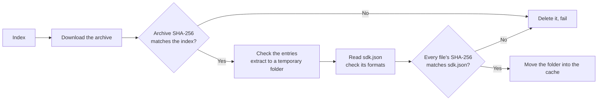

# SDK packages

An SDK package is a versioned zip archive that holds what a Studio project builds and runs against: headers, libraries, linker scripts, kernels and boot data. An SDK index lists the packages and the tools Studio downloads. This spec fixes the archive, its manifest `sdk.json`, the build flags `flags.json`, the firmware pins, the index, the rules that say whether a package fits a project, and every hash check.

State today: no package is built and no index exists. Pip-OS ships its SDK as the `sdk/` folder of its repository, as [PIPOS_ABI.md](./PIPOS_ABI.md#sdk) describes. A package is the compiled form of that folder plus the boot files. [STUDIO_PROJECT.md](./STUDIO_PROJECT.md) fixes the project that uses a package. [TESTING.md](./TESTING.md#bootjson) fixes `boot.json`.

## Packages and tools

| Name | Kind | Contents | Version |
|---|---|---|---|
| `pipos` | Package | Headers, `libpip.a`, `crt0` objects, linker scripts, `flags.json`, kernels, the runner ROM, the firmware stub, `boot.json`, the firmware pins | `MAJOR.MINOR.BUILD`. `MAJOR.MINOR` is the Pip-OS ABI it implements. |
| `gcc` | Tool | One xPack `arm-none-eabi-gcc` archive per host, from its publisher | The xPack release, such as `15.2.1` |
| `qemu` | Tool | One QEMU build per host, with its source archive | The QEMU version, such as `10.1.2` |

A package is our archive with an `sdk.json`. A tool is an upstream or separate archive that the index points to by URL and hash. A tool has no `sdk.json`.

Other packages, such as `deitrix`, `terminal`, `reel` and `templates`, follow the same rules when they exist. This spec defines the layout of `pipos` only.

## The archive

A package file is a zip archive named `<name>-<version>.zip`, such as `pipos-1.3.0.zip`.

| Rule | Detail |
|---|---|
| Compression | Stored or deflate only |
| Entries | Regular files and folders only. No symbolic links, no devices. |
| Names | UTF-8, `/` as the separator, relative, no empty, `.` or `..` component, no drive letter |
| Case | No two entries whose names differ only in case |
| Manifest | `sdk.json` at the archive root |
| Everything else | Listed in `sdk.json` `files`, and nothing unlisted |

An archive that breaks a rule fails the install with `package: archive` and names the entry. The tool extracts nothing from it.

A tool installs a package into its own folder, `<cache>/packages/<name>/<version>/`. `<cache>` is a per-user folder the tool chooses. The tool never writes into an installed package folder after the install.



## sdk.json

`sdk.json` is a JSON object, UTF-8, at the archive root.

| Field | Type | Required | Meaning |
|---|---|---|---|
| `format` | integer | Yes | `1` for this spec |
| `name` | string | Yes | The package name. Equals the name in the file name and in the index. |
| `version` | string | Yes | `X.Y.Z`, decimal, each part from 0 to 65535. Equals the version in the file name and in the index. |
| `abi` | string | For `pipos` | The ABI the package implements, `MAJOR.MINOR`. Equals the first two parts of `version`. |
| `built_from` | array of objects | Yes | One per repository that went into the package |
| `formats` | object | Yes | The format versions the package uses. See below. |
| `requires` | array of objects | No | Other packages this one needs. Empty by default. |
| `firmware` | object | For `pipos` | The firmware pins. See [Firmware pins](#firmware-pins). |
| `licences` | array of objects | Yes | The licence of each part. See [Licences](#licences). |
| `files` | array of objects | Yes | Every file in the archive but `sdk.json` |

`built_from` entries:

| Field | Type | Meaning |
|---|---|---|
| `repo` | string | The repository name, such as `Pip-OS` |
| `commit` | string | The full 40-digit commit, lower case hex |

`formats` holds one integer per format. A package names every format it carries.

| Key | Format | Defined in |
|---|---|---|
| `rimg` | The `rimg` header version, `hdr_version` | [IMAGE_FORMAT.md](./IMAGE_FORMAT.md) |
| `flags` | `flags.json` `format` | This spec |
| `boot` | `boot.json` `format` | [TESTING.md](./TESTING.md#bootjson) |

`requires` entries:

| Field | Type | Meaning |
|---|---|---|
| `name` | string | A package name |
| `abi` | string | The lowest ABI of that package, `MAJOR.MINOR`. It fits by the rules of [Version and ABI rules](#version-and-abi-rules). |

`files` entries:

| Field | Type | Meaning |
|---|---|---|
| `path` | string | The entry name in the archive |
| `size` | integer | The size in bytes |
| `sha256` | string | 64 lower case hex digits |

`files` is sorted by `path` in byte order.

### Reading sdk.json

- A larger `format` fails with `package: format` and asks for a newer tool.
- A format in `formats` with a value the tool does not know fails with `package: format` and names the format. Studio links its format code when it is built, so it never guesses.
- A field the tool does not know is ignored. A new field that changes how a package must be read raises `format`.
- A required field that is missing or has the wrong type fails with `package: manifest`.

### Layout of pipos

| Path | Content |
|---|---|
| `sdk.json` | The manifest |
| `include/pipos/*.h` | The SDK headers |
| `lib/libpip.a` | Syscall wrappers and the small libc |
| `lib/crt0-game.o` | Startup code for a holotape, subtype 0 |
| `lib/crt0-utility.o` | Startup code for a holotape, subtype 1 |
| `lib/crt0-rom.o` | Startup code for a ROM |
| `lib/holotape.ld` | Links at `0x00800000` |
| `lib/rom.ld` | Links at `0x00400000` |
| `flags.json` | Compile and link flags |
| `boot/PIPOS.IMG` | The release kernel |
| `boot/pipos.elf` | Its ELF, for a debugger |
| `boot/PIPOS.CFG` | The default Pip-OS config |
| `boot/config.txt` | The default `config.txt` |
| `boot/RUNNER.ROM` | The runner ROM: it launches the project's tape and prints its exit status |
| `boot/fwstub.bin` | The QEMU firmware stub, built from RobCo-Core `tests/fwstub/` |
| `boot.json` | The QEMU arguments per board |
| `docs/` | The API reference |
| `LICENSES/` | The licence texts |

## flags.json

`flags.json` holds the compile and link flags of a project build. Pip-OS writes it from `pipos-app.mk` when it builds the package, so the flags have one source.

| Field | Type | Required | Meaning |
|---|---|---|---|
| `format` | integer | Yes | `1` for this spec |
| `cflags` | array of strings | Yes | Flags for each C compile, in order |
| `include_dirs` | array of strings | Yes | Folders for `-I`, relative to the package root |
| `ldflags` | array of strings | Yes | Flags for the link, in order |
| `linker_scripts` | object | Yes | Kind to script path, relative to the package root: `holotape`, `rom` |
| `crt0` | object | Yes | Kind and subtype to object path: `holotape-game`, `holotape-utility`, `rom` |
| `libs` | array of strings | Yes | Archive paths relative to the package root, in link order |
| `system_libs` | array of strings | Yes | Flags for the compiler's own libraries, last on the link line, such as `-lgcc` |
| `abi_define` | string | Yes | The macro that carries the project's ABI. See [PIPOS_ABI.md](./PIPOS_ABI.md#calls-newer-than-the-target-abi). |

No flag in `cflags` or `ldflags` holds a path. Paths live in the fields made for them, so a tool joins them to the package folder on any system.

A tool runs, with `gcc` the `arm-none-eabi-gcc` of the locked tool archive and `PKG` the installed package folder:

1. For each source, in the order of [STUDIO_PROJECT.md](./STUDIO_PROJECT.md#build):
   `gcc <cflags> -D<abi_define>=<abi> -I<PKG/include_dirs>... -c <source> -o <object>`.
   `<abi>` is `0x` and 8 hex digits: `(MAJOR << 16) | MINOR` of `target.abi`.
2. `gcc <ldflags> -T <PKG/linker script> <PKG/crt0> <objects> <PKG/libs>... <system_libs> -o build/NAME.elf`
3. `arm-none-eabi-objcopy -O binary build/NAME.elf <raw>`
4. Seal `<raw>` into `build/NAME.HTP`.

A `flags.json` with a larger `format` fails with `package: format`. An unknown field is ignored.

## Firmware pins

The Pi firmware files are never part of a package. The `pipos` package carries their pins in `sdk.json` `firmware`, with the values of `tools/fetch_firmware.sh` at the RobCo-Core commit the package was built from.

| Field | Type | Meaning |
|---|---|---|
| `repo` | string | `raspberrypi/firmware` |
| `tag` | string | The release tag, such as `1.20260915` |
| `commit` | string | The full commit of that tag |
| `base_url` | string | The download base. `<base_url>/<file>` is each file. |
| `files` | array of objects | `name`, `sha256`, for `bootcode.bin`, `start.elf`, `fixup.dat` |

A tool downloads each file, checks its SHA-256 and keeps it in a per-user cache. A mismatch deletes the file and fails with `firmware: hash`. The tool never puts a firmware file into a package, an index or a release of its own.

## The index

The index is one JSON file that lists every package and tool a tool may install.

| Field | Type | Required | Meaning |
|---|---|---|---|
| `format` | integer | Yes | `1` for this spec |
| `packages` | array of objects | Yes | Every package version |
| `tools` | array of objects | Yes | Every tool version |

`packages` entries:

| Field | Type | Required | Meaning |
|---|---|---|---|
| `name` | string | Yes | The package name |
| `version` | string | Yes | `X.Y.Z` |
| `abi` | string | For `pipos` | As in `sdk.json` |
| `requires` | array | No | As in `sdk.json` |
| `url` | string | Yes | Where the archive is. `https:` or, for a local index, a path relative to the index file. |
| `size` | integer | Yes | The archive size in bytes |
| `sha256` | string | Yes | The archive's SHA-256 |

`tools` entries:

| Field | Type | Required | Meaning |
|---|---|---|---|
| `name` | string | Yes | `gcc` or `qemu` |
| `version` | string | Yes | The upstream version |
| `archives` | object | Yes | Host name to an archive object |

An archive object:

| Field | Type | Required | Meaning |
|---|---|---|---|
| `url` | string | Yes | Where the archive is |
| `size` | integer | Yes | Its size in bytes |
| `sha256` | string | Yes | Its SHA-256 |
| `root` | string | Yes | The folder inside the archive that holds `bin/`. Empty when `bin/` is at the top. |

The host names are `linux-x64`, `linux-arm64`, `macos-x64`, `macos-arm64` and `windows-x64`. A tool that has no archive for the running host fails with `index: host`.

A tool finds the index from the location it is given: an `https:` URL or a local file path. Studio's CI uses a local fixture index. The default location, and how a person overrides it, are not specified yet.

A larger `format` fails with `index: format`. An unknown field is ignored. An entry with a missing field fails with `index: entry` and names it. Two entries with the same name and version fail with `index: duplicate`.

## Version and ABI rules

A version is `X.Y.Z`. Versions compare part by part as integers, X first.

A `pipos` package fits a project when:

1. The project's `target.platform` is `pipos`.
2. The package's ABI major equals the project's ABI major.
3. The package's ABI minor is at least the project's ABI minor.
4. Every format in the package's `formats` is one the tool knows.

So a project with `abi = "1.3"` fits `pipos` 1.3.x and 1.4.x, and not 1.2.x or 2.0.x. A tape built for 1.3 loads on any 1.x kernel, because a Pip-OS loader checks only the ABI major. A call the kernel lacks returns `-PIP_ENOSYS`.

A `requires` entry fits by the same rules 2 and 3, with its `abi` as the project's.

No package fits: the tool fails with `sdk: no package` and names the platform and ABI.

## Hashes

Every hash is SHA-256, written as 64 lower case hex digits. A tool compares hashes as strings after it lowers their case.

| What | Checked against | When | On a mismatch |
|---|---|---|---|
| A downloaded package archive | The index `sha256` and `size` | After the download, before any extraction | Deletes the download. Fails with `package: hash`. |
| A package archive named in `robco.lock` | The lock `sha256` | Before the tool uses it | Fails with `lock: hash`. Changes nothing. |
| Each file of a package | Its `files` entry in `sdk.json` | After extraction, before the folder enters the cache | Deletes the extracted folder. Fails with `package: hash` and names the file. |
| A tool archive | The index archive object, and the lock if one exists | After the download, before extraction | Deletes the download. Fails with `tool: hash`. |
| A firmware file | `sdk.json` `firmware` | After the download | Deletes the file. Fails with `firmware: hash`. |

A tool never retries a mismatch from another location, and never installs a file that failed its check. A download that stops short counts as a mismatch.

## What a package must never contain

- The Pi firmware files `bootcode.bin`, `start.elf` and `fixup.dat`, or any other file from `raspberrypi/firmware`.
- A file under the GPL in any package whose files are compiled or linked into a tape: `pipos` today. The `qemu` tool archive is the only download under the GPL.
- A file not listed in `sdk.json` `files`.
- A path, user name or host name of the machine that built it, in `sdk.json`, `flags.json` or `boot.json`.

## Licences

`licences` lists each part of the package and its licence as an SPDX identifier.

| Field | Type | Meaning |
|---|---|---|
| `paths` | array of strings | Path prefixes in the archive |
| `spdx` | string | The SPDX licence identifier |

| Part | Licence |
|---|---|
| `pipos`: headers, `libpip.a`, `crt0` objects, linker scripts, kernels, runner ROM, firmware stub, data files | MIT |
| `gcc`: the xPack archive. Its `libgcc` ends up in every tape. | GPL-3.0 with the GCC Runtime Library Exception for `libgcc`. The archive is not ours and is not repackaged. |
| `qemu`: our build | GPL-2.0, with its source archive in the same release |
| The Pi firmware | Not in any package. Fetched from its publisher under its own licence. |

## Examples

`sdk.json` of a `pipos` package. The commits and hashes are placeholders: no package is built yet. The firmware pins are those of `tools/fetch_firmware.sh` today.

```json
{
  "format": 1,
  "name": "pipos",
  "version": "1.3.0",
  "abi": "1.3",
  "built_from": [
    {"repo": "Pip-OS", "commit": "1111111111111111111111111111111111111111"},
    {"repo": "RobCo-Core", "commit": "2222222222222222222222222222222222222222"}
  ],
  "formats": {"rimg": 1, "flags": 1, "boot": 1},
  "requires": [],
  "firmware": {
    "repo": "raspberrypi/firmware",
    "tag": "1.20260915",
    "commit": "6f0881cba8bea8ec24956a5718714730e9936ec5",
    "base_url": "https://raw.githubusercontent.com/raspberrypi/firmware/6f0881cba8bea8ec24956a5718714730e9936ec5/boot",
    "files": [
      {"name": "bootcode.bin", "sha256": "4245ec23b58158dc3e55f3e065eb4ecc0c0705d76c8db506e9f824941feee32e"},
      {"name": "start.elf", "sha256": "32f990801e7765bae6fe5cb940ba5eeff02dd0dac8dc5474db5b3fd345281790"},
      {"name": "fixup.dat", "sha256": "7853f2b51e4489f8b3ce6f9c52fd0afdda38c7383961524e0883d34afcb4827b"}
    ]
  },
  "licences": [
    {"paths": [""], "spdx": "MIT"}
  ],
  "files": [
    {"path": "boot.json", "size": 4210, "sha256": "0000000000000000000000000000000000000000000000000000000000000001"},
    {"path": "boot/PIPOS.CFG", "size": 512, "sha256": "0000000000000000000000000000000000000000000000000000000000000002"},
    {"path": "boot/PIPOS.IMG", "size": 98304, "sha256": "0000000000000000000000000000000000000000000000000000000000000003"},
    {"path": "boot/RUNNER.ROM", "size": 4096, "sha256": "0000000000000000000000000000000000000000000000000000000000000004"},
    {"path": "boot/config.txt", "size": 160, "sha256": "0000000000000000000000000000000000000000000000000000000000000005"},
    {"path": "boot/fwstub.bin", "size": 1280, "sha256": "0000000000000000000000000000000000000000000000000000000000000006"},
    {"path": "boot/pipos.elf", "size": 524288, "sha256": "0000000000000000000000000000000000000000000000000000000000000007"},
    {"path": "flags.json", "size": 700, "sha256": "0000000000000000000000000000000000000000000000000000000000000008"},
    {"path": "include/pipos/pipos.h", "size": 9000, "sha256": "0000000000000000000000000000000000000000000000000000000000000009"},
    {"path": "lib/crt0-game.o", "size": 1500, "sha256": "000000000000000000000000000000000000000000000000000000000000000a"},
    {"path": "lib/crt0-rom.o", "size": 1500, "sha256": "000000000000000000000000000000000000000000000000000000000000000b"},
    {"path": "lib/crt0-utility.o", "size": 1500, "sha256": "000000000000000000000000000000000000000000000000000000000000000c"},
    {"path": "lib/holotape.ld", "size": 900, "sha256": "000000000000000000000000000000000000000000000000000000000000000d"},
    {"path": "lib/libpip.a", "size": 40000, "sha256": "000000000000000000000000000000000000000000000000000000000000000e"},
    {"path": "lib/rom.ld", "size": 900, "sha256": "000000000000000000000000000000000000000000000000000000000000000f"}
  ]
}
```

`flags.json`. The architecture flags are those of RobCo-Core's `mk/robco.mk` today. The other values show the shape. `pipos-app.mk` will write the real ones.

```json
{
  "format": 1,
  "cflags": [
    "-mcpu=arm1176jzf-s", "-marm", "-mfloat-abi=soft", "-mgeneral-regs-only",
    "-mno-unaligned-access", "-std=gnu11", "-ffreestanding", "-nostdlib",
    "-ffunction-sections", "-fdata-sections", "-fno-tree-loop-distribute-patterns",
    "-O2", "-g", "-Wall", "-Wextra"
  ],
  "include_dirs": ["include"],
  "ldflags": [
    "-mcpu=arm1176jzf-s", "-marm", "-mfloat-abi=soft", "-nostdlib",
    "-Wl,--gc-sections"
  ],
  "linker_scripts": {"holotape": "lib/holotape.ld", "rom": "lib/rom.ld"},
  "crt0": {
    "holotape-game": "lib/crt0-game.o",
    "holotape-utility": "lib/crt0-utility.o",
    "rom": "lib/crt0-rom.o"
  },
  "libs": ["lib/libpip.a"],
  "system_libs": ["-lgcc"],
  "abi_define": "PIPOS_ABI_TARGET"
}
```

An index with one package and both tools. The URLs and hashes are placeholders.

```json
{
  "format": 1,
  "packages": [
    {
      "name": "pipos",
      "version": "1.3.0",
      "abi": "1.3",
      "requires": [],
      "url": "https://example.invalid/robco/pipos-1.3.0.zip",
      "size": 812345,
      "sha256": "0000000000000000000000000000000000000000000000000000000000000001"
    }
  ],
  "tools": [
    {
      "name": "gcc",
      "version": "15.2.1",
      "archives": {
        "linux-x64": {"url": "https://example.invalid/gcc-linux-x64.tar.gz", "size": 1, "sha256": "0000000000000000000000000000000000000000000000000000000000000003", "root": "xpack-arm-none-eabi-gcc-15.2.1-1"},
        "linux-arm64": {"url": "https://example.invalid/gcc-linux-arm64.tar.gz", "size": 1, "sha256": "0000000000000000000000000000000000000000000000000000000000000002", "root": "xpack-arm-none-eabi-gcc-15.2.1-1"},
        "macos-x64": {"url": "https://example.invalid/gcc-macos-x64.tar.gz", "size": 1, "sha256": "0000000000000000000000000000000000000000000000000000000000000005", "root": "xpack-arm-none-eabi-gcc-15.2.1-1"},
        "macos-arm64": {"url": "https://example.invalid/gcc-macos-arm64.tar.gz", "size": 1, "sha256": "0000000000000000000000000000000000000000000000000000000000000004", "root": "xpack-arm-none-eabi-gcc-15.2.1-1"},
        "windows-x64": {"url": "https://example.invalid/gcc-windows-x64.zip", "size": 1, "sha256": "0000000000000000000000000000000000000000000000000000000000000006", "root": "xpack-arm-none-eabi-gcc-15.2.1-1"}
      }
    },
    {
      "name": "qemu",
      "version": "10.1.2",
      "archives": {
        "linux-x64": {"url": "https://example.invalid/qemu-linux-x64.tar.gz", "size": 1, "sha256": "0000000000000000000000000000000000000000000000000000000000000007", "root": ""},
        "macos-arm64": {"url": "https://example.invalid/qemu-macos-arm64.tar.gz", "size": 1, "sha256": "0000000000000000000000000000000000000000000000000000000000000008", "root": ""},
        "windows-x64": {"url": "https://example.invalid/qemu-windows-x64.zip", "size": 1, "sha256": "0000000000000000000000000000000000000000000000000000000000000009", "root": ""}
      }
    }
  ]
}
```

`boot.json` has its example in [TESTING.md](./TESTING.md#bootjson).

## Open points

These rules are provisional. They are written down so the file is complete. Each may change before a tool reads the file.

| Point | Written here | Other options |
|---|---|---|
| Which package a tool picks when several fit | Not specified | The newest that fits, or the oldest that fits |
| The default index location and its override | Not specified | A URL built into each release, a setting, a command option, an environment variable |
| `crt0` per kind and subtype, as objects | Three objects | `crt0.S` in the package, compiled with defines for the magic and subtype |
| `<cache>` per system | The tool's choice | A fixed folder per system |
| An unknown field in `sdk.json`, `flags.json` or the index | Ignored | Fails |
| Whether an installed package is checked again on each build | Only the archive against the lock | Every file against `files` |
| Where the runner ROM and the firmware stub sit | `pipos` | A package of their own |
