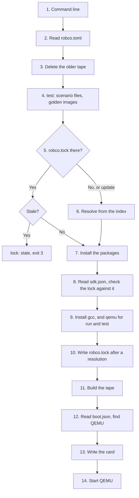
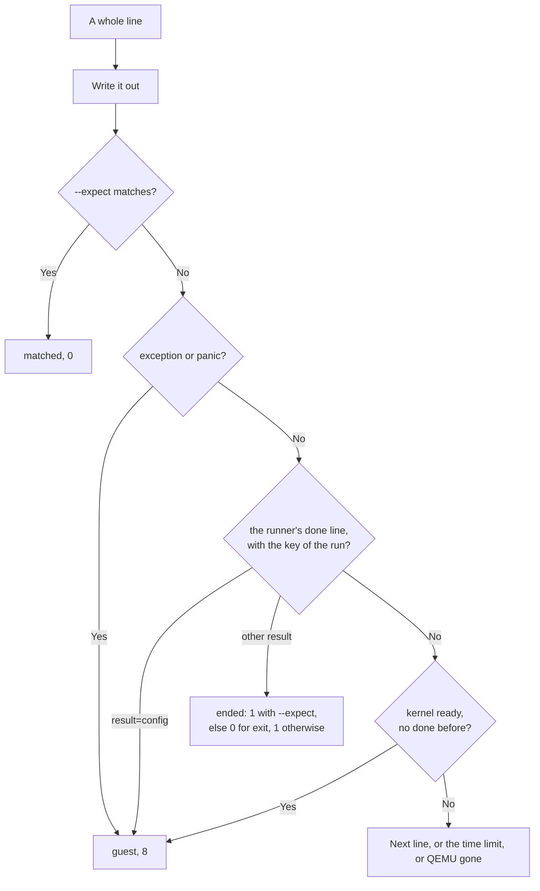

# The robco command

`robco` is the command line of RobCo Studio. It installs SDK packages, writes a project from a template, builds a tape, runs it in QEMU and runs a project's scenarios. This spec fixes what crosses between `robco` and whatever calls it: the command lines, the two output streams, the JSON lines of `--json`, the exit codes, the card image of a run, what ends a run, and the scenario files of `robco test`.

State today: `robco` prints its version and nothing else. No command of this spec exists yet. [STUDIO_PROJECT.md](./STUDIO_PROJECT.md) fixes the project files and [SDK_PACKAGE.md](./SDK_PACKAGE.md) the packages. This spec is version 1 of every format it defines.

## Commands

| Command | Does | Needs a project |
|---|---|---|
| `robco sdk list [--index LOCATION]` | Lists the packages and tools in the cache, and with `--index` those the index offers | No |
| `robco sdk install PACKAGE[@VERSION] --index LOCATION` | Installs a package, and for `pipos` the two tools it names | No |
| `robco new TEMPLATE NAME` | Writes a new project folder from a template | No |
| `robco update --index LOCATION` | Resolves again and writes `robco.lock`. [STUDIO_PROJECT.md](./STUDIO_PROJECT.md#robco-update) defines it. | Yes |
| `robco build [--index LOCATION]` | Builds `build/NAME.HTP` | Yes |
| `robco run --headless [--expect TEXT] [--timeout SECONDS] [--board BOARD] [--index LOCATION]` | Builds, then boots the tape in QEMU and prints its serial lines | Yes |
| `robco test [SCENARIO...] [--update-golden] [--board BOARD[,BOARD...]] [--index LOCATION]` | Builds, then runs the project's scenarios in QEMU, on one board or on several | Yes |

Every command also takes `--json`. `robco --version` and `robco version` print the version and are not part of this spec.

### Options

- An option that takes a value is written as two arguments, `--index LOCATION`, or as one, `--index=LOCATION`.
- Options and the other arguments may come in any order after the command words `sdk list`, `sdk install`, `new`, `update`, `build`, `run` and `test`.
- An unknown command, an unknown option, an option given twice, a missing value, a value outside its limits, a missing argument or an extra argument fails with `usage`. The command does nothing else.
- `--index` follows [Where the index is](./SDK_PACKAGE.md#where-the-index-is).

### The project folder

A command that needs a project runs in the project root. It looks for `robco.toml` in the current folder only, as [A project folder](./STUDIO_PROJECT.md#a-project-folder) says. Without that file it fails with `project: none`.

### Output streams

| Mode | Standard output | Standard error |
|---|---|---|
| Without `--json` | Text for a person. Its wording is not a contract. `robco run --headless` is the exception: it writes the serial lines and nothing else, as [Serial lines](#serial-lines) says. | First the diagnostics of the compiler and the linker, as those programs print them. Then, when the command fails, one error line. It is the last line. |
| With `--json` | The JSON lines of [JSON lines](#json-lines), and nothing else | Nothing |

A command that fails without `--json` prints exactly one error line:

```
<code>: <detail>
```

`<code>` is a code of [Error codes](#error-codes), such as `manifest: name`. `<detail>` is text for a person, on the same line. A tool acts on the code and on the exit code, never on the detail.

## Exit codes

Every command ends with one of these codes. A caller can act on the code alone.

| Code | Name | Meaning | Commands |
|---|---|---|---|
| 0 | `ok` | The command did what it was asked, and every check it made held | All |
| 1 | `failed` | The command ran to its end, and a check on the running tape did not hold | `run`, `test` |
| 2 | `usage` | The command line is wrong | All |
| 3 | `project` | The project's files, or a value given for the project, are refused | All but `sdk list` and `sdk install` |
| 4 | `sdk` | A package, a tool, the index or the cache is refused | All |
| 5 | `build` | A compile, the link, `objcopy` or the seal failed | `build`, `run`, `test` |
| 6 | `timeout` | The time limit of a run passed before the run ended | `run` |
| 7 | `simulator` | QEMU did not start, died or stopped answering | `run`, `test` |
| 8 | `guest` | The machine failed outside the tape: a kernel fault, or a runner ROM that did not report | `run` |
| 9 | `io` | The host refused to read, write, create or rename a file | All |
| 10 | `internal` | A fault of the tool itself. The message asks for a report. | All |

A command that cannot tell which case holds never ends with 0.

`robco run` gives one code per outcome. [What ends a run](#what-ends-a-run) has the rules.

| Outcome of `robco run --headless --expect TEXT` | Code |
|---|---|
| A line held `TEXT` | 0 |
| The tape ended and no line held `TEXT` | 1 |
| The time limit passed | 6 |
| QEMU did not start, or died | 7 |
| A line held an `ev=exception` or `ev=panic` marker, or an `ev=ready` marker of the kernel before the runner's `done` line | 8 |
| The runner ROM could not start the tape | 8 |

`robco test` counts runs. A run is one scenario on one board. The command ends with 0 when every run passed, with 7 when QEMU failed in at least one run, and with 1 when a run failed and QEMU failed in none. A fault of the machine inside a run fails that run, so it gives 1.

### Error codes

Every failure has one code. This table maps each code to its exit code, including the codes that [STUDIO_PROJECT.md](./STUDIO_PROJECT.md#errors) and [SDK_PACKAGE.md](./SDK_PACKAGE.md) define.

| Code | Exit | Defined in | When |
|---|---|---|---|
| `usage` | 2 | [Options](#options) | The command line is wrong |
| `project: none` | 3 | [The project folder](#the-project-folder) | The current folder holds no `robco.toml` |
| `manifest: syntax`, `manifest: format`, `manifest: unknown key`, `manifest: type`, `manifest: missing`, `manifest: name`, `manifest: version`, `manifest: title`, `manifest: kind`, `manifest: subtype`, `manifest: platform`, `manifest: abi`, `manifest: path`, `manifest: icon`, `manifest: sources` | 3 | [Errors](./STUDIO_PROJECT.md#errors) | `robco.toml` is refused |
| `lock: syntax`, `lock: format`, `lock: unknown key`, `lock: entry`, `lock: stale`, `lock: hash`, `lock: missing`, `lock: tool` | 3 | [Reading the lock](./STUDIO_PROJECT.md#reading-the-lock), [A stale lock](./STUDIO_PROJECT.md#a-stale-lock), [What the lock pins](./STUDIO_PROJECT.md#what-the-lock-pins) | `robco.lock` is refused, or no longer matches what it pins |
| `new: name`, `new: template`, `new: exists` | 3 | [robco new](#robco-new) | The name, the template or the folder is refused |
| `run: board` | 3 | [Starting QEMU](#starting-qemu) | The package has no such board. `robco test` uses the same code. |
| `test: none`, `test: name`, `test: syntax`, `test: format`, `test: unknown key`, `test: type`, `test: missing`, `test: step`, `test: value`, `test: golden` | 3 | [Scenario files](#scenario-files) | A scenario file or a golden image is refused |
| `package: archive`, `package: format`, `package: manifest`, `package: hash` | 4 | [The archive](./SDK_PACKAGE.md#the-archive), [Reading sdk.json](./SDK_PACKAGE.md#reading-sdkjson) | A package is refused: its archive, a format it uses, one of its files `sdk.json`, `flags.json` and `boot.json`, or a hash |
| `index: location`, `index: read`, `index: syntax`, `index: format`, `index: entry`, `index: duplicate`, `index: host` | 4 | [Reading the index](./SDK_PACKAGE.md#reading-the-index) | The index has no location, could not be fetched or opened, is not valid, or has no archive for this host |
| `sdk: no package`, `sdk: no tool` | 4 | [Version and ABI rules](./SDK_PACKAGE.md#version-and-abi-rules) | Nothing in the index fits |
| `tool: hash` | 4 | [Hashes](./SDK_PACKAGE.md#hashes) | A tool archive fails its check, or the cache holds another archive of that tool |
| `tool: archive` | 4 | [Tool archives](./SDK_PACKAGE.md#tool-archives) | A tool archive cannot be extracted, or does not hold what the index says |
| `tool: program` | 4 | [robco build](#robco-build), [Starting QEMU](#starting-qemu) | An installed tool folder lacks a program the command must start |
| `firmware: hash` | 4 | [Firmware pins](./SDK_PACKAGE.md#firmware-pins) | A firmware file fails its check |
| `cache: path` | 4 | [The cache folder](./SDK_PACKAGE.md#the-cache-folder) | `ROBCO_CACHE` is not an absolute path |
| `templates: none`, `templates: format`, `templates: manifest`, `templates: token` | 4 | [robco new](#robco-new), [templates.json](./SDK_PACKAGE.md#templatesjson) | No `templates` package is installed, or the installed one is refused |
| `build: compile`, `build: link`, `build: objcopy`, `build: seal` | 5 | [robco build](#robco-build) | A build step failed |
| `run: unmatched`, `run: tape` | 1 | [What ends a run](#what-ends-a-run) | The tape ended without the awaited result |
| `run: timeout` | 6 | [What ends a run](#what-ends-a-run) | The time limit passed |
| `sim: start`, `sim: died`, `sim: qmp` | 7 | [Starting QEMU](#starting-qemu) | QEMU did not start, died or did not answer |
| `guest: fault`, `guest: runner` | 8 | [What ends a run](#what-ends-a-run) | The machine failed outside the tape |
| `test: failed` | 1 | [robco test](#robco-test) | At least one run of a scenario failed |
| `io: read`, `io: write` | 9 | This table | The host refused to open, read, write, create or rename a file that exists or should be made. The detail names the path. It covers `robco.toml`, `robco.lock`, the sources, the outputs and the cache. A file of the project that is simply absent has its own code, such as `project: none`. A local index that cannot be read is `index: read`. |
| `internal` | 10 | This table | A fault of the tool itself |

`test: failed` gives exit code 7 in place of 1 when QEMU failed in a run, as [Exit codes](#exit-codes) says.

### Order of checks

A tool reads seven kinds of file. It checks every one in the same six steps and reports the first failure, so two tools give the same code for the same bad file.

1. The file is there, and the host lets the tool read it.
2. The bytes parse: they are UTF-8, and TOML 1.1 with a table at the top or JSON with an object at the top.
3. `format` is present, is a positive integer, and is one the tool knows.
4. No key is unknown, in the files that refuse unknown keys.
5. Each key or field, in the order of the tables of its spec: a required one is present, then its type is right, then its value has the form and the limits its table gives.
6. The rules that need another file, the file system or the index.

`format` comes before unknown keys and before every value, so a file of a later format reports its format and nothing else: a tool cannot tell a key of a later format from a mistake. `format` cannot come before step 2, since a tool must parse a file to read it.

The code of each step, per file:

| File | 1. Not there, or not readable | 2. Does not parse | 3. `format` | 4. Unknown key | 5. A key or a field | 6. Then |
|---|---|---|---|---|---|---|
| `robco.toml` | Absent: `project: none`. Not readable: `io: read`. | `manifest: syntax` | `manifest: format` | `manifest: unknown key`. A `build.backend` other than `robco` fails here. | `manifest: missing`, `manifest: type`, then the code of the value. The tables come in the order `[project]`, `[target]`, `[build]`. | The icon file, `manifest: path` and `manifest: icon`. Then each pattern of `sources` in order, `manifest: path` and `manifest: sources`. |
| `robco.lock` | Absent: no error. Not readable: `io: read`. | `lock: syntax` | `lock: format` | `lock: unknown key` | `lock: entry` | `lock: stale`. Then `lock: missing`, `lock: hash` and `lock: tool`, at steps 7 to 9 of [The steps of update, build, run and test](#the-steps-of-update-build-run-and-test). |
| A scenario file | A file name that breaks the rule: `test: name`. A `SCENARIO` with no file: `test: none`. Not readable: `io: read`. | `test: syntax` | `test: format` | `test: unknown key` | `timeout_ms`, then `step`, then each step in order. In a step: `test: missing`, `test: step`, `test: type`, `test: value`. | `test: golden` |
| The index | `index: location`, `index: read` | `index: syntax` | `index: format` | Ignored | `index: entry` | `index: duplicate`. Then, where an entry is used, `index: host` and the `sdk:` codes. |
| `sdk.json` | Absent from the archive: `package: archive` | `package: manifest` | `package: format`, for `format` and then for `formats` | Ignored | `package: manifest` | What must equal the index entry, `package: manifest`. Then the hashes, `package: hash`. |
| `flags.json`, `boot.json` | Absent from a `pipos` package: `package: manifest`, at the install | `package: manifest` | `package: format` | Ignored | `package: manifest` | For `boot.json`, a board it does not list: `run: board` |
| `templates.json` | `templates: manifest` | `templates: manifest` | `templates: format` | `templates: manifest` | `templates: manifest` | `templates: token` |

[The steps of update, build, run and test](#the-steps-of-update-build-run-and-test) says when a command reads each file: `robco.toml` first, then the scenario files, then `robco.lock`, the index when it must resolve or download, `sdk.json` at an install and whenever it uses an installed package, `flags.json` when it builds and `boot.json` before it starts QEMU. `robco new` reads `templates.json`. Each spec has the details of one file: [Errors](./STUDIO_PROJECT.md#errors), [Reading the lock](./STUDIO_PROJECT.md#reading-the-lock), [Scenario files](#scenario-files), [Reading the index](./SDK_PACKAGE.md#reading-the-index), [Reading sdk.json](./SDK_PACKAGE.md#reading-sdkjson), [Reading flags.json](./SDK_PACKAGE.md#reading-flagsjson), [boot.json](./TESTING.md#bootjson) and [templates.json](./SDK_PACKAGE.md#templatesjson).

## JSON lines

With `--json` a command writes one JSON object per line on standard output.

| Rule | Detail |
|---|---|
| Encoding | UTF-8, no byte order mark. Each line is one object with no line break inside, ended by one line feed, on every system. |
| Order of keys | `v`, then `kind`, then the keys of the kind in the order of its table |
| `v` | The integer `1` for this spec, on every line |
| Numbers | Integers only |
| Paths | `/` as the separator on every system. A path inside the project is relative to the project root. |
| The last line | Exactly one `result` line, and it is the last line of every run |
| Errors | A run that ends with a code other than 0 writes exactly one `error` line, right before the `result` line. A run that ends with 0 writes none. |
| A run with no `result` line | The command was killed. A caller treats it as failed. |

Rules for a newer version:

- A new key on an existing kind, and a new kind, do not raise `v`. A caller ignores a key and a kind it does not know.
- A key that is removed, renamed, retyped or given another meaning raises `v`. So does a kind that is removed.
- A caller that reads a `v` larger than it knows stops and reports it. It does not guess.

### Kinds

| `kind` | Written by | Meaning |
|---|---|---|
| `step` | `sdk install`, `update`, `build`, `run`, `test` | A unit of work started, ended or was skipped |
| `diagnostic` | `build`, `run`, `test` | One line that a program started by the tool printed |
| `item` | `sdk list` | One package or tool |
| `serial` | `run`, `test` | One line of the machine's PL011 |
| `scenario` | `test` | A scenario started or ended |
| `check` | `test` | One step of a scenario ended |
| `error` | All | The one failure of the run |
| `result` | All | The end of the run |

### step

| Key | Type | Value |
|---|---|---|
| `step` | string | `resolve`, `download`, `verify`, `install`, `compile`, `link`, `objcopy`, `seal`, `card` or `boot` |
| `item` | string | What the step works on. Empty when the step has one subject only. |
| `state` | string | `start`, `done` or `skip` |

A `start` line is followed by a `done` line with the same `step` and `item`, unless the command fails inside the step. A `skip` line stands alone: the work was not needed. Version 1 runs one step at a time, so no two steps are open at once.

| `step` | `item` | The work |
|---|---|---|
| `resolve` | Empty | Reading the index and picking packages and tools |
| `download` | `pipos@1.4.0` for a package, `gcc@15.2.1-1.1/linux-x64` for a tool | Fetching an archive |
| `verify` | As `download` | The hash checks of [Hashes](./SDK_PACKAGE.md#hashes) |
| `install` | As `download` | Extracting, and moving the folder into the cache. `skip` when the cache already holds it. |
| `compile` | `crt0` for the startup code, else the source path | Step 1 or 2 of [Build order](./SDK_PACKAGE.md#build-order) |
| `link`, `objcopy`, `seal` | Empty | Steps 3, 4 and 5 |
| `card` | Empty | Writing [the simulator card](#the-simulator-card) |
| `boot` | The board | From starting QEMU to the `cont` command |

An item that is already in the cache writes one `install` line with `skip` and no `download` or `verify` line.

### diagnostic

| Key | Type | Value |
|---|---|---|
| `program` | string | `gcc`, `objcopy` or `qemu` |
| `text` | string | One line of what the program printed, without its line end |

### serial

| Key | Type | Value |
|---|---|---|
| `t_ms` | integer | Milliseconds on the host's clock since the tool sent `cont` |
| `text` | string | One line of the PL011, by the rules of [Serial lines](#serial-lines) |

### error

| Key | Type | Value |
|---|---|---|
| `code` | string | A code of [Error codes](#error-codes) |
| `detail` | string | Text for a person, on one line |
| `exit` | integer | The exit code of the run |

### result

Every `result` line starts with these keys:

| Key | Type | Value |
|---|---|---|
| `command` | string | `sdk list`, `sdk install`, `new`, `update`, `build`, `run` or `test` |
| `ok` | boolean | `true` when `exit` is 0 |
| `exit` | integer | The exit code of the run |

The keys that follow depend on the command. Each command's section lists them. They are present when the table says "Always", and otherwise only when `ok` is `true`.

## robco sdk list

`robco sdk list [--index LOCATION] [--json]` writes one `item` line per package version and per tool archive: every one in the cache, and with `--index` also every one the index lists. It changes nothing.

| Key | Type | Value |
|---|---|---|
| `type` | string | `package` or `tool` |
| `name` | string | The name |
| `version` | string | The version |
| `host` | string | The host of a tool archive, such as `linux-x64`. Empty for a package. |
| `installed` | boolean | The cache holds it |
| `offered` | boolean | The index lists it. `false` without `--index`. |

Packages come first, then tools. Each group is sorted by `name`, then by `version`: as numbers for a package, as bytes for a tool, then by `host`. The `result` line adds one key:

| Key | Type | Present | Value |
|---|---|---|---|
| `count` | integer | When `ok` | The number of `item` lines |

## robco sdk install

`robco sdk install PACKAGE[@VERSION] --index LOCATION [--json]` installs one package into the cache.

| Argument | Picks |
|---|---|
| `PACKAGE` | The highest version of that package in the index, among those whose `formats` the tool knows |
| `PACKAGE@X.Y` | The highest version whose first two parts are `X.Y`, such as `pipos@1.4`, among those whose `formats` the tool knows |
| `PACKAGE@X.Y.Z` | That version |

The command reads `formats` from the index entry, as [Version and ABI rules](./SDK_PACKAGE.md#version-and-abi-rules) says, and downloads nothing to pick. A `PACKAGE@X.Y.Z` whose entry uses a format the tool does not know fails with `package: format` before any download.

Any other form after `@` fails with `usage`. A package that the index does not list at a version that matches fails with `sdk: no package`. `gcc` and `qemu` are tools, not packages, so `robco sdk install gcc` fails with `sdk: no package`.

The command then does this, in order:

1. It resolves the package and each package it `requires`.
2. For `pipos`, it adds the two tools the package names, for the running host, as [Tools a package names](./SDK_PACKAGE.md#tools-a-package-names) says.
3. For each of them that the cache does not hold, it downloads, checks and installs, by the rules of [SDK_PACKAGE.md](./SDK_PACKAGE.md#hashes). One that the cache holds is skipped.

It reads no `robco.toml` and writes no `robco.lock`. A second run with the same arguments skips everything and ends with 0. A failure leaves nothing of the failed item behind and leaves the items installed before it in place.

The `result` line adds:

| Key | Type | Present | Value |
|---|---|---|---|
| `packages` | array of objects | When `ok` | `name`, `version` and `state` of each package, in the order installed |
| `tools` | array of objects | When `ok` | `name`, `version`, `host` and `state` of each tool, `gcc` first |

`state` is `installed` when this run put it into the cache and `present` when the cache already held it.

## robco new

`robco new TEMPLATE NAME [--json]` writes a new project into the folder `NAME` of the current folder. Everything it writes comes from the installed `templates` package of [The templates package](./SDK_PACKAGE.md#the-templates-package). It reads no index and installs nothing.

It makes these checks in order and stops at the first that fails. It writes nothing until all have passed.

| Order | Check | Error |
|---|---|---|
| 1 | `NAME` follows the [name rules](./STUDIO_PROJECT.md#name-rules), as given. The command does not change its case. | `new: name`, with the reason |
| 2 | The cache holds a `templates` package. The command takes the highest version in `<cache>/packages/templates/`. | `templates: none`. The detail ends with `run robco sdk install templates`. |
| 3 | The tool knows every format in `formats` of that package's `sdk.json` | `package: format` |
| 4 | `templates.json` passes the checks of [templates.json](./SDK_PACKAGE.md#templatesjson) | `templates: format` or `templates: manifest` |
| 5 | `templates.json` lists a template whose `id` is `TEMPLATE` | `new: template`. The detail lists the ids. |
| 6 | No `substitute` file of the template holds a token other than `@NAME@` | `templates: token` |
| 7 | `NAME` in the current folder does not exist, or is an empty folder | `new: exists` |

Then it writes:

1. It creates a new folder beside the target, in the current folder, with a name of its own choice that starts with a dot.
2. It writes each file of the template there, at its `path`, with the folders the path needs. A `substitute` file gets every `@NAME@` replaced by `NAME`. Every other byte is the package's byte.
3. It removes an empty `NAME` folder if there is one, and renames the new folder to `NAME`.

A failure at any step removes the new folder and reports `io: write`. So the command leaves either the whole project or nothing. It writes no `robco.lock` and no `build/`: the first `robco build`, `robco run` or `robco test` in the project resolves and writes the lock, and needs `--index` for it.

The `result` line adds:

| Key | Type | Present | Value |
|---|---|---|---|
| `template` | string | When `ok` | The template's `id` |
| `name` | string | When `ok` | `NAME` |
| `path` | string | When `ok` | The folder written, relative to the current folder: `NAME` |
| `files` | array of strings | When `ok` | The paths written, relative to `path`, sorted in byte order |

## The steps of update, build, run and test

`robco update`, `robco build`, `robco run` and `robco test` share one list of steps. A command takes the steps that its column marks, in the order of the table, and stops at the first step that fails. No command takes a step out of this order, and no section of this spec gives another one.

| Step | Work | `update` | `build` | `run` | `test` | Fails with |
|---|---|---|---|---|---|---|
| 1 | Check the command line, by [Options](#options), then the place of the cache, by [The cache folder](./SDK_PACKAGE.md#the-cache-folder) | Yes | Yes | Yes | Yes | `usage`, 2. `cache: path`, 4. |
| 2 | Read `robco.toml`, in the six steps of [Order of checks](#order-of-checks) | Yes | Yes | Yes | Yes | `project: none`, 3. `io: read`, 9. A `manifest:` code, 3. |
| 3 | Delete `build/NAME.HTP` when it is there | No | Yes | Yes | Yes | `io: write`, 9 |
| 4 | Find and read the scenario files, then read the golden images, by [robco test](#robco-test) | No | No | No | Yes | A `test:` code, 3. `io: read`, 9. |
| 5 | Read `robco.lock`, by [Reading the lock](./STUDIO_PROJECT.md#reading-the-lock). When the file is there, check it for [a stale lock](./STUDIO_PROJECT.md#a-stale-lock), as far as the manifest and the lock alone can tell. | No | Yes | Yes | Yes | `io: read`, 9. `lock: syntax`, `lock: format`, `lock: unknown key`, `lock: entry`, `lock: stale`, 3. |
| 6 | Resolve: read the index and pick the `pipos` package, each package it requires and the two tools it names, by [Version and ABI rules](./SDK_PACKAGE.md#version-and-abi-rules) | Always | Without a lock | Without a lock | Without a lock | An `index:` code, `sdk: no package`, `sdk: no tool`, 4 |
| 7 | Install each package of the lock, or of the resolution, that the cache lacks. The packages come sorted by name in byte order. | Yes | Yes | Yes | Yes | An `index:` code, 4. `lock: missing`, `lock: hash`, 3. A `package:` code, 4. `io: write`, 9. |
| 8 | Read `sdk.json` of each of those packages in the cache. With a lock from step 5: finish the stale check with what the packages require, then check the locked tools against the `pipos` package, step 4 of [What the lock pins](./STUDIO_PROJECT.md#what-the-lock-pins). | No | Yes | Yes | Yes | `package: manifest`, `package: format`, 4. `lock: stale`, `lock: tool`, 3. |
| 9 | Install the tools that the cache lacks: `gcc`, and then `qemu` where the column says so | No | `gcc` | `gcc`, `qemu` | `gcc`, `qemu` | An `index:` code, 4. `lock: missing`, `lock: hash`, 3. `tool: hash`, `tool: archive`, 4. `io: write`, 9. |
| 10 | Write `robco.lock`, when step 6 resolved, by [How the tool writes the lock](./STUDIO_PROJECT.md#how-the-tool-writes-the-lock) | Yes | Without a lock | Without a lock | Without a lock | `io: write`, 9 |
| 11 | Build the tape, by [robco build](#robco-build) | No | Yes | Yes | Yes | `package: manifest`, `package: format`, `tool: program`, 4. A `build:` code, 5. `io: write`, 9. |
| 12 | Read `boot.json`, check the boards and find the QEMU program, steps 1 and 2 of [Starting QEMU](#starting-qemu) | No | No | Yes | Yes | `package: manifest`, `package: format`, 4. `run: board`, 3. `tool: program`, 4. |
| 13 | Write [the simulator card](#the-simulator-card) | No | No | Yes | Yes | `io: write`, 9 |
| 14 | Start QEMU and read the machine: once for `run`, by [What ends a run](#what-ends-a-run), and once per scenario and board for `test`, by [robco test](#robco-test) | No | No | Yes | Yes | `sim: start`, `sim: died`, `sim: qmp`, 7. For `run`: `run: unmatched`, `run: tape`, 1. `run: timeout`, 6. `guest: fault`, `guest: runner`, 8. For `test`: `test: failed`, 1 or 7. |

The number after each code is the exit code of the command, as [Error codes](#error-codes) maps it. Any step that reads or writes a file may also fail with `io: read` or `io: write`, 9, when the host refuses. Any step may fail with `internal`, 10.

What the order means:

- Step 3 comes right after the manifest, because the manifest gives `NAME`. A command that fails at step 2 deletes nothing. A command that fails at any later step leaves no `build/NAME.HTP`, so a failed command never leaves an older tape behind. `robco update` never touches `build/`.
- A command installs no tool before step 9. The version of `gcc` and of `qemu` comes from the lock of step 5 or from the resolution of step 6, and step 8 has checked it against the `pipos` package. A project fresh from `robco new` has no lock, so `robco run` and `robco test` resolve at step 6 like `robco build`, and only then install `qemu`.
- `robco build` never installs `qemu`. `robco update` installs the packages, since step 7 is what checks them, and no tool.
- Steps 7 and 9 read the index only when the cache lacks an item, by [Where the index is](./SDK_PACKAGE.md#where-the-index-is). With a lock, the item to download is the index entry with the name, the version and the hash that the lock pins. Without such an entry the step fails with `lock: missing`.
- An item that the cache holds is not downloaded. Steps 7 and 9 compare its record with the hash of the lock or of the resolution, by [Hashes](./SDK_PACKAGE.md#hashes): `lock: hash` with a lock, `package: hash` or `tool: hash` after a resolution.
- The lock is written at step 10, after every install of the command passed its checks. A command that fails before step 10 writes no lock: a first build that fails leaves the project without one, and a `robco update` that fails leaves the old one as it is.
- Steps 12 to 14 come after the build. A `--board` that the package does not list fails at step 12, with the tape built.

A command that runs again with nothing changed takes the same steps:

| It reads | It writes | It never writes |
|---|---|---|
| `robco.toml`, `robco.lock`, the sources and the icon, the scenario files and the golden images for `test`, and `sdk.json`, `flags.json` and `boot.json` of the locked package | `build/`, and the folder of each run in the system's temporary folder | `robco.toml`, the sources, the scenario files, `robco.lock` when step 5 found one, and the cache when it holds every locked item |

Such a command reads no index and needs no `--index` and no network: step 6 does not run, and steps 7 and 9 find every item in the cache. Step 11 compiles, links and seals every time. Only an install is ever skipped, so the `step` lines of two runs are the same. `robco test --update-golden` is the one command that writes under `tests/golden/`.

The `step` lines of `--json` follow the same order: `resolve` at step 6, then `download`, `verify` and `install` at steps 7 and 9, `compile`, `link`, `objcopy` and `seal` at step 11, `card` at step 13 and `boot` at step 14.



## robco build

`robco build [--index LOCATION] [--json]` builds the tape of the project in the current folder. It takes steps 1 to 11 of [The steps of update, build, run and test](#the-steps-of-update-build-run-and-test). Step 11, the build itself, does these in order and stops at the first failure:

| Order | Work | Errors |
|---|---|---|
| 1 | Read `flags.json` of the locked `pipos` package, by [Reading flags.json](./SDK_PACKAGE.md#reading-flagsjson) | `package: manifest`, `package: format` |
| 2 | Find `arm-none-eabi-gcc` and `arm-none-eabi-objcopy` in `bin/` of the locked `gcc` tool, with `.exe` on Windows | `tool: program` |
| 3 | Compile the startup code and each source, steps 1 and 2 of [Build order](./SDK_PACKAGE.md#build-order), in the order of the [source list](./STUDIO_PROJECT.md#source-order) | `build: compile`, with the source |
| 4 | Link, step 3 | `build: link` |
| 5 | `objcopy`, step 4 | `build: objcopy` |
| 6 | Seal and validate, by [Sealing and packing](./IMAGE_FORMAT.md#sealing-and-packing) | `build: seal`, with the `@RC` name of the code, such as `size` |
| 7 | Write `build/NAME.HTP` and `build/NAME.elf` | `io: write` |

A program that exits with a code other than 0 fails its step. Each line a program prints becomes a `diagnostic` line with `--json`. [What a holotape build produces](./STUDIO_PROJECT.md#what-a-holotape-build-produces) says what is left after a failure.

The `result` line adds:

| Key | Type | Present | Value |
|---|---|---|---|
| `tape` | string | When `ok` | `build/NAME.HTP` |
| `elf` | string | When `ok` | `build/NAME.elf` |
| `size` | integer | When `ok` | The size of the tape in bytes |
| `sha256` | string | When `ok` | The SHA-256 of the tape, 64 lower case hex digits |
| `abi` | string | When `ok` | `target.abi`, such as `1.3` |
| `gcc` | string | When `ok` | The version of the locked `gcc` tool, such as `15.2.1-1.1` |
| `sources` | array of strings | When `ok` | The [source list](./STUDIO_PROJECT.md#source-order), in link order |

`robco update` writes `step` lines for `resolve`, `download`, `verify` and `install`, and a `result` line with no added key.

## The simulator card

`robco run` and `robco test` boot the machine from a card image that the tool builds for each run. It is the card of a real device, less the firmware files, with the runner ROM in place of Deitrix.

| Property | Value |
|---|---|
| Size | 16 MiB, 16,777,216 bytes |
| Sector 0 | An MBR with one partition entry at offset `0x1BE`: status `0x00`, first CHS `FE FF FF`, type `0x0E`, last CHS `FE FF FF`, first sector 2048, 30,720 sectors. Bytes 510 and 511 are `55 AA`. Every other byte of sectors 0 to 2047 is 0. |
| Volume | FAT16, made by the suite's own FatFs: `fs_mkfs()` with `FS_MKFS_FAT` and a cluster of 512 bytes |
| Dates | The library's fixed time, 2026-01-01 00:00:00, on every file and folder. The tool sets no clock. |
| Entries | Created in the order of the table below, which fixes the order inside each folder |

The files, in the order the tool creates them:

| Order | Path on the card | Bytes from | Read by |
|---|---|---|---|
| 1 | `/PIPOS.IMG` | The package, `boot/PIPOS.IMG` | Nothing in QEMU. A real device's firmware loads it. |
| 2 | `/config.txt` | The package, `boot/config.txt` | Nothing in QEMU |
| 3 | `/PIPBOY/` | A folder | |
| 4 | `/PIPBOY/PIPOS.CFG` | The tool: the text below | The kernel |
| 5 | `/PIPBOY/ROM1.ROM` | The package, `boot/RUNNER.ROM` | The kernel |
| 6 | `/PIPBOY/RUNNER.CFG` | The tool: the text of [RUNNER.CFG](./SDK_PACKAGE.md#runnercfg) | The runner ROM |
| 7 | `/PIPBOY/HOLO/` | A folder | |
| 8 | `/PIPBOY/HOLO/NAME.HTP` | The project, `build/NAME.HTP` | The kernel, for the runner ROM |

`NAME` is `project.name`. The card holds nothing else: no firmware file, no save folder and no other tape. The kernel creates `/PIPBOY/SAVE` when the tape first saves.

`/PIPBOY/PIPOS.CFG` is exactly this text: 11 lines, each ended by one line feed, 113 bytes in all.

```
[display]
scheme = green
line_delay_ms = 0
backend = hdmi

[audio]
volume = 100
beep = no

[holotape]
slot = off
```

| Key | Value | Why |
|---|---|---|
| `display.scheme` | `green` | The default colours of a tape follow the scheme. A fixed scheme keeps golden images right. |
| `display.line_delay_ms` | `0` | No pause between the boot lines, so the tape starts as soon as the kernel is up. The package's own `boot/PIPOS.CFG` pauses 150 ms per line. |
| `display.backend` | `hdmi` | QEMU has no SPI panel. The screen a capture reads is the HDMI one. |
| `audio.volume` | `100` | A fixed level in the audio trace |
| `audio.beep` | `no` | No power-on beep in the audio trace, so every sound in it is the tape's |
| `holotape.slot` | `off` | QEMU has no card on SPI0. The tape is on the boot card. |

The tool writes all six keys even where the value is the kernel's default, so a later kernel with other defaults gives the same run.

The same package and the same tape give the same card image, byte for byte, on every system. The files always fit: the kernel, the ROM and the tape are each at most 4 MiB. Each run, and each scenario of `robco test`, starts from a fresh copy of the card. What a tape saves is gone when the run ends.

Left out on purpose: FAT32, a card for a real device, a card with Deitrix, and a card that keeps its saves between runs.

## robco run

`robco run --headless [--expect TEXT] [--timeout SECONDS] [--board BOARD] [--index LOCATION] [--json]` builds the tape, boots it in QEMU on the runner ROM and reads the machine's serial lines until the run ends.

| Option | Value | Default | Meaning |
|---|---|---|---|
| `--headless` | None | | Required in version 1. Without it the command fails with `usage`: the run in a window comes later. |
| `--expect` | `TEXT`, 1 to 200 bytes, with no line feed | None | The text to wait for. See [What --expect matches](#what---expect-matches). |
| `--timeout` | Whole seconds, 1 to 3600 | 60 | The time limit of the run |
| `--board` | A board name | `raspi0` | The QEMU machine |

The command takes every step of [The steps of update, build, run and test](#the-steps-of-update-build-run-and-test), in that order. It installs the `qemu` tool at step 9, once the lock or the resolution has named its version. A failure before step 14 ends the command with that failure's code, and no QEMU starts.

### Starting QEMU

The tool boots the machine from the `pipos` package that the lock names, `PKG`, and the `qemu` tool that the lock names.

1. It reads `PKG/boot.json`, by the rules of [boot.json](./TESTING.md#bootjson). A file that is not JSON, or that breaks a reader rule of that section, fails with `package: manifest` and names the file. A `format` other than `1` fails with `package: format`. A `--board` that the file does not list fails with `run: board`, and the detail lists the boards. `robco test` checks every board of its `--board` list here, in the order given, and fails at the first that the file does not list, before any machine starts. The mode is the board's `default_mode`.
2. The program is the board's `qemu` value in `bin/` of the `qemu` tool folder, with `.exe` on Windows. A missing program fails with `tool: program`. `robco test` finds the program of every board of its list here.
3. It makes a new, empty folder for the run in the system's temporary folder, and writes [the simulator card](#the-simulator-card) there as `sd.img`. `robco test` writes the card once, into a folder of its own, and gives the folder of each run a copy of those bytes as `sd.img`.
4. It builds the command line in the order of [boot.json](./TESTING.md#bootjson): `{stub}` is `PKG/boot/fwstub.bin`, `{image}` is `PKG/boot/PIPOS.IMG` and `{sd}` is the card. It attaches QMP once, no qtest, both serial ports and the card, and no other device. It adds no `-seed` option: [the key of a run](./SDK_PACKAGE.md#the-key-of-a-run) must come from random numbers that nobody fixed.
5. QMP and both serial ports use TCP on `127.0.0.1`, on every system.
6. It starts QEMU so that QEMU dies when the tool dies, connects to QMP and to both serial ports, and only then sends QMP `cont`. The time limit of the run starts at `cont`.
7. While the machine runs, it sends QMP `query-status` every 20 ms. [QEMU keep-alive](./TESTING.md#qemu-keep-alive) says why: without it QEMU 10.1 at times leaves a `raspi0` or `raspi1ap` machine halted until the next QMP command, which a quiet tool never sends.

| Failure | Error |
|---|---|
| QEMU does not start, or a connection is not made within 10 s | `sim: start` |
| QEMU exits, or one of its three connections closes, before the run ends | `sim: died` |
| QMP answers a command with an error, or does not answer within 10 s | `sim: qmp` |

A read that waits on a silent machine is not a closed connection. A machine that prints nothing for a while is still running.

When the run ends, the tool stops QEMU and removes the run's folder before it exits. No QEMU process outlives the command, however the command ends.

### Serial lines

The tool reads the PL011, the first serial port, as lines.

| Rule | Detail |
|---|---|
| A line | The bytes up to a line feed, without the line feed and without one carriage return before it |
| A long line | Cut at 4096 bytes. The rest starts a new line. |
| An unfinished line | It is not a line until its line feed comes. When the run ends, the bytes still waiting are written as one last line and are never matched. |
| As text | UTF-8, with U+FFFD in place of each byte that is not valid |

Without `--json` the command writes each line on standard output as it comes, ended by one line feed. With `--json` it writes one `serial` line per line. The mini UART carries the script channel and is never printed.

### What --expect matches

`TEXT` matches a line when the bytes of `TEXT` occur in the bytes of the line. The match is exact and case-sensitive. `TEXT` is plain text and never a pattern: no character in it is special. Only whole lines of the PL011 are searched.

Left out on purpose: regular expressions, a match across two lines, and a match on the script channel.

### What ends a run

The tool handles each whole line in this order, and the first rule that holds ends the run:

| Order | Rule | Outcome | Exit | Error |
|---|---|---|---|---|
| 1 | The line is written out, as [Serial lines](#serial-lines) says | | | |
| 2 | `--expect` is given and `TEXT` matches the line | `matched` | 0 | None |
| 3 | The line holds a kernel marker with `ev=exception` or `ev=panic` | `guest` | 8 | `guest: fault`, with the line |
| 4 | The line is the runner's `done` line with `result=config` | `guest` | 8 | `guest: runner`, with the line |
| 5 | The line is the runner's `done` line with another result, and `--expect` is given | `ended` | 1 | `run: unmatched` |
| 6 | The same, without `--expect`, and the result is `exit` | `ended` | 0 | None |
| 7 | The same, without `--expect`, and the result is not `exit` | `ended` | 1 | `run: tape`, with the result |
| 8 | The line holds the kernel marker `stage=pipos ev=ready`, and the runner's `done` line did not come before | `guest` | 8 | `guest: runner`, with the line |

"The runner's `done` line" and "a kernel marker" have the exact meaning of [When a run is over](./SDK_PACKAGE.md#when-a-run-is-over). The runner's `done` line is the one line that carries the key of the run, or the `result=config` line that comes before any `run` line. A line that only looks like it is text, and rules 4 to 7 pass over it.

A tape can print any line, so [Who may print a line](./SDK_PACKAGE.md#who-may-print-a-line) sorts the rules by what a tape can do:

| Rules | A tape can trigger them | What that gives the tape |
|---|---|---|
| 2 | Yes, by printing `TEXT` | The match that `--expect` asks for. This is the point of the option. |
| 3 and 8 | Yes, by printing a line in the form of a kernel marker | A failed run with exit code 8, for a machine that had no fault. Never a passed run. |
| 4 | No | |
| 5, 6 and 7 | Only by ending | The result and the status are the ones `holo_launch` returned. A tape cannot make rule 6 hold without ending with a status from 0 to 255. |

Between lines, two more things end the run:

| Event | Outcome | Exit | Error |
|---|---|---|---|
| The time limit passes | `timeout` | 6 | `run: timeout` |
| QEMU exits or a connection closes | `simulator` | 7 | `sim: died` |

Rule 2 comes before the others, so `--expect` can wait for any line, a marker included. The exit status of the tape is not the exit code of the command: it is `tape_rc` in the `result` line.



The `result` line adds:

| Key | Type | Present | Value |
|---|---|---|---|
| `outcome` | string | Always | `matched`, `ended`, `timeout`, `simulator` or `guest`. `not_run` when the command failed before `cont`. |
| `board` | string | Always | The board |
| `line` | string | Always | The line that ended the run, by rules 2 to 8. Empty for `timeout`, `simulator` and `not_run`. |
| `tape_result` | string | Always | The `result` of the runner's `done` line when it came, else empty |
| `tape_rc` | integer | Always | The `rc` of that line when it came, else 0 |
| `ms` | integer | Always | Milliseconds from `cont` to the end of the run. 0 for `not_run`. |

## robco test

`robco test [SCENARIO...] [--update-golden] [--board BOARD[,BOARD...]] [--index LOCATION] [--json]` builds the tape and runs scenarios against it, each in a machine of its own.

| Argument or option | Meaning |
|---|---|
| `SCENARIO` | The name of a scenario: the file `tests/SCENARIO.toml`. Several names run in the order given, and a name given twice fails with `usage`. With none, every `tests/*.toml`, sorted by the byte value of the name. |
| `--update-golden` | Writes golden images in place of comparing them. See [Golden images](#golden-images). |
| `--board` | One board name, or several with one comma between two names and no space, such as `raspi0,raspi2b`. Default `raspi0`. An empty name, and a name that comes twice, fail with `usage`. |

A run is one scenario on one board. The command makes one run for each scenario and each board of `--board`. The runs come scenario by scenario, and for one scenario board by board in the order of `--board`.

The command takes every step of [The steps of update, build, run and test](#the-steps-of-update-build-run-and-test), in that order. Its own parts of that list are these:

1. At step 4, after it has read `robco.toml`, it finds the scenario files and reads every one, in the order they will run. A `SCENARIO` that breaks the name rule of [Scenario files](#scenario-files) fails with `test: name`, and the tool looks for no file. With `SCENARIO` arguments the tool reads those files and no other file of `tests/`. The first file that breaks a rule of [Scenario files](#scenario-files) ends the command with its `test: ...` code. No scenario file at all, a `tests/` folder that is not there, or a `SCENARIO` with no file, fails with `test: none`. A test run that found nothing to run never passes.
2. Still at step 4, without `--update-golden`, it reads every golden image the scenarios name, in the order of the scenarios and of their steps. A missing image, or a file that is not a PNG in the format of [Golden images](#golden-images), fails with `test: golden` and names the path. With `--update-golden` it reads no golden image.
3. At steps 5 to 13 it reads the lock or resolves, installs the packages, `gcc` and `qemu`, builds the tape, checks every board of `--board` against `boot.json` and writes the card. It installs `qemu` at step 9, never before the lock or the resolution has named its version.
4. At step 14 it makes the runs one after another. Each gets a fresh copy of [the simulator card](#the-simulator-card) and a new QEMU, started as [Starting QEMU](#starting-qemu) says. A run that fails does not stop the next one.
5. It ends with the code that [Exit codes](#exit-codes) gives for the outcomes. When a run did not pass, the error is `test: failed`, and the detail counts the runs that failed.

### Scenario files

A scenario is a file `tests/NAME.toml` in the project. `NAME` is 1 to 32 characters from `a` to `z`, `0` to `9`, `_` and `-`, and it is the scenario's name. A `.toml` file in `tests/` with another name fails with `test: name`. Folders inside `tests/` are not searched.

The file is TOML 1.1 in UTF-8, as the project file is: [TOML 1.1 and a reader built on a 1.0 parser](./STUDIO_PROJECT.md#toml-11-and-a-reader-built-on-a-10-parser) applies. Its keys:

| Key | Type | Required | Default | Limits | Meaning |
|---|---|---|---|---|---|
| `format` | integer | Yes | | `1` for this spec | The format version, outside any table |
| `timeout_ms` | integer | No | `120000` | 1000 to 3600000 | The time limit of the whole scenario, from `cont` |
| `step` | array of tables | Yes | | 1 to 256 steps | The steps, in order, each written as `[[step]]` |

Each step holds exactly one action key, and `timeout_ms` where the table allows it:

| Action key | Type | Limits | The step | Passes when | `timeout_ms` |
|---|---|---|---|---|---|
| `expect` | string | 1 to 200 bytes, none below `0x20` and none equal to `0x7F` | Waits for a line of the PL011 that holds the text | Such a line comes | Allowed. Default `10000`, 1 to 600000. |
| `press` | string | A key name | Presses the key and holds it | The machine answers `ok` | Not allowed |
| `release` | string | A key name | Releases the key | The machine answers `ok` | Not allowed |
| `tap` | string | A key name | Presses the key, then releases it | The machine answers `ok` twice | Not allowed |
| `dial` | integer | -1000000 to 1000000, not 0 | Turns the dial by that many detents | The machine answers `ok` | Not allowed |
| `sleep_ms` | integer | 1 to 60000 | Waits that long on the host's clock | Always | Not allowed |
| `screen` | string | A golden name: 1 to 32 characters from `a` to `z`, `0` to `9`, `_` and `-` | Takes one capture of the screen and compares it with the golden image of that name | The two are equal | Not allowed |
| `exit` | integer | 0 to 255 | Waits for the tape to end | The runner's `done` line has `result=exit` and this `rc` | Allowed, as for `expect` |

A key name is one of `up`, `down`, `left`, `right`, `select`, `back` and `dial_push`.

An `exit` step may only be the last step. A scenario without one passes when its last step passes, and the tool then stops the machine while the tape still runs.

| Error | When |
|---|---|
| `test: syntax` | The file is not TOML 1.1 or not UTF-8. The detail has the line. |
| `test: format` | `format` is missing, is not a positive integer, or is larger than the tool knows. For a larger value the message asks for a newer tool. |
| `test: unknown key` | A key or a table this spec does not define, at the top or in a step |
| `test: type` | A key has the wrong TOML type |
| `test: missing` | `step` is absent or empty, or a step holds no action key |
| `test: step` | A step holds two action keys, holds `timeout_ms` where it is not allowed, or is an `exit` step that is not the last. Also more than 256 steps. |
| `test: value` | A value is outside its limits: a number, a text, a key name or a golden name |
| `test: name` | The file's name breaks the name rule |

The tool checks a file in the steps of [Order of checks](#order-of-checks). After `format` and the unknown keys it checks `timeout_ms`, then `step`, then each step in the order of the file. In one step the order is: no action key, `test: missing`. Two action keys, a `timeout_ms` that is not allowed, or an `exit` step that is not the last, `test: step`. A wrong type, `test: type`. A value outside its limits, `test: value`.

A scenario names no board, no package and no tape. It must pass on every board, and `--board` picks the boards it runs on.

Left out on purpose: loops, conditions, variables, steps that read the script channel, text typed as characters, GPIO lines, and a scenario that runs two machines.

### What a step does

An `expect` step searches the lines of the PL011 in order. The scenario keeps a place in the stream, which starts at the first line of the boot. The step takes the first line at or after that place that holds the text, by the match rule of [What --expect matches](#what---expect-matches), and moves the place to the line after it. So a line that came before the step began still counts, and two `expect` steps never take the same line.

A key step sends one line on the script channel, the mini UART, as the suite's own tests do, and waits for the status line:

| Step | Lines sent, each ended by a line feed |
|---|---|
| `press = "select"` | `key select 1` |
| `release = "select"` | `key select 0` |
| `tap = "select"` | `key select 1`, then after its `ok`, `key select 0` |
| `dial = -3` | `dial -3` |

The [script backend](../guide/api/input.md#script-backend) defines these lines and their answers. The tool sends one line at a time. The answer is the next line of the mini UART that is `ok`, or starts with `ok ` or with `err`. Other lines are passed over. Only the line `ok` passes the step. `ok dropped`, any `err` line, or no answer within 10 s fails it. The kernel reads the script channel only while the tape sleeps or reads input, as [What the kernel gives a ROM](./SDK_PACKAGE.md#what-the-kernel-gives-a-rom) says, so a key sent to a tape that does neither fails at that limit.

A `screen` step sends QMP `screendump` once, with a file in the run's folder, reads the PPM that QEMU writes, and compares. It takes one capture and never tries again.

An `exit` step waits for the runner's `done` line, as [When a run is over](./SDK_PACKAGE.md#when-a-run-is-over) defines it: the line with the key of the run. It fails at once when the line has another result or another `rc`. A line of a tape in the same form, with another key or none, is text: it neither passes nor fails the step.

### What ends a scenario

A scenario passes when every step passed. It fails at the first step that fails, and the steps after it do not run. A step fails by its own rule in the table of [Scenario files](#scenario-files), or by one of these:

| Event | Fails | `reason` |
|---|---|---|
| The step's own limit passes | That step | `timeout` |
| The scenario's limit passes | The step that is running | `timeout` |
| The tool reads a line that holds a kernel marker with `ev=exception` or `ev=panic` | The step that is running, whatever its action | `guest` |
| The tool reads the kernel marker `stage=pipos ev=ready`, and the runner's `done` line did not come before it | The step that is running, whatever its action | `guest` |
| QEMU exits, a connection closes or QMP fails | The step that is running | `simulator` |
| An `expect` step reaches the runner's `done` line before a line that holds its text | That step | `ended` |
| An `exit` step finds the runner's `done` line with another result or another `rc` | That step | `status` |
| The machine answers a key step with anything but `ok`, or not at all | That step | `script` |
| A `screen` step finds another size, or another pixel | That step | `size` or `pixels` |

The tool reads the PL011 from `cont` until the last step has passed. When a line of the third or fourth row comes while no step runs, the next step fails with it before it does anything else.

The runner's `done` line fails no step but an `expect` step. A tape may end while a key step or a `sleep_ms` step runs: the kernel's main loop then answers the script channel, and an `exit` step that follows finds the line.

A scenario passes on nothing a tape can fake but the text of its `expect` steps. The third and fourth rows take lines that a tape can print too, and they only fail a step. [Who may print a line](./SDK_PACKAGE.md#who-may-print-a-line) has the whole list.

### Golden images

| Property | Value |
|---|---|
| Path | `tests/golden/SCENARIO/NAME.png`, with `SCENARIO` the scenario's name and `NAME` the value of the `screen` step. The path names no board. |
| Format | PNG, 8 bits per channel, colour type 2, which is RGB with no alpha and no palette. Any other file fails with `test: golden`. |
| Source | A capture of QEMU, written by `robco test --update-golden` or by the suite's own test harness. Never drawn or edited by hand. |
| Boards | One image per screen, shared by every board. No image belongs to one board. |

The screen of a tape is the same on every board. The suite's own tests rest on that today: Pip-OS and Deitrix each keep one image per screen, with no board in its name, and compare the capture of every board with it. So a scenario that runs on several boards compares every board with the same image, and a tape whose screen differs between two boards fails.

The comparison:

1. The tool decodes the capture, a binary PPM, `P6` with a maximum value of 255, into rows of RGB pixels.
2. It decodes the golden image into rows of RGB pixels.
3. The two have the same width and the same height. Otherwise the step fails with the reason `size`.
4. Every pixel has the same three values. Otherwise the step fails with the reason `pixels`, and reports the first pixel that differs, reading rows from the top and each row from the left, and how many pixels differ.

There is no tolerance, no mask and no scaling. The bytes of the two files are never compared: two PNG writers give different files for the same pixels.

When a `screen` step fails, the tool writes the capture to `build/test/SCENARIO/BOARD/NAME.png`, so a person can look at it. It empties `build/test/SCENARIO/` before the first run of the scenario.

With `--update-golden` the tool reads no golden image, and a `screen` step compares against what the command itself captured:

1. The first capture that the command takes for a path stands in for the golden image of that path, and its step passes.
2. Every later capture for the same path is compared with that first capture, by the comparison above. That is the same `screen` step on a later board, and a later `screen` step of the scenario with the same name. A difference fails the step with `size` or `pixels`, as it would against an image. The tool then writes both captures under `build/test/SCENARIO/`, each in the folder of its board.
3. After the last run of a scenario, when the scenario passed on every board, the tool writes the first capture of each path to that path, as a PNG in the format above, and creates the folders it needs. It writes each path once.
4. When a run of the scenario failed, on any board and for any reason, the tool writes no image of that scenario and leaves the files that are there as they are. The other scenarios are not affected.

Every case, for one `screen` step:

| Case | Without `--update-golden` | With `--update-golden` |
|---|---|---|
| The image is missing | `test: golden`, exit code 3, at step 4. No machine starts. | The image is not read. It is written when the scenario passes on every board. |
| The image is there, and the scenario runs on one board | The capture is compared with the image. A difference fails the step with `size` or `pixels`, and the command ends with `test: failed`. | The image is not read. The capture replaces it when the scenario passes. |
| The scenario runs on several boards, and their screens agree | Each run compares its own capture with the one image. Each run passes or fails on its own. | One image is written, after the last board. |
| The scenario runs on several boards, and two screens disagree | At most the boards that show the image pass. Every other run fails at the step, with `size` or `pixels`. | The step fails on the first board whose capture differs from the first board's, with `size` or `pixels`. No image of the scenario is written or changed, and the command ends with `test: failed`. |

So `--update-golden` never writes one path twice, and never writes an image that a board of the command does not show. A person looks at the new files before committing them.

Left out on purpose: a tolerance, a region to leave out, an image per board, and a way to pick the board whose screen wins. A screen that shows a clock or a random value cannot be compared in version 1.

### Time

A scenario may rely on order and never on durations.

| A scenario may assume | A scenario may not assume |
|---|---|
| Steps run in order, and a step starts after the one before it passed | How much time passes between two steps |
| An `expect` step has seen every line up to the one it took | That a line comes within a given time on every host |
| A capture shows the screen as it was at some moment after the step before it passed | That a capture shows a given frame of an animation |
| `sleep_ms` waits at least that long on the host's clock | That the machine ran for that long |

The reasons:

- Each capture stops the machine for a few milliseconds, because QEMU holds its main lock while it writes the image. [K5](https://github.com/RobCo-Industries/RobCo-Studio/blob/main/docs/spikes/K5.md) measured about 3 to 6 ms per capture, and stalls of up to 300 ms when the image went to a slow disk. The machine's clock does not slow down: the machine runs fewer instructions.
- The machine's speed is the host's speed. A loaded host runs the tape more slowly.
- Every command to QEMU and every line on the script channel takes time that the tape does not see.

So a tape that is to be tested logs a line after each frame it presents, and its scenario waits for that line before a `screen` step. The capture then shows that frame, however slow the host is. The [holotape-c template](./SDK_PACKAGE.md#the-holotape-c-template) does this. A time limit is a bound for a broken run, never a measure: a scenario that needs its limits to be tight is wrong.

### Lines of robco test

A run writes two `scenario` lines, one with `start` and one with `done`. Every `step`, `serial` and `check` line of the run comes between the two, and no line of another run does. So a caller tells the runs of one scenario on two boards apart by the `scenario` line that came last.

A `scenario` line:

| Key | Type | Value |
|---|---|---|
| `name` | string | The scenario's name |
| `state` | string | `start` or `done` |
| `board` | string | The board of the run |
| `outcome` | string | Empty for `start`. For `done`: `passed`, `failed`, or `simulator` when QEMU failed. |
| `failed_step` | integer | The number of the step that failed, counting from 1. 0 for `start` and for `passed`. |
| `updated` | integer | The number of golden images the tool wrote when this run ended. The images of a scenario are written after its last board, so only the `done` line of that run can hold more than 0. 0 for `start` and without `--update-golden`. |
| `ms` | integer | Milliseconds from `cont` to the end. 0 for `start`. |

A `check` line, one per step that ran:

| Key | Type | Value |
|---|---|---|
| `scenario` | string | The scenario's name |
| `index` | integer | The number of the step, counting from 1 |
| `action` | string | The step's action key |
| `ok` | boolean | The step passed |
| `reason` | string | Empty when `ok`. Else `timeout`, `guest`, `ended`, `simulator`, `script`, `status`, `size` or `pixels`. |
| `detail` | string | Text for a person. For `script` the answer line. For `status` the runner's `done` line. For `size` both sizes. |
| `ms` | integer | Milliseconds the step took |

A `check` line with the reason `pixels` adds five keys:

| Key | Type | Value |
|---|---|---|
| `x`, `y` | integer | The first pixel that differs, with 0, 0 at the top left |
| `want` | string | The golden image's pixel, as `#rrggbb` in lower case hex |
| `got` | string | The capture's pixel, in the same form |
| `count` | integer | How many pixels differ |

The `result` line adds:

| Key | Type | Present | Value |
|---|---|---|---|
| `scenarios` | integer | Always | How many runs ended: one per scenario and board. 0 when the command failed before the first. |
| `passed` | integer | Always | How many passed |
| `failed` | integer | Always | How many did not |
| `updated` | integer | Always | How many golden images were written |

## Examples

Each block is the whole standard output of one command with `--json`. Hashes are placeholders.

`robco sdk install pipos@1.4 --index index.json --json`, on Linux, with `gcc` already in the cache:

```json
{"v":1,"kind":"step","step":"resolve","item":"","state":"start"}
{"v":1,"kind":"step","step":"resolve","item":"","state":"done"}
{"v":1,"kind":"step","step":"download","item":"pipos@1.4.0","state":"start"}
{"v":1,"kind":"step","step":"download","item":"pipos@1.4.0","state":"done"}
{"v":1,"kind":"step","step":"verify","item":"pipos@1.4.0","state":"start"}
{"v":1,"kind":"step","step":"verify","item":"pipos@1.4.0","state":"done"}
{"v":1,"kind":"step","step":"install","item":"pipos@1.4.0","state":"start"}
{"v":1,"kind":"step","step":"install","item":"pipos@1.4.0","state":"done"}
{"v":1,"kind":"step","step":"install","item":"gcc@15.2.1-1.1/linux-x64","state":"skip"}
{"v":1,"kind":"step","step":"download","item":"qemu@10.1.2/linux-x64","state":"start"}
{"v":1,"kind":"step","step":"download","item":"qemu@10.1.2/linux-x64","state":"done"}
{"v":1,"kind":"step","step":"verify","item":"qemu@10.1.2/linux-x64","state":"start"}
{"v":1,"kind":"step","step":"verify","item":"qemu@10.1.2/linux-x64","state":"done"}
{"v":1,"kind":"step","step":"install","item":"qemu@10.1.2/linux-x64","state":"start"}
{"v":1,"kind":"step","step":"install","item":"qemu@10.1.2/linux-x64","state":"done"}
{"v":1,"kind":"result","command":"sdk install","ok":true,"exit":0,"packages":[{"name":"pipos","version":"1.4.0","state":"installed"}],"tools":[{"name":"gcc","version":"15.2.1-1.1","host":"linux-x64","state":"present"},{"name":"qemu","version":"10.1.2","host":"linux-x64","state":"installed"}]}
```

`robco sdk list --json`, after that:

```json
{"v":1,"kind":"item","type":"package","name":"pipos","version":"1.4.0","host":"","installed":true,"offered":false}
{"v":1,"kind":"item","type":"tool","name":"gcc","version":"15.2.1-1.1","host":"linux-x64","installed":true,"offered":false}
{"v":1,"kind":"item","type":"tool","name":"qemu","version":"10.1.2","host":"linux-x64","installed":true,"offered":false}
{"v":1,"kind":"result","command":"sdk list","ok":true,"exit":0,"count":3}
```

`robco new holotape-c PIPES --json`:

```json
{"v":1,"kind":"result","command":"new","ok":true,"exit":0,"template":"holotape-c","name":"PIPES","path":"PIPES","files":["icon.pbm","robco.toml","src/main.c","tests/golden/start/ready.png","tests/start.toml"]}
```

`robco new holotape-c pipes --json`, which fails:

```json
{"v":1,"kind":"error","code":"new: name","detail":"\"pipes\" holds lower case letters: use A to Z, 0 to 9, _ and -","exit":3}
{"v":1,"kind":"result","command":"new","ok":false,"exit":3}
```

`robco build --json` in that project, with a lock and every package in the cache:

```json
{"v":1,"kind":"step","step":"install","item":"pipos@1.4.0","state":"skip"}
{"v":1,"kind":"step","step":"install","item":"gcc@15.2.1-1.1/linux-x64","state":"skip"}
{"v":1,"kind":"step","step":"compile","item":"crt0","state":"start"}
{"v":1,"kind":"step","step":"compile","item":"crt0","state":"done"}
{"v":1,"kind":"step","step":"compile","item":"src/main.c","state":"start"}
{"v":1,"kind":"step","step":"compile","item":"src/main.c","state":"done"}
{"v":1,"kind":"step","step":"link","item":"","state":"start"}
{"v":1,"kind":"step","step":"link","item":"","state":"done"}
{"v":1,"kind":"step","step":"objcopy","item":"","state":"start"}
{"v":1,"kind":"step","step":"objcopy","item":"","state":"done"}
{"v":1,"kind":"step","step":"seal","item":"","state":"start"}
{"v":1,"kind":"step","step":"seal","item":"","state":"done"}
{"v":1,"kind":"result","command":"build","ok":true,"exit":0,"tape":"build/PIPES.HTP","elf":"build/PIPES.elf","size":2304,"sha256":"0000000000000000000000000000000000000000000000000000000000000001","abi":"1.4","gcc":"15.2.1-1.1","sources":["src/main.c"]}
```

`robco build --json` with a mistake in `src/main.c`:

```json
{"v":1,"kind":"step","step":"install","item":"pipos@1.4.0","state":"skip"}
{"v":1,"kind":"step","step":"install","item":"gcc@15.2.1-1.1/linux-x64","state":"skip"}
{"v":1,"kind":"step","step":"compile","item":"crt0","state":"start"}
{"v":1,"kind":"step","step":"compile","item":"crt0","state":"done"}
{"v":1,"kind":"step","step":"compile","item":"src/main.c","state":"start"}
{"v":1,"kind":"diagnostic","program":"gcc","text":"src/main.c:12:5: error: 'x' undeclared (first use in this function)"}
{"v":1,"kind":"error","code":"build: compile","detail":"src/main.c","exit":5}
{"v":1,"kind":"result","command":"build","ok":false,"exit":5}
```

`robco build --json` in a project whose manifest says `backend = "make"`:

```json
{"v":1,"kind":"error","code":"manifest: unknown key","detail":"build.backend = \"make\"","exit":3}
{"v":1,"kind":"result","command":"build","ok":false,"exit":3}
```

`robco run --headless --expect "tape: ready" --json`. The lines of the install and of the build are cut here, and so are the serial lines between the first and the last:

```json
{"v":1,"kind":"step","step":"card","item":"","state":"start"}
{"v":1,"kind":"step","step":"card","item":"","state":"done"}
{"v":1,"kind":"step","step":"boot","item":"raspi0","state":"start"}
{"v":1,"kind":"step","step":"boot","item":"raspi0","state":"done"}
{"v":1,"kind":"serial","t_ms":41,"text":"@RC stage=pipos ev=boot midr=0x410fb767 soc=bcm2835 base=0x20000000 board_rev=0x00900092 mem=0x1c000000 entry_mode=svc"}
{"v":1,"kind":"serial","t_ms":902,"text":"@RC stage=runner ev=run tape=PIPES.HTP key=2e91c7045b0fa3d6"}
{"v":1,"kind":"serial","t_ms":931,"text":"tape: ready"}
{"v":1,"kind":"result","command":"run","ok":true,"exit":0,"outcome":"matched","board":"raspi0","line":"tape: ready","tape_result":"","tape_rc":0,"ms":931}
```

`robco run --headless --expect "never" --json`, where the tape returns 3. Only the end is shown:

```json
{"v":1,"kind":"serial","t_ms":2210,"text":"@RC stage=pipos ev=holo_exit status=3"}
{"v":1,"kind":"serial","t_ms":2211,"text":"@RC stage=runner ev=done result=exit rc=3 key=47d0b61e09c85a2f"}
{"v":1,"kind":"error","code":"run: unmatched","detail":"the tape ended and no line held \"never\"","exit":1}
{"v":1,"kind":"result","command":"run","ok":false,"exit":1,"outcome":"ended","board":"raspi0","line":"@RC stage=runner ev=done result=exit rc=3 key=47d0b61e09c85a2f","tape_result":"exit","tape_rc":3,"ms":2211}
```

`robco test --json` in the same project. The lines of the install and of the build and most serial lines are cut:

```json
{"v":1,"kind":"step","step":"card","item":"","state":"start"}
{"v":1,"kind":"step","step":"card","item":"","state":"done"}
{"v":1,"kind":"scenario","name":"start","state":"start","board":"raspi0","outcome":"","failed_step":0,"updated":0,"ms":0}
{"v":1,"kind":"step","step":"boot","item":"raspi0","state":"start"}
{"v":1,"kind":"step","step":"boot","item":"raspi0","state":"done"}
{"v":1,"kind":"serial","t_ms":931,"text":"tape: ready"}
{"v":1,"kind":"check","scenario":"start","index":1,"action":"expect","ok":true,"reason":"","detail":"","ms":931}
{"v":1,"kind":"check","scenario":"start","index":2,"action":"screen","ok":true,"reason":"","detail":"","ms":6}
{"v":1,"kind":"check","scenario":"start","index":3,"action":"tap","ok":true,"reason":"","detail":"","ms":4}
{"v":1,"kind":"serial","t_ms":948,"text":"@RC stage=runner ev=done result=exit rc=0 key=0a5f3e8172c4d96b"}
{"v":1,"kind":"check","scenario":"start","index":4,"action":"exit","ok":true,"reason":"","detail":"","ms":7}
{"v":1,"kind":"scenario","name":"start","state":"done","board":"raspi0","outcome":"passed","failed_step":0,"updated":0,"ms":948}
{"v":1,"kind":"result","command":"test","ok":true,"exit":0,"scenarios":1,"passed":1,"failed":0,"updated":0}
```

The same run after someone changed the golden image. Only the end is shown:

```json
{"v":1,"kind":"check","scenario":"start","index":2,"action":"screen","ok":false,"reason":"pixels","detail":"tests/golden/start/ready.png differs, capture kept as build/test/start/raspi0/ready.png","ms":6,"x":12,"y":8,"want":"#000000","got":"#33e066","count":412}
{"v":1,"kind":"scenario","name":"start","state":"done","board":"raspi0","outcome":"failed","failed_step":2,"updated":0,"ms":937}
{"v":1,"kind":"error","code":"test: failed","detail":"1 of 1 runs failed","exit":1}
{"v":1,"kind":"result","command":"test","ok":false,"exit":1,"scenarios":1,"passed":0,"failed":1,"updated":0}
```

`robco test --update-golden --board raspi0,raspi2b --json`, where the two boards show the same screen. The lines of the install and of the build and the serial lines are cut. One image is written, after the last board:

```json
{"v":1,"kind":"step","step":"card","item":"","state":"start"}
{"v":1,"kind":"step","step":"card","item":"","state":"done"}
{"v":1,"kind":"scenario","name":"start","state":"start","board":"raspi0","outcome":"","failed_step":0,"updated":0,"ms":0}
{"v":1,"kind":"step","step":"boot","item":"raspi0","state":"start"}
{"v":1,"kind":"step","step":"boot","item":"raspi0","state":"done"}
{"v":1,"kind":"check","scenario":"start","index":1,"action":"expect","ok":true,"reason":"","detail":"","ms":931}
{"v":1,"kind":"check","scenario":"start","index":2,"action":"screen","ok":true,"reason":"","detail":"","ms":6}
{"v":1,"kind":"check","scenario":"start","index":3,"action":"tap","ok":true,"reason":"","detail":"","ms":4}
{"v":1,"kind":"check","scenario":"start","index":4,"action":"exit","ok":true,"reason":"","detail":"","ms":7}
{"v":1,"kind":"scenario","name":"start","state":"done","board":"raspi0","outcome":"passed","failed_step":0,"updated":0,"ms":948}
{"v":1,"kind":"scenario","name":"start","state":"start","board":"raspi2b","outcome":"","failed_step":0,"updated":0,"ms":0}
{"v":1,"kind":"step","step":"boot","item":"raspi2b","state":"start"}
{"v":1,"kind":"step","step":"boot","item":"raspi2b","state":"done"}
{"v":1,"kind":"check","scenario":"start","index":1,"action":"expect","ok":true,"reason":"","detail":"","ms":602}
{"v":1,"kind":"check","scenario":"start","index":2,"action":"screen","ok":true,"reason":"","detail":"","ms":5}
{"v":1,"kind":"check","scenario":"start","index":3,"action":"tap","ok":true,"reason":"","detail":"","ms":4}
{"v":1,"kind":"check","scenario":"start","index":4,"action":"exit","ok":true,"reason":"","detail":"","ms":6}
{"v":1,"kind":"scenario","name":"start","state":"done","board":"raspi2b","outcome":"passed","failed_step":0,"updated":1,"ms":617}
{"v":1,"kind":"result","command":"test","ok":true,"exit":0,"scenarios":2,"passed":2,"failed":0,"updated":1}
```

The same command where the screen of `raspi2b` differs from the screen of `raspi0`. The run on `raspi0` is as above. The lines from the second `scenario` line on:

```json
{"v":1,"kind":"scenario","name":"start","state":"done","board":"raspi0","outcome":"passed","failed_step":0,"updated":0,"ms":948}
{"v":1,"kind":"scenario","name":"start","state":"start","board":"raspi2b","outcome":"","failed_step":0,"updated":0,"ms":0}
{"v":1,"kind":"step","step":"boot","item":"raspi2b","state":"start"}
{"v":1,"kind":"step","step":"boot","item":"raspi2b","state":"done"}
{"v":1,"kind":"check","scenario":"start","index":1,"action":"expect","ok":true,"reason":"","detail":"","ms":602}
{"v":1,"kind":"check","scenario":"start","index":2,"action":"screen","ok":false,"reason":"pixels","detail":"raspi2b differs from raspi0 for tests/golden/start/ready.png, captures kept as build/test/start/raspi2b/ready.png and build/test/start/raspi0/ready.png","ms":5,"x":12,"y":8,"want":"#33e066","got":"#000000","count":412}
{"v":1,"kind":"scenario","name":"start","state":"done","board":"raspi2b","outcome":"failed","failed_step":2,"updated":0,"ms":609}
{"v":1,"kind":"error","code":"test: failed","detail":"1 of 2 runs failed","exit":1}
{"v":1,"kind":"result","command":"test","ok":false,"exit":1,"scenarios":2,"passed":1,"failed":1,"updated":0}
```

A scenario file that uses every kind of step, `tests/moves.toml`:

```toml
format = 1
timeout_ms = 60000

[[step]]
expect = "game: title"
timeout_ms = 20000

[[step]]
screen = "title"

[[step]]
tap = "select"

[[step]]
expect = "game: level 1"

[[step]]
press = "right"

[[step]]
sleep_ms = 300

[[step]]
release = "right"

[[step]]
dial = -3

[[step]]
expect = "game: cursor x=4"

[[step]]
screen = "moved"

[[step]]
tap = "back"

[[step]]
exit = 0
timeout_ms = 5000
```

Its golden images are `tests/golden/moves/title.png` and `tests/golden/moves/moved.png`, one each for every board.

## Left out of version 1

One line each, so nobody adds them by accident:

- `robco run` without `--headless`, and any window.
- Keys on the command line of `robco run`.
- `robco sdk remove` and `robco sdk doctor`, and an index URL built into the tool.
- Byte counts inside a download, and steps that run at the same time.
- A JSON line for the script channel, and parsed markers as JSON. A caller parses the `text` of a `serial` line.
- Sound, the holotape slot, GPIO lines, a second machine.
- A golden image per board, and a `--board` value that stands for every board.
