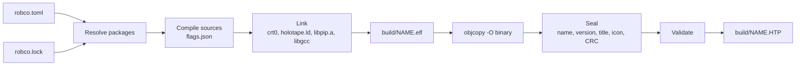

# Studio projects: robco.toml and robco.lock

RobCo Studio is a desktop tool for the suite: a `robco` command and a window. It builds holotapes and apps for the suite's operating systems, runs them in QEMU and writes cards. A Studio project is a folder with a manifest, `robco.toml`, and a lock file, `robco.lock`. This spec fixes both files.

State today: neither the tool nor any project file exists. No code reads or writes these files yet. Pip-OS projects build with `pipos-app.mk`, as [PIPOS_ABI.md](./PIPOS_ABI.md#sdk) describes, and keep doing so. [SDK_PACKAGE.md](./SDK_PACKAGE.md) fixes the packages a project builds against.

## A project folder

| Path | Content | Written by |
|---|---|---|
| `robco.toml` | The manifest. What to build and for what. | The author |
| `robco.lock` | The exact packages and tools a build used | The tool |
| `src/` | C sources, by convention. The manifest names the files. | The author |
| `build/` | Every output and every intermediate file | The tool |
| `build/gen/` | Generated C files | The tool |

The project root is the folder that holds `robco.toml`. A tool looks for `robco.toml` in the current folder only. It does not search parent folders.

A tool writes only under `build/` and to `robco.lock`. It never changes `robco.toml` during a build. `build/` may be deleted at any time. A project under version control commits `robco.toml` and `robco.lock` and ignores `build/`.

## robco.toml

### Syntax

`robco.toml` is TOML 1.0, encoded as UTF-8. A file that does not parse as TOML 1.0 fails with `manifest: syntax` and the line number.

Every path in the manifest follows these rules:

- It is relative to the project root.
- It uses `/` as the separator on every system.
- It has no empty component, no `.` and no `..` component.
- It does not start with `/` or a drive letter.
- It names a file inside the project root. A symbolic link that leads outside the root is refused.

A path that breaks a rule fails with `manifest: path` and the key.

### Format version

The first key of the file is `format`, outside any table.

| Key | Type | Required | Value |
|---|---|---|---|
| `format` | integer | Yes | `1` for this spec |

A tool reads every format version it knows. A manifest with a larger `format` fails with `manifest: format`, and the message asks for a newer tool. A missing `format`, or one that is not a positive integer, fails with `manifest: format`.

A change to this spec that an older tool would build wrongly raises `format`. A new optional key with a default that keeps old builds the same does not.

### Unknown keys

A key or a table that this spec does not define fails the build with `manifest: unknown key` and its dotted name, such as `project.titel`. The tool builds nothing.

### [project]

| Key | Type | Required | Default | Limits | Meaning |
|---|---|---|---|---|---|
| `name` | string | Yes | | See [Name rules](#name-rules) | The file stem of the output and the `name` field of the `rimg` header |
| `title` | string | No | Empty | ASCII, 0 to 64 bytes, no NUL | The META title |
| `version` | string | Yes | | `X.Y.Z`, decimal. X from 0 to 65535, Y and Z from 0 to 255. | The `image_version` field: `(X << 16) \| (Y << 8) \| Z` |
| `kind` | string | Yes | | See [Kinds](#kinds) | What the project builds |
| `subtype` | string | For `holotape` | | `game` or `utility` | The `ROBCO78` subtype: 0 or 1 |
| `icon` | string | No | No icon | A path | A 32x32 icon: PBM, `P1` or `P4`, or 128 raw bytes, read by the rules of `rimg.py seal --icon-format auto` in [IMAGE_FORMAT.md](./IMAGE_FORMAT.md#seal) |

Without `icon` the 128 icon bytes stay as the startup code wrote them, blank for a zeroed block. Without `title` the title stays empty.

A version string has no leading `+` or `-`, no spaces and no fourth part. Leading zeros are allowed and ignored. `1.02.3` is `1.2.3`.

### [target]

| Key | Type | Required | Default | Limits | Meaning |
|---|---|---|---|---|---|
| `platform` | string | Yes | | `pipos` | The operating system the output runs on |
| `abi` | string | Yes | | `MAJOR.MINOR`, decimal. MAJOR from 0 to 65535, MINOR from 0 to 65535. | The lowest ABI the project needs |

For `pipos`, MAJOR must be 1, the Pip-OS ABI major in [PIPOS_ABI.md](./PIPOS_ABI.md). Another major fails with `manifest: abi`.

`abi` does three things:

1. It picks the packages that fit. See [SDK_PACKAGE.md](./SDK_PACKAGE.md#version-and-abi-rules).
2. It goes into the image header as `abi_version = (MAJOR << 16) | MINOR`.
3. It hides calls newer than itself in the SDK headers. See [PIPOS_ABI.md](./PIPOS_ABI.md#calls-newer-than-the-target-abi).

### [build]

| Key | Type | Required | Default | Limits | Meaning |
|---|---|---|---|---|---|
| `backend` | string | No | `"robco"` | `robco` | Who runs the build. `robco`: the tool compiles, links and seals itself. |
| `sources` | array of strings | No | `["src/*.c"]` | 1 to 256 patterns, each a path pattern | The C files to compile |

A pattern is a path whose last component may hold `*`, which matches any run of characters other than `/`, including none. No other wildcard exists. Every other component is literal. The tool expands each pattern, keeps only regular files, drops repeats and sorts the list by byte value of the path. A pattern that matches nothing fails with `manifest: sources` and the pattern. Only files ending in `.c` compile. Any other match fails with `manifest: sources`.

### Keys reserved for later formats

These keys are named so no project uses them for something else. A format 1 tool refuses each one as an unknown key.

| Key | Purpose |
|---|---|
| `build.backend = "make"` | A ROM project that keeps its own Makefile |
| `build.runtime` | A runtime library linked into the tape, such as `reel` |
| `[[asset]]` | Assets packed into generated C |

### Name rules

`project.name` is the 8.3 stem of the output file and the `name` field of the header. It is:

- 1 to 8 characters long.
- Made of `A` to `Z`, `0` to `9`, `_` and `-`.

This is the stem rule of [Files on the SD card](./IMAGE_FORMAT.md#files-on-the-sd-card), less `~`. The tool refuses `~` because FAT short names use it for generated names. Any other name fails with `manifest: name` and the reason. Lower case letters fail too. The tool does not change the case.

The header's 16-byte `name` field holds the name, NUL-padded.

## Kinds

| Kind | Output | Runs on | State |
|---|---|---|---|
| `holotape` | `build/NAME.HTP`: a sealed `ROBCO78` image, subtype 0 or 1 | Pip-OS | Defined here |
| `rom` | `ROM1.ROM` and a card tree | Pip-OS | Reserved |
| `journal` | A program tape for the Pip-Boy, and for text a data tape for UOS | Pip-OS, UOS | Reserved |
| `terminal-content` | Files under `/UOS/` | UOS | Reserved |
| `site` | Two or more projects with a card each | Both | Reserved |

A format 1 tool builds `holotape` only. Any other value of `kind` fails with `manifest: kind` and names the kind.

### What a holotape build produces

| File | Content | Required |
|---|---|---|
| `build/NAME.HTP` | The sealed image. `NAME` is `project.name`. | Yes |
| `build/NAME.elf` | The linked ELF, for a debugger | Yes |
| `build/obj/` | Object files | No, tool's choice |

`build/NAME.HTP` passes `rimg.py verify` with no options. Its header holds:

| Field | Value |
|---|---|
| `magic` | `"ROBCO78\0"` |
| `flags` | 1, the META block is present |
| `load_addr` | `0x00800000` |
| `file_size` | The file length |
| `mem_size` | As linked: file, BSS and stack |
| `abi_version` | From `target.abi` |
| `image_version` | From `project.version` |
| `subtype` | 0 for `game`, 1 for `utility` |
| `name` | `project.name`, NUL-padded to 16 bytes |
| `crc32` | By the rules of [CRC](./IMAGE_FORMAT.md#crc) |
| META `title` | `project.title`, NUL-padded to 64 bytes |
| META `icon` | From `project.icon`, or as the startup code wrote it |

The tool seals the image with the rules of [Sealing and packing](./IMAGE_FORMAT.md#sealing-and-packing). A build that fails any step writes no `build/NAME.HTP`. It deletes an older one first, so a failed build never leaves a stale tape behind.



[SDK_PACKAGE.md](./SDK_PACKAGE.md#flagsjson) gives the compile and link command lines.

## Errors

A tool reports the first error it finds as `manifest: <code>: <detail>` and builds nothing.

| Code | When |
|---|---|
| `syntax` | The file is not TOML 1.0 or not UTF-8 |
| `format` | `format` is missing, not a positive integer, or larger than the tool knows |
| `unknown key` | A key or table this spec does not define |
| `type` | A key has the wrong TOML type |
| `missing` | A required key is absent |
| `name` | `project.name` breaks a name rule |
| `version` | `project.version` is not `X.Y.Z` or out of range |
| `title` | `project.title` is not ASCII, holds a NUL or is longer than 64 bytes |
| `kind` | `project.kind` is unknown or not built by this tool |
| `subtype` | `project.subtype` is missing for a holotape or not `game` or `utility` |
| `platform` | `target.platform` is not `pipos` |
| `abi` | `target.abi` is not `MAJOR.MINOR`, out of range, or the wrong major |
| `path` | A path breaks a path rule |
| `icon` | The icon file is missing or breaks the icon rules |
| `sources` | A pattern matches nothing, or matches a file that is not `.c` |

## robco.lock

`robco.lock` records the exact packages and tools a build resolved, with their hashes. Two people with the same manifest and the same lock file build with the same inputs. The tool writes it. A person does not edit it.

### Syntax and format version

`robco.lock` is TOML 1.0 in UTF-8. Its first key is `format`, an integer, `1` for this spec. The format rules are those of the manifest: a larger value fails with `lock: format`, and an unknown key fails with `lock: unknown key`.

### Keys

| Key | Type | Required | Meaning |
|---|---|---|---|
| `format` | integer | Yes | `1` |
| `index` | string | Yes | The index the packages came from, as the tool was given it: a URL or a local path. For the record only. |
| `[[package]]` | array of tables | Yes, one or more | One entry per package |
| `[[tool]]` | array of tables | Yes, one or more | One entry per downloaded tool |

Each `[[package]]`:

| Key | Type | Required | Meaning |
|---|---|---|---|
| `name` | string | Yes | The package name, such as `pipos` |
| `version` | string | Yes | The exact version, `X.Y.Z` |
| `sha256` | string | Yes | The SHA-256 of the package archive. 64 lower case hex digits. |

Each `[[tool]]`:

| Key | Type | Required | Meaning |
|---|---|---|---|
| `name` | string | Yes | `gcc` or `qemu` |
| `version` | string | Yes | The upstream version, such as `15.2.1` |
| `[tool.archives]` | table | Yes | One key per host, such as `linux-x64`. Each value is the SHA-256 of that host's archive. |

The lock lists the archives of every host the index offers, not only the host that wrote it. A lock written on macOS then works unchanged on Windows and Linux.

Entries are sorted by `name`. A tool writes the file with the keys in the order of the tables above, so the same resolution gives the same bytes.

### What the lock pins

The lock pins inputs, not outputs. It holds no hash of a built tape. With a lock in place, the tool:

1. Installs or finds each listed package at its exact version.
2. Checks each archive against its `sha256`, as [SDK_PACKAGE.md](./SDK_PACKAGE.md#hashes) says. A mismatch fails the build with `lock: hash` and names the package. The tool never replaces a pinned package with another version or another archive on its own.
3. Checks that the pinned packages still fit the manifest by the rules of [SDK_PACKAGE.md](./SDK_PACKAGE.md#version-and-abi-rules).

### When the lock changes

| Event | What the tool does |
|---|---|
| No `robco.lock` | Resolves from the index and writes the lock. |
| A lock whose packages fit the manifest | Uses it unchanged. |
| A lock whose packages no longer fit, after a change to `target.abi` or `target.platform` | Fails with `lock: stale`. It changes nothing. The command that updates the lock is not specified yet. |
| A lock that does not parse, or a larger `format` | Fails with `lock: syntax` or `lock: format`. |

## Examples

A holotape in C. Its folder holds `robco.toml`, `robco.lock`, `icon.pbm` and `src/main.c`.

```toml
format = 1

[project]
name = "PIPES"
title = "Pipes"
version = "1.0.0"
kind = "holotape"
subtype = "game"
icon = "icon.pbm"

[target]
platform = "pipos"
abi = "1.3"

[build]
backend = "robco"
sources = ["src/*.c"]
```

The lock file that a build of it writes. The hashes are placeholders: no package is built yet.

```toml
format = 1
index = "https://example.invalid/robco/index.json"

[[package]]
name = "pipos"
version = "1.3.0"
sha256 = "0000000000000000000000000000000000000000000000000000000000000001"

[[tool]]
name = "gcc"
version = "15.2.1"

[tool.archives]
linux-arm64 = "0000000000000000000000000000000000000000000000000000000000000002"
linux-x64 = "0000000000000000000000000000000000000000000000000000000000000003"
macos-arm64 = "0000000000000000000000000000000000000000000000000000000000000004"
macos-x64 = "0000000000000000000000000000000000000000000000000000000000000005"
windows-x64 = "0000000000000000000000000000000000000000000000000000000000000006"

[[tool]]
name = "qemu"
version = "10.1.2"

[tool.archives]
linux-x64 = "0000000000000000000000000000000000000000000000000000000000000007"
macos-arm64 = "0000000000000000000000000000000000000000000000000000000000000008"
windows-x64 = "0000000000000000000000000000000000000000000000000000000000000009"
```

## Open points

These rules are provisional. They are written down so the file is complete. Each may change before a tool reads the file.

| Point | Written here | Other options |
|---|---|---|
| An unknown key | Fails the build | Warn and ignore |
| Lower case in `project.name` | Fails | Upper-case it, as the `BOOT.CFG` path rule does |
| A missing `title` | Empty | Required, or the name |
| A missing `subtype` | Fails | Default to `game` |
| A missing `sources` | `["src/*.c"]` | Required |
| Wildcards | `*` in the last component only | Also `**` for folders |
| The lock file format | TOML | JSON |
| The command that updates a stale lock | Not specified | An `update` command, or a build that re-resolves on its own |
| Which package wins when several fit | Not specified here. See [SDK_PACKAGE.md](./SDK_PACKAGE.md#open-points). | |
