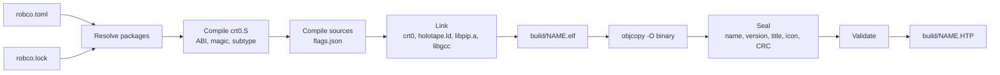

# Studio projects: robco.toml and robco.lock

RobCo Studio is a desktop tool for the suite: a `robco` command and a window. It builds holotapes and apps for the suite's operating systems, runs them in QEMU and writes cards. A Studio project is a folder with a manifest, `robco.toml`, and a lock file, `robco.lock`. This spec fixes both files.

State today: neither the tool nor any project file exists. No code reads or writes these files yet. Pip-OS projects build with `pipos-app.mk`, as [PIPOS_ABI.md](./PIPOS_ABI.md#sdk) describes, and keep doing so. [SDK_PACKAGE.md](./SDK_PACKAGE.md) fixes the packages a project builds against.

## A project folder

| Path | Content | Written by |
|---|---|---|
| `robco.toml` | The manifest. What to build and for what. | The author |
| `robco.lock` | The exact packages and tools a build used | The tool |
| `src/` | C sources, by convention. The manifest names the files. | The author |
| `tests/*.toml` | Scenario files. See [Scenario files](./STUDIO_CLI.md#scenario-files). | The author |
| `tests/golden/` | Golden images of the scenarios | The tool, when a person asks for it |
| `build/` | Every output and every intermediate file | The tool |
| `build/gen/` | Generated C files | The tool |

The project root is the folder that holds `robco.toml`. A tool looks for `robco.toml` in the current folder only. It does not search parent folders.

A tool writes only under `build/` and to `robco.lock`. `robco test --update-golden` also writes under `tests/golden/`, and nothing else does. A tool never changes `robco.toml` during a build. `build/` may be deleted at any time. A project under version control commits `robco.toml` and `robco.lock` and ignores `build/`.

## robco.toml

### Syntax

`robco.toml` is TOML 1.1, encoded as UTF-8. A file that does not parse as TOML 1.1 fails with `manifest: syntax` and the line number. `robco.lock` is TOML 1.1 too, and fails with `lock: syntax`.

#### TOML 1.1 and a reader built on a 1.0 parser

TOML 1.1 reads every TOML 1.0 file with the same meaning. It adds four forms that TOML 1.0 refuses:

| Added in TOML 1.1 | Example | In these files |
|---|---|---|
| An inline table may span lines and may end with a comma | The example below | A table of the manifest may be written this way |
| The escape `\xHH` in a basic string, for the characters up to U+00FF | `title = "Pi\x70es"` | Any string value |
| The escape `\e` in a basic string, for U+001B | `"\e"` | Parses. No key takes a control character, so the value then fails its own rule, such as `manifest: title`. |
| A time or a date and time without seconds | `08:30` | Parses. No key takes a time, so it fails with `manifest: type`. |

A reader built on a TOML 1.0 parser does not follow this spec:

- It reads every file that uses none of the four forms, and reads it right.
- It refuses a file that uses one of them with `manifest: syntax`, where this spec asks for the file to be read, or to fail with another code. So two tools would disagree on the same project.
- A reader must therefore use a TOML 1.1 parser. A test of a reader holds a manifest with each of the four forms.

A tool writes only the forms that TOML 1.0 and 1.1 share. That covers `robco.lock`, by [How the tool writes the lock](#how-the-tool-writes-the-lock), and the files of a template. So any TOML 1.0 program reads what the tool writes. The rule above is about what a reader accepts from a person.

This manifest uses the first two forms, and it writes `format` after other keys, which [Format version](#format-version) allows. It means the same as the first manifest of [Examples](#examples), and a TOML 1.0 parser refuses it:

```toml
project = {
    name = "PIPES",
    title = "Pi\x70es",
    version = "1.0.0",
    kind = "holotape",
    subtype = "game",
    icon = "icon.pbm",
}
target = { platform = "pipos", abi = "1.3" }
format = 1

[build]
backend = "robco"
sources = ["src/*.c"]
```

Every path in the manifest follows these rules:

- It is relative to the project root.
- It uses `/` as the separator on every system.
- It has no empty component, no `.` and no `..` component.
- It does not start with `/` or a drive letter.
- It names a file inside the project root. A symbolic link that leads outside the root is refused.

A path that breaks a rule fails with `manifest: path` and the key.

### Format version

`format` is a key outside any table.

| Key | Type | Required | Value |
|---|---|---|---|
| `format` | integer | Yes | `1` for this spec |

A tool reads every format version it knows. A manifest with a larger `format` fails with `manifest: format`, and the message asks for a newer tool. A missing `format`, or one that is not a positive integer, fails with `manifest: format`.

The order of keys carries no meaning, in a table and outside one. `format` need not be the first key of the file, and no key need come before another. TOML itself sets one limit: a key outside any table stands above the first table header. A `format` written below a header such as `[build]` belongs to that table. The file then has no `format` of its own and fails with `manifest: format`.

`format` is still the first thing a tool checks. Once the file has parsed, the tool checks `format` before any other rule, so a manifest of a later format reports `manifest: format` and never an unknown key or a bad value of that later format.

A change to this spec that an older tool would build wrongly raises `format`. A new optional key with a default that keeps old builds the same does not.

### Unknown keys

A key or a table that this spec does not define fails the build with `manifest: unknown key` and its dotted name, such as `project.titel`. The tool builds nothing.

### [project]

| Key | Type | Required | Default | Limits | Meaning |
|---|---|---|---|---|---|
| `name` | string | Yes | | See [Name rules](#name-rules) | The file stem of the output and the `name` field of the `rimg` header |
| `title` | string | No | Empty | ASCII, 0 to 64 bytes, no NUL | The META title |
| `version` | string | Yes | | `X.Y.Z`, decimal. X from 0 to 65535, Y and Z from 0 to 255. | The `image_version` field: `(X << 16) \| (Y << 8) \| Z` |
| `kind` | string | Yes | | See [Kinds](#kinds) | What the project builds |
| `subtype` | string | For `holotape` | | `game` or `utility` | The `ROBCO78` subtype: 0 or 1 |
| `icon` | string | No | No icon | A path | A 32x32 icon: PBM, `P1` or `P4`, or 128 raw bytes, read by the rules of `rimg.py seal --icon-format auto` in [IMAGE_FORMAT.md](./IMAGE_FORMAT.md#seal) |

Without `icon` the 128 icon bytes stay as the startup code wrote them, blank for a zeroed block. Without `title` the title stays empty.

A version string has no leading `+` or `-`, no spaces and no fourth part. Leading zeros are allowed and ignored. `1.02.3` is `1.2.3`.

### [target]

| Key | Type | Required | Default | Limits | Meaning |
|---|---|---|---|---|---|
| `platform` | string | Yes | | `pipos` | The operating system the output runs on |
| `abi` | string | Yes | | `MAJOR.MINOR`, decimal. MAJOR from 0 to 65535, MINOR from 0 to 65535. | The lowest ABI the project needs |

For `pipos`, MAJOR must be 1, the Pip-OS ABI major in [PIPOS_ABI.md](./PIPOS_ABI.md). Another major fails with `manifest: abi`.

`abi` does three things:

1. It picks the packages that fit. See [SDK_PACKAGE.md](./SDK_PACKAGE.md#version-and-abi-rules).
2. It goes into the image header as `abi_version = (MAJOR << 16) | MINOR`. The build compiles the package's startup code with that value, as [Startup code](./SDK_PACKAGE.md#startup-code) says. A project that targets 1.3 and builds against `pipos` 1.4.0 gets `0x00010003`.
3. It hides calls newer than itself in the SDK headers. See [PIPOS_ABI.md](./PIPOS_ABI.md#calls-newer-than-the-target-abi).

### [build]

| Key | Type | Required | Default | Limits | Meaning |
|---|---|---|---|---|---|
| `backend` | string | No | `"robco"` | Exactly `robco` | Who runs the build. `robco`: the tool compiles, links and seals itself. |
| `sources` | array of strings | No | `["src/*.c"]` | 1 to 256 patterns, each a path pattern | The C files to compile |

`backend` has one value in format 1. Any other string fails with `manifest: unknown key`, and the detail is `build.backend = "<value>"`, with the value written as a TOML basic string. `make` is reserved for a later format and fails the same way, so the whole error line is:

```
manifest: unknown key: build.backend = "make"
```

The code is `unknown key` and not a code of its own because a format 1 tool knows no other backend, as it knows no other key. The comparison is exact: `Robco` and `robco ` fail. A `backend` that is not a string fails with `manifest: type`.

A pattern is a path whose last component may hold `*`, which matches any run of characters other than `/`, including none. No other wildcard exists. Every other component is literal. The tool expands each pattern and keeps only regular files. A pattern that matches nothing fails with `manifest: sources` and the pattern. Only files ending in `.c` compile. Any other match fails with `manifest: sources`. [Source order](#source-order) says in which order the files compile and link.

`sources` holds 1 to 256 patterns. The limit counts the entries of the array as the manifest writes them, before a pattern is expanded and before a path that comes twice is dropped. Both ends fail with `manifest: sources`, and the detail gives the count:

| `sources` | Result |
|---|---|
| Absent | The default, `["src/*.c"]` |
| `[]` | `manifest: sources`, with the detail `build.sources holds 0 patterns, 1 to 256 allowed` |
| 1 to 256 entries | Read |
| 257 entries or more | `manifest: sources`, with the count in the same detail |

The tool makes this check on the manifest alone, before it looks at a file. The source list that the patterns expand to has no limit of its own: one pattern may match more than 256 files.

### Source order

The source list is the order of the link, and the link order is one of the things that decide the bytes of the tape. The tool builds the list in three steps:

1. It takes the patterns of `sources` in the order the manifest writes them.
2. It expands each pattern. A pattern without `*` gives one path, as written. A pattern with `*` gives every match, sorted by the byte value of the path.
3. It appends the paths of each pattern to the list. A path that is already in the list is skipped and keeps its first place.

Step 2 of [Build order](./SDK_PACKAGE.md#build-order) compiles the list in this order, and step 3 links the objects in the same order, after the startup code.

| Manifest | Source list |
|---|---|
| `sources` absent, so `["src/*.c"]` | Every `.c` file of `src/`, sorted by path |
| `["main.c", "game.c", "logic.c", "draw.c"]` | Those four files, in that order |
| `["src/main.c", "src/*.c"]` | `src/main.c`, then the other `.c` files of `src/`, sorted by path |

So a project states its order by naming its files one by one, and gets the sorted order wherever it writes a pattern. The list never depends on the host system, on the order in which a file system lists a folder, or on a locale.

A path without `*` must spell the file name as the folder holds it, byte for byte. A name that differs only in case fails with `manifest: sources`, also on a file system that would open the file anyway. A manifest that builds on one system then builds on every system.

The reason for this rule: the sealed tape of Culvert was measured equal across systems and build paths with the sources linked in the order of its Makefile, `main.c game.c logic.c draw.c`. [K2](https://github.com/RobCo-Industries/RobCo-Studio/blob/main/docs/spikes/K2.md) names the link order as a condition, and no other order was measured. A build that keeps the written order links what the Makefile links, so nothing new has to be measured. A rule that sorted every list would have changed Culvert's link order in one of the two builds.

#### A project that also builds with a Makefile

A project may keep a Makefile that includes `pipos-app.mk` beside its `robco.toml`, as Culvert does in Deitrix. Both builds give the same tape only when both files say the same things:

| Makefile | `robco.toml` | Rule |
|---|---|---|
| `SRCS` | `build.sources` | The same files in the same order, each named one by one, with no `*` |
| `ABI` | `target.abi` | The same `MAJOR.MINOR`. Both files state it. See [The target ABI in pipos-app.mk](./PIPOS_ABI.md#the-target-abi-in-pipos-appmk). |
| `NAME`, `TITLE`, `VERSION`, `ICON` | `project.name`, `project.title`, `project.version`, `project.icon` | The same values |
| `KIND`, `SUBTYPE` | `project.kind`, `project.subtype` | `holotape`, and the same subtype |
| `CFLAGS_EXTRA` | No key | Empty. Format 1 has no key for extra flags. |

Each source path is relative to the folder that holds both files, and Make runs in that folder. The compiler is the one the package names, in both builds. See [Tools a package names](./SDK_PACKAGE.md#tools-a-package-names).

A job that compares the two builds checks these, in this order, and fails at the first that does not hold:

1. The `sources` array of the `result` line of `robco build --json` equals the words of `SRCS` as Make expands it, in order. The failure message prints both lists.
2. The `abi` field of that line equals the Makefile's `ABI`.
3. The `gcc` field of that line equals the release of the compiler that the Makefile build ran.
4. The two `NAME.HTP` files have the same SHA-256.

Checks 1 to 3 come first so that a difference between the tapes has a named cause. The job compares no object, no archive and no ELF, as [What must be equal](#what-must-be-equal) says. [robco build](./STUDIO_CLI.md#robco-build) defines the `result` line.

### Keys reserved for later formats

These keys are named so no project uses them for something else. A format 1 tool refuses each one with `manifest: unknown key`. The detail is the dotted name of the key, and for the first row `build.backend = "make"`.

| Key | Purpose |
|---|---|
| `build.backend = "make"` | A ROM project that keeps its own Makefile |
| `build.runtime` | A runtime library linked into the tape, such as `reel` |
| `[[asset]]` | Assets packed into generated C |

### Name rules

`project.name` is the 8.3 stem of the output file and the `name` field of the header. It is:

- 1 to 8 characters long.
- Made of `A` to `Z`, `0` to `9`, `_` and `-`.

This is the stem rule of [Files on the SD card](./IMAGE_FORMAT.md#files-on-the-sd-card), less `~`. The tool refuses `~` because FAT short names use it for generated names. Any other name fails with `manifest: name` and the reason. Lower case letters fail too. The tool does not change the case.

The header's 16-byte `name` field holds the name, NUL-padded.

## Kinds

| Kind | Output | Runs on | State |
|---|---|---|---|
| `holotape` | `build/NAME.HTP`: a sealed `ROBCO78` image, subtype 0 or 1 | Pip-OS | Defined here |
| `rom` | `ROM1.ROM` and a card tree | Pip-OS | Reserved |
| `journal` | A program tape for the Pip-Boy, and for text a data tape for UOS | Pip-OS, UOS | Reserved |
| `terminal-content` | Files under `/UOS/` | UOS | Reserved |
| `site` | Two or more projects with a card each | Both | Reserved |

A format 1 tool builds `holotape` only. Any other value of `kind` fails with `manifest: kind` and names the kind.

### What a holotape build produces

| File | Content | Required |
|---|---|---|
| `build/NAME.HTP` | The sealed image. `NAME` is `project.name`. | Yes |
| `build/NAME.elf` | The linked ELF, for a debugger | Yes |
| `build/obj/` | Object files | No, tool's choice |

`build/NAME.HTP` passes `rimg.py verify` with no options. Its header holds:

| Field | Value |
|---|---|
| `magic` | `"ROBCO78\0"` |
| `flags` | 1, the META block is present |
| `load_addr` | `0x00800000` |
| `file_size` | The file length |
| `mem_size` | As linked: file, BSS and stack |
| `abi_version` | `target.abi` as `(MAJOR << 16) \| MINOR`, written by the startup code |
| `image_version` | From `project.version` |
| `subtype` | 0 for `game`, 1 for `utility` |
| `name` | `project.name`, NUL-padded to 16 bytes |
| `crc32` | By the rules of [CRC](./IMAGE_FORMAT.md#crc) |
| META `title` | `project.title`, NUL-padded to 64 bytes |
| META `icon` | From `project.icon`, or as the startup code wrote it |

The tool seals the image with the rules of [Sealing and packing](./IMAGE_FORMAT.md#sealing-and-packing). A build that fails any step writes no `build/NAME.HTP`. It deletes an older one first, so a failed build never leaves a stale tape behind.



[Build order](./SDK_PACKAGE.md#build-order) gives the compile and link command lines.

### What must be equal

Only `build/NAME.HTP` must be byte-equal on every host system and in every project folder, for the same manifest, lock and sources. `build/NAME.elf` and the objects may differ. See [What must be equal](./SDK_PACKAGE.md#what-must-be-equal).

## Errors

A tool reports the first error it finds as `manifest: <code>: <detail>` and builds nothing.

"First" has a fixed meaning, so two tools report the same code for the same manifest. The tool follows the six steps of [Order of checks](./STUDIO_CLI.md#order-of-checks):

1. A manifest that is absent fails with `project: none`, and one that the host does not let the tool read with `io: read`. Neither is a `manifest:` code.
2. `syntax`.
3. `format`.
4. `unknown key`, for the first unknown key or table in the order of the file, and for a `build.backend` other than `robco`.
5. Each key of `[project]`, then of `[target]`, then of `[build]`, in the order of its table. For one key: `missing` when it is required and absent, `type` when its TOML type is wrong, then the code of its value: `name`, `title`, `version`, `kind`, `subtype`, `path` for an `icon` that breaks a path rule, `platform`, `abi`, `sources` for the count of patterns, and `path` for a pattern that breaks a path rule. A missing `subtype` in a holotape is `subtype`, not `missing`.
6. The checks that look at files: the icon file, `path` and `icon`, then each pattern of `sources` in the order written, `path` and `sources`.

| Code | When |
|---|---|
| `syntax` | The file is not TOML 1.1 or not UTF-8 |
| `format` | `format` is missing, not a positive integer, or larger than the tool knows |
| `unknown key` | A key or table this spec does not define, or a `build.backend` other than `robco` |
| `type` | A key has the wrong TOML type |
| `missing` | A required key is absent |
| `name` | `project.name` breaks a name rule |
| `version` | `project.version` is not `X.Y.Z` or out of range |
| `title` | `project.title` is not ASCII, holds a NUL or is longer than 64 bytes |
| `kind` | `project.kind` is unknown or not built by this tool |
| `subtype` | `project.subtype` is missing for a holotape or not `game` or `utility` |
| `platform` | `target.platform` is not `pipos` |
| `abi` | `target.abi` is not `MAJOR.MINOR`, out of range, or the wrong major |
| `path` | A path breaks a path rule |
| `icon` | The icon file is missing or breaks the icon rules |
| `sources` | `build.sources` is empty or holds more than 256 patterns, a pattern matches nothing or matches a file that is not `.c`, or a path spells a file name in another case |

## robco.lock

`robco.lock` records the exact packages and tools a build resolved, with their hashes. Two people with the same manifest and the same lock file build with the same inputs. The tool writes it. A person does not edit it.

### Syntax and format version

`robco.lock` is TOML 1.1 in UTF-8. `format` is an integer outside any table, `1` for this spec. The format rules are those of the manifest: a reader gives the order of keys no meaning, checks `format` before any other rule, fails a larger value, a missing one and one that is not a positive integer with `lock: format`, and fails an unknown key with `lock: unknown key`.

### Keys

| Key | Type | Required | Meaning |
|---|---|---|---|
| `format` | integer | Yes | `1` |
| `index` | string | Yes | The index the packages came from, as the tool was given it: a URL or a local path. For the record only. |
| `[[package]]` | array of tables | No | One entry per package. A package the project needs and the lock lacks makes the lock [stale](#a-stale-lock). |
| `[[tool]]` | array of tables | No | One entry per tool: at most two, one named `gcc` and one named `qemu`. A lock without both is stale. |

Each `[[package]]`:

| Key | Type | Required | Meaning |
|---|---|---|---|
| `name` | string | Yes | The package name, such as `pipos`: 1 to 32 characters from `a` to `z`, `0` to `9` and `-`, starting with a letter. No two entries have the same name. |
| `version` | string | Yes | The exact version, `X.Y.Z`, each part from 0 to 65535 with no leading zero |
| `sha256` | string | Yes | The SHA-256 of the package archive. 64 lower case hex digits. |

Each `[[tool]]`:

| Key | Type | Required | Meaning |
|---|---|---|---|
| `name` | string | Yes | `gcc` or `qemu`, and nothing else. No two entries have the same name. |
| `version` | string | Yes | The version that the locked `pipos` package names for this tool, such as `15.2.1-1.1`. 1 to 64 bytes from `0x21` to `0x7E`, with no `"` and no `\`. See [Tools a package names](./SDK_PACKAGE.md#tools-a-package-names). |
| `[tool.archives]` | table | Yes | One key per host, such as `linux-x64`, and at least one. Each key is a host name in the form of [The index](./SDK_PACKAGE.md#the-index). Each value is the SHA-256 of that host's archive, 64 lower case hex digits. |

The lock lists the archives of every host the index offers, not only the host that wrote it, and that includes a host name this version of the tool does not know. A lock written on macOS then works unchanged on Windows and Linux.

A lock names no tool but `gcc` and `qemu`. Format 1 knows no other tool, and no package of format 1 can name one: `tools` of a `pipos` package holds exactly those two. A `[[tool]]` with another name can therefore never be right, whatever the manifest says, so it makes the lock invalid and not stale: `lock: entry`, with the detail `tool.name = "<value>"`. A tool walks the `[[tool]]` entries only after this check, so it never tries to install a tool that no package named.

### Reading the lock

| Case | Result |
|---|---|
| The project root has no `robco.lock` | No error. [When the lock changes](#when-the-lock-changes) says what the command does. |
| The file exists, and the host refuses to open or to read it | `io: read`, with the path. Exit code 9. The code is not a `lock:` code, since the tool has read nothing of the lock. |
| The bytes are not UTF-8 or not TOML 1.1 | `lock: syntax`, with the line |
| `format` is missing, is not a positive integer, or is larger than the tool knows | `lock: format`. For a larger one the message asks for a newer tool. |
| A key or a table that this spec does not define, at the top, in an entry or under one | `lock: unknown key`, with its dotted name, such as `tool.arch` |
| A required key is missing, a key has the wrong TOML type, a value breaks the form its table gives, two entries have the same `name`, a `[[tool]]` has a name other than `gcc` and `qemu`, or `[tool.archives]` is empty | `lock: entry`, with the key and for a bad value the value, such as `package.sha256` or `tool.name = "gdb"`. The message ends with `run robco update`. |
| The lock is stale | `lock: stale`, by [A stale lock](#a-stale-lock) |

The checks come in the order of the table, and the tool reports the first failure. So a lock of a later format reports `lock: format`, whatever else it holds: a tool cannot tell an unknown key of a later format from a mistake. In the sixth row the tool checks `index` first, then each `[[package]]` in the order of the file, key by key in the order of the tables of [Keys](#keys), then each `[[tool]]` the same way.

A failure to write `robco.lock`, or to rename the temporary file over it, is `io: write`, with the path. No `lock:` code means a failure of the host's file system.

### How the tool writes the lock

Two tools that resolve the same index for the same manifest write the same bytes. A writer follows this layout exactly:

| Rule | Detail |
|---|---|
| Encoding | UTF-8, with no byte order mark |
| Line end | One line feed, on every system. No carriage return. |
| End of the file | The last line ends with one line feed, and nothing follows it |
| Spaces | One space on each side of every `=`. No space at the start or the end of a line, and no tab. |
| Comments | None |
| Blank lines | Exactly one before each `[[package]]`, each `[[tool]]` and each `[tool.archives]` header. None anywhere else. |
| First lines | `format = 1`, then `index`, with no blank line between them |
| Packages | Every `[[package]]` block, sorted by `name` in byte order. In a block: `name`, `version`, `sha256`. |
| Tools | After the last package, every `[[tool]]` block, sorted by `name` in byte order, so `gcc` then `qemu`. In a block: `name`, `version`, then `[tool.archives]`. |
| Archives | One line per host, sorted by host name in byte order. The key is the host name, written bare, with no quotes. |
| Strings | Basic strings in double quotes, on one line. A writer escapes `\` as `\\`, `"` as `\"`, and each character below U+0020 and U+007F as `\u00` and two lower case hex digits. It writes every other character as itself, in UTF-8. Only `index` can hold a character that needs an escape: the forms of the other values leave none. |
| Numbers | `format` is the only one: decimal digits with no sign |

A reader does not ask for this layout. It reads any TOML 1.1 file that holds the keys, by [Reading the lock](#reading-the-lock). The layout binds a writer only.

The lock at the end of [Examples](#examples) is in this layout, byte for byte. It is what a resolution of the index example of [SDK_PACKAGE.md](./SDK_PACKAGE.md#examples) writes for the first manifest, with the index location `https://example.invalid/robco/index.json`.

### What the lock pins

The lock pins inputs, not outputs. It holds no hash of a built tape. With a lock in place, the tool:

1. Installs or finds each listed package at its exact version.
2. Checks each archive against its `sha256`, as [SDK_PACKAGE.md](./SDK_PACKAGE.md#hashes) says. A mismatch fails the build with `lock: hash` and names the package. The tool never replaces a pinned package with another version or another archive on its own.
3. Checks that the pinned packages still fit the manifest by the rules of [SDK_PACKAGE.md](./SDK_PACKAGE.md#version-and-abi-rules).
4. Checks, once the `pipos` package is installed and before it installs or starts any tool, that each `[[tool]]` entry has the `version` that the package's `sdk.json` names for it. A difference fails the build with `lock: tool` and names the tool and both versions. The message ends with `run robco update`. The tool changes nothing. Only a lock edited by hand can fail here, since the tool writes both from one resolution.

So every tool a command installs or starts passed three checks: its name is `gcc` or `qemu`, by [Reading the lock](#reading-the-lock), the locked `pipos` package names it at that version, by step 4, and its archive has the hash the lock pins.

A resolution writes the `[[tool]]` entries from the package it picked: for each of `gcc` and `qemu`, the version the package names and the SHA-256 of every archive the index lists for that version.

### When the lock changes

| Event | What the tool does |
|---|---|
| No `robco.lock` | Resolves from the index and writes the lock. |
| A lock whose packages fit the manifest | Uses it unchanged. |
| A stale lock | Fails with `lock: stale`. It changes nothing. |
| A lock that does not parse, a `format` the tool refuses, an unknown key or a bad entry | Fails with `lock: syntax`, `lock: format`, `lock: unknown key` or `lock: entry`, by [Reading the lock](#reading-the-lock). It changes nothing. |
| A `[[tool]]` version that the installed `pipos` package does not name | Fails with `lock: tool`. It changes nothing. See [What the lock pins](#what-the-lock-pins). |
| `robco update` | Resolves again and writes a new lock. See below. |

A build never moves a pin. Only `robco update` does, and only when a person runs it.

### A stale lock

A lock that parses is stale when one of these holds for the current manifest:

1. A `[[package]]` entry no longer fits, by rules 1 to 3 of [Version and ABI rules](./SDK_PACKAGE.md#version-and-abi-rules). A change to `target.abi` or `target.platform` does this. The lock has no `abi` key, so the ABI of a locked `pipos` package is the first two parts of its `version`, which its `sdk.json` must equal.
2. The manifest needs a package that the lock does not list: `pipos` for `target.platform = "pipos"`, and each package that a listed package `requires`.
3. The lock lists a package that the manifest does not need.
4. The lock does not list both tools, `gcc` and `qemu`, or a `[[tool]]` entry has no archive for the running host.

The tool checks for a stale lock before it installs, downloads or compiles anything. It needs the manifest and the lock only, with one exception: what a listed package `requires` is in that package's `sdk.json`. The tool checks that part of item 2 right after it has installed the listed packages, before it installs a tool or compiles, and fails the same way. Rule 4 of the fit rules, the formats, is not a matter of a stale lock: a locked package that uses a format the tool does not know fails with `package: format` when the tool reads its `sdk.json`.

A `[[tool]]` entry that the project does not need cannot exist in a lock that parses: the lock holds no tool but `gcc` and `qemu`, each at most once, and the project needs both. A `[[tool]]` at a version that the locked package does not name fails with `lock: tool`, by [What the lock pins](#what-the-lock-pins). It fails with `lock: stale: <detail>`. The detail names the first package or tool that fails, in the order of the list above and then by `name`, and the message ends with `run robco update`. The tool writes no `build/NAME.HTP`, deletes an older one, and leaves `robco.lock` as it is.

A lock that is not stale but names a package version or a tool archive that the index no longer lists still pins it. The tool installs it from `<cache>` if it is there. If it must download it and the index has no entry with that name, version and hash, it fails with `lock: missing` and names it.

### robco update

`robco update [--index LOCATION]` resolves every package and tool again from the index, as if no lock existed. It picks the newest package that fits, by [Version and ABI rules](./SDK_PACKAGE.md#version-and-abi-rules), installs and checks it, then writes a new `robco.lock` in place of the old one. It builds nothing and touches nothing under `build/`. It needs `--index`, as [Where the index is](./SDK_PACKAGE.md#where-the-index-is) says.

`robco update` fails with the code of the first error it meets and then leaves the old `robco.lock` as it is. It writes the new lock to a temporary file in the project root and renames it over the old one, so a failure never leaves half a lock.

## Examples

A holotape in C. Its folder holds `robco.toml`, `robco.lock`, `icon.pbm` and `src/main.c`.

```toml
format = 1

[project]
name = "PIPES"
title = "Pipes"
version = "1.0.0"
kind = "holotape"
subtype = "game"
icon = "icon.pbm"

[target]
platform = "pipos"
abi = "1.3"

[build]
backend = "robco"
sources = ["src/*.c"]
```

Culvert, a project that also builds with a Makefile. Its folder, `holotapes/culvert` in Deitrix, holds `Makefile`, `robco.toml`, `icon.pbm`, four `.c` files and their headers. The Makefile says `SRCS := main.c game.c logic.c draw.c` today. It will also say `ABI := 1.4`, the ABI its tape carries today. By [A project that also builds with a Makefile](#a-project-that-also-builds-with-a-makefile), the manifest holds:

```toml
format = 1

[project]
name = "CULVERT"
title = "Culvert"
version = "1.0.0"
kind = "holotape"
subtype = "game"
icon = "icon.pbm"

[target]
platform = "pipos"
abi = "1.4"

[build]
backend = "robco"
sources = ["main.c", "game.c", "logic.c", "draw.c"]
```

Deitrix adds two things for this: the line `ABI := 1.4` in `holotapes/culvert/Makefile`, and `holotapes/culvert/robco.toml` with the content above. It changes no source file and no order. A later change of the ABI changes both files in one commit.

The lock file that a build of the first example writes. The hashes are placeholders: no package is built yet.

```toml
format = 1
index = "https://example.invalid/robco/index.json"

[[package]]
name = "pipos"
version = "1.3.0"
sha256 = "0000000000000000000000000000000000000000000000000000000000000001"

[[tool]]
name = "gcc"
version = "15.2.1-1.1"

[tool.archives]
linux-arm64 = "0000000000000000000000000000000000000000000000000000000000000002"
linux-x64 = "0000000000000000000000000000000000000000000000000000000000000003"
macos-arm64 = "0000000000000000000000000000000000000000000000000000000000000004"
macos-x64 = "0000000000000000000000000000000000000000000000000000000000000005"
windows-x64 = "0000000000000000000000000000000000000000000000000000000000000006"

[[tool]]
name = "qemu"
version = "10.1.2"

[tool.archives]
linux-x64 = "0000000000000000000000000000000000000000000000000000000000000007"
macos-arm64 = "0000000000000000000000000000000000000000000000000000000000000008"
windows-x64 = "0000000000000000000000000000000000000000000000000000000000000009"
```
