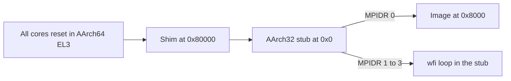
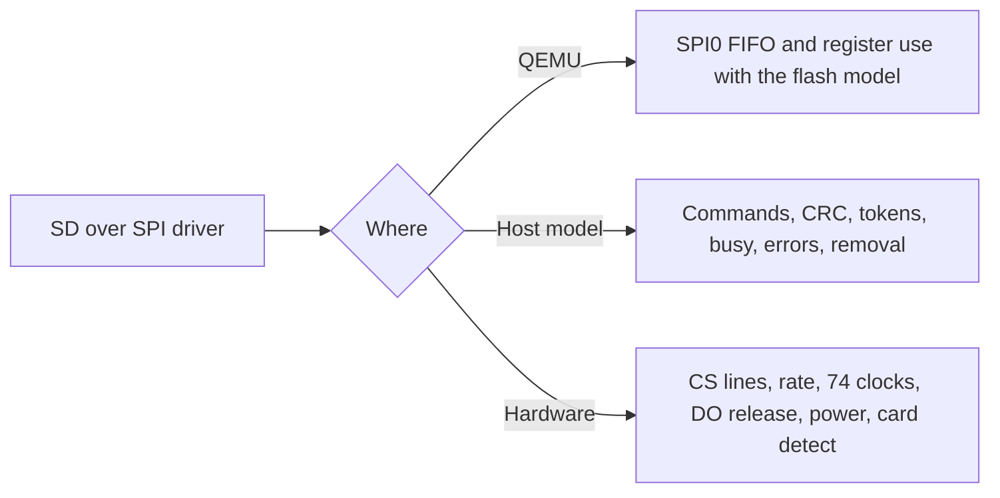

# Testing

Every repo in the suite tests with the same harness from RobCo-Core. QEMU 10.1.2 runs the target tests. Real boards run a short checklist for what QEMU cannot model. [HARDWARE_VALIDATION.md](../HARDWARE_VALIDATION.md) holds that checklist for every component.

## Layers

| Layer | What runs | Where |
|---|---|---|
| 1. Host tests | C unit tests built for the host from the real sources: klibc, CRC, `rimg`, boot info, tick maths, allocator, partitions, FatFs over a file, input queue and decoders, audio notes, sequencer and PCM engine, date and time, INI, the SD protocol over SPI and the holotape slot against a card model. 18 files, about 180 tests. Later: game logic, UI layout. | `tests/host/` |
| 2. Tool tests | pytest for the host tools, the Makefile, the docs checker, and the file system against mtools | `tests/tools/` |
| 3. Serial tests | Boot an image in QEMU and assert on `@RC` markers and text. 17 files, each run on every board. | `tests/target/` |
| 4. Screen tests | Console cell grid dumped over the UART, plus QMP `screendump` compared with golden images | `tests/target/`, `tests/golden/` |
| 5. Input tests | Key input over the console backend on the PL011 and the script backend on the mini UART. GPIO buttons and the dial with levels driven through qtest. | `tests/target/test_input.py`, `tests/target/test_input_gpio.py` |
| 6. Fault tests | Bad magic, bad CRC, out-of-slot images, a missing next stage, an undefined instruction, MMU faults. Later: truncated file, oversized file, crashing holotape. | `tests/target/` |

The harness is Python with pytest and Pillow in a venv. `tests/harness/` holds the shared code:

| File | Role | State |
|---|---|---|
| `qemu.py` | Starts QEMU headless, talks QMP, HMP and qtest, captures serial, kills QEMU on exit | Exists |
| `boot.py` | `boot()`: boots a raw image the way the firmware does. Serial read and write, `@RC` marker parsing, screendumps. | Exists |
| `sdimage.py` | Builds SD images and fault images from Python | Exists |
| `pigpio.py` | Drives the Pi's own GPIO input levels through qtest: buttons, bounce and dial turns on a timed schedule | Exists |
| `expect.py` | Waits for `@RC` markers and text on a serial log | To be added. `boot.py` covers it today. |
| `screen.py` | PPM to PNG, golden compare | To be added |
| `inputs.py` | Sends scripted keys over the serial backend | To be added. `test_input.py` sends the lines itself. |

`tests/conftest.py` adds the `--board` option and the shared fixtures. `tests/fwstub/` holds the firmware stub.

## Booting images in QEMU

### Why not plain -kernel

A raw image passed with `-kernel` loads at `0x10000`, not `0x8000` (fact V1). Our images link at `0x8000` and do not relocate. A raw `-kernel` run would crash.

An ELF passed with `-kernel` loads at its link address (V2). On `raspi2b` it starts all four cores at the entry point. Real firmware parks the secondaries and enters in HYP. So an ELF run does not match hardware either.

### Firmware stub plus loader

`boot()` in `tests/harness/boot.py` runs the same raw image the firmware would load. It starts QEMU stopped, connects to the serial ports, then resumes it. The command line looks like this:

```
qemu-system-arm -M raspi2b -display none -monitor none -no-user-config \
  -qmp unix:<tmp>/qmp.sock,server=on,wait=off \
  -chardev socket,id=ser0,path=<tmp>/serial0.sock,server=on,wait=off \
  -serial chardev:ser0 -S \
  -device loader,file=tests/fwstub/build/fwstub.bin,addr=0x0,force-raw=on \
  -device loader,file=IMAGE,addr=0x8000,force-raw=on \
  -device loader,addr=0x7f00,data=<word>,data-len=4 ...
```

`fwstub.bin` mimics the firmware handoff. It is loaded raw at `0x0`, where AArch32 cores start when QEMU has no kernel. All cores run it.

- It parks secondary cores in a `wfi` loop. It reads MPIDR only when the MIDR part is not `0xB76`.
- It reads a parameter block at `0x7F00`: the magic `RCFW`, the machine id, the RAM size and flags. The harness writes these four words with `-device loader`. Without the magic it uses `0xC42` and 256 MiB.
- It writes an `ATAG_CORE`, `ATAG_MEM` and `ATAG_NONE` list at `0x100`.
- If the HYP flag is set and the CPU is not ARM1176, it switches from Secure SVC to Non-secure HYP with an `smc` into its own monitor vectors.
- It jumps to `0x8000` with r0 = 0, r1 = machine id, r2 = `0x100`.

| Board | Machine id | RAM | Entry mode |
|---|---|---|---|
| `raspi0` | `0xC42` | 512 MiB | SVC |
| `raspi1ap` | `0xC42` | 512 MiB | SVC |
| `raspi2b` | `0xC43` | 1 GiB | HYP |
| `raspi3b` | `0xC43` | 1 GiB | HYP |

`boot(image, board, mode="svc")` enters in SVC on `raspi2b` and `raspi3b` too.

The `-device loader` option with `force-raw=on` puts the image at `0x8000` byte for byte (V3).

Some tests attach more devices:

| Test | Device | Arguments |
|---|---|---|
| `test_sdraw.py` | SD card image on the EMMC controller | `-drive if=sd,format=raw,file=sd.img` |
| `test_input.py` | Mini UART as a second serial port | `boot(..., serial2=True)` |
| `test_rtc.py` | DS1338 RTC model, DS1307 registers, on I2C bus 1 | `-device ds1338,bus=i2c-bus.1,address=0x68` |
| `test_spi.py` | W25Q32 SPI flash on the SPI0 bus | `-device w25q32,bus=spi` |
| `test_gpiox.py` | Two PCA9554 GPIO expanders on I2C bus 1, inputs driven through qtest | `-device pca9554,bus=i2c-bus.1,address=0x20` and `0x21`, `boot(..., qtest=True)` |
| `test_input_gpio.py` | Pi GPIO input levels driven through qtest, every active-low line high at start | `boot(..., serial2=True, qtest=True, gpio_high=[...])` |

`test_rtc.py` and `test_spi.py` also boot once without the device, to check the absent case.

### raspi3b

`raspi3b` exists only in `qemu-system-aarch64`, and its CPU always starts in AArch64 (V5). `tests/fwstub/a64_shim.py` holds seven AArch64 words. The harness loads them at `0x80000` and starts all four cores there. They drop each core to AArch32 HYP at `0x0`, the firmware stub:

| Word | Instruction |
|---|---|
| `0xD2802620` | `mov x0, #0x131` |
| `0xD51E1100` | `msr scr_el3, x0` |
| `0xD2803B40` | `mov x0, #0x1DA`, AArch32 HYP with A, I and F masked |
| `0xD51E4000` | `msr spsr_el3, x0` |
| `0xD2800000` | `mov x0, #0x0`, the firmware stub |
| `0xD51E4020` | `msr elr_el3, x0` |
| `0xD69F03E0` | `eret` |

For `mode="svc"` the third word is `0xD2803A60`, `mov x0, #0x1D3`. The stub then runs as on the other boards, but never issues `smc`, because the CPU is already in the right mode. No AArch64 toolchain is needed.

The stub reads MPIDR and parks cores 1 to 3 in its AArch32 `wfi` loop, as on `raspi2b`. Real firmware also parks them before the image runs. CPU 0 alone enters the image, so `start.S` runs on CPU 0 as before.



Without the harness, QEMU starts cores 1 to 3 at `0x0` in AArch64 EL3 (V18). There they run the A32 stub as A64 code, fault, and spin on the EL3 vector at `0x200`. Each spinning core keeps one host thread busy and slows every MMIO access of CPU 0. A SPI panel test took 8 seconds instead of 1. The harness avoids that by starting the spare cores in the shim.

The parking does not test the parking code in `start.S`. On `raspi3b` that code never runs on cores 1 to 3. The `-kernel` ELF runs on `raspi2b` cover it, because QEMU starts every core at the entry point there (V2).

### boot.json

`boot.json` holds the arguments of `boot_args()` as data, so a tool other than the Python harness boots a board the same way. Studio reads it from the `pipos` package, as [SDK_PACKAGE.md](./SDK_PACKAGE.md#layout-of-pipos) says.

State today: no writer exists. The harness keeps its own board table in `tests/harness/boot.py` and `tests/fwstub/a64_shim.py`. A writer in the harness will produce `boot.json` from that table, so the boot rules keep one source, and a tool test will compare the two. The example below is what `boot_args()` gives today.

| Field | Type | Required | Meaning |
|---|---|---|---|
| `format` | integer | Yes | `1` for this spec |
| `common` | array of strings | Yes | Arguments every boot passes after `-M` |
| `sd` | array of strings | Yes | Arguments that attach an SD image, added when there is one |
| `boards` | object | Yes | One entry per board, keyed by the QEMU machine name |

A board entry:

| Field | Type | Required | Meaning |
|---|---|---|---|
| `qemu` | string | Yes | The QEMU program: `qemu-system-arm` or `qemu-system-aarch64` |
| `machine` | string | Yes | The `-M` value |
| `default_mode` | string | Yes | The mode `boot()` uses with `mode="auto"` |
| `modes` | object | Yes | `svc`, and `hyp` where the board has it. Each holds the arguments of that mode. |

Strings hold three placeholders. A tool replaces each with a path and nothing else:

| Placeholder | Path |
|---|---|
| `{stub}` | The firmware stub, `fwstub.bin` |
| `{image}` | The raw image, loaded at `0x8000` |
| `{sd}` | The SD image |

QEMU reads a comma in an option value as the end of the value, and a doubled comma as one comma. A tool doubles every comma in a path before it puts the path in a placeholder. The harness does not, so it cannot boot a path with a comma.

A tool builds the command line in this order, which is the harness's order:

1. The `qemu` program, `-M`, the `machine`.
2. `common`.
3. QMP, then qtest when used. The transport is the tool's choice: the harness uses Unix sockets.
4. The serial ports, PL011 first, then the mini UART when used (V15). Each is a `-chardev` and a `-serial chardev:<id>`.
5. `-S`, so the tool can connect before the guest runs. It then sends QMP `cont`.
6. The arguments of the chosen mode.
7. `sd` when an SD image is attached.
8. Any device a test adds, as in the table of devices above.

The mode arguments do what [Firmware stub plus loader](#firmware-stub-plus-loader) and [raspi3b](#raspi3b) describe. They load the stub at `0x0`, the image at `0x8000` and the four parameter words at `0x7F00`. The flags word is 1 only for `hyp` on `raspi2b`. On `raspi3b` it stays 0 in both modes, because the shim already enters HYP or SVC. There the mode arguments also load the seven shim words at `0x80000` and start all four cores there, CPU 0 first. The shim's third word differs between the two modes.

A `boot.json` with a larger `format` fails. A tool ignores a field it does not know. A board or a mode the file does not list cannot boot, and the tool says so.

The example, for every board the harness knows:

```json
{
  "format": 1,
  "common": ["-display", "none", "-monitor", "none", "-no-user-config"],
  "sd": ["-drive", "if=sd,format=raw,file={sd}"],
  "boards": {
    "raspi0": {
      "qemu": "qemu-system-arm",
      "machine": "raspi0",
      "default_mode": "svc",
      "modes": {
        "svc": [
          "-device", "loader,file={stub},addr=0x0,force-raw=on",
          "-device", "loader,file={image},addr=0x8000,force-raw=on",
          "-device", "loader,addr=0x7f00,data=0x57464352,data-len=4",
          "-device", "loader,addr=0x7f04,data=0x00000c42,data-len=4",
          "-device", "loader,addr=0x7f08,data=0x20000000,data-len=4",
          "-device", "loader,addr=0x7f0c,data=0x00000000,data-len=4"
        ]
      }
    },
    "raspi1ap": {
      "qemu": "qemu-system-arm",
      "machine": "raspi1ap",
      "default_mode": "svc",
      "modes": {
        "svc": [
          "-device", "loader,file={stub},addr=0x0,force-raw=on",
          "-device", "loader,file={image},addr=0x8000,force-raw=on",
          "-device", "loader,addr=0x7f00,data=0x57464352,data-len=4",
          "-device", "loader,addr=0x7f04,data=0x00000c42,data-len=4",
          "-device", "loader,addr=0x7f08,data=0x20000000,data-len=4",
          "-device", "loader,addr=0x7f0c,data=0x00000000,data-len=4"
        ]
      }
    },
    "raspi2b": {
      "qemu": "qemu-system-arm",
      "machine": "raspi2b",
      "default_mode": "hyp",
      "modes": {
        "svc": [
          "-device", "loader,file={stub},addr=0x0,force-raw=on",
          "-device", "loader,file={image},addr=0x8000,force-raw=on",
          "-device", "loader,addr=0x7f00,data=0x57464352,data-len=4",
          "-device", "loader,addr=0x7f04,data=0x00000c43,data-len=4",
          "-device", "loader,addr=0x7f08,data=0x40000000,data-len=4",
          "-device", "loader,addr=0x7f0c,data=0x00000000,data-len=4"
        ],
        "hyp": [
          "-device", "loader,file={stub},addr=0x0,force-raw=on",
          "-device", "loader,file={image},addr=0x8000,force-raw=on",
          "-device", "loader,addr=0x7f00,data=0x57464352,data-len=4",
          "-device", "loader,addr=0x7f04,data=0x00000c43,data-len=4",
          "-device", "loader,addr=0x7f08,data=0x40000000,data-len=4",
          "-device", "loader,addr=0x7f0c,data=0x00000001,data-len=4"
        ]
      }
    },
    "raspi3b": {
      "qemu": "qemu-system-aarch64",
      "machine": "raspi3b",
      "default_mode": "hyp",
      "modes": {
        "svc": [
          "-device", "loader,file={stub},addr=0x0,force-raw=on",
          "-device", "loader,file={image},addr=0x8000,force-raw=on",
          "-device", "loader,addr=0x7f00,data=0x57464352,data-len=4",
          "-device", "loader,addr=0x7f04,data=0x00000c43,data-len=4",
          "-device", "loader,addr=0x7f08,data=0x40000000,data-len=4",
          "-device", "loader,addr=0x7f0c,data=0x00000000,data-len=4",
          "-device", "loader,addr=0x80000,data=0xd2802620,data-len=4",
          "-device", "loader,addr=0x80004,data=0xd51e1100,data-len=4",
          "-device", "loader,addr=0x80008,data=0xd2803a60,data-len=4",
          "-device", "loader,addr=0x8000c,data=0xd51e4000,data-len=4",
          "-device", "loader,addr=0x80010,data=0xd2800000,data-len=4",
          "-device", "loader,addr=0x80014,data=0xd51e4020,data-len=4",
          "-device", "loader,addr=0x80018,data=0xd69f03e0,data-len=4",
          "-device", "loader,addr=0x80000,cpu-num=0",
          "-device", "loader,addr=0x80000,cpu-num=1",
          "-device", "loader,addr=0x80000,cpu-num=2",
          "-device", "loader,addr=0x80000,cpu-num=3"
        ],
        "hyp": [
          "-device", "loader,file={stub},addr=0x0,force-raw=on",
          "-device", "loader,file={image},addr=0x8000,force-raw=on",
          "-device", "loader,addr=0x7f00,data=0x57464352,data-len=4",
          "-device", "loader,addr=0x7f04,data=0x00000c43,data-len=4",
          "-device", "loader,addr=0x7f08,data=0x40000000,data-len=4",
          "-device", "loader,addr=0x7f0c,data=0x00000000,data-len=4",
          "-device", "loader,addr=0x80000,data=0xd2802620,data-len=4",
          "-device", "loader,addr=0x80004,data=0xd51e1100,data-len=4",
          "-device", "loader,addr=0x80008,data=0xd2803b40,data-len=4",
          "-device", "loader,addr=0x8000c,data=0xd51e4000,data-len=4",
          "-device", "loader,addr=0x80010,data=0xd2800000,data-len=4",
          "-device", "loader,addr=0x80014,data=0xd51e4020,data-len=4",
          "-device", "loader,addr=0x80018,data=0xd69f03e0,data-len=4",
          "-device", "loader,addr=0x80000,cpu-num=0",
          "-device", "loader,addr=0x80000,cpu-num=1",
          "-device", "loader,addr=0x80000,cpu-num=2",
          "-device", "loader,addr=0x80000,cpu-num=3"
        ]
      }
    }
  }
}
```

### Guest state on timeout

A wait in `boot.py` that times out appends a guest state block to its `QemuError`, after the serial log. The dump asks QEMU for the run state, stops the VM, reads the interrupt controller and system timer registers and one CPU0 sample, then resumes it. It then takes five samples of CPU0's pc, lr, sp and CPSR while the VM runs, and names functions from the image's ELF. The VM is resumed even when a read fails. A VM that was already stopped stays stopped. If QEMU does not report the run state, the dump sends no stop and no cont and labels the state unknown. The block says whether the keep-alive was on. `vm.state_dump()` returns the same block. [tests/README.md](../../tests/README.md#when-a-wait-times-out) shows how to read it.

| Board | System timer | Interrupt controller | Local controller |
|---|---|---|---|
| `raspi0`, `raspi1ap` | `0x20003000` | `0x2000B200` | none |
| `raspi2b`, `raspi3b` | `0x3F003000` | `0x3F00B200` | `0x40000000` |

### QEMU keep-alive

While a VM from `boot()` runs, the harness sends QMP `query-status` every 20 ms from a background thread, under the same lock as every other QMP command. A thread that holds the lock and waits on the socket sends the due pings itself, so a long wait or slow command does not delay them. Pings go on while the VM is stopped. It covers all waits and sleeps in a test.

On the GitHub Linux runner, QEMU 10.1 sometimes failed to deliver a due system timer interrupt to the halted ARM1176 CPU on `raspi0` and `raspi1ap`. Pip-OS boots stalled in `wfi` for the whole timeout: 17 of 900 on `raspi1ap`, 1 of 900 on `raspi0`, none on `raspi2b`, `raspi3b` or 12,000 boots on macOS. In all 21 captured cases the compare had matched about 30 seconds earlier, and the guest resumed within one second of the first QMP monitor command. The cause inside QEMU is not identified.

The keep-alive cannot hide a guest bug: the guest cannot see monitor traffic. A guest that masks IRQs, never arms its timer or waits on its own logic still hangs. `ROBCO_QEMU_KEEPALIVE=0` or `boot(..., keepalive=False)` turns it off, to reproduce the stall. [tests/README.md](../../tests/README.md#qemu-keep-alive) has the details.

## Boards and suites

| QEMU machine | SoC | Suites |
|---|---|---|
| `raspi0` | BCM2835 | Canary, spikes, target tests |
| `raspi1ap` | BCM2835 | Canary, spikes, target tests |
| `raspi2b` | BCM2836 | Canary, spikes, target tests |
| `raspi3b` | BCM2837 | Canary, spikes, target tests |

`make test-target` runs on all four boards. `BOARD=<name>` limits it to one. The Spleen font tests run on `raspi0` and `raspi2b` only. Without `--board`, pytest picks `raspi0` and `raspi2b`. The reusable workflow runs `raspi0` and `raspi2b` unless the caller passes other boards.

Pi 2 runs only in QEMU. Real hardware is the authority for BCM2837, GPIO input, audio and the TFT.

## What QEMU cannot test

| Gap | Fact | Coverage |
|---|---|---|
| GPIO input | An undriven pin reads 0 and pulls change nothing (V12, V19). There are no input lines, edge and level events are not modelled and no GPIO interrupt comes. A qtest write to GPSET0/1 or GPCLR0/1 sets the level of any pin (V19). | `test_input_gpio.py` drives buttons and the dial through `pigpio.py` on every board, and checks the stuck-line guard with every line low. Real contacts, pulls and edges run on the hardware checklist. |
| PWM audio | Not modelled. Reading PWM data-aborts on `raspi0` and `raspi1ap` (V7). On `raspi2b` and `raspi3b` writes are dropped. | Host tests for the notes, the sequencer and the PCM engine. The audio driver probes PWM and falls back to the trace backend, which the target test checks. PCM on the trace backend runs the real timer channel 3 IRQ. Sound runs on the hardware checklist. |
| Real SPI signalling | QEMU ignores the rate, the mode and chip select. | `test_spi.py` checks the data path with the flash model. Rates, modes and chip select levels run on the hardware checklist. |
| SD card in SPI mode | No SD card model attaches to SPI0 (V20). SPI0 has no chip select lines (V21). | A host-side card model tests the driver. See [SD card over SPI](#sd-card-over-spi). |
| Watchdog countdown | `bcm2835_powermgt` resets at the PM_RSTC write and does not count PM_WDOG. A reset clears PM_RSTS to `0x1000`. | `tests/host/test_wdog.c` checks every register write. `test_wdog.py` checks that an armed watchdog resets the board and skips the kick, stop, reboot and halt cases by name. They run on the hardware checklist. |
| SPI TFT | No model | The display interface is the same for HDMI and TFT, so HDMI goldens cover drawing. The TFT runs on the hardware checklist. |
| I2C timing | Every transfer finishes at once. No clock stretching. | The bus rate, timeouts and clock stretching run on the hardware checklist. |
| Cache and timing | QEMU does not model caches, memory types or the SMP bit | `test_mmu.py` checks the map, the faults and that every component still works. Speed and coherence run on the hardware checklist. |
| VC bus alias, SD routing on WiFi boards | QEMU does not match real firmware here | Pending hardware validation |

### GPIO buttons and dials in project tests

A project test can drive the Pi's own button and dial lines. Boot with `qtest=True` and list every active-low line in `gpio_high=`, so it reads released before the guest starts. Then use `PiGpio` from `tests/harness/pigpio.py`: `press()`, `release()` and `tap()` for buttons, `bounce()` for chatter, `turn()` for a dial with 4 transitions per detent. Timing follows the host clock. Hold a press for several ticks of the guest, and use `slip()` on `io.log` to check how late the host was. Lines on an I2C expander use `set_irq_in` instead, as `test_gpiox.py` does.

| Function | What it does |
|---|---|
| `boot(..., qtest=True, gpio_high=pins)` | Drives `pins` high before the guest starts |
| `PiGpio(vm, board, names=None, active_low=True)` | Wraps the qtest socket. `names` maps button names to pins. |
| `set(pin, level)`, `get(pin)` | Writes a level through GPSET or GPCLR, reads the GPLEV bit |
| `press(pin)`, `release(pin)`, `tap(pin, hold_s)` | Button levels, active low unless `active_low=False` |
| `play(schedule)` | Applies `(t, pin, level)` changes on time, keeps `(planned, real)` times in `io.log`, returns the latest write |
| `bounce(pin, count, period_s, settle=False)` | A button that chatters, then rests released or pressed |
| `turn(pin_a, pin_b, detents, state_s, lengths=(1, 1, 1, 1), bounce=None)` | A dial turn from rest, both lines high. `lengths` scales each Gray state. |
| `slip(log)` | The latest write and the most a state could have been cut short, in seconds. Each log entry is (planned, start, done). |
| `pressed_span(schedule, log, press)` | The longest time the line could have been pressed, from the start of the first press write to the return of the last release write, in seconds |
| `one_sample_at_most(span_s, missed, jitter_s, tick_s)` | True when no two tick samples can fall inside the span |
| `hosttiming.skip(numbers)` | Skips a test whose runs had poor host timing, with the reason `host timing: <numbers>` |
| `quad_schedule()`, `bounce_schedule()`, `quad_states()`, `level_writes()` | The pure parts behind the above, tested in `tests/tools/test_harness_pigpio.py` |

#### Host timing skips

QEMU's guest tick is irregular when the host is busy. Each timed check in `test_input_gpio.py` judges a run only when the host timing of that run was good enough. A run is good enough when it missed no tick and stayed within the check's own bound on the tick gap or jitter. One helper, `judged()`, applies both rules to every check. It tries a bad run 3 times, then skips the test through `hosttiming.skip()`. That is a host timing skip. Its reason starts with `host timing:` and gives the numbers of the last run.

One rule fixes when `timed()` measures. The window opens before the first pin change of a run. It closes only after the guest processed the last effect of the run. That effect is the last event the run can cause. A run that must cause no event settles for 100 ms instead, inside the window. That covers a late sample, the debounce and one more tick. The callable that `timed()` wraps does the wait, so every check obeys the rule by construction. A wait asks for one event, not a count that earlier events can reach.

| Check | Last effect | How the test knows |
|---|---|---|
| Button tap | Release of that key | `until(released(name))` sees the release, then settles |
| Glitch, chatter | No event | `settle()` |
| Repeat | Release of `up` | `until(released("up"))` sees the release, then settles. The press and the first repeat cannot end the wait. |
| Dial slow, bounce, hidden states | Last detent of the turn | `until(turned(detents))` sees the count of that sign reach the turn's detents, then settles and reads the total |
| Dial at the limit | Last detent of the turn | Same as the other turns |
| Wiggle | No event | `settle()` |
| Dial push | Release of `dial_push` | Same as a button tap |

A qtest write can be slow, and the pin changes at some moment between the start of the `writel` and its return. So `play()` logs three times for each write: the planned time, the start and the return. Each check takes the bound that makes it strict:

| Question | Bound | From | To | Used by |
|---|---|---|---|---|
| Did every state last long enough to sample? | Lower, the shortest a state could be | Return of the write that began it | Start of the write that ended it | `slip()` short value: dial slow, bounce, hidden states, at the limit, wiggle |
| Was a pulse short enough to hide between samples? | Upper, the longest a press could be | Start of the first press's write | Return of the write that ended the last press | `pressed_span()`: glitch, chatter |
| How late did a write take effect? | Upper | Planned time | Return of the write | `slip()` late value, the return of `play()` |

A run judged on the wrong bound passes a check that the host made impossible, and blames the decoder for the host. `test_a_state_shorter_than_the_tick_gap_is_no_longer_judged` in `tests/tools/test_harness_pigpio.py` shows such a run.

A wait gives up after 2 s, so a lost event fails the check that follows. A stall that long also misses ticks, so the run is tried again first.

A bad run can still change the guest's state. A dial turn tried again may have lost or added a step, and that step stays in the dial total. So a check of the whole total leaves out the change of each run tried again, and still fails on a step outside every run. The next run starts clean: each turn ends at the rest state, and the decoder clears its partial count there. `quad_rest_clears_any_history` in `tests/host/test_input_quad.c` proves that rule.

`tests/target/conftest.py` counts host timing skips per board in each session. A skip counts against its test's board parameter. Tests with no board share one bucket. Each board allows 1 skip. A session fails when any one board goes over, even if the other boards skip none. Its summary lists each counted skip with its board and numbers, and names the boards over the limit. Other skips, such as a board QEMU lacks, do not count. On a loaded machine, `--timing-skips-max=N` allows N skips per board. `make test-target` passes `-rs`, so the log shows every skip reason. Project tests get this rule only by copying the target conftest, since `harness.plugin` does not include it.

### SD card over SPI

The holotape slot puts a second SD card on SPI0 with chip select 1, next to the display on chip select 0. QEMU 10.1.2 cannot run that setup.

- No card attaches to SPI0 (V20). `-device ssi-sd,bus=spi` fails with "expects a pluggable device type". `sd-card-spi` exists but lands on the EMMC SD bus.
- SPI0 drives no chip select lines (V21). Two devices on bus `spi` both answer every byte, and the controller ORs their replies. A flash never sees a CS edge, so only its first command works.
- A read-only image is refused as an SD card (V22). Write protect cannot be tested with a read-only image.
- The EMMC card can be pulled and put back at run time with QMP `eject` and `blockdev-change-medium` (V22). The present state register follows. SPI0 has no card detect, and GPIO input cannot be injected (V12).
- `tests/target/test_storage_removal.py` uses that on the EMMC card on every board. It pulls the card during a read, checks `FS_ERR_GONE` on every later call and a RAM volume that keeps working, then puts in another image and reads its files through a read-only mount. QEMU cannot show a pull in the middle of one block transfer, a card that keeps its inserted bit set while gone, a swap between two calls with no failed call in between, or what a real card holds after losing power during a write. The host test `tests/host/test_fs_removal.c` pulls a fake card at every device call instead. QEMU sets the card-inserted bit with a card in, so the driver always takes its card detect branch there. `tests/host/test_sd_card_detect.c` runs the driver on a fake controller for both kinds of board: one that reports the bit and one that leaves it 0.
- A guest moves 2 MiB through the SPI0 FIFO in about 2 s (V23). A block by block read of 2 MiB adds a few percent of command, token and CRC bytes.



| Where | What it covers |
|---|---|
| QEMU | SPI0 register use, FIFO polling and the byte path, with `w25q32` on bus `spi`. The EMMC volume and its removal through QMP. `tests/target/test_holo.py` runs `examples/holo` with card detect driven through qtest: with no card the slot stays off, and with detect low attach fails by the CMD0 timeout and leaves power and bus off. |
| Host model | `tests/host/sdcard_model.c`, used by `test_sdspi.c` and `test_holo.c`. See below. |
| Hardware | Chip select 0 and 1 sharing the bus, the card releasing DO when deselected, the 74 clock start at 400 kHz, the rate switch, power and voltage, card detect and real removal. |

QEMU gives no data on CRC checks, CMD59, write busy or card timing, because no card model reaches SPI0.

The host card model is an SDHC or SDSC card with a backing array. It answers CMD0, CMD8, CMD9, CMD10, CMD16, CMD17, CMD55, ACMD41, CMD58 and CMD59 with R1, R3 and R7 replies, start and error tokens and data CRC16. It checks CRC7 on CMD0 and CMD8, and on every command once CMD59 turned checks on. It refuses version 1 and MMC cards the way they answer CMD8. Hooks inject each fault: no answer, a wrong CMD8 echo, ACMD41 never ready, a bad data CRC, a data error token, no start token, an unknown CSD, a card that vanishes after N bytes, and SD mode garbage after a command sent without the start clocks.

The model also checks the driver and counts each break as a violation: a command before 74 clocks with CS high, MOSI low while CS is high or while the card sends, CS low again or the bus off without 8 clocks after CS rose, a clock over 400 kHz before ACMD41 finished, a bad CRC7, a write command, power on with no card, the bus on before the power, the power off before the bus, and power on less than 100 ms after it went off. `test_holo.c` runs the slot on the real `spi0.c` over a fake controller and GPIO, with the ILI9341 driver and its panel model on CE0, and counts any display byte sent while `HOLO_BUS` is high.

What stays for hardware: real cards and their timing, the slow start and the off time of the supply, the bus buffer, card detect and lock tab polarity, contact bounce, the 9.62 MHz rate through the buffer, and a pulled card on the real board.

## Canary suite

`tests/canary/` checks the QEMU behaviour the harness relies on. Run it after any QEMU upgrade. A canary failure means QEMU changed, not our code.

| ID | Fact | What it protects |
|---|---|---|
| V1 | Raw `-kernel` loads at `0x10000`. Entry in SVC, r0 = 0, r1 = `0xC42`, r2 = `0x100`, ATAGS at `0x100`. | The reason for the stub plus loader method |
| V2 | ELF `-kernel` loads at its link address | The fwstub boot |
| V3 | `-device loader,...,addr=0x8000,force-raw=on,cpu-num=0` loads and starts at `0x8000` | Running the exact raw image |
| V5 | `raspi3b` cannot turn AArch64 off. Seven words drop to AArch32 HYP or SVC at `0x8000`. | The raspi3b shim |
| V6 | `mrc p15, 0, r1, c0, c0, 5` gives MIDR on `raspi0` and MPIDR on `raspi2b` | The ARM1176 MPIDR trap in `start.S` |
| V7 | PWM read data-aborts on `raspi0`, works on `raspi2b` | `mmio_probe` use in the audio driver |
| V9 | Mailbox channel 8 answers board revision, ARM memory and UART clock, 3 MHz | Mailbox driver and UART divisor |
| V10 | Timer C1 match sets CS bit 1 and IRQ 1 pending. Writing CS bit 1 clears it. | Timer interrupt driver |
| V11 | `-drive if=sd` attaches to the EMMC controller. The image size must be a power of 2. | EMMC driver and SD image padding |
| V12 | GPLEV0/1 read 0 | The stuck-line guard test: undriven active-low lines look pressed |
| V13 | QMP `screendump` works headless and writes a PPM | Screen tests in CI |
| V14 | PM_WDOG then PM_RSTC full reset emits a QMP `RESET` event | Reboot and watchdog tests |
| V15 | First `-serial` is the PL011, second is the mini UART | Serial capture order |
| V16 | SPI0 is modelled on every board. With nothing attached a byte completes at once and reads 0. | The SPI and TFT panel target tests |
| V17 | QEMU's `pca9554` model answers on I2C bus 1 with the data sheet registers. qtest `set_irq_in` drives its input pins. | The GPIO expander target test |
| V18 | `raspi3b` resets cores 1 to 3 at `0x0` in AArch64 EL3. With A32 code there they spin on the EL3 vector at `0x200`. With `boot()` they sit in the stub's AArch32 `wfi` loop. | Parking the spare `raspi3b` cores |
| V19 | The GPIO device has no input lines. A qtest write to GPSET0/1 or GPCLR0/1 sets or clears that pin's GPLEV0/1 bit, input pins included, in both banks. A write to GPLEV changes nothing. A pull-up leaves an undriven pin at 0. The event detect registers read 0 and GPU IRQ 49 never goes pending. An output pin reads back its level. With the guest running, one write takes under 5 ms at the median and guest timer time follows host time within 5 %. | `pigpio.py` and the GPIO button and dial target tests |
| V20 | No SD card can sit on SPI0. `ssi-sd` is not user creatable, and `sd-card-spi` plugs only into an SD bus. | Testing an SD driver in SPI mode on a host model, not in QEMU |
| V21 | SPI0 drives no chip select lines. Every device on bus `spi` gets every byte, whatever the CS field says, and the replies are ORed. Each device needs its own `cs=` index. | Never putting two devices on the bus in one test |
| V22 | A read-only drive is refused as an SD card. QMP `eject` and `blockdev-change-medium` work on the `sd0` drive, and EMMC present state bits 16 and 18 follow them. | Card removal tests on the EMMC path |
| V23 | Guest code moves 2 MiB through the SPI0 FIFO, one byte at a time, in about 2 s on every board | Test time budgets for SPI drivers |

V4 and V8 are not checked.

## SD images

`make_sd_image()` in `tests/harness/sdimage.py` builds SD images with mtools. It needs no root and no loop devices.

| Property | Value |
|---|---|
| Size | Rounded up to a power of 2 (V11). Tests use 64 MiB. |
| Partition table | MBR, one partition |
| Partition | Starts at LBA 2048. Type `0x0C`, FAT32 LBA, from 64 MiB. Type `0x0E`, FAT16 LBA, below that. |
| Format | `mformat` on `sd.img@@1M` |
| Copy | `mmd` and `mcopy` on `sd.img@@1M` |

Fault images start from a good image. `corrupt()` then patches raw bytes in place, such as one byte of `MFBOOT.SYS`.

## CI

CI runs in the `robco-ci` container, built from `ci/Dockerfile` in RobCo-Core. It holds Ubuntu 24.04, QEMU 10.1.2 built from source with `qemu-system-arm` and `qemu-system-aarch64`, `gcc-arm-none-eabi`, a host `gcc`, mtools and Python.

The image tag is a content tag. It is the first 12 hex characters of the SHA-256 of `ci/Dockerfile`. `ci/IMAGE_TAG` stores it. CI fails if `ci/image-tag.sh` gives a different value. The image is `ghcr.io/robco-industries/robco-ci:<tag>`. A new Dockerfile gives a new tag, so a repo never runs on a container it did not pin.

RobCo-Core's own `.github/workflows/ci.yml` runs on pushes to `main` and on pull requests. It has four jobs:

| Job | What it runs |
|---|---|
| `image` | Checks that `ci/IMAGE_TAG` equals `ci/image-tag.sh`, then builds and pushes the container if that tag does not exist yet |
| `host` | `make test-host HOST_SANITIZE=require` |
| `canary` | `make venv && make test-canary` |
| `test` | `make venv && make test-tools test-docs test-spikes test-examples test-target` |

`host`, `canary` and `test` run inside the container and need `image`. Together they run every target `make test` runs. The container runs as root, and socket paths stay under the system temporary directory.

Each sibling repo calls the reusable workflow `.github/workflows/robco-ci.yml` from RobCo-Core with the tag from `ci/IMAGE_TAG` in its RobCo-Core submodule. It checks out with `submodules: recursive` and runs two jobs in the container:

| Job | What it runs |
|---|---|
| `build` | `make CI=1 <make-targets>`, default `all`. Uploads `artifact-path` as the `build` artifact when it is set. |
| `test` | `make CI=1 <test-targets> BOARD=<board>` once per board in `boards`, default `raspi0` and `raspi2b`. Skipped when `test-targets` is empty. |

### Catch CI failures before a push

CI builds the host tests on Linux with GCC and `-Werror`. A Mac builds them with clang, which lacks some GCC warnings. Two checks close the gap.

`make test-host-gccwarn` runs first in `make test-host` when the host `cc` is clang. It compiles every host C file with `arm-none-eabi-gcc` and the macOS SDK headers, without linking, in two passes:

| Pass | Flags | Catches |
|---|---|---|
| `ci` | CI's host flags: `-O1` and `-fsanitize=address,undefined -fno-sanitize-recover=undefined -fno-omit-frame-pointer` | Warnings GCC gives only with the sanitizers, such as a `-Wformat-truncation` on `snprintf` in a loop |
| `o2` | The same flags without the sanitizers, at `-O2` | Warnings GCC gives only with more optimisation |

It takes about 35 seconds from clean. After that it compiles a file again only when the file, a header it includes or the compile command changes. The compile command covers the compiler path, its version and every flag, so a new define in a project's `Makefile` or on the command line also counts. It skips with one line when the host `cc` is GCC, when the cross GCC is missing or when no SDK headers are found. The cross GCC targets 32-bit ARM, so it cannot see warnings that depend on a 64-bit `long` or pointer.

`make ci-local` runs the CI build itself, in the `robco-ci` container with Docker. It catches what the cross GCC cannot: 64-bit type sizes, the Linux libc and the exact GCC version of CI. It copies the tree to `build/ci-local/src` without `build`, `.venv` and `.git`, writes the `.git/HEAD` files the doc-link check reads, then runs `make CI=1 <targets>` as the calling user. No host environment variable reaches the container. The container gets at most `CI_LOCAL_CPUS` CPUs, 4 by default. The script refuses a bare `-j`, which would start unlimited jobs.

The container sees only the copy. When `ROBCO_CORE` points outside the tree, the script copies RobCo-Core to `.ci-local/robco-core` in the copy and passes `ROBCO_CORE` for that place to make. A symbolic link to RobCo-Core, such as `external/robco-core`, points there too. The script stops on any other link that leaves the tree, and on an absolute link. A path in a project's `Makefile` that leaves the tree, such as a source outside it, fails in the container.

```sh
make ci-local                                  # the default targets
make ci-local CI_LOCAL_TARGETS="-k test-host"  # other targets, once
make ci-local-image                            # build robco-ci:<tag> locally
```

The default targets are CI's build job. In RobCo-Core they are `test-host HOST_SANITIZE=require`, the `host` job. A project that includes `mk/host.mk` gets both targets with `all test-host` as the default. It sets `CI_LOCAL_TARGETS` to the `make-targets` of its workflow when they differ. `tools/ci_local.sh` takes the same targets as arguments.

The script runs `robco-ci:<tag>` when that local image exists, else `ghcr.io/robco-industries/robco-ci:<tag>`, which needs a registry login. `<tag>` comes from `ci/IMAGE_TAG`. `CI_IMAGE` overrides both. With no image, it names the command that builds one. `make ci-local-image` builds the image from `ci/Dockerfile`. It compiles QEMU, so a first build takes several minutes and loads every CPU.

Project maintainers: after you bump the RobCo-Core pin, remove local copies of these checks. UOS has `test-host-gccwarn-ci` in its `Makefile` and its own `tools/ci_local.sh`.

## Hardware checklists

QEMU is not the authority for real boards. A change that touches what QEMU cannot model ships with a short checklist in the repo's `docs/`.

- One checklist per hardware question. Each step says what to do and what to expect, in `@RC` lines where possible.
- Checklists run on a Pi Zero or Pi 1 for BCM2835, and on a Pi 3 or Zero 2 W for BCM2837.
- The result is written back into the spec. A spot marked "pending hardware validation" stays marked until a checklist has run on that board.
- Work that does not depend on the result continues while a checklist waits.
