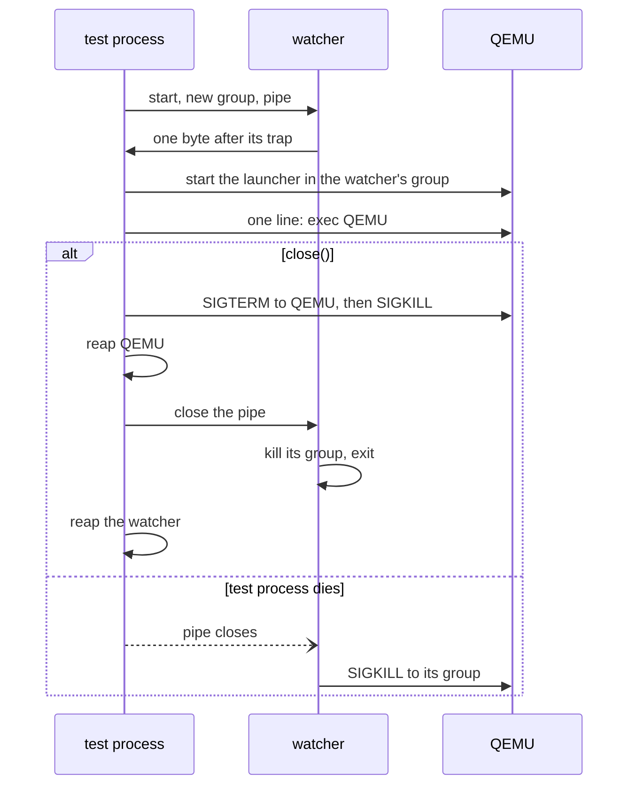

# Tests

## Run

    make venv
    make test-host            # C unit tests for src/lib and src/fs, the loader among them
    make test-tools           # pytest for tools/, the Makefile and fs_tool
    make test-docs            # links, API coverage and words in the Markdown files
    make test-canary
    make test-examples        # every example and variant, warning-free
    make test-target          # spikes and examples on all four boards through boot()
    make test-target BOARD=raspi0   # the same on one board

`BOARD` defaults to `all`. It is passed to pytest as `--board`, so it
takes a board name or `all`. The reusable workflow sets it per board.

Needs `qemu-system-arm` and `qemu-system-aarch64` on `PATH`. A machine
missing from the installed QEMU is skipped. V2 is skipped without
`arm-none-eabi-gcc`.

## Host tests

    make test-host                  # build and run every tests/host/test_*.c
    make test-host HOST_SANITIZE=0  # without ASan and UBSan
    make test-host HOST_SANITIZE=require  # fail if they are missing (CI)
    build/host/test_alloc realloc   # run only tests whose name contains "realloc"

`make test` runs them first. Each `tests/host/test_<name>.c` becomes
`build/host/test_<name>`, linked with every real `src/lib/*.c`, the file
system layer (`src/fs/*.c` and FatFs) and the file-backed block device
in `host/blk_file.c`, and built with the host `cc`. `make test-host` also
builds `build/host/fs_tool`, which `tools/test_fs_interop.py` runs. Code in `src/lib/` must not touch registers or
drivers; that code belongs in `src/drv/`, `src/arch/`, `src/board/` or
`src/gfx/`. ASan and UBSan are on when the compiler supports
them. The build defines `ROBCO_HOST`, which drops the library's own
`memcpy`, `memset`, `memmove` and `memcmp` so the host libc ones are used.
`test_fs_readonly.c` is the exception: it links a second copy of the
file system built with `ROBCO_FS_READONLY=1` and reads an image that
`fs_tool` writes to `build/host/fs_readonly.img`.

CI builds the host tests with GCC, and GCC reports warnings that Apple
clang does not, such as `-Wformat-truncation`. So when the host `cc` is
clang, `make test-host` first runs `make test-host-gccwarn`. It compiles
every C file in the host test folder and every source the tests link with
`arm-none-eabi-gcc` and the macOS SDK headers, and links nothing. Each
file is compiled twice: once with CI's flags, `-O1` and the sanitizers,
and once without the sanitizers at `-O2`. Both passes matter. UBSan hides
loop bounds from GCC, so some truncation warnings fire only with CI's
flags, and other warnings need `-O2`. A warning fails the build as it
would in CI. `tests/fixtures/gccwarn/format_truncation_bad.c` is bad on
purpose: the check compiles it and fails if CI's pass accepts it.
The cross compiler targets 32-bit ARM, so the check skips pointer and
integer casts of different sizes, and a format whose type size differs
between 32-bit ARM and a 64-bit Linux host can still pass here and fail
in CI. `make ci-local` catches those. The target prints one line and
skips when the host `cc` is GCC, when the cross GCC is missing or when
no SDK is found. `HOST_GCCWARN_CC` and `HOST_GCCWARN_INC` point it at
another compiler or header directory. A project that includes
`mk/host.mk` gets it with the same source lists, plus `HOST_GCCWARN_SRCS`
for C files outside its host test folder.

To add a test, create `tests/host/test_<name>.c`:

```c
#include <robco/crc32.h>

#include "rc_test.h"

TEST(check_value)
{
    CHECK_EQ(crc32("123456789", 9), 0xCBF43926u);
}
```

`rc_test.h` gives `CHECK`, `CHECK_EQ`, `CHECK_STR` and `CHECK_MEM`. A
failed check prints file, line and values, and the test goes on.

What fits: code in `src/lib/` that touches no hardware and makes no
assumption about pointer size (the host is 64-bit, the target 32-bit).
What does not: drivers, MMIO, assembly, exceptions, timing and anything
in `src/arch`, `src/board` or `src/drv`. Test those under `target/`.

## Host tests in a project

A project that uses RobCo-Core as a submodule includes `mk/host.mk` after
`mk/robco.mk` and gets the same `test-host` target for its own tests:

```make
ROBCO_CORE    := external/robco-core
HOST_TEST_DIR := tests/host
HOST_SRCS     := kernel/settings.c
HOST_INCLUDES := kernel
include $(ROBCO_CORE)/mk/robco.mk
include $(ROBCO_CORE)/mk/host.mk
```

| Variable | Default | Meaning |
|---|---|---|
| `ROBCO_CORE` | `.` | Path to RobCo-Core. Every core path starts with it. |
| `HOST_TEST_DIR` | RobCo-Core's `tests/host` | Directory of the project's `test_<name>.c` files. Setting it switches to a project build. |
| `HOST_SRCS` | empty | Pure project sources linked into every test |
| `HOST_INCLUDES` | empty | Extra include directories |
| `HOST_DEFINES` | empty | Extra defines, such as `FOO=1` |
| `HOST_CORE_SETS` | empty in a project | `fs` adds `src/fs` and `tests/host/blk_file.c`, `fatfs` adds FatFs. `fs` needs `fatfs`. The pure library `src/lib` is always linked. |
| `HOST_BUILD` | `$(BUILD)/host` | Output directory |
| `HOST_CC`, `HOST_SANITIZE` | `cc`, `1` | As above, `require` included |

Tests include `rc_test.h` from RobCo-Core's `tests/host`. A project test
fails `make test-host` the same way a core test does.
[tests/fixtures/sample-project](fixtures/sample-project/Makefile) is a
complete project. `tools/test_sample_project.py` copies it to a
temporary directory outside the repository and builds it there.

## Layout

- `harness/qemu.py`: starts QEMU headless and talks QMP, HMP (through
  QMP) and qtest. It can poke instruction words with `-device loader`
  and capture serial output to files. It kills QEMU on exit, even after
  a timeout or a failed test.
- `harness/boot.py`: boots a raw image at 0x8000 like the GPU firmware.
  Gives serial read and write, `@RC` marker parsing and screendumps.
- `harness/sdimage.py`: builds MBR + FAT SD images with mtools.
- `harness/plugin.py`: the pytest plugin with `--board` and the `board`,
  `need_mtools` and `robco_build` fixtures. `conftest.py` enables it,
  and so does a project. See [the harness in a project](#the-harness-in-a-project).
- `harness/run.py`: boots an image on this terminal, see
  [run an image by hand](#run-an-image-by-hand).
- `fwstub/`: the firmware stub `boot()` loads at 0x0. It parks secondary
  cores, writes ATAGS at 0x100, switches to HYP on raspi2b and enters
  the image with r0 = 0, r1 = machine id, r2 = 0x100. `a64_shim.py`
  holds the AArch64 words that drop raspi3b to AArch32 first. All four
  raspi3b cores run them, so the stub parks cores 1 to 3 as on raspi2b.
  Until the shim ends, `info registers` on raspi3b shows `PC` and `X00`
  to `X30`, with no `R15`. To read `R15` or `PSR` right after start,
  call `registers_a32()`, not `registers()`. It waits up to 5 s for
  AArch32 state and fails with the last dump if CPU0 never gets there.
- `host/`: host unit tests, `rc_test.h`, the file-backed block device
  `blk_file.c` and `fs_tool.c`.
- `target/`: tests that boot real images. `--board NAME` picks boards
  (repeatable, default raspi0 and raspi2b, `all` for all four). They
  boot the spikes and the examples `hello`, `tick`, `gpio`, `console`,
  `heap`, `demo`, `sdraw`, `storage`, `mmu`, `input`, `audio`, `rtc`, `spi` and `umode`.
  `test_umode.py` runs user-mode tasks with the MMU off and on: system
  calls, register and flag preservation, faults with their addresses,
  watchdog kills, and the fatal path for kernel faults.
  `test_sdraw.py` and `test_storage.py` attach an SD image.
  `test_storage.py` also boots the read-only build of `storage`. `test_input.py` drives the
  serial and script backends, the second over the mini UART.
  `test_input_gpio.py` drives the GPIO buttons and the dial through
  qtest, and needs the `ticks` command of `examples/input`.
  `test_rtc.py` attaches QEMU's `ds1338` model at I2C address `0x68`.
  `test_gpiox.py` attaches two `pca9554` models at `0x20` and `0x21`.
  `test_spi.py` attaches a `w25q32` SPI flash. `demo` and `chain1` also
  run with the MMU and caches on. The `demo` menu variant drives a
  screen menu with arrow keys on raspi0 and raspi2b, with and without
  an SD image, and checks the audio clicks. `test_chain.py` boots `chain1`, which validates
  `chain2` (placed at 0x00200000 by a loader device) and hands off to it.
  It also covers a bad CRC, a wrong magic, a wrong `load_addr`, a
  `mem_size` past the slot, no image, `chain2` alone, a corrupt boot
  info block, and a tick in `chain1` that must leave no stale timer
  interrupt for `chain2`. The `CHAIN1_SD` variant loads `chain2` from an
  SD image with the stage loader and falls back to the backup file.
- `tools/`: pytest unit tests for the host tools: `tools/rimg.py` on
  images built in memory, one case per error code, the font and doc
  tools, the marker table of `BOOT_PROTOCOL.md` against the chain
  examples, the `SLOT_END` link check, the build-time checks of the audio
  macros, the `BOARD` variable of
  `test-target`, and the argument handling, refusal cases and
  `config.txt` of `fetch_firmware.sh`, `mkbootdir.sh` and `mksdimage.sh`,
  and the `sdimage` make target. The firmware
  download test runs only with `ROBCO_NET_TESTS=1`.
  `test_fs_interop.py` checks `fs_tool` against images made with mtools
  and, when installed, `fsck.vfat` or `fsck_msdos`.
- `canary/`: checks the QEMU behaviours our code depends on. Run it
  after any QEMU upgrade. A failure means QEMU changed, not our code.

## Canary facts

| ID  | Machines | Fact | Why we care |
|-----|----------|------|-------------|
| V1  | raspi0, 1ap, 2b | Raw `-kernel` loads at 0x10000. Entry: SVC, r0=0, r1=0xC42, r2=0x100, ATAGS at 0x100. | Link address and boot register handling for `-kernel` runs. |
| V2  | raspi0, 1ap, 2b | ELF `-kernel` loads at its link address. | ELF builds can boot at 0x8000 like real hardware. |
| V3  | raspi0, 1ap, 2b | `-device loader,...,addr=0x8000,force-raw=on,cpu-num=0` loads and starts at 0x8000. | Run the same raw image as the real board. |
| V5  | raspi3b | AArch64 cannot be turned off. Seven AArch64 words drop to AArch32 HYP (or SVC) at 0x8000. | Pi 3 needs an EL3 shim to run our 32-bit kernel. |
| V6  | raspi0, 2b | `mrc p15,0,r1,c0,c0,5` gives MIDR on raspi0, MPIDR (bit 31 set) on raspi2b. | Core ID code must handle both. |
| V7  | raspi0, 2b | PWM read data-aborts on raspi0, works on raspi2b. | Do not touch PWM on raspi0 under QEMU. |
| V9  | raspi0, 1ap, 2b | Mailbox channel 8 answers board revision, ARM memory, UART clock (3 MHz). | Property mailbox driver and UART baud setup. |
| V10 | raspi0, 1ap, 2b | Timer C1 match sets CS bit 1 and IRQ 1 pending. Writing CS bit 1 clears it. | Timer interrupt driver. |
| V11 | raspi0, 1ap, 2b | `-drive if=sd` attaches to the SDHCI (EMMC) controller. Size must be a power of 2. | SD driver targets EMMC. Disk images need padding. |
| V12 | raspi0, 1ap, 2b | GPLEV0/1 read 0. | Undriven active-low lines look pressed: the stuck-line guard turns the GPIO backend off. V19 shows how to drive them. |
| V13 | raspi0, 1ap, 2b | QMP `screendump` works headless and writes a PPM. | Framebuffer tests in CI. |
| V14 | raspi0, 1ap, 2b | PM_WDOG then PM_RSTC full reset emits a QMP `RESET` event. | Reboot and watchdog tests. |
| V15 | raspi0, 1ap, 2b | First `-serial` is the PL011, second is the mini UART. | Serial capture order in tests. |
| V16 | raspi0, 1ap, 2b, 3b | SPI0 is modelled. With nothing attached a byte completes at once and reads 0. | SPI and TFT panel tests run on every board. |
| V17 | raspi0, 1ap, 2b, 3b | `-device pca9554,bus=i2c-bus.1` answers at 0x20 to 0x27 and 0x38 to 0x3F with the data sheet power-on values. The register pointer keeps 2 bits and a multi-byte read repeats one register. QMP `qom-get` of `pinN` gives the config bit OR the output bit, so it shows outputs and reads inputs as high. qtest `set_irq_in <path> unnamed-gpio-in N level` sets an outside level that the input register ANDs with the chip's own drive, so 1 releases a line and 0 also pulls an output driven high to 0. `qom-set pinN` makes the pin an output at that level. | `test_gpiox.py` observes outputs with `qom-get` and drives inputs with qtest, never with `qom-set`, and releases every line before pins change direction. |
| V18 | raspi3b | Cores 1 to 3 reset at 0x0 in AArch64 EL3 and, with A32 code there, spin on the EL3 vector at 0x200. With `boot()` they sit in the stub's AArch32 `wfi` loop. | Spinning spare cores slow every MMIO access of CPU 0. |
| V19 | raspi0, 1ap, 2b, 3b | `bcm2835_gpio` has 54 output lines and no input lines. A qtest `writel` to GPSET0/1 or GPCLR0/1 sets or clears that pin's GPLEV0/1 bit, for input pins too, and the level stays. A write to GPLEV does nothing. A pull-up leaves an undriven pin at 0. The event detect registers read 0 and GPU IRQ 49 never goes pending. An output pin reads back its level in GPLEV. Under TCG one qtest write takes under 5 ms at the median, about 0.1 ms here, and guest timer time follows host time within 5 %. | `harness/pigpio.py` drives button and dial lines with GPSET and GPCLR. Tests drive every active-low line high before the guest starts. |
| V20 | raspi0, 1ap, 2b, 3b | `ssi-sd` is not user creatable. `sd-card-spi` plugs only into an SD bus and lands on `generic-sdhci`. | No SD card in SPI mode can be tested on SPI0. |
| V21 | raspi0, 1ap, 2b, 3b | SPI0 drives no CS lines. Every device on `spi` gets every byte and the replies OR. Each device needs its own `cs=` index. | One device per bus in tests. CS runs on hardware. |
| V22 | raspi0, 1ap, 2b, 3b | A read-only drive is refused as an SD card. QMP `eject` and `blockdev-change-medium` work on `sd0`; EMMC present state bits 16 and 18 follow. | Card removal tests on the EMMC path. |
| V23 | raspi0, 1ap, 2b, 3b | Guest code moves 2 MiB through the SPI0 FIFO in about 2 s. | Time budgets for SPI tests. |

V4 and V8 are not checked here.

## Writing a target test

Put it under `tests/target/`. Take the `board` fixture to run it on each
`--board`:

```python
import re
from harness.boot import boot

def test_hello(board, spike_image):
    with boot(spike_image("s1"), board) as vm:
        vm.wait_for("type to echo", timeout=10)
        hello = [m for m in vm.markers() if m["ev"] == "hello"]
        assert hello[0]["fw_r2"] == "0x100"
        vm.send("abc")
        vm.wait_for(re.compile(r"\nabc"), timeout=5)
```

Examples build through the session fixture `example_image`.
`example_image(name, variant=None, extra_cflags=None)` builds
`examples/<name>` once per (name, variant) with `CI=1` and returns the
path of its `.img`. A variant builds into `build/<variant>`:

```python
from harness.boot import boot

def test_my_example(board, example_image):
    with boot(example_image("hello"), board) as vm:
        vm.wait_for("ev=ready", timeout=10)

def test_my_fault(board, example_image):
    img = example_image("hello", "fault", "-DHELLO_FAULT=1")
    with boot(img, board) as vm:
        vm.wait_for("ev=exception", timeout=10)
```

`boot()` options: `mode="svc"` forces SVC entry, `sd=path` attaches an
SD image, `serial2=True` adds the mini UART, `extra_args=[...]` goes
straight to QEMU. `vm.qmp` is the `Qemu` object from `harness/qemu.py`.
QEMU is killed when the `with` block ends, even on failure.
`qtest=True` adds a qtest socket while the guest runs, so
`vm.qmp.set_irq_in(path, n, level)` can drive a device's GPIO inputs.
For the Pi's own GPIO pins, `gpio_high=[...]` drives those pins high
before the guest starts, and `PiGpio` from `harness/pigpio.py` presses
buttons and turns a dial (V19). `tests/target/test_input_gpio.py` shows
how, and `docs/spec/TESTING.md` lists the functions.

The guest may still be printing when a test reads its output.
`vm.serial` and `vm.serial2` return everything received so far.
`vm.markers()` and `vm.lines(port)` only see complete lines, up to the
last newline. `vm.wait_for()` searches the raw stream; end the pattern
in `\n` or pass `line=True` before parsing what it matched.

`vm.script(command, timeout=10)` drives the script channel. It needs
`serial2=True` and `input_script_start()` in the guest. It sends one
line on the mini UART and returns `ScriptReply(status, lines)`: the
status line, such as `ok` or `err unknown key`, and the lines a project
handler wrote before it, without their `| ` prefix. Send one command at
a time.

```python
def test_board_command(board, example_image):
    with boot(example_image("input"), board, serial2=True) as vm:
        vm.wait_for("ready\n", timeout=60, port=1)
        status, lines = vm.script("board")
        assert status == "ok" and lines[0].startswith("soc=")
```

## Subprocess environments

Never copy the host environment into a test value. pytest prints the
arguments and locals of a failing test, so a copy of `os.environ` puts every
host secret in the terminal and in CI logs. Build the `env=` of a subprocess
with `minimal_env(**extra)` from `tests/harness/env.py`. It keeps an
allowlist of host variables and hides values in its repr. A child that
needs no change can simply inherit: leave out `env=`.
A test that reaches the network uses `network_env(**extra)` instead. It adds
the host proxy and CA settings, which stay off the allowlist because a proxy
URL can hold a password.
`tests/tools/test_env_hygiene.py` fails on a full copy.

## When a wait times out

A `vm.wait_for()` or `vm.script()` that times out raises `QemuError`
with the serial log first, then a guest state block. The block reads
CPU0 and the hardware over QMP, so it shows where the guest was when
the test gave up. `vm.state_dump()` returns the same text on demand.

The dump first asks QEMU for the run state with QMP `query-status`.
If the VM runs, the dump stops it with QMP `stop`. It reads the interrupt
controllers, the system timer and one CPU0 sample on the stopped VM,
then resumes it with `cont`. It then takes five CPU0 samples while the
VM runs, to see whether the guest still executes. The VM is resumed
even when a read fails. A VM that was already stopped stays stopped
and is read as it is. If `query-status` fails, the dump sends no
`stop` and no `cont`, reads the VM as it is and labels the run state
unknown. The block says how the device registers were
read and whether the keep-alive was on.

The dump has an 8 second budget. It reads the hardware first and looks
up symbols last, with whatever time is left. If a step fails or runs
out of time, the block keeps everything read so far and adds one
`not collected:` line naming the step and the reason. A slow or missing
symbol tool costs only the names: pc and lr stay as raw addresses and
the `symbols:` line says why. `state dump failed` means nothing could
be read at all.

This one is `examples/audio` idle in its `wfi` loop on `raspi0`:

```
--- guest state at timeout (raspi0) ---
summary: guest executing: no (pc and registers fixed over 5 samples); IRQs unmasked (CPSR.I=0 in every sample)
keep-alive: on
device registers: read with the VM stopped (QMP stop, then cont)
cpu0 at stop: pc=0x000085e8 <robco_main> lr=0x000085c4 <robco_main> sp=0x00015040 cpsr=0xa0000153 svc I=0 F=1 T=0
cpu0 samples while running (5, 100 ms apart):
  #1 pc=0x000085e8 <robco_main> lr=0x000085c4 <robco_main> sp=0x00015040 cpsr=0xa0000153 svc I=0 F=1 T=0
  ... samples 2 to 5 are the same
symbols: audio.elf via arm-none-eabi-addr2line
interrupt controller @ 0x2000b200:
  basic_pending=0x00000100 pending1=0x00000002 pending2=0x00000000 fiq_ctrl=0x00000000 enable1=0x00000002 enable2=0x00000000 enable_basic=0x00000000
system timer @ 0x20003000:
  CS=0x00000002 (match M3..M0=0010) CLO=0x0041d957 CHI=0x00000000
  C0=0x00000000 match=0 distance=-4315479 us (behind)
  C1=0x0041cba9 match=1 distance=-3502 us (behind)
  C2=0x00000000 match=0 distance=-4315479 us (behind)
  C3=0x00000000 match=0 distance=-4315479 us (behind)
info registers (first sample):
  CPU#0
  R00=ffffffff R01=20201000 R02=00000090 R03=ffffff9e
  ...
  R12=00000ce3 R13=00015040 R14=000085c4 R15=000085e8
  PSR=a0000153 N-C- A S svc32
--- end of guest state ---
```

Here the tick is healthy. C1 matched 3.5 ms before the stop and its
interrupt is pending in `pending1`. The guest takes it once the VM
runs again. On a healthy guest a match up to a few milliseconds old is
normal. A match tens of seconds old is not.

What each part holds:

- `summary`: whether pc or any core register changed across the
  samples, and whether CPSR.I masked IRQs. Fixed registers mean "no"
  only when the VM ran. When it was stopped, or `cont` failed, or its
  state is unknown, the summary says "cannot be judged" and why.
- `keep-alive`: `on` while the ping thread runs. `off (stopped: <reason>)` means the thread ended by itself, for example when QEMU exited or the QMP connection failed. See [QEMU keep-alive](#qemu-keep-alive).
- `device registers`: read with the VM stopped by the dump, already
  stopped, running when the stop failed, or with the run state unknown
  when `query-status` failed.
- `cpu0 at stop`: pc, lr, sp and CPSR of the stopped VM.
- Five samples of pc, lr, sp and CPSR, 100 ms apart. Their heading
  says the run state: while running, of the stopped VM, after a failed
  `cont`, or unknown. CPSR shows the mode
  and the I, F and T bits. pc and lr carry function names when the
  ELF is known. `boot()` uses the `.elf` next to the `.img`, or
  `boot(..., elf=path)`. Without one, the `symbols:` line says why.
- The BCM2835 interrupt controller pending and enable registers. On
  `raspi2b` and `raspi3b` also the local controller at `0x40000000`:
  control, GPU routing, core 0 timer control and core 0 IRQ source.
- The system timer: CS, CLO, CHI and C0 to C3. Each compare shows its
  distance from CLO in microseconds, wrap-safe.
- The full `info registers` text of the first sample, without the
  floating-point registers.

How to read the three classic hangs:

- Idle with a dead tick. The summary says not executing and IRQs
  unmasked. pc sits on a `wfi` in an idle function. Look at the
  system timer: the tick's compare (C1 or C3) is far behind CLO with its
  match bit clear, so it fires only after the counter wraps in about
  71 minutes. Or its bit is clear in `enable1`.
- Spinning. The summary says executing. pc moves between a few
  addresses in one function, or stays put while registers change.
  That function is the loop to look at, for example a poll on a
  register that never changes.
- Stuck with IRQs masked. The summary says IRQs masked in every sample.
  If pc also moves, the guest spins in a critical section and no
  interrupt can end it. A match bit set in CS or a pending bit
  confirms an interrupt is waiting.

The dump never hides the original error. If QEMU has exited, the
block says so. If reading a register fails, the block holds one
`state dump failed:` line. The dump has an 8 second budget and a
2 second limit per QMP reply, so a dead socket cannot hang the run.
Each QMP command carries an id. A reply that comes after its command
timed out is dropped, so later `vm.qmp` calls get their own replies.

## QEMU keep-alive

While a VM from `boot()` runs, the harness sends QMP `query-status`
every 20 ms from a background thread. It covers every wait: `wait_for`,
`script`, `wait_event` and plain sleeps in a test. One lock holds each
QMP command and its reply, so the thread and the test never read each
other's replies. A thread that holds the lock and waits on the socket
sends the due pings itself and drops their replies by id. So a long
`wait_event` or a slow command does not delay them. Pings go on while
the VM is stopped, since `query-status` changes nothing. They end when
the VM closes.

The gap between two pings stays near 20 ms. It grows only when 8 pings
sent during one wait are still unanswered, which means QEMU's main loop
is busy with the monitor, so the stall below cannot occur.

Why it exists. On the GitHub Linux runner, with QEMU 10.1 on `raspi0`
and `raspi1ap` (ARM1176, one core), a Pip-OS boot sometimes stalled
until the test timed out. The guest sat in `wfi` waiting for its
100 Hz tick. The system timer compare had matched about 30 seconds
earlier, but the interrupt did not arrive. This hit 17 of 900 boots on
`raspi1ap` and 1 of 900 on `raspi0`. It never hit `raspi2b`, `raspi3b`,
or 12,000 boots on macOS. In all 21 captured cases the guest resumed
within one second of the first QMP monitor command the harness sent.
The cause inside QEMU is not identified. The keep-alive keeps QEMU's
main loop busy with monitor traffic so a due interrupt is not left
waiting.

It cannot hide a guest bug. The guest cannot see monitor traffic: no
serial byte, no register and no run state changes. A guest that waits
on its own logic, masks IRQs or never arms its timer still hangs, and
the state dump still shows it.

Cost: on a 10 second idle wait, under 0.1 s of harness CPU and a few
tenths of a second of QEMU CPU.

Turn it off to reproduce the stall on purpose:

```sh
ROBCO_QEMU_KEEPALIVE=0 make test-target
```

or `boot(..., keepalive=False)` for one boot. The whole suite passes
either way: tests about the keep-alive pass `keepalive=` themselves. `Qemu` objects a test
builds itself, such as the canary's, have no keep-alive. Neither has
`Qemu.run_to_exit()`, which runs without QMP, nor `python3 -m harness.run`.

## QEMU outlives no test process

`Qemu.start()` first starts a small shell watcher as the leader of a new
process group, then starts QEMU inside that group. The watcher blocks on
a pipe from the test process. When that process dies, by a timeout, a
signal, `SIGKILL` or an exit that skips `close()`, the pipe closes and
the watcher kills its group: QEMU and itself.

The order leaves no gap. QEMU's child joins the watcher's group, then
waits in a small launcher shell. The test process lets it exec QEMU only
after the join, while the test process and so the watcher still live.
`close()` sends `SIGTERM` to QEMU's own pid,
waits 3 seconds, then sends `SIGKILL` to that pid. It never signals the
group, so the watcher gets nothing from `close()`. It then reaps QEMU,
closes the pipe and reaps the watcher. The watcher kills the group on
its way out, which takes any child QEMU left. A test process killed
while `close()` waits for a slow QEMU still takes QEMU with it.

The start sequence, step by step. "Dies" means `SIGKILL` to the test
process right after that step.

| Step | Process | If the test process dies here |
| --- | --- | --- |
| 1. Fork and exec the watcher, new group | Test process, watcher | The watcher's pipe closes. It exits with no QEMU |
| 2. The watcher sets its trap, prints one byte | Watcher | Same |
| 3. Fork QEMU's child | Test process | The child holds the watcher's pipe until its exec, so the watcher waits |
| 4. The child joins the group | Child | Same. The join comes before the exec in both forms |
| 5. The child execs the launcher shell | Launcher | The pipe now closes. The watcher kills the group, launcher included |
| 6. Write the pidfile | Test process | Same. The launcher also reads end of file and exits |
| 7. Check the watcher lives, send one line | Test process | The child is in the live group: the watcher kills it |
| 8. The launcher execs QEMU, same pid | QEMU | The watcher kills the group |

Step 3 is why the watcher cannot act before the join: a forked child
keeps every fd of its parent until the exec, the watcher's pipe too.
Step 7 is why QEMU cannot run in a dead group: the launcher waits for a
line that only a live test process sends, after Popen returned, which is
after the join. A watcher that died and was not reaped yet still leaves
its group. Step 7 refuses it and `start()` raises `QemuError`. The
launcher costs about a tenth of a millisecond on Linux.

The child calls `setpgid()` before the exec. Python 3.11 and later pass
`process_group` to `Popen`. Older ones call `os.setpgid()` from
`preexec_fn`. If the watcher's group is gone, the call fails in the
child, QEMU never runs and `start()` raises `QemuError`. Set
`ROBCO_QEMU_PGID_FALLBACK=1` to force the older form. The orphan tests
run once with each form.

The group id never names a stranger. A group id stays taken while its
leader lives, and the watcher outlives QEMU.

The watcher ignores `SIGINT`, `SIGHUP` and `SIGTERM`, so a signal sent
to the whole group from outside leaves it in place. In the `preexec_fn`
form the child sets them to ignored before the exec, and an ignored
signal stays ignored across it. The `process_group` form has no hook in
the child, so the shell's `trap` does it. The watcher then prints one
byte, and `start()` waits for that byte before it starts QEMU. Both
forms run the trap and the wait, which costs about a millisecond.



The table lists each moment in the life of a VM, what can die there,
and what is left to stop QEMU. "Dies" covers any end of the test
process: `SIGKILL`, `SIGTERM`, a `pytest-timeout` kill or an exit that
skips `close()`.

| Moment or event | Who can die | What stops QEMU |
| --- | --- | --- |
| Before the watcher starts | Test process | No QEMU yet |
| Watcher started, trap not set | Test process | No QEMU yet. The pipe closes and the watcher exits |
| Watcher ready, QEMU not started | Test process | No QEMU yet. The watcher kills its group and exits |
| Child forked, not in the group yet | Test process | The child holds the watcher's pipe, so the watcher waits for it |
| Launcher in the group, not released | Test process | The launcher exits at end of file, and the watcher kills the group |
| Both running | Test process | The watcher, at end of file on its pipe |
| `close()` before its `SIGTERM` | Test process | The watcher |
| `close()` after its `SIGTERM`, during its waits | Test process, QEMU | The watcher, since `close()` never signals it |
| After QEMU is reaped | Test process, watcher | Nothing left to stop |
| `SIGINT` from a terminal | Test process | QEMU's group is not the terminal's foreground group, so only pytest gets it. pytest runs `close()`, or dies and the watcher acts |
| `SIGHUP` when the terminal closes | Test process | Same as `SIGINT`. A `SIGHUP` that does reach the group leaves the watcher, which ignores it |
| `SIGTERM` or `SIGINT` to the whole group | QEMU | The watcher ignores both and stays |
| `pytest-timeout` kills the test process | Test process | The watcher |
| `pytest-timeout` thread method, process lives | Nothing | The fixture's `close()`, or the watcher when the session ends |
| Outside `SIGKILL` to the watcher alone | Watcher | Nothing while the test process lives |

The last row is the one gap: QEMU runs on with no watcher. `close()`
still stops it: it signals QEMU's own pid, reaps it, then reaps the dead
watcher. If the test process dies first, the next session's sweep kills
that QEMU, since its pidfile names a dead owner.

Each VM's temp folder holds `qemu.pid`: a `v2` tag, the QEMU pid, its
start time, the test process pid and the process group, which is the
watcher's pid. The start time is QEMU's own: the launcher becomes QEMU
with the same pid, so the harness reads it before QEMU runs, the way
the sweep reads it later. A late QEMU start on a busy machine thus
cannot hide an orphan. The sweep skips a pidfile in the older form,
which held the watcher's start time. At session start the plugin
calls `sweep_stale()`. It kills a QEMU only when the test process is
gone, the pid still leads that group and started at that time. It never
matches QEMU by name, so your own QEMU is safe.

The sweep is a courtesy, so no error in it stops a session. It never
kills a process whose start time it cannot read, for example where `ps`
may not run, and leaves that pidfile in place with one line on stderr.

The sweep trusts a folder and its pidfile only when both belong to you,
neither is a symbolic link and no group or other user may write them.
The harness creates the folder with mode 0700 and the pidfile with mode
0600. The sweep also kills only a process that runs as you.

A zombie counts as dead. In a container whose process 1 reaps no child,
such as the CI one, a dead orphan stays a zombie and `os.kill(pid, 0)`
still finds it. The harness reads the state from `/proc` on Linux and
from `ps` on macOS.

Where it can read no process state at all, a zombie counts as alive.
The sweep then kills nothing and reports the pidfiles it skipped, and
the zombie tests skip.

## The harness in a project

A project with RobCo-Core in `external/robco-core` enables the plugin
with three lines in its `tests/conftest.py`:

```python
import os, sys
sys.path.insert(0, os.path.join(os.path.dirname(__file__), "../external/robco-core/tests"))
pytest_plugins = ["harness.plugin"]
```

It then gets:

| Name | Does |
|---|---|
| `--board NAME` | Runs board tests on `NAME`, repeatable, or `all`. Without it: `raspi0` and `raspi2b`, or the `robco_boards` ini value, such as `robco_boards = raspi0 raspi1ap raspi2b raspi3b` in `pytest.ini`. |
| `board` | The board name. Skips when the installed QEMU lacks the machine. |
| `need_mtools` | Skips the test without mtools |
| `robco_build(directory, target="all", variant=None, flags=(), image=None)` | Runs `make -s -C directory CI=1 BUILD=build[/variant] flags target` once per session and argument set, and returns the image path. The name comes from `IMAGE` in the Makefile, or from `image`, relative to the build directory. |

```python
import os
from harness.boot import boot

ROOT = os.path.dirname(os.path.dirname(os.path.abspath(__file__)))

def test_ready(board, robco_build):
    with boot(robco_build(ROOT), board) as vm:
        vm.wait_for("ev=ready", timeout=30, line=True)
```

[tests/fixtures/sample-project/tests](fixtures/sample-project/tests/conftest.py)
is a complete example. `tools/test_harness_plugin.py` runs it from a copy
outside the repository.

### Temp folders

Tests write card images and build copies into `tmp_path`. The plugin
removes a passing test's `tmp_path` as soon as the test ends. A test
that fails or errors keeps its folder, so you can open its card image.
This holds for a failure in setup, in the test itself and in teardown.
A skipped test and an expected failure that fails as expected lose
their folders. pytest keeps
the folders of the last three runs under the system temp folder, in
`pytest-of-<user>`.

Set `ROBCO_KEEP_TMP=1` to keep every folder, passing tests included:

```sh
ROBCO_KEEP_TMP=1 make test-canary
```

A project needs no change for this. When its own pytest configuration
sets `tmp_path_retention_policy`, that value wins and the plugin leaves
the policy alone. Folders from `tmp_path_factory.mktemp()` stay until
the session ends, and go then only when every test passed. Use
`tmp_path` for card images.

## Run an image by hand

`harness.run` boots an image with the same firmware stub and arguments
as `boot()`, and connects the console to your terminal:

```sh
PYTHONPATH=external/robco-core/tests python3 -m harness.run build/app.img --board raspi2b
PYTHONPATH=external/robco-core/tests python3 -m harness.run build/app.img --board raspi0 \
    --sd build/sd.img --mode svc --serial2 tcp:4555
```

The terminal is in raw mode while QEMU runs and is restored on exit.
Press Ctrl-A, then x, to quit. Ctrl-A, then c, opens the QEMU monitor.
`--serial2 pty` puts the mini UART, the script channel, on a pty whose
path QEMU prints. `--serial2 tcp:PORT` puts it on `127.0.0.1:PORT`, for
`nc 127.0.0.1 PORT`. The runner prints the QEMU pid at start, and exits
with QEMU's exit status. `--qemu-arg` adds a QEMU argument.

`--window` opens the QEMU display window, which shows the framebuffer.
The console stays on your terminal:

```sh
PYTHONPATH=external/robco-core/tests python3 -m harness.run build/app.img --board raspi3b --window
```

## What QEMU cannot prove

Caches, PWM sound, real GPIO contacts, pulls and edges, real SPI signalling and SD pin routing
on boards with WiFi need a real board. QEMU enforces MMU permissions,
but real fault status values and the behaviour of privileged
instructions in USR mode need real silicon too. The checklist is in
[docs/HARDWARE_VALIDATION.md](../docs/HARDWARE_VALIDATION.md).
